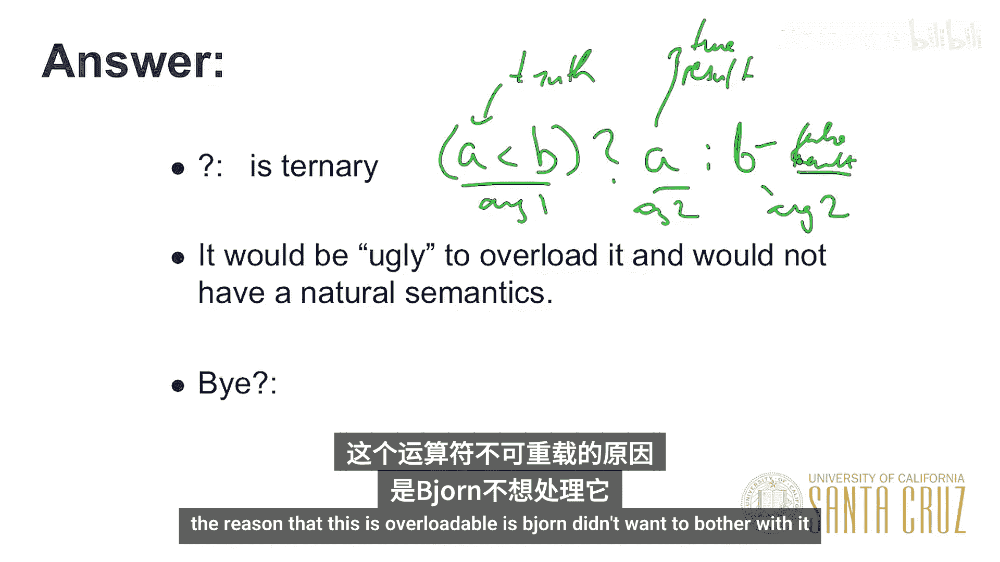

# C++编程：P37：重载和函数选择


## 概述 📖

在本节课中，我们将学习C++中的两个核心概念：**运算符重载**和**友元函数**。我们将探讨如何通过运算符重载让自定义类型像内置类型一样工作，以及如何使用友元函数来访问类的私有成员以实现更灵活的运算符重载。

---

## 运算符重载与类型转换 🔄

上一节我们介绍了图算法作业的扩展。本节中，我们来看看C++中一个非常巧妙但颇具争议的特性：运算符重载。

运算符重载允许我们为现有的C++运算符赋予新的含义。我们已经在IO库中见过这个特性，例如使用左移运算符 `<<` 进行输出。一个高级原则是：**用户定义的类型应该与内置类型难以区分**。运算符重载和类型转换是实现这一原则的机制。

例如，对于内置的整数类型，`a + b` 的含义是明确的。如果我们定义了一个表示有理数的类 `Rational`，我们也希望能够使用 `c + d` 来对两个有理数进行加法运算。更进一步，我们可能还希望 `a + c` 能够工作，其中 `a` 是整数，`c` 是有理数。这就需要整数到有理数的隐式转换。

### 转换构造函数

我们以一个简单的 `Point` 类为例。`Point` 表示二维空间中的一个点，其内部表示为一对 `double` 值。

```cpp
class Point {
private:
    double x, y;
public:
    Point(double x_val = 0, double y_val = 0) : x(x_val), y(y_val) {}
};
```

这个构造函数 `Point(double x_val, double y_val = 0)` 也是一个**转换构造函数**。它允许将单个 `double` 值隐式转换为一个 `Point` 对象（y坐标默认为0）。

```cpp
Point s; // s 是 (0, 0)
double d = 3.5;
s = d; // 隐式转换：d 被转换为 Point(3.5, 0.0)，然后赋值给 s
```

### 禁止隐式转换

有时我们不希望发生隐式转换，因为这可能导致意外的函数调用匹配。我们可以使用 `explicit` 关键字来关闭隐式转换。

```cpp
explicit Point(double x_val = 0, double y_val = 0) : x(x_val), y(y_val) {}
```

添加 `explicit` 后，`s = d;` 将导致编译错误，必须使用显式转换：`s = Point(d);`。

### 类型转换运算符

我们如何将 `Point` 转换为 `double` 呢？我们不能修改内置的 `double` 类型。C++的解决方案是在 `Point` 类中定义一个**类型转换运算符**。

```cpp
class Point {
    // ... 其他成员
public:
    operator double() const {
        return sqrt(x*x + y*y); // 例如，转换为到原点的距离
    }
};
```

现在，`Point` 对象可以在需要 `double` 的上下文中被隐式转换。但请注意，这种转换的语义（例如，点到原点的距离）必须清晰且符合该类型在应用领域中的自然含义，否则应使用一个具有明确名称的成员函数（如 `length()`）来代替。

---

## 函数重载与选择规则 🎯

C++支持函数重载，即多个函数可以共享同一个名字，只要它们的参数列表（签名）不同。编译器需要一套规则来决定调用哪个函数。

以下是编译器选择重载函数的优先级顺序：

1.  **精确匹配**：参数类型与函数签名完全一致。
2.  **标准提升匹配**：例如，`int` 可以提升为 `double`。
3.  **标准转换匹配**：包括更宽泛的数值转换。
4.  **用户定义转换匹配**：例如，我们为 `Point` 定义的转换。
5.  **匹配省略号（...）**：这是最差的匹配。

当存在多个可行的匹配时，如果编译器无法确定一个“最佳”匹配，就会产生“歧义”错误。用户定义的转换和隐式构造函数使得重载解析变得复杂，因此需要谨慎使用 `explicit` 关键字来避免意外的转换。

---

## 友元函数与运算符重载 🤝

上一节我们介绍了类型转换。本节中，我们来看看如何通过友元函数来实现更通用的运算符重载。

### 为什么需要友元？

考虑为 `Point` 类重载输出运算符 `<<`。我们希望这样使用：
```cpp
Point q(1.0, 2.5);
std::cout << q; // 期望输出: (1.0, 2.5)
```
如果我们将其实现为 `Point` 的普通成员函数：
```cpp
// 在类内声明
std::ostream& operator<<(std::ostream& os);
```
调用时将是 `q.operator<<(std::cout)`，这与我们期望的 `std::cout << q` 语法顺序不符。此外，成员函数的第一个隐式参数是 `this` 指针，这限制了重载的灵活性。

### 友元函数的定义

友元函数不是类的成员，但它被授予访问该类私有和保护成员的权限。这打破了数据封装的严格性，因此应谨慎使用。

以下是使用友元函数重载 `<<` 的正确方式：
```cpp
class Point {
    // ... 其他成员
    // 声明友元函数
    friend std::ostream& operator<<(std::ostream& os, const Point& p);
};

// 在类外定义友元函数
std::ostream& operator<<(std::ostream& os, const Point& p) {
    os << "(" << p.x << ", " << p.y << ")"; // 可以访问私有成员 x, y
    return os;
}
```

### 成员函数重载 vs 友元函数重载

对于二元运算符（如 `+`），有两种重载方式：

**1. 成员函数重载：**
```cpp
class Point {
public:
    Point operator+(const Point& rhs) const {
        return Point(x + rhs.x, y + rhs.y);
    }
};
// 调用: Point c = a + b; // 等价于 a.operator+(b)
```
这种方式下，只有运算符右侧的参数（`rhs`）可以享受隐式类型转换。左侧的操作数（`this` 指向的对象）必须是 `Point` 类型。

**2. 友元函数重载：**
```cpp
class Point {
    friend Point operator+(const Point& lhs, const Point& rhs);
};
Point operator+(const Point& lhs, const Point& rhs) {
    return Point(lhs.x + rhs.x, lhs.y + rhs.y);
}
```
这种方式下，**两个参数是对称的**，都通过参数列表传递，因此**两侧的操作数都可以享受隐式类型转换**。这通常是我们期望的行为，以保持操作的对称性。例如，如果定义了 `double` 到 `Point` 的转换，`double d; Point p;` 那么 `d + p` 和 `p + d` 都能通过友元重载正常工作，而成员函数重载则无法处理 `d + p` 的情况。

---

## 运算符重载的注意事项与限制 ⚠️

虽然运算符重载功能强大，但必须谨慎使用。

以下是使用运算符重载的一些准则：
*   **符合直觉**：重载的运算符行为应符合该操作在数学或该问题领域的常规含义。例如，`+` 应该表示加法，而不是其他操作。
*   **保持一致性**：如果重载了 `+`，通常也应该重载相关的运算符，如 `+=`、`-` 等。
*   **避免滥用**：不要仅仅因为“有趣”而重载运算符。在团队或公共项目中，晦涩的运算符重载会严重降低代码可读性和可维护性。

并非所有C++运算符都可以重载。以下是一些不可重载的运算符：
*   **作用域解析运算符** `::`
*   **成员访问运算符** `.`
*   **成员指针访问运算符** `.*`
*   **条件运算符** `?:`
*   `sizeof` 和 `typeid` 运算符
*   **预处理符号** `#` 和 `##`

关于条件运算符 `?:` 的思考：它是一个三元运算符，语法为 `条件 ? 表达式1 : 表达式2`。它不可重载的原因主要是其使用频率不高，在大多数代数领域没有对应的自然语义，并且重载它会带来复杂的语法和语义问题。

---

## 总结 🎓

本节课中我们一起学习了C++中两个紧密相关的核心特性：
1.  **运算符重载**：允许我们为用户自定义类型定义运算符的行为，使其能够像内置类型一样被直观地使用。
2.  **友元函数**：通过授予外部函数访问私有成员的权限，解决了某些运算符（如流插入 `<<`）无法作为成员函数重载的问题，并实现了二元运算符的对称性重载。

我们还探讨了与之相关的**转换构造函数**、**类型转换运算符**以及编译器进行**重载函数选择**的复杂规则。记住，这些强大的工具应当用于让代码更清晰、更符合领域逻辑，而不是制造晦涩的“黑魔法”。



