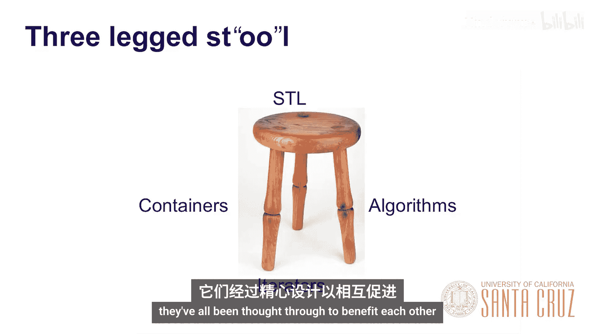
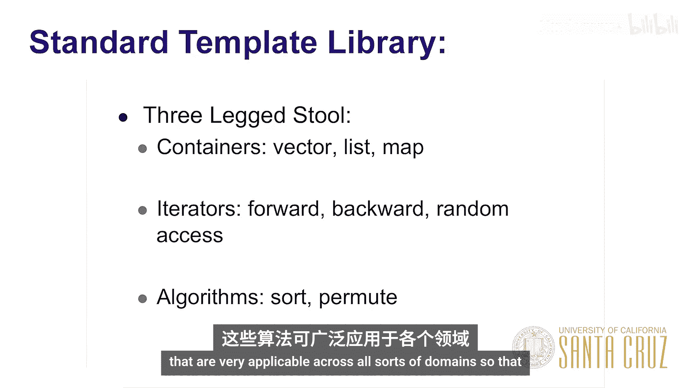
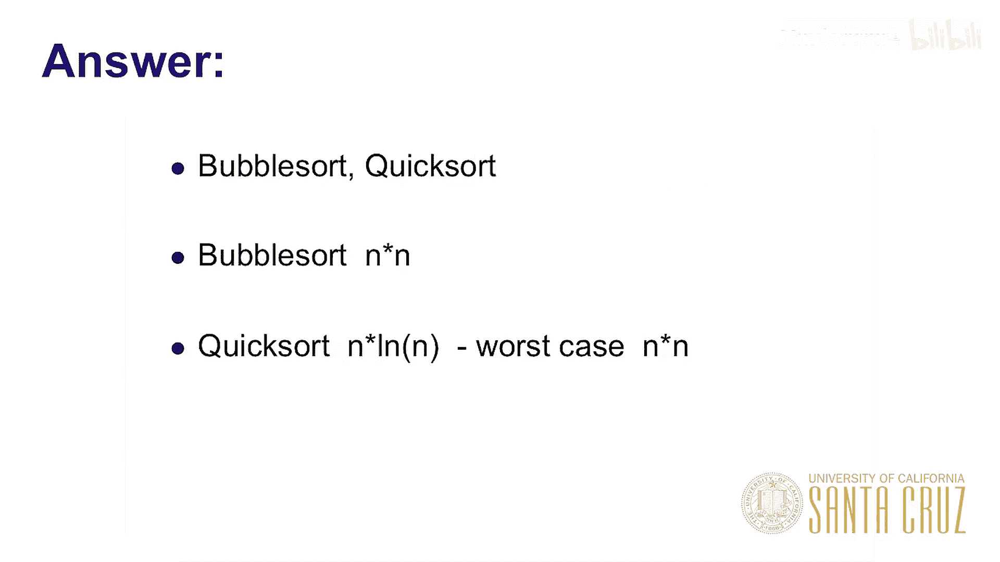
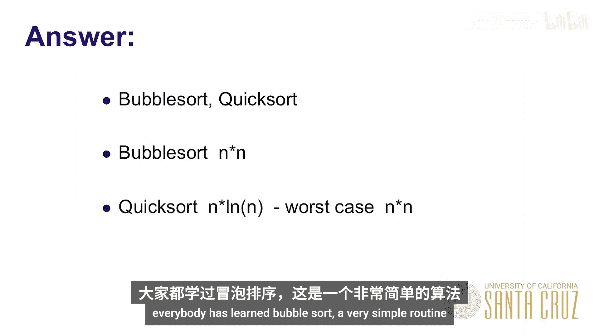
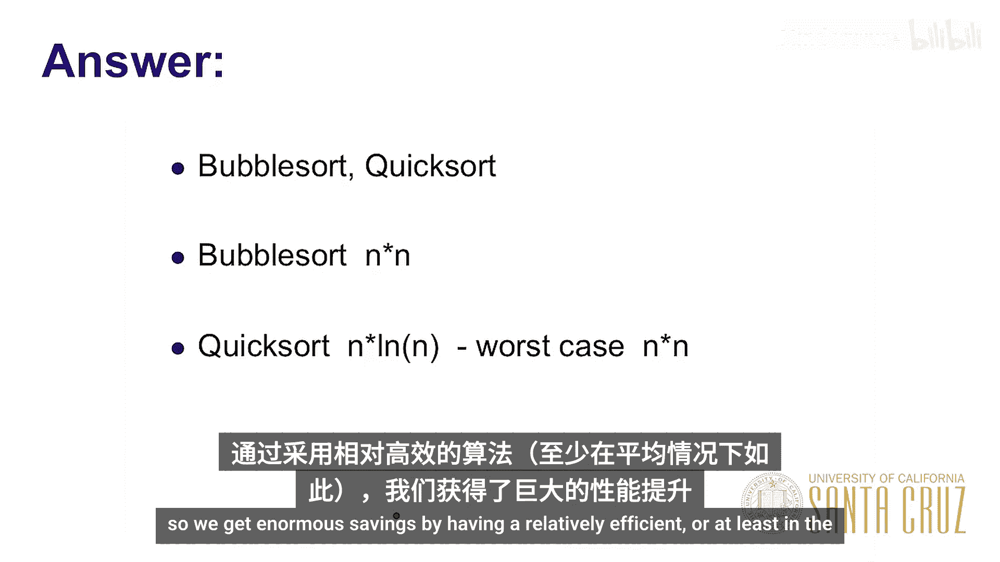
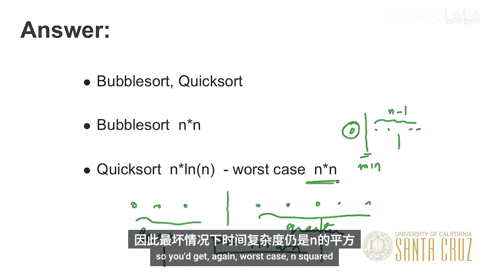

# 【加州大学】C++编程-｜-C-Plus-Plus-A-p38-P38_4-6-STL和C++11-STL_04_01_07--BV1p2ejzREUQ_p38-

Today we're going to delve into the architecture of the standard template library。

The standard template library we've already been using， we've been using it。

With container classes such as vector。Vectctor is very。

 very useful if you've been doing much with it in your homework。

 you will see that it's a big benefit over the sea。Standard way of， of， of。Index collections。

 which is a relatively primitive form of array。So STL has an architecture。

 once we understand that architecture we're going to have。A much better way to use it。

 we're also in understanding architecture going to learn how to extend the STL library。Now。

 one of the。Topics I'm going to start emphasizing。Today。

 and in the future part of the course and successor course is going to be new developments。

In the C+ plus standard。C+ plus has been around since 1985。

Originally released at Bell Labs with the seafront compiler。

It immediately got a lot of attention in industry and got widely adopted。

And then things got added to it。The last major standardization occurred around 1998。

 so that's 15 years ago。And most of the practice that we have had in industry and most of the practice that I have shown you。

Is based on。1998， C+ plus， but in 9 and 2011。The Standard committee。Made major additions。

 major improvements to the language and major additions among the major additions for the expansion of the standard template library。

That allows us to effectively， without having to create our own。New libraries。

Use libraries from this new standard， an example is the threading library。

So threading has become more and more important as we have multi core computers， multi processors。

 clouds。And the ability to have a community standard in threading。

 It wasn't that we couldn't do threading。 We could do threading even in the old sea community。

 We could use po threads， for example。Now。Built into a library is a standard。

So we're going to start discussing some of the new C11 features as well。

 and that will be a big emphasis in the second half of this course。

To understand the architecture of ST T L， I like to picture it as a three legged stool。

So SDL is sitting on containers。Algorithms and iterators。And they all interact。

 they've all been thought through to benefit each other。

The components of the three legged stool are containers like vector and L。

List and vector are what are called sequential containers and sequential containers。

 We know what the first element， the third element， the n element。Of a list or a vector is。

 So we think of it as storing things in compartments that are indexed。 On the other hand。

 we have other kinds of containers such as sets and maps。And those are called associative containers。

And there， the major form of lookup is no longer an index。

 but instead is an association between a key and what the key lets you。Get to the contents。

So there's an association。In the real world， if I were to give you a friend's name and maybe ask you for the friend's address。

 that would be。An associative lookup。Then there is the ability to search through those。Containers。

And that ability is going to be provided by what we call iterators。Iterators are ways。

Conceptually very close to pointers。 So if you want to think of an iterator in the C language。

 Think of a pointer， pointer lets you get access to an array or to parts of a struck。

 And in this case， pointers are can be generalized。

 And given other properties that make them more convenient， more systematic。And there will be。

At the end of the day， five major categories of iterators， which will also explain finally。

 what we want to generate out of STL is convenient algorithms。

 algorithms that are very applicable across all sorts of domains。

So that we don't have to keep inventing the wheel。 Why should we have to continually invent。

Sorting algorithms， finding algorithms， accumulating algorithms。Partitioning algorithms。

We're using those all the time。Addd。If you are a student。

 those are probably a lot of your exercises and you get to learn how to。Disriimminate between。

Good ones and bad ones。 That's a lot of what your' learning is in your basic computer science classes。

 so you might learn。How to write a bubble sort and learn why a bubble sort is not as good as quick sort or a heap sort。

You might learn how to deal with permutations and use random number generation and see what the qualities or random number generator are that make it。

Useful and reliable in the kinds of programs。We're displaying。

 So all those things in this case are going to be provided by professionals within the SL standard。

Great， great labor saving， okay。Name two standard sorting algorithms。Inent， I just mentioned them。

What is their expected time？What is their worst case time， take a second。

Everybody has learned bubble sort， a very simple routine。

Bubble sort is an n squared routine。 we basically interchange elements。啊。Where if。

Adjacent elements of out of order， we swap them and we go through the whole sequence continuing to swap。

And if we do that right， the typical bubble sort， lets us get。

One element at least in order at the end of that list。

 and now we can bubble sort the remaining elements which are n minus1 after the first pass and then n minus2 and then n minus3 and if we look at the order of that computation ends up being order n squared on the other hand。

 quick sort，A sort invented by Tony Hore。If it's working well。Gets us an n log n sort。

 And just remember， N log n。Is very， very much more efficient than n squared。

 because let's say the log of 1000。Base 10 is just two， so we would have something like。20。

000 abstract operations as opposed to a million abstract operations if we were to use bubble sort。

 so we get enormous savings by having a relatively efficient or at least in the average case。

 efficient algorithm， recall how quick sort works， Quick sort works by taking an element。

And then using the element and dividing all the elements， comparing it to。 And hopefully。

 they divide。In two halves， and these are the less than elements。These are the greater than elements。

This is the element that does the partition。So it's sometimes called a partition sort。

And if it divides it roughly in half， it gets you your log and behavior， hopefully again。

 this is something you all have had in your background that was expected when coming into this class。

If not， you should look it up。Then after you've done a partition， you now read partition。Recursively。

 each of these lists， and again， if they're roughly half the size of the previous list。

 you end up with this up。Loarithmic behavior in dividing the list。

And each time you have to go through n element so you get the N log N behavior。It's worst case。

Occurs if the partition element ends up， for example， partitioning in this very bad way。

Is no elements below it。 Let's say the partition element itself was a minimum。

So all the remaining elements are above it， this is just。This is just zero。

And now you partition this and you have the same behavior。

 and this would only give you one element in the ordering each time so you'd get again worst case n square。

That's not going to happen。In a probabilistic， large situation。 and there are。

Special ways to do sampling that make it even less likely。

