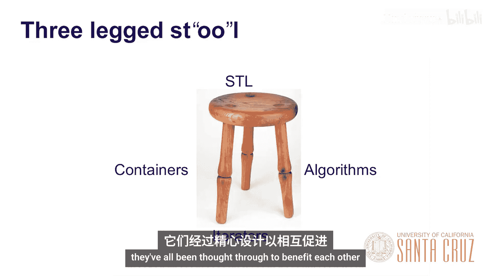
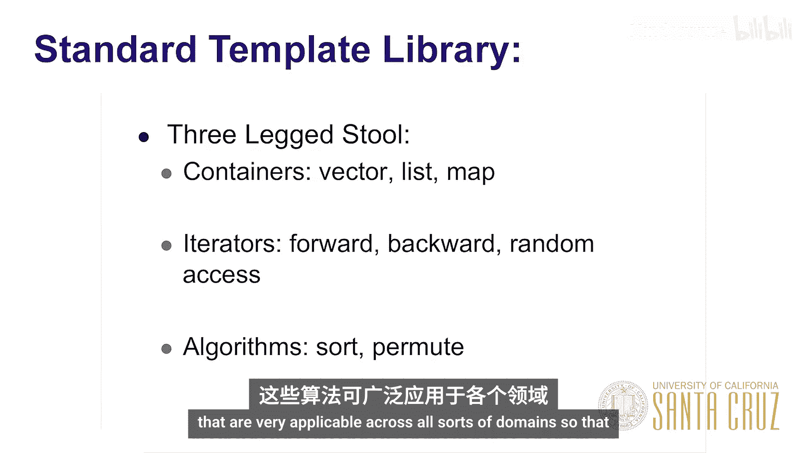
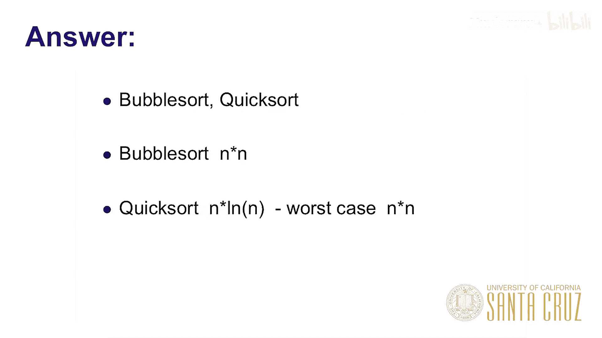
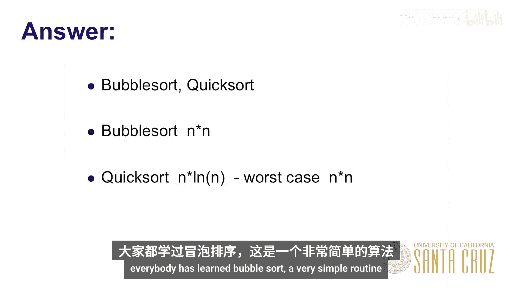
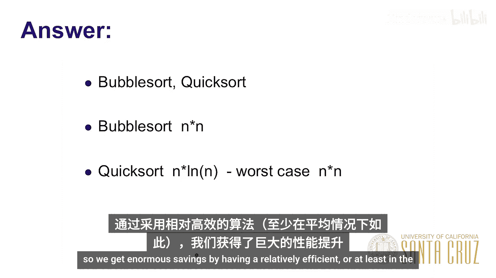
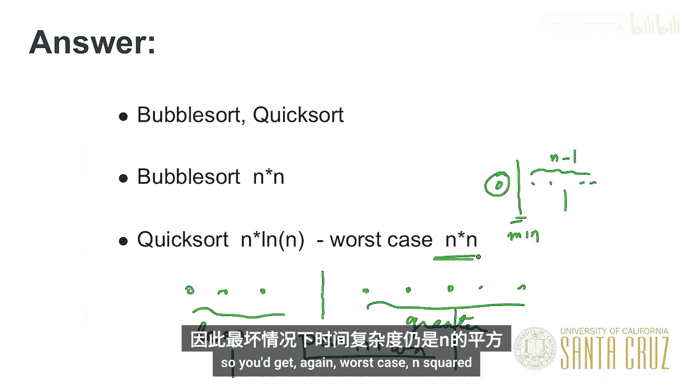

# C++编程：P38：STL架构与C++11新特性 🏗️

在本节课中，我们将深入探讨标准模板库（STL）的架构，并简要介绍C++11标准带来的新特性。理解STL的架构能帮助我们更高效地使用它，甚至扩展它。同时，了解语言的新发展对于编写现代C++代码至关重要。

## STL的三足鼎立架构

上一节我们介绍了STL的基本概念，本节中我们来看看其核心架构。STL的架构可以形象地比喻为一个三足凳，它由三个相互协作的核心组件支撑：**容器**、**算法**和**迭代器**。

### 容器（Containers）

容器用于存储数据。STL提供了多种容器，主要分为两类：

以下是顺序容器的例子：
*   `vector`：动态数组，支持快速随机访问。
*   `list`：双向链表，支持高效的插入和删除。

顺序容器中的元素有明确的顺序，我们可以通过索引（如第一个、第三个元素）来访问它们。

以下是关联容器的例子：
*   `set`：集合，存储唯一键。
*   `map`：映射，存储键值对。

关联容器不通过数字索引访问，而是通过**键**与**值**之间的关联进行查找。例如，通过朋友的名字（键）来查找其地址（值）。

### 迭代器（Iterators）

为了在容器中遍历和访问元素，我们需要迭代器。迭代器在概念上非常接近C语言中的**指针**。指针可以访问数组或结构体的成员，而迭代器是这一概念的泛化，它提供了更系统、更便捷的方式来遍历各种容器。

最终，STL定义了五种主要类别的迭代器，它们为算法的通用性奠定了基础。

### 算法（Algorithms）

算法是对数据进行操作的函数，例如排序、查找、累加等。STL提供了一系列通用的算法，它们通过迭代器与容器协作，从而避免了程序员重复“发明轮子”。

## 算法效率示例：排序

为了理解STL算法带来的好处，让我们比较两种经典的排序算法。

以下是两种常见排序算法的对比：
*   **冒泡排序（Bubble Sort）**：一种简单的排序算法。
    *   **平均时间复杂度**：`O(n²)`
    *   其工作原理是反复交换相邻的未按序排列的元素。
*   **快速排序（Quick Sort）**：由托尼·霍尔发明的高效排序算法。
    *   **平均时间复杂度**：`O(n log n)`
    *   **最坏情况时间复杂度**：`O(n²)`

`O(n log n)` 的效率远高于 `O(n²)`。例如，对1000个元素排序，`n log n` 约为 `1000 * 3 ≈ 3000` 次操作，而 `n²` 则是 `1,000,000` 次操作，效率差异巨大。

快速排序采用**分治**策略。它选择一个基准元素进行**分区**，将小于基准的元素移到其左侧，大于基准的元素移到其右侧。

然后对左右两个子序列递归地进行相同操作。如果每次分区都能大致均分，就能获得 `O(n log n)` 的效率。

最坏情况发生在分区极度不平衡时，例如每次分区后都有一个子序列为空。

不过，通过合理的基准选择策略（如随机选择），在实际应用中几乎可以避免最坏情况。

## C++11标准与STL的扩展

C++语言自1985年诞生以来不断演进。上一次主要标准化是在1998年。而**2011年**的C++11标准为语言带来了重大改进和扩展，其中就包括对STL的极大扩充。

这些新特性允许我们直接使用标准库，而无需自己创建基础库。一个重要的例子是**线程库**。随着多核处理器和云计算的发展，并发编程变得日益重要。C++11将线程支持作为标准库的一部分，为多线程编程提供了统一的社区标准。

在本课程的后半部分，我们将重点讨论一些C++11的新特性。

---

本节课中我们一起学习了STL的三支柱架构：容器、算法和迭代器，并通过排序算法对比了算法效率的重要性。我们还了解到C++11标准为STL和语言本身带来了强大的新特性，例如原生的线程支持，这将是我们后续学习的重点。掌握这些基础知识是有效使用和扩展STL的关键。