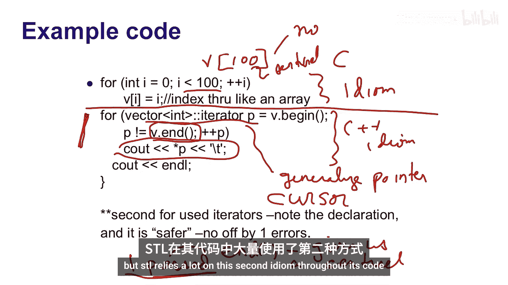
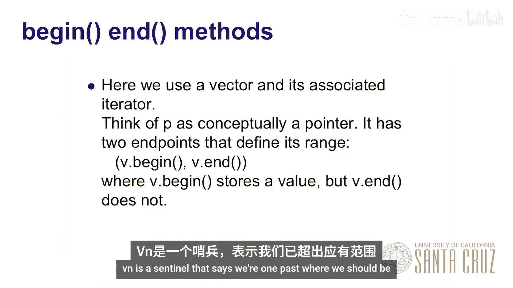

# 【加州大学】C++编程-｜-C-Plus-Plus-A-p39-P39_4-7-STL示例_04_01_08--BV1p2ejzREUQ_p39-

So。Let us look at。An example using STL， using a vector。Using from the standard library IO stream。

 which of course we've used， the namespace STD indicates that what we're dealing with is indeed a standard library again。

 if the namespace was something else it might be a local corporation library you might have。

Using namespace AT&T。If the AT and T people wanted to create。Their own versions。So。

Here we have vector， vector is a template， as why as the standard template library。 Remember。

 template is all about generic programming， so STL is heavily invested in using templates。Indeed。

 two of the techniques that SDL takes advantage of to get some of their efficiency and generality is。

It'sThe use of templates throughout。And the use of inlining throughout S L as a major design criteria is to try and get things that are nearly as efficient as they can be。

 even if they were hand codeed。Especially hand coded。And here's some example code。

This is a usual idiom。It's an idiom， both for。Vectctorors， but also。

Vectctorors can be treated like arrays。Now。This was used for initialization。

And this is more a sea style idiom。Here you're getting a C plus plus style idiom。

And here you see that you have this notion of iterator， this generalization of pointer。

We also sometimes call it a cursor。I understand that。Looking at a position。We have these。

Special functions， VM， so that VN is always sort of。The sentinel。 So and。And identifies。

Where we are finished with our computation， where we're finished with our sequence。

So it's like less than 100。10undred， there is a sentinel。 That means we can look up through 99。

 So there is no V I of 100 where there there would not be a V of 100。Via100。100 is instead。Oh。

 it's one past。So think of it as。One past， one element past。

And we de referenceence P which gets us the contents of whatever that container is。

 and then we use it in whatever way we want。 in this case is just for output。 So again。

 here are two of the standard idioms， Both are in use and our coding style， but。

We want you to move on to this and we'll hopefully explain why that has。Value。

 but STL relies a lot on this second。Iiom and throughout its code。

So。The iterator logic is fundamental。To the use of the standard template library。As I stated。

 P is conceptually a pointer， has two endpoints that define its range。

Begin is actually the starting element and stores of value， but VN doesn't store a value。

 VN is a sentinel that says we're one past where we should be。

 so we're always testing VN with a not equal logic， the P not equal to VN is what's very typical。

