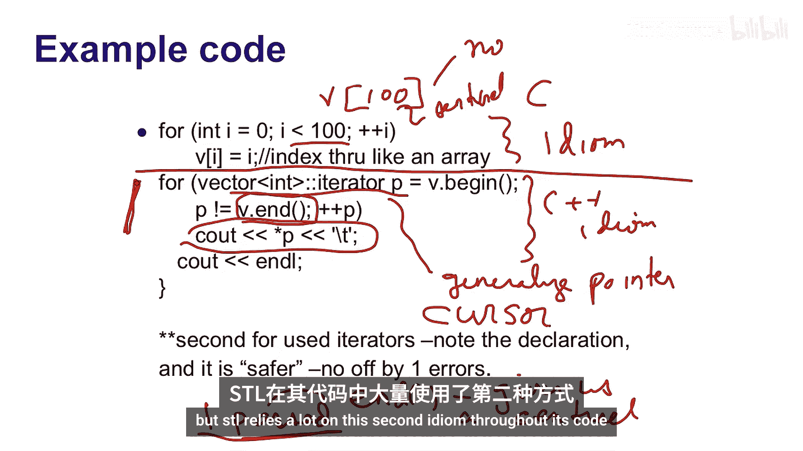
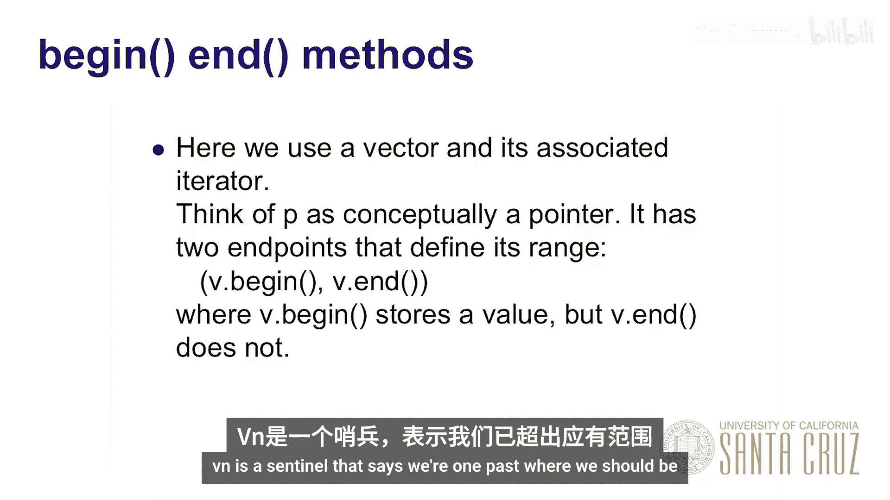

# C++编程：P39：STL示例与迭代器概念

在本节课中，我们将学习标准模板库（STL）的一个具体示例，重点理解`vector`容器的使用以及迭代器（iterator）这一核心概念。我们将通过对比C风格和C++风格的代码习惯用法，来展示STL的设计理念和优势。

## 使用STL的vector示例

首先，我们来看一个使用STL中`vector`的示例代码。这段代码包含了标准输入输出流库，并使用了`std`命名空间，这表明我们使用的是标准库中的组件。

```cpp
#include <iostream>
#include <vector>
using namespace std;
```

`vector`本身是一个模板，这体现了STL作为标准模板库的核心——泛型编程。STL广泛使用模板和内联技术，旨在实现接近手写代码的高效性。

## 两种初始化与遍历习惯用法

以下是两种常见的代码习惯用法，用于初始化和遍历容器。

第一种是更偏向C风格的数组初始化方式：
```cpp
// C风格习惯用法示例
for (int i = 0; i < 100; ++i) {
    v[i] = i; // 假设v是一个vector<int>
}
```

第二种则是更地道的C++ STL风格，它引入了迭代器的概念：
```cpp
// C++ STL风格习惯用法示例
vector<int>::iterator p = v.begin();
while (p != v.end()) {
    cout << *p << endl;
    ++p;
}
```

在这个例子中，`p`是一个迭代器，可以理解为指针的泛化，有时也被称为“游标”。`v.begin()`指向容器的第一个元素，而`v.end()`则是一个“哨兵”，它指向容器**最后一个元素的下一个位置**，用于标识序列的结束。

## 迭代器逻辑的核心地位

迭代器逻辑是使用标准模板库的基础。正如之前所述，迭代器`p`在概念上类似于指针。



它的操作范围由两个端点定义：
*   `begin()`：指向容器中实际的起始元素。
*   `end()`：作为哨兵，指向容器末尾的“下一个”位置。我们通常使用 `p != v.end()` 这样的不等逻辑来判断是否到达终点。

这种设计使得遍历代码更加通用和安全，是STL代码中广泛依赖的核心习惯用法。

## 总结



本节课中，我们一起学习了STL中`vector`的基本使用。我们对比了C风格和C++风格的容器操作习惯用法，并重点介绍了**迭代器**这一核心概念。迭代器作为泛化的指针，配合`begin()`和`end()`哨兵，构成了STL遍历和操作容器的通用、高效模式。理解并掌握这种基于迭代器的编程风格，是有效使用C++标准库的关键。