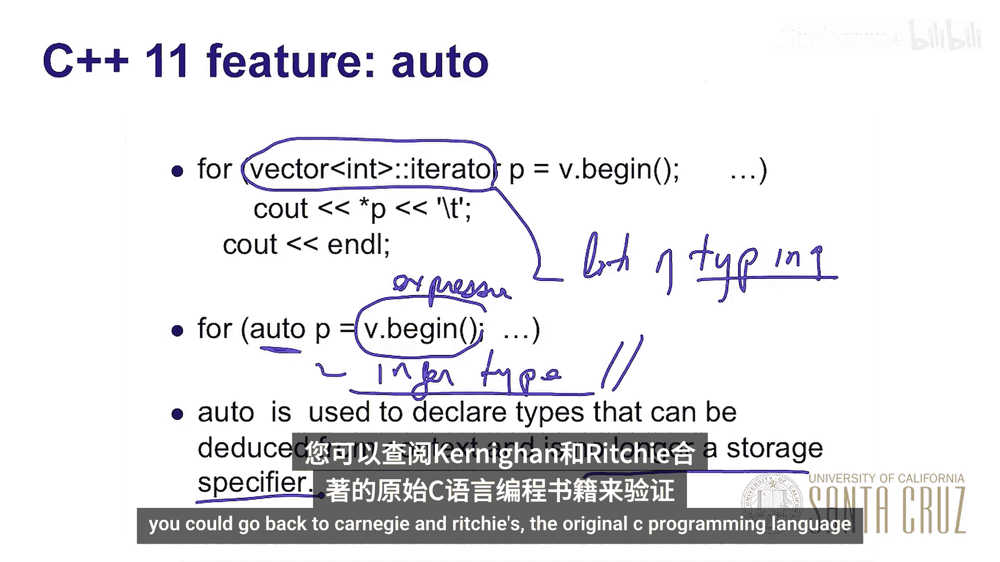
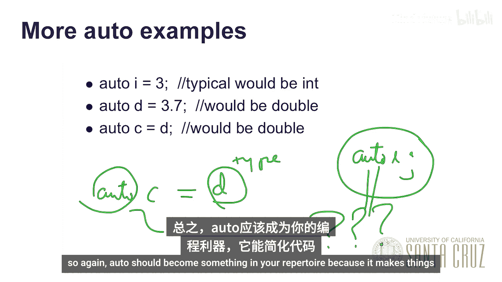
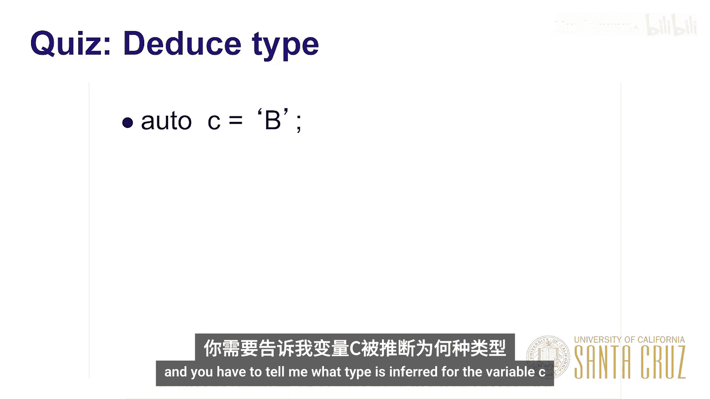
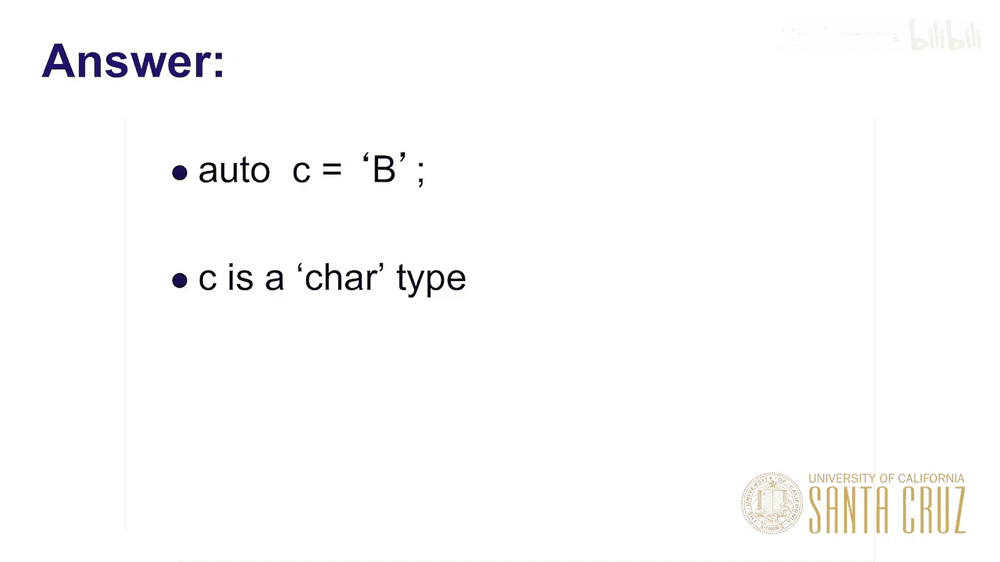
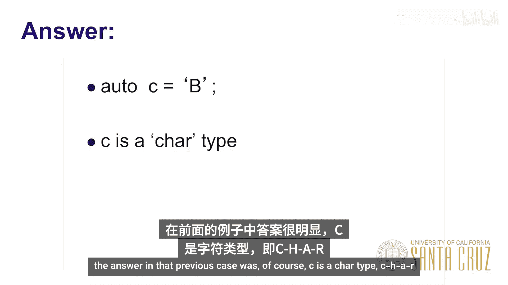
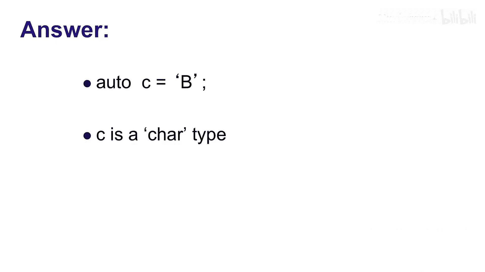

# 【加州大学】C++编程-｜-C-Plus-Plus-A-p40-P40_4-8-C++11特性_auto_04_01_09--BV1p2ejzREUQ_p40-

Now。L and behold， C++ 11。Allows for new features， and it allows us to change the idiom up in in a more convenient way。

 So I'm going to start showing you that。And we're going to start having a combination of the older style。

I want you to keep in mind that in the next few years。

 we're going to see more and more compilers which are compatible with the new standard。

And you should be able to start really taking advantage of it hopefully currently in wide use starting to be in wide use is the current version of the canoe compiler。

 so I believe that's 4。8 and I believe that does implement。Most features of the new standard。

So what are we seeing here，'re seeing。How to collapse。What is。A fairly cumbersome declaration。

 a lot of typing。That's quite appropriate。 I'm talking about keystrokes， but I'm also talking about。

Having the right type。Frequently easy to make an error or forget something in。

This kind of complicated syntax。So now。Wto。As a new meaning。

 this is not its meaning in the original C language。

 the meaning in the original C language is deprecated。

 deprecated is legal speak in programming language standards committees for no longer supported。

So the meaning of auto has been completely changed。An auto now means。Infer。Type。So。

That means that the type must be inferable。 and the auto isn't going to work if there isn't a way to understand the type。

 But if there's a way to understand the type and there is。This is an expression。

The compiler knows what type this expression is， it turns out it's vector and iterator。

So at the point where the compiler knows what that type is， it' just instead of having to specify it。

 you just say auto。Much more convenient。 Let the compiler do the work and let the compiler do the work safely。

In the。Very early days， it was what was called a storage specifier。

 auto in the early days of sea that's worth remembering。Was。A storage specifier that said。

 put this automatically on the stack。And indeed， in most instances。

 nobody used it because it was redundant。 you would just say int eye rather than auto int eye。

 So the old use。Was never in use。You could go back to Carnegie and Richie E the original C programming language book and try and find a use within the book。

呃。Of auto， and as far as I know， they didn't include auto and any real code throughout the original book that defined the language。

So here's some more examples of how auto could be used， they're fairly straightforward。

 there are indeed way more complicated ones， and you can see how inference works。The first one。

It's an alternative to saying ant I。The second one is an alternative saying double。

 The third one is an alternative in this case to say double。

 but let's look at the third one in more detail。So in general， whatever D is。Would have a type。

And if it was a type。That was fairly complicated to specify。Then this avoids。

Re specifying what might be a complicated type， but might be some kind of。Template。Iterator type。

Could be anything。So as long as we know the typer can infer it， now we couldn't just say auto。I。

 semiko。Right。No information to do the deduction， so that would lead to a syntax error。So。Again。

 auto。Should become something in your repertoire because it makes things simpler for you。

So just so you can check here is a very simple use of auto again。

 and you have to tell me what type is inferred for the variable C。

A。The answer in that previous case was， of course C is a cha type CAR。

