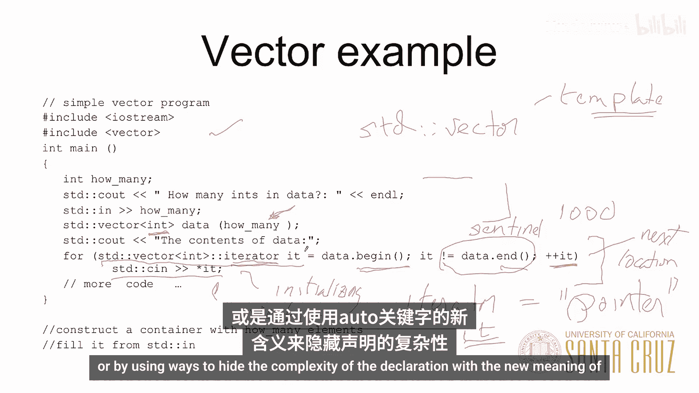

# 【加州大学】C++编程-｜-C-Plus-Plus-A-p41-P41_4-9-向量方法_04_01_10--BV1p2ejzREUQ_p41-

Now， new topic。When we get a container class。From。The standard template library。

 we also get a lot of additional functionality， again， recall。We're replacing a primitive container。

Aray。With。A much more sophisticated object。 An object that's going to。Give you more flexibility。

And it's going to be much safer to use。 Those are the two things you're going to buy with vector。

 Maybe you will take a very small amount of。An efficiency hit。 but in large measure， you won't。

And indeed， we're going to see in the new standard a fixed array type as a container。

 which also will。With greater efficiency in some cases。

Also be useful to replace the simple array type in C。So here are some methods。

V dot size gets you the current size of container。That's important because containers can be resized on the go one of the most useful functions of the container is。

 gee， I can of course， when I declare the container， give it a size。

That's frequently something that can be passed into the constructor。

But I also have the ability if I'm adding an element into the container。The container will expand。

So I don't run out of room as I would in an ordinary CA sense。嗯。

I need a whole number of constructors again， remember in our little lecture on object orientation how valuable it is to have a large number of constructors Constructors make it convenient to initialize a data type。

And they make it convenient。Across a whole bunch of needs。So。These are some of the critical。

Constructors you're going to see and you're largely going to see them for almost all kinds of sequence containers。

 so vector is just an example， I chose vector because vector is it has 90% of your value in studying the container classes。

TheThe knee jerk reaction， when you need a container is a sequential container is the pick vector。

 You almost should have a reason not to。 You should have a reason why you need a list or a ge instead of。

A vector。 So vector is going to be most of where you're going to get your value from the Stanford template library。

 So here's a constructor where you just built an empty container。 And then as you add things to it。

 it's going to expand。Here's a container that's of a particular starting size。

And here's a container in which there's not only a starting size but a value for its initialization。

So let's turn to。An example we'll use throughout the segment for a simple vector， vector。

Is the most important container class， it's the go to sequential container class when we're using it。

We have to get it from the standard library。So in effect， this is STD vector。

And we'll walk through this code。just see how。Effective it is and again。Largely。

 people are replacing ordinary， old style Cs with。Vectctor because you don't lose on efficiency and you gain in a lot of safety advantages and in flexibility。

So here we're going to ask。How big a vector you want。

 vector itself will have its own constructor classes， which enable it to。Go off to the heap。

And obtain all the storage necessary for a particular data type。

So we're asking how many elements you could say 10 or you could say 10，000。Of course。

 that will affect your running time and whether there's enough storage available on your system。

If it got two。Big storage gets so big。 You're going to see some kind of。呃。Bad allocation， exception。

So we ask through standard in for how many here we type something in。

 like we might type in a thousand。And now。This is the。Data types， so all of this stuff is a template。

 all of this is a template class。And for each template that is used， you're going to get code。

 So if you need a vector for int， you're going to get different code for vector for double。

 so keep in mind that that can affect what might be called codebloat。

 So here you're going to get everything to do with int。

 that's going to be the underlying data type that will be stored in the vector container class。

And now you will dynamically use the constructor of one argument。

To build  a thousand element integer sequential data type。

And now we're just going to deal with one very simple。呃。Thing that this program does。

And that is printing out that data。And you can imagine that there's going to be more code。

 So how are you going to print out the data and again， with STL。A standard template library。

The critical idiom to understand is that。All its containers can be used with iterators。

 So your logic， if you're going to extend in an STL like manner。

 you have to understand the iterator logic。 Remember， iterators。Are a8。Pointer type。In old sea。

 there was only a very simple primitive pointer。Iterators。Extend。That concept。

But keep the idea of pointing at where things are， it's a pointer type。Now notice。The definition。

The declaration of we're going to declare in this fourth statement a local variable。

 the local variable is IT。Its type iss tied to what it's iterating over。

 so we have it taking out of the standard library。A vector of。Henceence， so if that had been float。

 it would have to be float there， if that had been char or string， it would have to be those types。

And then， scope resolution。 and then。The word iterator。And so all of this is a type， and this says。

 this is the type associated with that so that the right thing can be pointed at。

And then within these classes。There are location primitives。 beging and end， beginner as where。

That vector starts。Again， think of it as a generalized。Memory primitive。

 which is saying what's the location at the start of this vector？

And then end is a sentinel that says， oh， you're at the end。

You can think of it as some kind of generalized zero， but this is a test on。TheAs a sentinel。So keep。

Walking through， remember iterators。Can be auto increment， and that just means get the next location。

So this for loop is all about starting at the beginning。

 going to the end and visiting each location once and only once and then with each location。

Use it to initialize your vector。So you're initializing your vector from standard N。

So if you were to run this code。From your local computer。

 you would see on your screen how many you would tell it how many。

 and then it would say the contents of and then。It would ask you to initialize。

 And then you'd have to write more code， a further iterator to print。呃。

What you filled the vector with onto standard out。 So you could extend this so that you can show it。

Processing your input and then printing out your output， that would be a nice extension。

 a nice exercise for you to see if you understand the whole iterator concept。Now。

 the iterator concept you we'll see in a later point can be hidden。It's an underlying mechanism。

 but it can be hidden。By either using things like the fore range or by using ways to hide the complexity of the declaration。

With。The new meaning of the key word auto。

