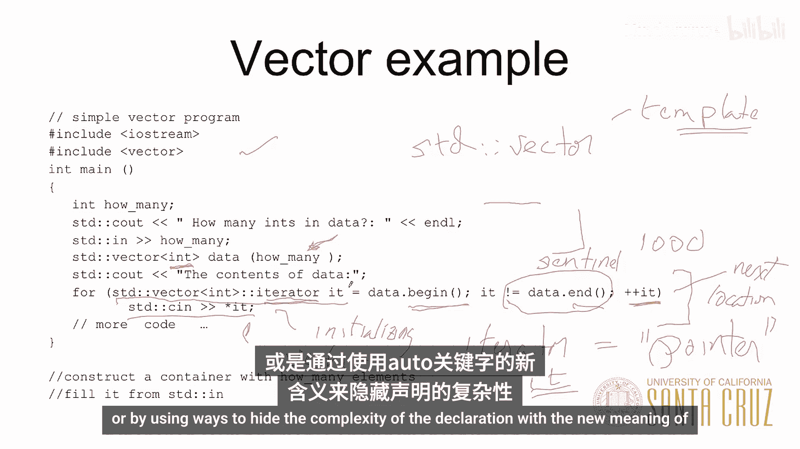

# C++编程：P41：向量方法


## 概述

在本节课中，我们将要学习C++标准模板库（STL）中最重要的顺序容器之一：`vector`。我们将了解为何要使用`vector`替代传统的C风格数组，并学习其核心方法、构造函数以及如何使用迭代器来遍历容器。

---

## 从数组到向量

上一节我们介绍了容器类的基本概念。本节中我们来看看为何要使用`vector`。

当我们从标准模板库中获得一个容器类时，我们也获得了大量附加功能。我们正在用一个更复杂的对象——`vector`，来替代原始的容器——数组。这个对象将提供更大的灵活性，并且使用起来更安全。使用`vector`可能会带来微小的效率损失，但在很大程度上不会。实际上，在新标准中，我们还会看到一个固定大小的数组类型容器，它在某些情况下效率更高，同样可用于替代C语言中的简单数组类型。

以下是使用`vector`的两个主要优势：
*   **灵活性**：容器可以在运行时动态调整大小。
*   **安全性**：相比原始数组，`vector`提供了更好的边界检查和内存管理。

---

## 核心方法与构造函数

现在，让我们看看`vector`提供的一些核心方法和构造函数。构造函数对于方便地初始化数据类型至关重要，它们能满足各种需求。

以下是`vector`的一些关键构造函数，这些构造函数在几乎所有序列容器中都很常见：
*   `vector<T> v;`：创建一个空的`vector`容器。
*   `vector<T> v(n);`：创建一个包含`n`个元素的`vector`，元素进行默认初始化。
*   `vector<T> v(n, value);`：创建一个包含`n`个元素的`vector`，每个元素都初始化为`value`。

一个非常重要的方法是：
*   `v.size()`：获取容器当前的大小。这很重要，因为容器可以在运行时调整大小。

---

## 一个简单的向量示例

理解了构造函数和方法后，本节我们通过一个具体示例来看看`vector`的实际应用。

`vector`是最重要的容器类，也是我们使用顺序容器时的首选。我们必须从标准库中获取它，因此其完整名称是`std::vector`。人们普遍用`vector`替代传统C风格数组，因为它在效率上损失很小，却获得了许多安全优势和灵活性。

让我们分析以下代码，看看它如何工作：

```cpp
#include <iostream>
#include <vector>

int main() {
    int how_many;
    std::cout << "How many elements? ";
    std::cin >> how_many;

    std::vector<int> data(how_many); // 使用构造函数动态创建指定大小的vector

    std::vector<int>::iterator it; // 声明一个迭代器
    for (it = data.begin(); it != data.end(); ++it) {
        std::cin >> *it; // 使用迭代器从标准输入初始化vector
    }

    // 扩展练习：可以添加另一个循环，使用迭代器将vector内容打印到标准输出
    return 0;
}
```

这段代码首先询问用户需要多少元素（例如1000个），然后使用单参数构造函数动态创建一个包含相应数量整数的`vector`。程序的核心功能是使用迭代器来填充这个`vector`。

---

## 理解迭代器

上一节代码中出现了迭代器，它是使用STL的关键。本节我们来深入理解迭代器的概念。

使用标准模板库时，关键要理解其容器都可以与迭代器一起使用。迭代器是一种指针类型。在旧版C中，只有非常简单的原始指针。迭代器扩展了这个概念，但保留了指向事物位置的思想。

以下是关于迭代器的要点：
*   **声明**：迭代器的类型与其迭代的容器类型绑定。例如，对于`std::vector<int>`，迭代器类型是`std::vector<int>::iterator`。
*   **位置指示**：容器类提供了`begin()`和`end()`方法。`begin()`返回指向容器第一个元素的位置，`end()`返回一个“哨兵”，表示容器末尾的下一个位置。
*   **遍历**：迭代器支持自增操作（`++`），用于移动到下一个位置。`for`循环从`begin()`开始，到`end()`结束，确保每个位置被访问一次且仅一次。

在上面的代码中，我们使用迭代器`it`遍历`vector`，并通过解引用`*it`从标准输入读取值来初始化每个元素。

值得注意的是，迭代器的概念在后续学习中可以被隐藏。例如，可以使用**基于范围的for循环**或C++11的`auto`关键字来简化迭代器的声明，从而隐藏其复杂性。

---

## 总结



本节课中我们一起学习了C++标准模板库中的`vector`容器。我们了解了使用`vector`相比传统数组在**灵活性**和**安全性**上的优势。我们学习了`vector`的核心**构造函数**（如创建空容器、指定大小、指定大小和初始值）和`size()`方法。最后，我们通过一个示例代码深入探讨了**迭代器**的概念，它是遍历和操作STL容器的通用且强大的工具。记住，`vector`是处理顺序容器需求时的首选，除非有特殊理由（如需要频繁在中间插入删除），否则应优先考虑它。