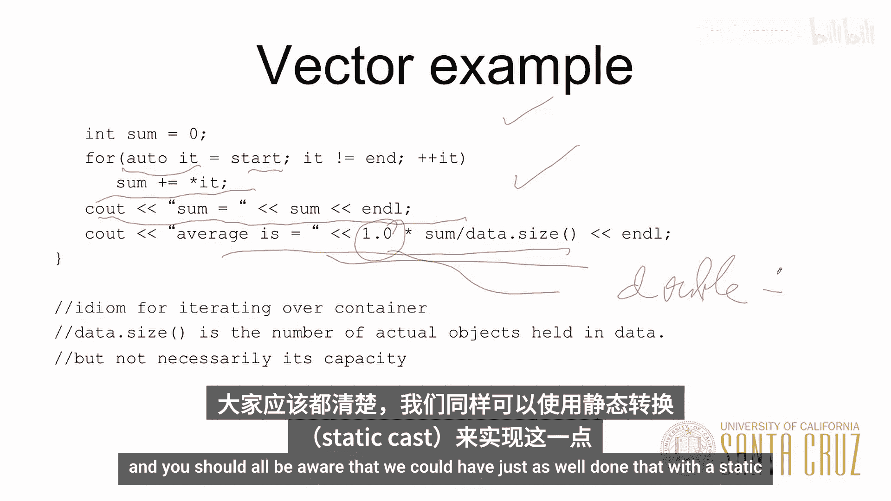

# 【加州大学】C++编程-｜-C-Plus-Plus-A-p42-P42_4-10-更多代码_04_01_11--BV1p2ejzREUQ_p42-

So in our vector program。In the last segment， you saw that we use this very。

Complicated declaration for the variable it， the local iterator variable。And that's where again。

 auto is so important， as is mentioned earlier， O is not at all what has started out to be in old C in old sea it was。

Storage classification and C++ 11。Ato is a。Type inference mechanism。So， here。

The looks and says it has to be of an appropriate type。For data begin。 And if you remember。

 data begin is where the beginning of that vector， which was storing a bunch。

 which is for storing a bunch of integers。 So it would infer。That whole。Standard vector and， colon。

 colon iterator logic。And you don't have to write it and it's quite transparent as to what is going on and you're back to just using it a Sentinel and then auto incrementing the pointer type so that you can march through for how many elements。

And。Fll your vector。So here's all the Sgl value。We've used the iterator itum。

 the iterator idiom for the vector， make sure we go。Correctly across the whole container。

We don't have any。Possibility of making indexing errors， right？

That's a value anybodybody that's programmed in C knows that we get sick faults or some other fancy message at runtime if somehow we index out of the range of the array and this is a way to avoid that so this is one of the very strong values of moving over to the iterator idiom and the range begin and end and again I say you'll see that over and over in the STL library。

And as part of the idiom， we see the auto increment of the pointer throughout。

 and then we see the dereencing and processing of the item。And you can just as well imagine that。

Instead of this。Process。This could be processing startP in a very complicated way。

 taking each element in time and doing something， whether its not just this rather rudimentary printing it。

 you could even call a whole function on it to do some fancy stuff with it。Okay。Quz。

 avoiding bound errors。For int I equals 0， I less than or equal to upper bound plus plus of y。

 some is sum plus theta of y。Can you find something wrong， think C。

 think what's wrong if this is the conventional C idiom。Upper bound is normally not tested。With that。

 it's normally testeded with this。So this is going to get you one past where you look。

And going one past is going to result in some kind of runtime era， and again， conventionally。

 this is thought of as an off by one era。And that's what we're trying to get you to avoid。So again。

 to demonstrate how powerful STL is。We're going to use the SDL iterator standard library。

 we're going to use a file stream library and we're going to do something where text where we get data from a local standard file there。

You can be processing arbitrary amounts of data。Some experimenter as。

Given you the weights of elephant seals， that's what we do out here at UCSC。

 we are right next to the breeding ground of the elephant seals and you decide you want to know what the average weight of elephant seals are and you have a bunch of data which is integral integer data。

 it turns out actually elephant seals can be。Up to。six or 7，000 pounds。

 especially the males get to be quite a bit bigger than the females。

 so if you're a biologist and you are tracking a lot of this。

 this is very useful and this is very common again in all sorts of data science。

 you have some big files， your processing and you're trying to find key important statistics out of those files。

How do we do this？Well， the first thing we do， which is again very simple because of STL is we have an IF stream。

 a data file， and the local name， a local file name。So that's going to be called data dot text。

We have an iterator for the type of data that' will be stored there， which is going to be an int。And。

We have。呃。Two pointers， a start pointer and an end pointer。

And the start pointer is going to be initialized to the beginning of the file。

So the file's name locally is data。 textex。Stk points at wherever we go to open that file。

And end will end up being the sentinel for the end of that file。

 Now here's what's fascinating about STL。 Here's a constructor type。And it has two arguments。

One of the arguments is they're both iterators。They're iterators to something else。

 namely an ice string。One is the start of the ice stream and one is the end of the ice stream。

 so this is going to generate fancy code that you don't have to use， that's why it's so powerful。

 it itself is going to do an initialization out of that text file of all the integers found in that text file and it's arbitrary so we don't know and advance how many we need。

And because vector itself is an expandable sequential container。The system will build it。

And that data is all going to end up。Sitting here in the internal variable data。

Now we can process the data and notice we， let's say in this case we want an average。

 so we're going to sum the data。Initializes sum to zero're going to use our。啊。

Use of auto to get the right type for the iterator at's the start。

Which had been initiated to the beginning of。The file。

And we're going to go to the end and we're going to do the sum。And then。

We can print out the sum and then we can find the average of the sum， of course I use 1。

0 so it ends up in the double domain。You should all be aware that we could have just as well done that with a static cast。

