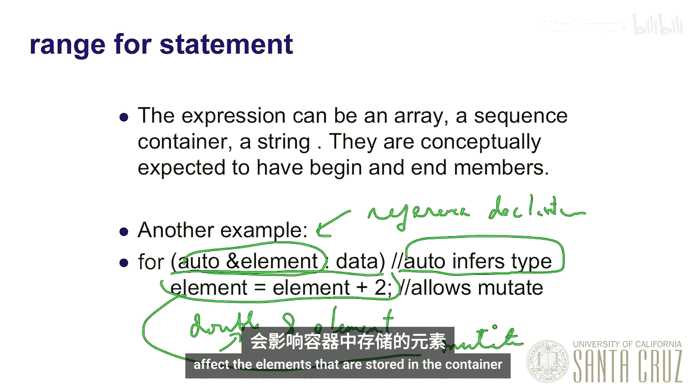

# 【加州大学】C++编程-｜-C-Plus-Plus-A-p43-P43_4-11-C++11特性_for语句_04_01_12--BV1p2ejzREUQ_p43-

Okay。Here's a new little topic。And。As I said earlier。We're going to start injecting。A。

New features from C+ plus 11， which you should start adopting into your own practice because they're going to make your programming chores easier。

There's a claim in the C++ 11 standard。That。The new version of language is easier to use than the old version of language。

Now on the surface it may seem a little absurd， why do I mean it may seem a little absurd？

The new standard adds about 60% more。Material to the old standard。

 The old standard took about 800 pages to describe。

 The new standard takes about 1300 pages to describe。Normally。

 when you have something that's another 500 pages long to describe， you don't call it simpler。

You call it more complicated。And indeed， there are things in the new language that are fairly complicated。

 but there are many things in the new language， such as you already saw with auto that gives you if you adopt them。

A much easier way to write code， a much more natural， more intuitive way。

 And here's another one of them。And that is the range based force statement。

So that's our little tip of the day， our new C+ plus 11 tip of the day。

 which is this new force statement， how does this new force statement work？

We have a declaration in the force statement。Then we have the explicit character colon。

Then we have some expression。And finally， we execute a statement that of course。

 the statement can be a brace andcloed block， so it can be it's a single statement。

 but of course you can make it as complicated as you want through as usual using a brace andclo block。

Here's a simple example of its use for double D， recognize that double D is obviously a declaration。

 So we've。Identified a variable D that's going to be local to this range forest statement。

And then we have an expression， recall're calling the expression in this case， data。For example。

 data could be an array of doubles。And it could be an array of doubles， which was declared。

 Let's presume that it was declared as double data upper bound。 So its some。Fupppper bounds 100。

 we have 100。Pieces of data， the data sitting in each element is a double。

And you can see now what that force statement is supposed to do。

It's supposed to add up all the elements in that array。啊。And the way it adds them up。Is。D。And the。

In turnn。😔，Mches。😔，Over data。And you could think of it as D。Is being assigned data。Of I plus plus。

 in turn， where somehow。I was some indexer cursor that was marching through that。So typically。

Data is going to be an aggregate。This is going to end up being。

An individual value taken from that aggregate。 and you see nothing about a range。

So this is even simpler than begin end。 Begin end is implicit。 Begin end is implicit。

 So this further simplifies the STL idiom of saying for an iterator auto of P equal。Data begin。

And P not equal to data of end。And then you would do P plus plus。So instead of that whole thing。

 you have a much simpler statement than you avoid even mentioning the iteration。

What can be used in the expression。Where you have a arranged range for， it can be an array。

 it can be an ordinary sequence container， it can be a string， think about a string。

 a string is a series of character elements， so it's a specialized container。And conceptually。

 you expect them to have begin end members。 So where you have sequence containers with begin end members。

Or strings Or ordinary arrays。All of those are subject to the range four。

Let's look at another example。The lowercase。So here。This is， again， a declaration。

The declaration is a reference declaration。Notice also that I've used auto to infer types。

 so I'm using now several of the new ideas from C++ 11。So。

And it would have been just as suitable to have said double ampersan。In effect， it's just a way of。

Getting the compiler to see that that should have been double。But again。

 you could say this is going to work regardless of type。And now， rather than do summing。

I'm mutating this value。And because I'm mutating it， that's why I needed the reference declaration。

So， again。This is a very standard idiom now with the for range。

 and it's a standard idiom when the effort when you're going to in your processing。

Affect the elements that are stored in the container。

