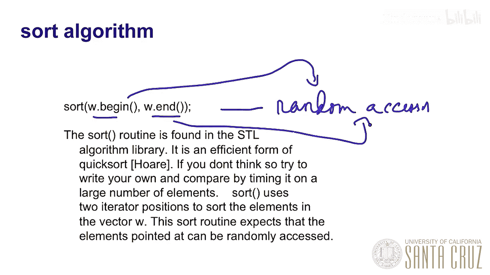

# 【加州大学】C++编程-｜-C-Plus-Plus-A-p44-P44_4-12-STL输入文件_04_01_13--BV1p2ejzREUQ_p44-

Okay。NowLet's turn to another example and study yet another example again。

 all of us out there have pretty much at least in most instances， students myself。

 we learn from experience from practice， from seeing。

Example code and once we see an example rather than some abstract document， we know from that idiom。

 that example typically if it's archetypal。It then lets us。

Understand the technique and absorb that technique。So in this example。

We are going to read in a series of words from a file。And we're going to read them into a vector。

 and then we're going to sort them。So you can imagine that you're humanities professor。

 and you want to verify that a certain play was written by。Shakespeare。

 where maybe there was some controversy and some of the methods you might use is to see the usage of words how often they get used Shakespeare where has every author seems to have patterns and usage patterns and there are statistics you can again apply to their text and use those statistics to verify。

That it's likely that it was Shakespeare， these techniques also get used， for example。

 in the Bible to figure out whether there are multiple authors and where。

There seems to be stylistically changes from parts of the text to other parts of the text。And again。

 we're going to demonstrate how powerful STL is so this。

 if we were try to write this in old style C or even in the original pre STL C plus plus。

 we would have had to write many more lines of code， all of the code。It would be subject to。

Difficulty。It would make for pretty low level routines that could have lots of fronttime errors。

 but here we have the ability to just reuse code reuse code is a silver bullet that allows us to。

Quickly and efficiently rate large。呃。Pieces of， of of code。Again。

 we need to know what kinds of SDL libraries we need， IO streamam iterator， Estreamream。

 FStream again is for the files。And now we're going to also choose to use algorithm。

 So algorithm is where。And。Our case， there's going to be a sorting routine。And again。

 this would have required a bunch of lines of code， this sorting routine， as you'll see later on。

 we'll talk a little more about it is based on H' quick sort algorithm and again the container class our most useful container classes。

As our vector class。So。We open word dot text。So we can imagine。Shakespeare。Some play。

Hamless's play is sitting in a big document， you can find this stuff all over the internet。

It gets some big file and it has words in it。And we need an eyestream iterator。

That's going to migrate over and visit that file。And we're going to use what we used before。

 which is two pointer types， a start and an end， the startle point to the initial place in the open text file。

 the word word dot text， the word dot text is a local file contains the information we want to process。

 and that information is going to be a series of strings， words are just strings。And again。

 we can use this kind of constructor to basically go off to。These pointers。

 which are now pointing at a file that's to be read。And will'll initialize this vector。

And critical to that initialized vector is。The actual reading of that file uses white space。

To distinguish individual strings。 So we don't have to write， for example。

 some elementary routine that would crunch characters looking for white space to separate out the individual strings。

 And we also get the ability because string is a dynamic type to represent small words like a and the from large words like polysyllabic。

 So arbitrary strings， which in this case， are hoped to be words。Can。Be dynamic。

And here we go and start processing those words， so words are read in。And now we're going to use。

Our four range statement。Again， a very powerful feature that simplifies a lot of coding in modern C++ 11。

So what does the four range do？It looks at。In general， some kind of container。

And visits everything in turn so we can't get a range error。And。Dcides what it needs。

In visiting the individual item， so order， auto is going to pick out an individual string。

So auto is going to use the compiler to infer what the appropriate type is。

 and then all we want to do， for example， is print out。And see what's actually in that file。

 So this stuff is just going to print out that file。 So if the file said。The quick。Brown Fox。

That's what we would see on the screen。And each of those words would be separated by a tab character。

And here we invoke the sort。Standard library sort out of algorithm。So it's a two argument thing。

The two arguments are iterators。So if you look at the logic of STL and any time you see an STL。

Algorithm is generally going to work。With iterators， because that it's the most powerful logic。

 that's how all of this was designed to be very integrative。And again， we use our four range。

 and this time after the sort， we're going to see。Something。Different。

 so if it was just the quick brown。These would be reoriented。 I think we actually would see the。

Brown。😔，Quick。Check me on this and the reason we'd see it in that order is。The。

 which is the first letter。Has lower ASI value than the uppercase has lower ASI value than the lowercase B's and Q's。

So。For range idiom simplifies how we visit。A container class， the sort is STL。

 so it's an extremely efficient algorithm we don't have to rewrite。And once it's sorted。

 we can do interesting things like frequency counts so again。Try it。

 see if you can do some other things， and another thing you might do is maybe it's inappropriate to distinguish between capitalized and uncapitalized letters lower and uppercase。

 so maybe you would want to before you you want to maybe process the file so that everything is lowercase。

So that would be it。Exercise， change everything to lower case first， then process the file。

And that's all。 This is very powerful。 You can see that we're getting a lot done。

And manipulating a text file with rather little effort if you know STL， if you know STL。

It just brings a lot of firepower and lets you write very concise but very understandable and remarkably correct code。

 why， because all of these subpieces have been thoroughly checked out。So conventionally。

 that algorithm。Quick sort by horror。Is called with。

An iterator range and again I told you we're going to see this a lot。

We're going to see an iterator range， this is going to be a specific iterator。

 a starting iterator and an ending iterator so we could have。呃。

Sorted something that was a shorter range。 We didn't have to pick the whole。File of vectors。

 we could do something else， but this would be very typical。

 the starting iterator and the ending iterator。 the other thing we have to know about this。

Is this algorithm？Requires random。Access。So these iterator values must be random access。

For this to work。There wasn't random access， this would fail。And notice in my comments on the slide。

See if you could try to write your own code。If you're up for that， right。

 your own quick sort and compare it timing wise and see if you could do better。

 this is remarkably efficient code。And it's done by professionals in this library。

 and they know the libraries wouldn't be used if they were easily improved on。

Professional use requires that use be highly efficient。

