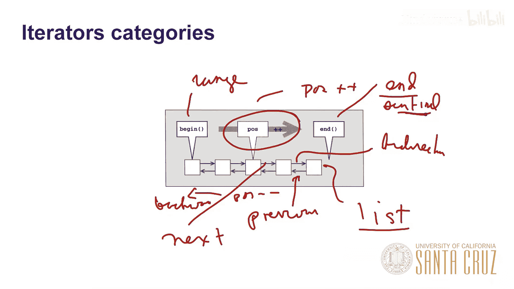
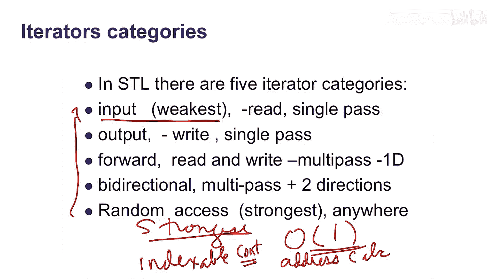
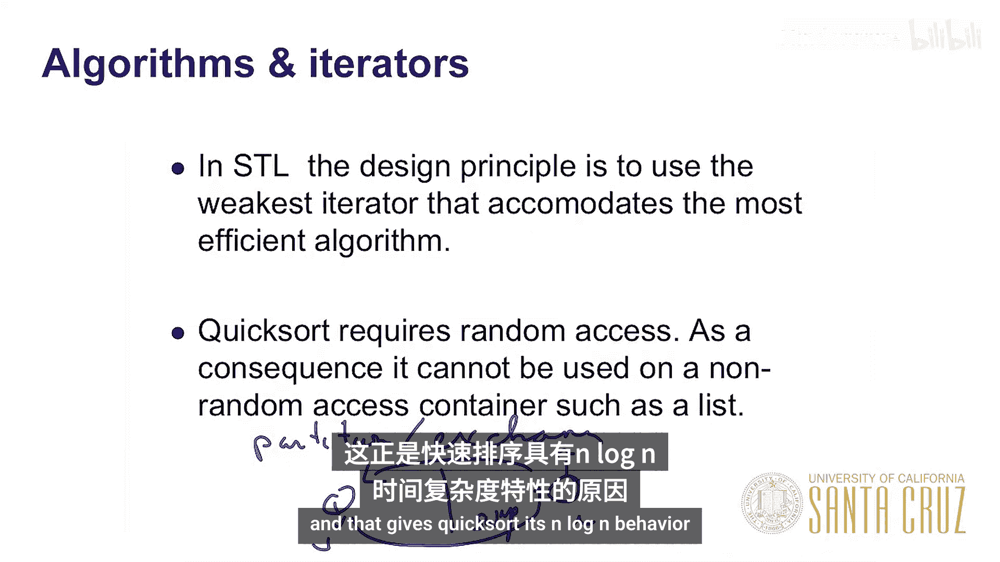
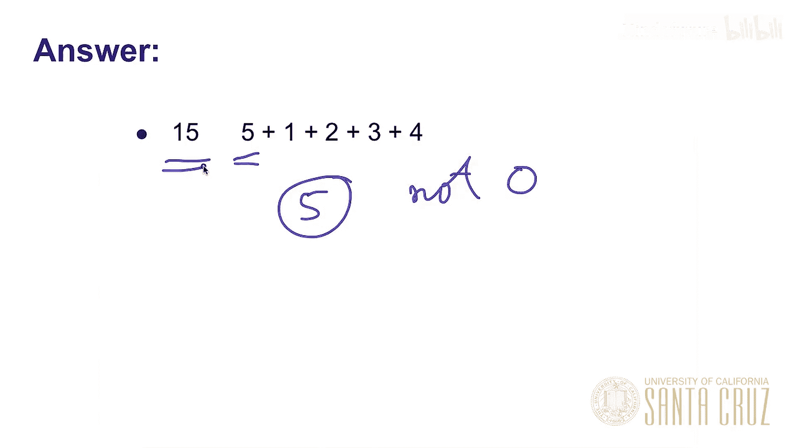

# 【加州大学】C++编程-｜-C-Plus-Plus-A-p45-P45_4-13-迭代器类别_04_01_14--BV1p2ejzREUQ_p45-

Next major topic is going to， again be architectural。

 we're going to describe in more detail what the itator hierarchy is， itator。Categories。

 you can see in the slide that an iterator。And the iterator characteristics are you have methods like begin and end。

In this case， you're seeing。This is a list。Your typical list allows for。By direction。

And that there's。Previous。Pointer and。A next pointer。

So if you are at a particular position in a list， you could do position plus plus and move over or you could do position。

Minus， minus， and move backwards。And again， this specifies the range。This is the start of the range。

And sentinel of the range。So again。Very important to grasp that diagram， this is in terms of a list。

 but it would be similar in terms of a vector or similar in terms of a double ended Q。

There are basically an S TL 5 major categories， and the categories are。Strongest。s weakest。

 if you want to think of that。 So this is the strongest。Bandom access， this is the weakest。

 what we call input。Let's look at the weakest first。

 The weakest allows you to read and only look at information once。Read in a single pass。

 what could that mean， think of an input file。Input files are used for reading and if you read through them。

 you get to the end of file and then you're done。The cursor。Goes away。The second weakest。

 which is very similar is for output and output you can write to the file。

So the file can be modified， but again is single pass。

The third weakest sort of intermediary is forward。In a forward iterator。

 you can read and write so you can do both operations so you have more operations。

But you can also act on it， the file doesn't disappear on you。It can be used multi multipass。

 so the construct you're operating on like a vector list is staying there。

Unlike thinking of a file that file read that disappears on you， so it can be multipassed。

 but it's one directional。 that's what I mean by 1 D。 I don't mean one dimensional。

 I mean one direction。Bydirectional， which we saw in that little diagram is again。

More more sophisticated。Multi pass is allowed， and you can go to a previous element。

 as well as the next element。 And finally， random axis is strongest because you can go anywhere and you can go anywhere in what。

Is known in analysis algorithms In order  One， you can do an address computation anywhere into what is。

Indexable， so you can think of that as something where it's an indexable。A container。

The canonical one being a vector or in the C language and array。Now。When we go to design algorithms。

 we always keep in mind what iterator category we want to use and we always want to choose and we'll try to understand but let me say this first。

 I'm going to repeat it if you study this in detail if you go to study you'll have to study the library on your own。

 the library is enormous。But very important conceptually， to keep in mind。That。

When you design an algorithm， you design the most efficient version of the algorithm that allows you to use。

The weakest iterator category。

So。Reating that in STL， the design principle is to use the weakest iterator that accommodates the most efficient algorithm。

 we' seen quick sort。 Quick sort requires random access without random access。

You can't do Quick sort。As a consequence cannot be used on a non rent excess container such as the list。

 Indeed， list， for example， has a special sort routine。 It's not that you can't sort a list。

 You could do it in one of two ways。 You could transfer the contents of the list。To a vector。

 for example， that would be one way and then call the ordinary sort on the vector。

And then reconstitutes the list。So there you're building， you're destroying one list。

 rebuilding the list and using vector， but it may be simpler to just call the specialized sort on a vector。

 which will not be as efficient。Can't be。 It won't be as efficient。

 It doesn't have random access available to it in moving stuff around。 Now， why random access。 Well。

 remember， we want an order and log N computation for quick sort。 And if you qua。

Quickword is also called partition。Exchange。We have that petition element。 we identify。

Two elements that。Belong on the other side of petition。And we swapped them。

For the swap to be efficient。This is sitting in I， and this is sitting in J。

And we need to deal with that in random access mode。If we deal with that as a list， we can do that。

 then that becomes an order n computation， so each swap would be order n。InRandom access。

 each swap is order one， and that gives Quickword its analog log N behavior。

Let's go through the iterator hierarchy a little more carefully， there's the input iterator。

The input iterator must allow the elements to be searched in a forward direction one by one requires the operator plus plus to be defined。

 advanced the iterator， and also requires that you will be allowed to dereference。

The object that the pointer is pointing at， that the iterator is pointing at。

When you have an input iterator， canonically， it's for accessing elements sequentially in input stream。

And that requires a rather minimal set of operations。

Similar to using what's called the find of an element in a collection search sequentially。Also。

 input iterators can have。Equality and inequality defined。So if you think of。

 because it's in the standard algorithms library。Find。And we have some basic。Sequential。

Let's say we're looking for the element six。We could start at the beginning。

And then move along until we hit fined。And that's going to be perfectly efficient。

 We don't need any random access。 We don't know where something is。

 So we're going to have to look through。The set of items。

 but we only need to look through them once if we go through them more than once。What's the point。

 I would be extra work， so looking and trying to find something in a list or think about。

A pile of note cards where you're keeping addresses for your friends， and they're unordered。

The typical algorithm would be exactly this。 Find， I would go to my little note file and keep。

Sequentialally reading through them。And looking for。Particular element I would look for。

 Where is Laura Pole's current address。And I just would continue to look that up and find would do it so fine can。

Rely on。A week， the weakest possible iterator， the input iterator。

And that's how it would be defined in SDL。Here's an example using an input iterator。

And it's using thenumeric Library。So again， there's algorithm， there's numeric。

 these are the different kinds of methods that get produced generically through the use of STL。

 that's the three legged stool again。And accumulate will be sitting in an America。Libray。

And accumulate。In this case， is using。An input iterator that's at the start of this I F string。

So we have a file。File is sitting somewhere。It's a data file。

Whose name is data in the local directory， which has some series of numbers， which are integers。

And we want to add all those numbers up。So let's say there were the six numbers， 6，4， minus 3 and 19。

 the file had four elements。We have。An I cream iterator which points at the beginning of the file。

And we have something for the end of stream， the end of file and effect。

So this is the equivalent of begin and end。 And then the we accumulate starting with the value 0。

 So this can be an arbitrary。Value， for example， if we have a whole bunch of files。

To look up and add up。We may want the last value to be the starting value for the next accumulate。

 accumulate is just going to add 6 plus 4-3 at 7 plus 19。 So we're going to end up with。In that case。

 printing out 26。All very compact。All done without worrying about。Indexing。A。Highly useful because。

Operations like this occur all the time and accumulate， as we see。

 only needs to run through at once in one direction， just like find。 And so it can make use of。

The weakest iterator and still be highly efficient。

So if you were to look at the signature for accumulate in the library and you'll see look it up in a standard or go look it up using the Wikipedia。

You'll see that its signature involves they'll probably say something like input iterator there。

 And then some kind of value again， because it's all generic， right， These are input iterators of。

A general type。So this is some。Tip。In general， so it can be an arbitrary value。

 and usually by default， that starts at whatever is the natural zero。For that type。

But it could be some other。Value that you're starting。

Thats accumulate very useful numericalmeric routine。People are doing accumulate over and over again。

 So what's the point of writing your own version。No point to it at all。Okay， take a little quiz。

See what would happen。 What is the output。From this little code segment。

So we saw that the starting value。Was 5。 It wasn't 0。And so it was5 plus1 plus 2 plus3 plus4。

5 plus 10， so that's 15。The answer is 15。

