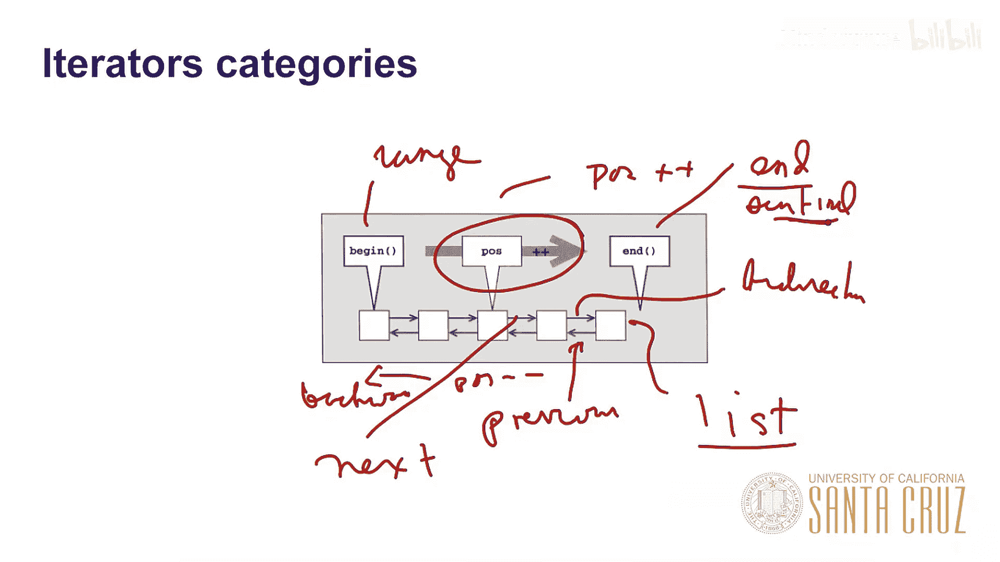
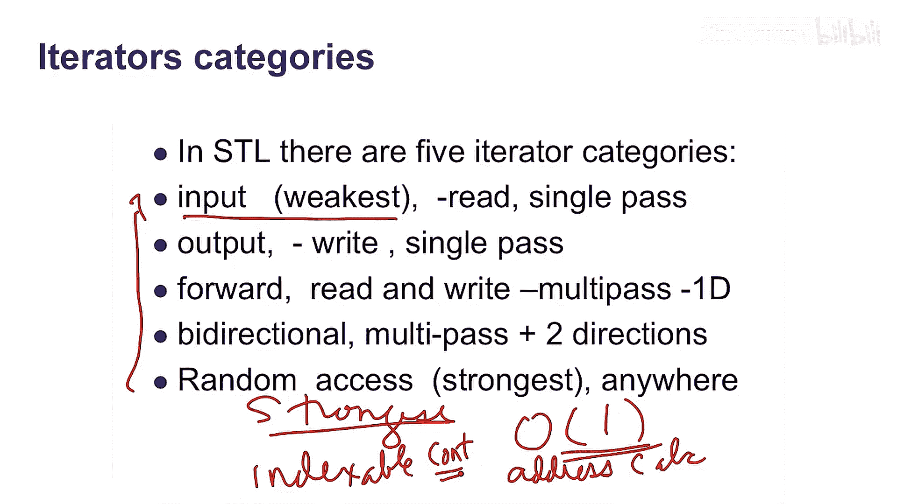
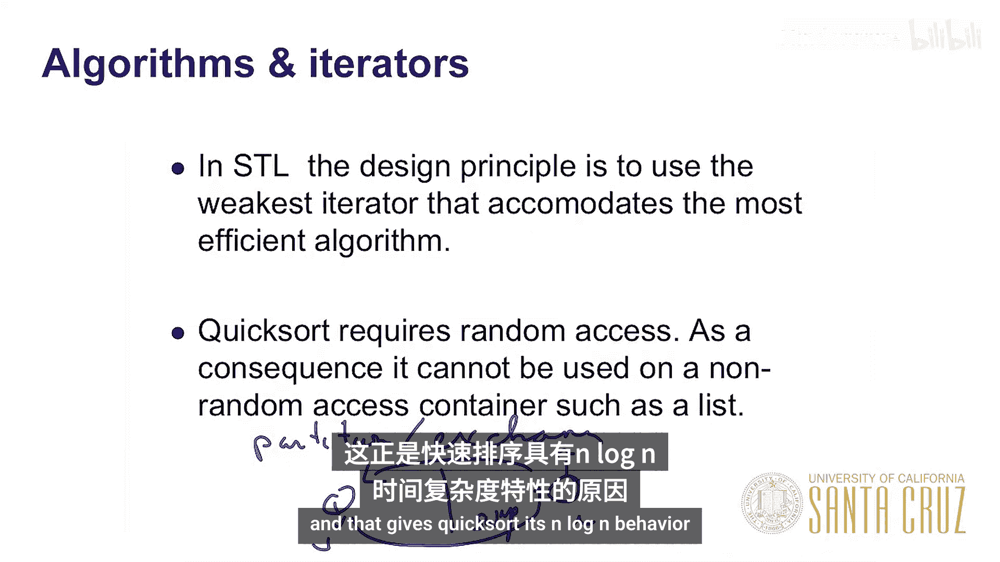
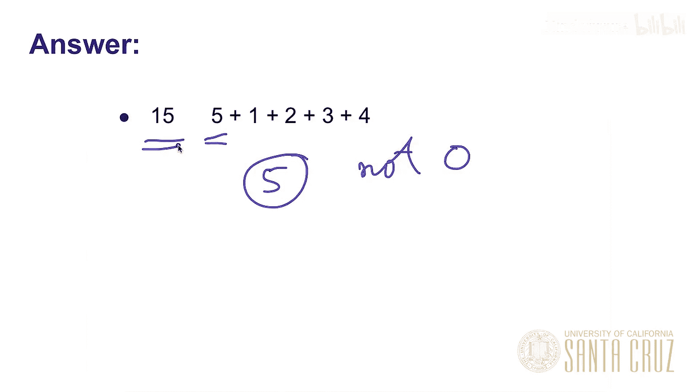

# C++编程：P45：迭代器类别

## 概述



在本节课中，我们将要学习C++标准模板库（STL）中一个核心的架构概念——迭代器类别。我们将了解迭代器的不同分类，从最弱到最强，并探讨为什么在设计算法时，应优先选择能满足算法需求的最弱迭代器类别。

## 迭代器基础与类别总览

上一节我们介绍了迭代器的基本概念。本节中我们来看看迭代器是如何被分类的。

迭代器是访问容器（如`list`、`vector`）中元素的通用方法。例如，一个典型的双向链表迭代器允许你向前（`++`）或向后（`--`）移动，并使用`begin()`和`end()`来指定一个范围。

STL将迭代器分为5个主要类别，可以按功能从强到弱排序：
*   **最强**：随机访问迭代器
*   **最弱**：输入迭代器

以下是这五个类别的简要列表：
1.  **输入迭代器**：最弱。允许单向、单次读取元素。
2.  **输出迭代器**：与输入迭代器类似，但用于单向、单次写入。
3.  **前向迭代器**：允许单向读取和写入，并且支持多次遍历容器。
4.  **双向迭代器**：在前向迭代器基础上，增加了向后移动（`--`）的能力。
5.  **随机访问迭代器**：最强。允许任意位置的跳转（如 `+ n`），是像`vector`或数组这类可索引容器的典型迭代器。

## 算法设计原则：使用最弱的迭代器



当我们设计算法时，一个重要的原则是：**使用能满足算法最高效实现的最弱迭代器类别**。

以快速排序算法为例。快速排序的核心操作是分区和交换，它需要能够快速访问任意位置的元素来进行高效的交换。这要求**随机访问**能力。

```cpp
// 伪代码示意：快速排序中的交换需要随机访问
swap(container[i], container[j]); // i和j可以是任意索引
```

如果一个容器（如`list`）不支持随机访问迭代器，那么每次交换操作的成本将变为O(n)，导致整个快速排序算法效率低下。因此，标准库中的`std::sort`算法要求随机访问迭代器。对于`list`，标准库提供了一个专门的`list::sort`成员函数，它使用不同的（效率相对较低的）算法来适应双向迭代器的特性。



这个设计原则确保了算法在尽可能多的容器类型上保持高效。

## 深入迭代器类别：输入迭代器

让我们更仔细地看看最弱的迭代器类别——输入迭代器。

输入迭代器必须支持单向顺序访问元素。它要求定义`++`运算符来推进迭代器，并允许对迭代器进行解引用（`*`）来读取它指向的元素。它通常用于表示输入流（如从文件读取数据），并且只支持单次遍历。

标准库中的`std::find`算法就是一个很好的例子。它在一个范围内线性搜索特定元素，只需要顺序查看每个元素一次，因此它完全可以基于输入迭代器来实现。

以下是使用输入迭代器的一个典型例子——`std::accumulate`算法（位于 `<numeric>` 头文件中）：

```cpp
#include <iostream>
#include <numeric>
#include <iterator>

int main() {
    // 假设文件"data.txt"中包含：6 4 -3 19
    std::ifstream data_file("data.txt");
    std::istream_iterator<int> data_begin(data_file); // 输入迭代器起点
    std::istream_iterator<int> data_end; // 输入迭代器终点（默认构造表示文件尾）

    // 使用accumulate求和，初始值为0
    int sum = std::accumulate(data_begin, data_end, 0);
    std::cout << "Sum is: " << sum << std::endl; // 输出：Sum is: 26
    return 0;
}
```

`std::accumulate` 函数遍历由输入迭代器指定的范围（从`data_begin`到`data_end`），将所有元素累加到初始值（这里是`0`）上。它只需要单向、单次遍历，因此使用输入迭代器就是最高效的选择。

它的函数签名大致如下，体现了对通用输入迭代器类型的要求：
```cpp
template< class InputIt, class T >
T accumulate( InputIt first, InputIt last, T init );
```

**小测验**：如果初始值是`5`，要累加的序列是`{1, 2, 3, 4}`，结果是多少？
> 答案是 **15**。计算过程是：5 + 1 + 2 + 3 + 4 = 15。

## 总结



本节课中我们一起学习了STL迭代器的类别体系。我们了解了从输入、输出、前向、双向到随机访问这五种迭代器类别，以及它们各自的能力。最重要的是，我们掌握了STL算法设计的核心原则：**为算法选择能满足其最高效实现的最弱迭代器类别**。这一原则保证了泛型算法既灵活又高效。理解迭代器类别有助于我们正确选择和使用STL中的算法与容器。