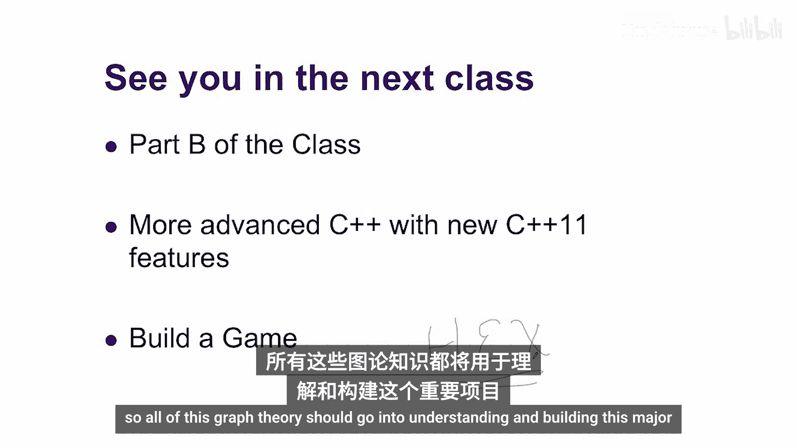

# 【加州大学】C++编程-｜-C-Plus-Plus-A-p46-P46_4-14-输出随机图_04_01_15--BV1p2ejzREUQ_p46-

Okay， let's do something a little more complicated and something in which。

We've used in our homework assignments。So。In the assignments。

 I've talked about generating a random graph。And the random graph has what's called a density and the density is roughly speaking。

How many edges per node are available。 So if I have a density of 05， density will be。Between 0 and 1。

1 would mean that we have what's called the complete graph。

 Every possible edges included in the graph。0 would mean we would have a completely disconnected graph。

 We would have nodes， but no edges， half would mean that if I had a graph which had 100 nodes on average。

There would be 50 edges per node， that would be a reasonably dense graph。For something that large。

 and it's very useful to use。Random generation techniques， because when you start applying。

Graph algorithms。To hard problems。It's hard to get real world data。At University of California。

 Santa Cruz， my colleagues have a huge project。And。Designing the。Internet。

In the sense of making internet connections reliable and optimal。And the internet has。

Hundreds of millions of nodes or maybe even billions of nodes at this point。And。

You can send packets reliably all through the internet。And there has to be some design criteria。

How is an organization going to build its own local internet or in the case of the military。

 you might have to have a dynamic net because the connections。

Are going to involve things in which there are catastrophic failures。 let's say you're a tank。

Is shot up。And it was one of your internet points， nowadays， the battlefield is electronic。

So there's just tons of research in how to create。Both static and dynamic networks that make the internet efficient and highly reliable and inexpensive。

And those characteristics are hard to come by， the data is hard to come by。

 and so you try to simulate it and frequently you simulate it with the right set of random parameters。

So here's something very basic。And it'll also show a small amount of。

Use of some of the techniques we've already talked about。

We're going to borrow stuff from the standard library。And C plus plus 11。

We might want to replace Rand。Rand is very basic。And C plus plus 11。

 one of the places where there's significant improvement is a new set of standard。

Random functions that get you all sorts of interesting characteristics。

So I hope you go and examine that。And maybe at a later time， we'll talk a little bit about that。

And this is a simple thing that。Prodes a probability。

 and you should see why it provides a probability。First off， Rand is in the int domain。

Rand Max is the largest possible value that can be generated。So this is going to be， well。

 this is unsigned。And this is the largest possible value。 So this is always going to be。

Less than one。But if it was if they both were in an in domainoma。These would always lead to zeros。

 we don't want that， so we force。That value into the double domain。

 We cast it into the double domain。 And then this becomes a mixed computation。 And then indeed。

 we get。A fractional value， which would be between zero and one。

 So that's the probability one That's the probability one something between zero and one。

Here's the density？The density we're going to get from the user。The inputed。

We want some value input put it， such as 0。5。We also want a size。So let's say this was the default。

Free。We asked for a size and this could have just as well been zero， so we're getting a new size。

 let's say we want 100。So we'd have to type that in。And now we're going to create a graph。

And we're going to use basically。A bull。Matrix。So the graph is going to have an effect。A zero。

 if there's no edge， I And J， no edge。0。Were actually false。 And if there's an edge。

 there's going to be a one I J having an edge。True。We're also going to allow colors。

that makes the problem a little more interesting。 so edges are going to be able to have colors。

 Think about your navigation computer on your car。My navigation computer allows the streets to be freeways。

Or local streets。And it allows me in computing a route to say avoid freeways。

 how does it know to avoid freeways while freeways are blue。And ordinary streets are green。

And so it's going to look at the subgraph。Namely， the subgraph。Of。Edges。

 which are only green if it wants to avoid freeways。

We call that anytime we use a random number generator， we want to。

Do something about initializing a seed to avoid routinely getting always the same behavior out of the program。

 so this is a standard practice to seed the random number generator using something from the real world which would start at a different value。

Here we construct the different components。They're basically constructing three matrices。

So this is a cost matrix like how if I and J。Heb。Coss 5， you can think of that as five miles。

 Here's a， maybe I and G。We' have the color。Bread。And this is whether I and J exist。So。

 we're building。The data structure。To let us。Represent the graph and the graph representation in this case is a matrix。

Representation， not the edgeless representation。 So for those of you who want， you can try it。

Try to do the same thing， but do it with an edge list。Here's where we create an edge。

Think of this as flipping a coin。 A coin is weighted。To give me a probability。

Between0 and1 and then test whether the probability is below the density。 So if density was one。

 all these probabilities would be less than one。But if density was down near zero。

Then the probabilities would largely be。Greater than the density。

 And so it would be a relatively sparse graph。So we're testing to see in this。

 the fact that this is symmetric means that the edges are undirected。 So we're generating undirected。

Edges。Of a particular density。And then。We're testing if the edge exists。So， this is。Bulin。

Then we do a color and a cost。We're going to have three colors， so we use the modlo operator。

And we'll get value 0，1 or 2， and those will be the equivalent of the colors。

And we'll have a cost in this case， it'll be probability 30， so times 30， so the values of the costs。

If their integer values will be between zero and。29。I don't think we can get to 30。

And then I'm going to print this to an output file。In the output file。

 you can you should try this yourself， take the code from the site and you'll see that you'll get。

A coat that has these characteristics that will have certain costs for each edge just willll check again to see that the edge is true。

And if the edge is true and those files will list the cost。And a color and will have them as output。

Okay。Okay， we're at the end of。Part a。Of this course。

I hope you've had a good time and got to really make use of C++ and enhance your programming skills。

 you've also learned how to do things with graphs and graph algorithms。

And then part B is going to be the next class， and I hope to see many of you in Part B。

 and there will be more advanced parts of C++ in Part B。

 and we'll try to see yet some newer C++ 11 features as well， and the chief work of Part B。

Is to build a game and to build a game。Game is a well known game。 that's hex。

 and the reason part A was so important to this is not only that you learn how to。

Program effectively in C plus plus。 But hex is a game that is well represented by graph theory。

 So all of this graph theory should go into understanding and building。This major project。

