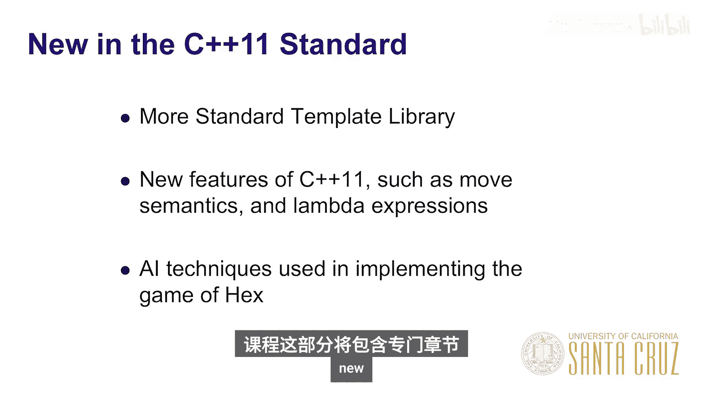
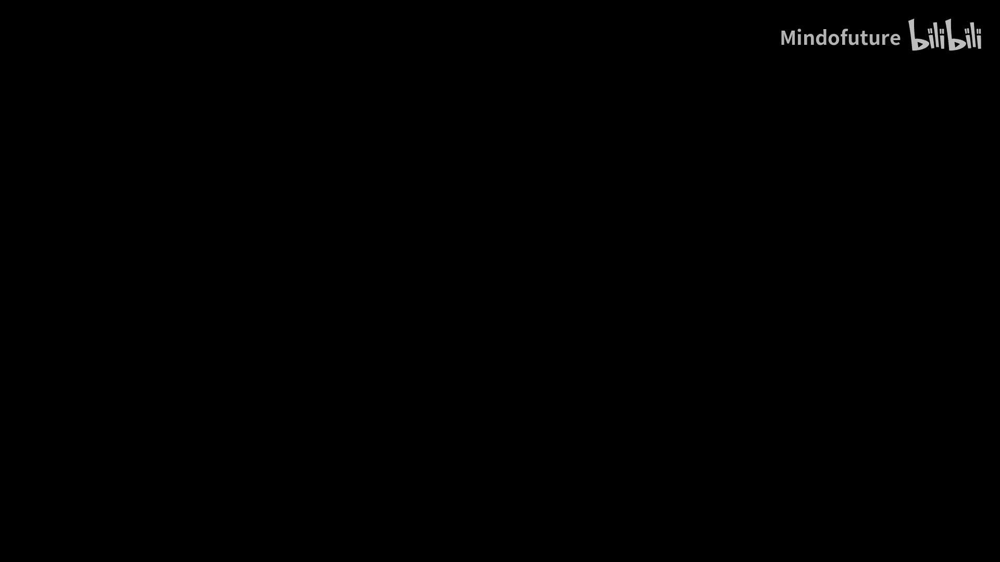

# 【加州大学】C++编程-｜-C-Plus-Plus-B-p02-P02_1-1-概述_01_03_01--BV1KseJzqEbZ_p2-

🎼嗯。🎼，🎼By。🎼そだ？Okay， today we're starting。A new emphasis， we're doing more advanced C++ programming。

If you've just begun。With these lectures， I'll expect you to have the equivalent of the background from the first four weeks。

 which gave you the basis for。Standard C++ programming， and it emphasized mostly。C plus plus。

As it's been practiced till about four or five years ago。The latest standard and C+ plus is。

C plus plus 2011， and that's going to be a feature。Of this next four weeks。

 And we're going to try and emphasize。Different elements that can be very productive for you。

 So earlier。Our students were looking at C++ largely as of 1998。

 1998 was when the Standards Committee last made big changes。

 and if you recall C++ was invented by Drn Strewstrip，And the first general release was in 1985。

So from '85 to 98， there was a fair amount of additional material。

 dramatically the material that added exceptions and templates occurred around 1990。

 and then the standard template library got built in。And that got to be standard practice。

Into the late 90s and incorporated in this 1998 standard。And that's largely what we've been using。

But there are lots of new features in C+ plus 11。That make your job easier。

And I want to emphasize them throughout。So you're going to learn a lot about the new standard。

 and we're going to start with also the standard template library。

A lot of what got done in the new standard was to make the standard template library better。

More efficient。And larger。So the initial library。A。Was deemed。An interesting start。

 but then many people added to it。As they added to it and tested it out。

 and there were very famous additional libraries like the Boos Library。

And that became common practice， the people on the Standards committee。Decided to adopt。啊。

What by now has been well tested practice， tested in some of these extensively used libraries like the Bo libraries。

 and we're going to see packages like the threading package and like the regular expression package。

 we're going to also see some new container types such as unordered maps that will benefit your professional programming。

So what have you gotten through to date and part one， you know basic C++。

You know how to code a template， you know how to use IoStam。Also。

 if you've taken the part one and done all the part one material， you have learned how to use。

And manufacture an abstract data type such as a graph， and we concentrated on graph algorithms。

 such as the minimum spanning tree algorithm。Of prim。Or crsco and the diykestra shortest path out。

And again， if you've been following this in my textbooks， roughly speaking。

 we covered material through about chapter six。With part two of this course。

We're going to learn a lot more about the standard template library。Again， libraries。are。

A tremendous convenience， they're a great reuse aid。Their。Community practice。

That professionals have put together。And if it's in the library。

 you should not be writing your own routines。It's just waste of time。啊。

Needlessly possibly introducing errors。And unless there is a crucial reason to replace some aspect of the library。

Anytime the library has what you need， the library should be your first source of where to go for code。

Some of the new features that we'll see in this part of the course。Our move semantics。

 which is a very novel idea。That's been brought into the language that allows many routines to be。

Much more efficient。 It allows copying of complicated aggregates an assignment of complicated aggregates to be highly efficient。

 And as you move to something like SDL and you move to vectors and lists and doubleended cues。

You are going to work with more sophisticated aggregates。

 and so you don't want your efficiency impacted by expensive rewriting costs。啊。

Copying costs at the machine level。Another very interesting。

Add to the language is lambmbda expressions， and for those of you who have wider experience。

In the programming language community， Labut expressions classically were first introduced in the early artificial intelligence languages。

 especially the listsp languages。Lambda expressions are a form of unnamed function。

So they allow you to just inject functions。呃。Effectively anywhere in your code and manipulate functions。

Finally。What we're going to study is the ability to build an interesting game。

The game is the game of Hex， it's a game first invented in the 1940s。

By a Dutch mathematician and reinvented。By John Nash。

The very famous Nobel Prize winning appliedlied mathematician。Who was a combinatorial mathematician。

 And Hex is a combinatorial game。So hex will use all of our understanding of graphs。

Graft theory will be very useful in building this game， as it is for many games。

 so I know a lot of you out there are very interested in building your own games。呃。

And this will give you insight into how to do that and the game。

As we go along to make it sophisticated， we will have the computer player of the game have its own artificial intelligence。

 so artificial intelligence is my own area， that's my own research area。

And I will show you how to build AI techniques that can work in almost any game in which you need some intelligence in which you want the machine。

As an intelligent opponent， we're going to have segments in this part of our course where I'm going to highlight new and C plus plus features in the standard。

Now。Again。If you have a compiler that。Users。These new features。

 you'll be able to test them such a compiler， the one I'm currently using is the latest can new compiler。

 it's 4。8。Earlier compilers had many of these features， so it's not like these features。

 all of a sudden got added in in the last year or two。They have been added in all along。

 they weren't necessarily in the standard， but there were versions of what we were doing in compilers already added in。

 especially in the Gnu compilers by 2003 and if you look at all the kinds of flags you can have with your Gnu compiler。

 you may see in your Gnu manual，What types of features can be added in？Also。

 if you have one of the newer Microsoft compilers and C++， you may have lots of these features。

In any case， if you don't have access to a relatively new compiler。

 all of our assignments and what we're learning can be done in what you might call traditional or retro C++。

 namely C++。That's been available。啊。Widely available since 1998。

 so you can avoid using the new features if it's absolutely necessary， but。As we speak。

 most compiler vendors are adding these features as fast as they can。

Making sure to test them and making sure that they are doing it in an effective way。

 so you should have wide availability。And it's too such a compiler。

