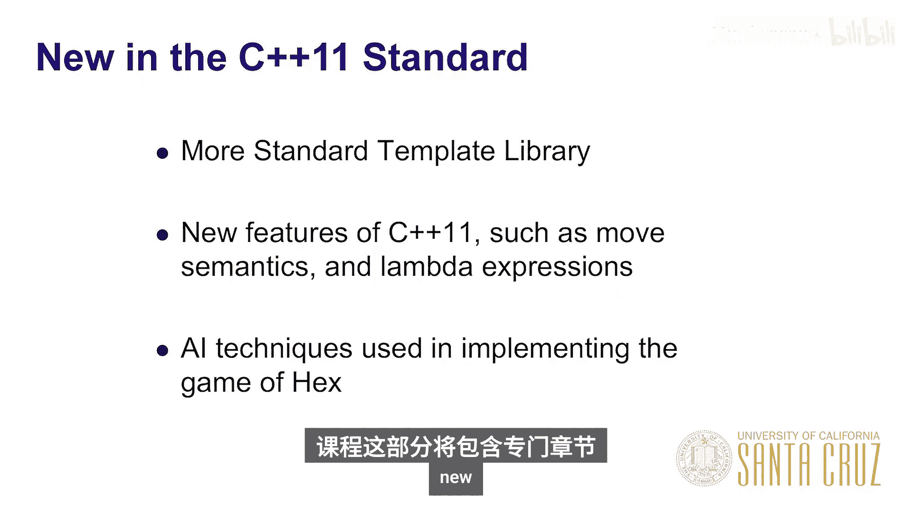

# C++编程：P02：概述

在本节课中，我们将开始学习更高级的C++编程。我们将重点介绍C++11标准引入的新特性，并深入探索标准模板库（STL）的扩展功能。如果你已经完成了前四周的基础学习，掌握了标准C++编程的核心概念，那么你已经为接下来的内容做好了准备。

## 课程背景与演进

上一节我们回顾了C++的基础，本节中我们来看看C++语言的发展历程。C++由Bjarne Stroustrup博士发明，并于1985年首次发布。从1985年到1998年，语言增加了大量新内容，例如在1990年左右引入了异常处理和模板。随后，标准模板库（STL）被构建并纳入实践，最终整合到了1998年的标准中。我们之前的学习主要基于这个1998年的标准。

然而，C++11标准带来了许多使编程更高效的新特性。本课程将重点介绍这些新特性，并同时深入讲解标准模板库。新标准的许多工作正是为了使STL更高效、功能更强大。

## 已掌握知识与本课程目标

在课程的第一部分，你已经学会了：
*   基本的C++语法。
*   如何编写模板。
*   如何使用`iostream`进行输入输出。
*   如何创建和使用抽象数据类型（例如图）。
*   一些图算法，如Prim或Kruskal的最小生成树算法，以及Dijkstra的最短路径算法。

如果你跟随教材学习，大致相当于完成了前六章的内容。

在课程的第二部分，我们将更深入地学习标准模板库。库是极大的便利，是优秀的代码复用工具，也是专业社区的实践结晶。**如果库中已有你需要的功能，就不应该自己编写**，这既能节省时间，也能避免不必要的错误。除非有至关重要的理由需要替换库的某些部分，否则库应该是你寻找代码的首选来源。

## C++11核心新特性介绍

以下是本课程将涵盖的一些C++11核心新特性：

**移动语义**
这是一种新颖的概念，允许许多例程变得更加高效。它使得复杂聚合体的复制和赋值操作开销极低。当你使用STL中的`vector`、`list`、`deque`等复杂数据结构时，移动语义可以避免昂贵的复制成本对程序效率产生影响。

**Lambda表达式**
Lambda表达式是一种未命名函数的形式。它允许你在代码中任何地方“注入”并操作函数，为编程带来了极大的灵活性。

## 实践项目：Hex游戏

最后，我们将通过构建一个有趣的游戏——Hex，来综合运用所学知识。Hex游戏最初由一位丹麦数学家于20世纪40年代发明，后来由著名的诺贝尔奖得主、应用数学家约翰·纳什重新发现。这是一个组合游戏。

构建Hex游戏将充分利用我们对图论的理解，图论对于构建许多游戏都非常有用。随着项目的推进，我们将为游戏的电脑玩家添加人工智能（AI），使其成为一个智能对手。人工智能是我的研究领域，我将向你展示如何构建可以应用于几乎所有需要智能对手的游戏中的AI技术。

## 编译器支持说明

为了测试这些新特性，你需要一个支持C++11的编译器。我目前使用的是最新版本的GNU编译器（如g++ 4.8或更高版本）。实际上，许多新特性并非在最近一两年才突然加入，GNU编译器早在2003年左右就开始逐步支持其中的许多功能。你可以查阅GNU手册，了解如何通过编译标志启用这些特性。较新版本的Microsoft Visual C++编译器也支持大部分特性。

如果你的编译器暂时不完全支持C++11，也无需担心。我们所有的作业和学习内容都可以使用所谓的“传统”或“复古”C++（即1998年以来广泛可用的C++）来完成。当然，目前大多数编译器厂商都在尽快添加并测试这些新特性，因此你应该能够广泛获得支持。

---

本节课中，我们一起学习了C++11新标准课程的概述，回顾了C++的发展历史，明确了本课程的学习目标，并简要介绍了移动语义、Lambda表达式等核心新特性以及最终的Hex游戏实践项目。接下来，我们将逐步深入这些主题。