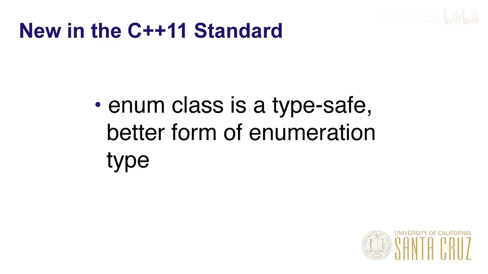
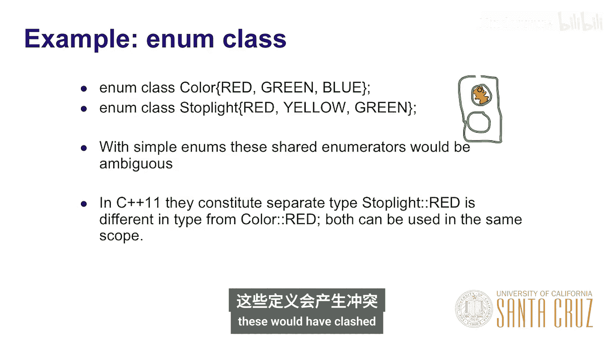
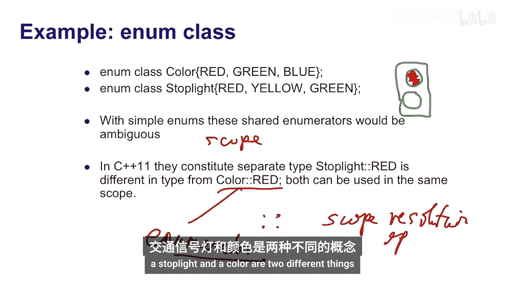
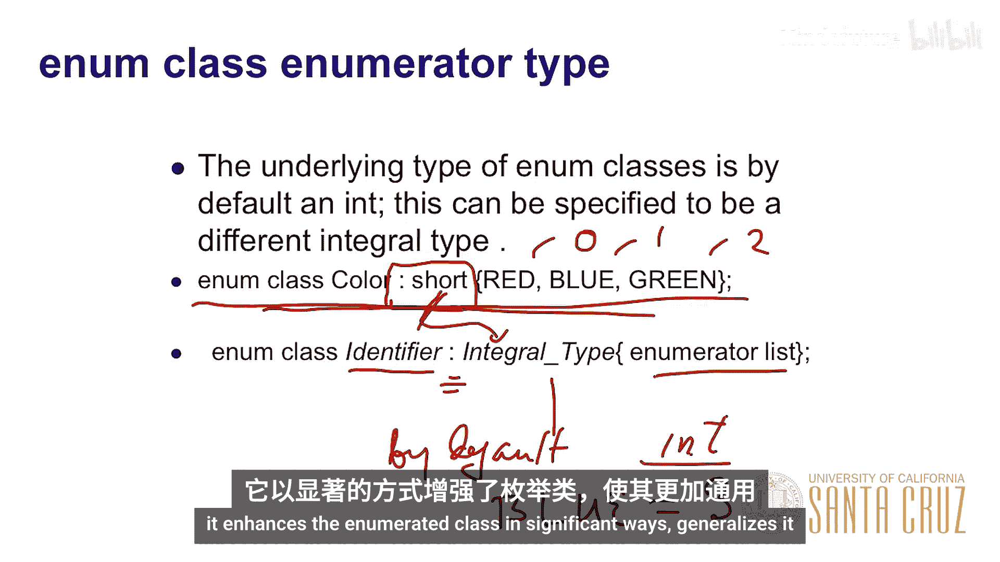
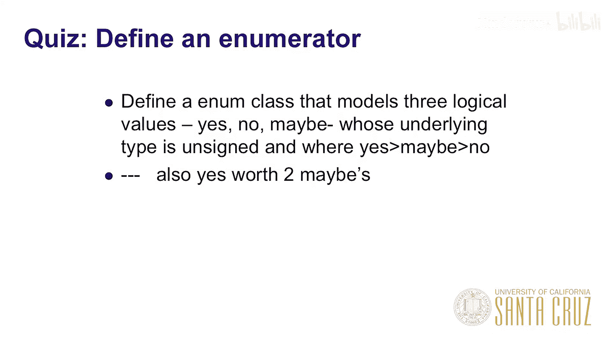
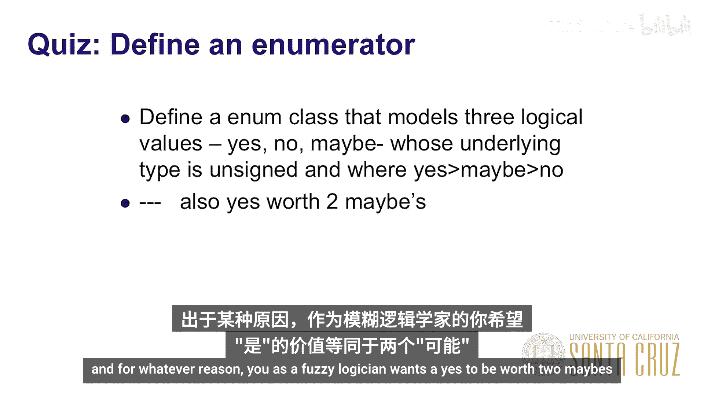
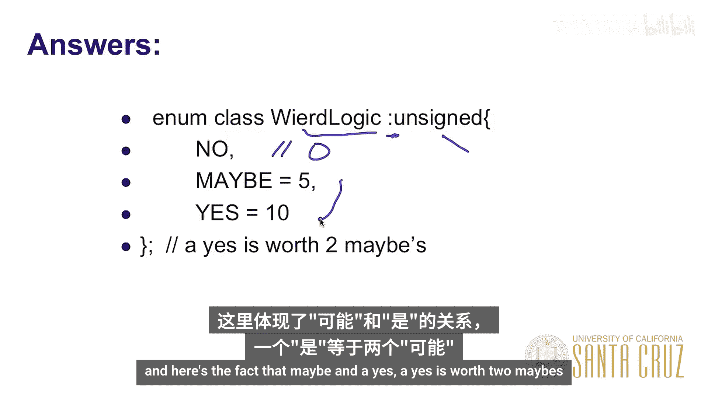

# 【加州大学】C++编程-｜-C-Plus-Plus-B-p03-P03_1-2-C++11新特性_01_03_02--BV1KseJzqEbZ_p3-

So what is a feature that we're going to see that a first feature I'm going to talk about that will'll see that's better than an existing feature。

 and one is the anum class。And we'll see why in the noon class。

Is a better form of enumeration data structure than the old ordinary aumum。

 So the old ordinary enumum can be used pretty much for anything an anumum class gets used。

 but the enum class。

Has。Critical advantages which include， especially type safety。Here's an example。Of an a no class。

So I have one class I want to call color， let's say I'm writing a drawing program。

And I want a color palette。And notice， I have red， green and blue。But I also， for some reason。

 need a class for stop lights， and stop lights are red， yellow and green。So。Ass my stoplight class？

And I wanted to be able to have colors like red。And you can see that there are two enumerators。Red。

That are occurring in both classes。 And if you had defined them in the old style， simple en nos。

These would have clashed， they would have led to a compiler error because they would have been ambiguous if they were in the same。

Context that they were in the same。Block or scope。So they couldn't have shared the same scope。

Now they constitute in C++ 11。Separate types， distinct separate types。 So one is stop light。

 and we use。A notation， don't forget。This is our scope resolution operator。Generally。

 we've used that with class and here。These enumerators are two different types。

And they can be used in the same scope。Because they don't conflict， they're actually separate types。

 So you get a fair amount of type safety， a stop light and a color are two different things。

Now， just to give you a little more syntax。Typically， we'll write such a thing this way。

And recall that means this is typically zero， that's one， that's two。But。Here。Oh， excuse me。

 there here's the new type。 Here's the additional syntax I want to show you。I also。

Am allowed to specify an integral type by default。It's going to be an ordinary int。

 as it is with the annus。But I can make it anything I want it to be as long as integral。

 integrals include things like shorts and onside and indeed longs。

And then we would have our numerator list， and， of course。In the enumerator list。

 we can also do things。Like。Specify。Some particular value as well in the sequence。So。

This style of enumerated type。Es。Importantly， it enhances the enumerated class in significant ways。

Generalizes。Okay。Take a little quiz。

Theine and enumerated class that models three logical values。Yes， no， and maybe。

You might think about something in fuzzy logic， whose underlying type is unsigned。

And where yes is greater than maybe is greater than no。And for whatever reason， you。

 as a fuzzy logician， wants a yes to be worth two maybe。

A burden a hand worth two in the bush。So take a second。Here's our answer。And we follow the syntax。

So we have the enumerator class name， we have the colon， we said we wanted to select uns signed。

No is automatically going to be by default0。And here's the fact that maybe， and a yes。

 a yes is worth two maybes。

So if you've been using enums in your programming and you have this available to you。

 I want you to shift to enumerated classes， just better practice now。

