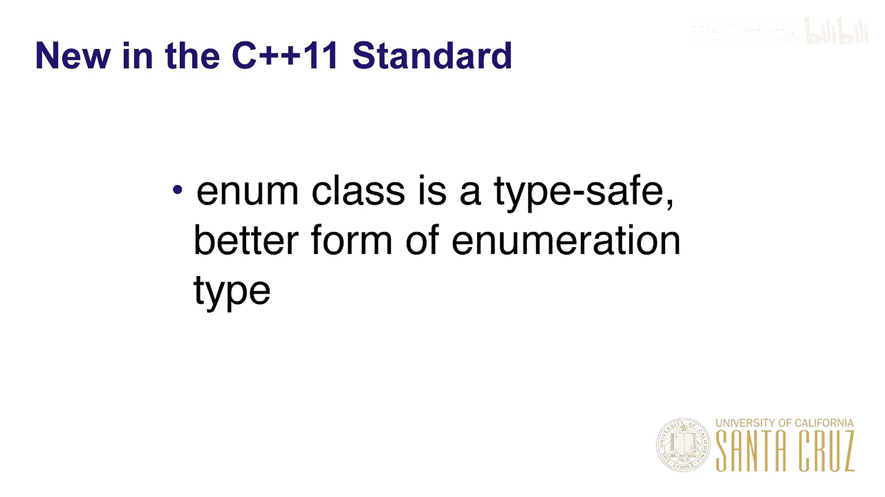
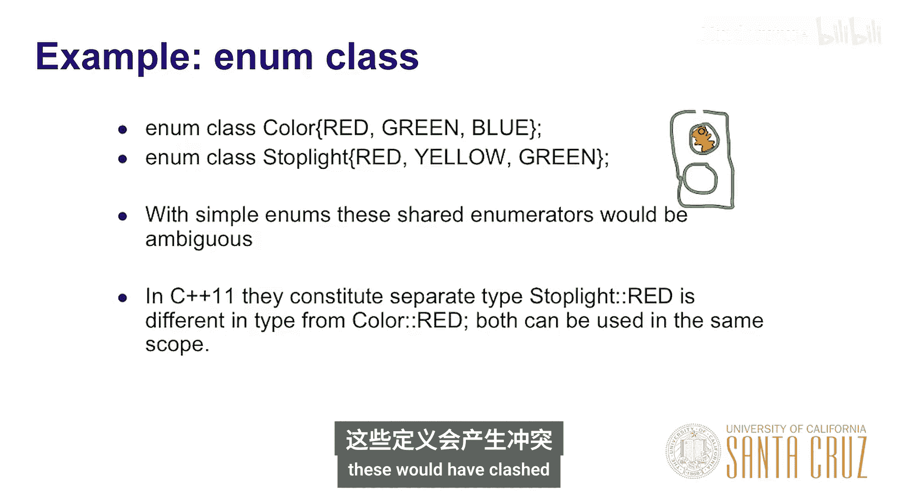
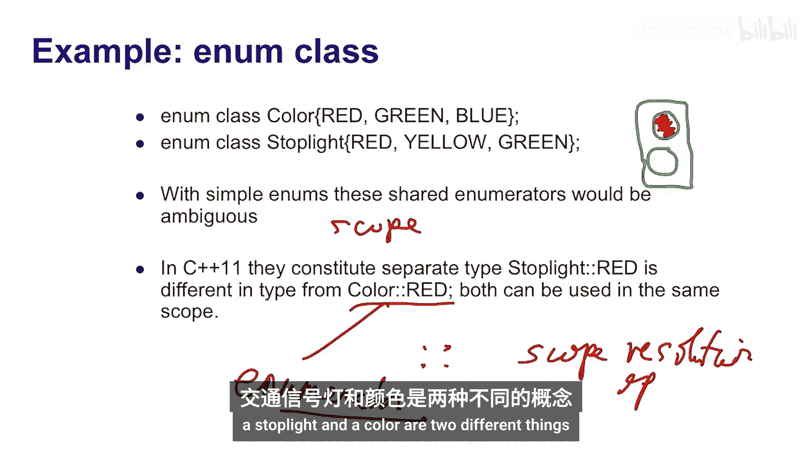
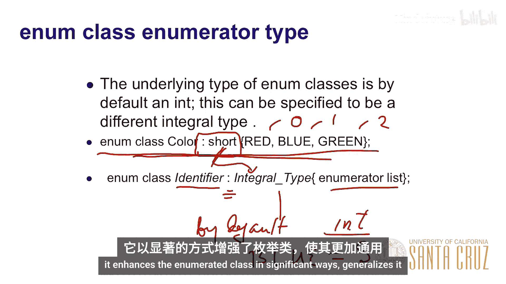
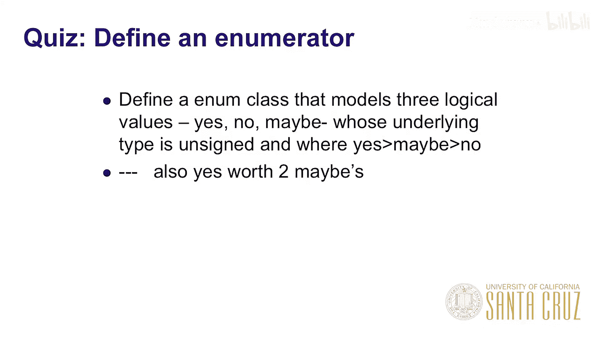
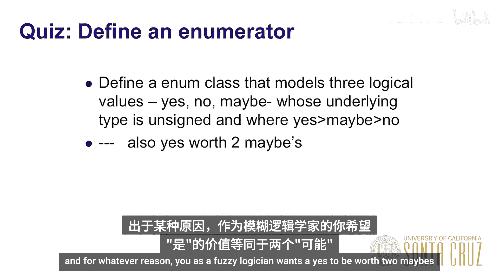
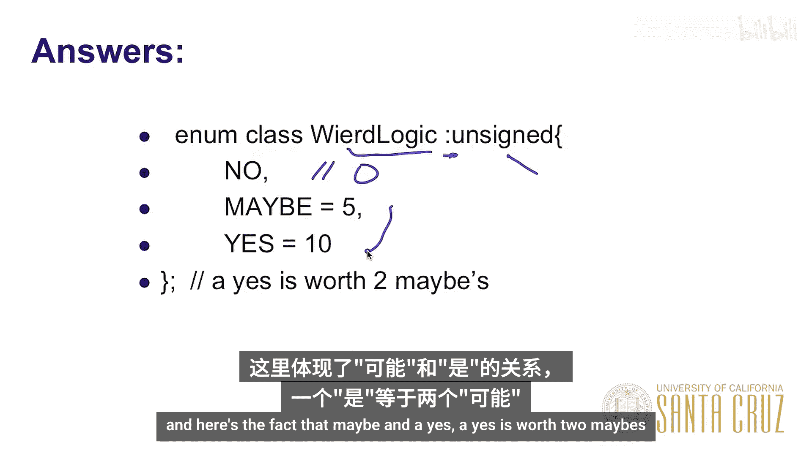

# C++编程：P03_1-2：C++11新特性之枚举类 🆕

在本节课中，我们将要学习C++11引入的一个重要新特性：**枚举类**。我们将了解它如何改进传统的枚举类型，并带来更强的类型安全性。

## 什么是枚举类？



上一节我们介绍了C++11带来的新特性，本节中我们来看看其中一个具体特性：**枚举类**。枚举类是一种比传统普通枚举更好的枚举数据结构形式。

传统普通枚举可以用于枚举类能使用的几乎所有场景，但枚举类具有关键优势，特别是**类型安全性**。

## 枚举类的优势与示例

以下是枚举类的一个示例。假设我正在编写一个绘图程序，需要一个颜色调色板。

```cpp
enum class Color {
    red,
    green,
    blue
};
```

同时，由于某些原因，我还需要一个表示交通信号灯的类，信号灯有红、黄、绿三种状态。

```cpp
enum class Stoplight {
    red,
    yellow,
    green
};
```



可以看到，两个枚举类中都出现了名为 `red` 的枚举成员。如果使用旧式的简单枚举来定义它们，这些同名成员会发生冲突，导致编译器错误，因为如果它们处于同一个块或作用域中，就会产生歧义。

在C++11中，它们构成了**独立的、不同的类型**。我们使用作用域解析运算符 `::` 来访问它们。

```cpp
Color myColor = Color::red;
Stoplight myLight = Stoplight::red;
```

这两个枚举成员可以在同一作用域中使用，因为它们不会冲突，实际上是独立的类型。因此，你获得了相当程度的类型安全性，`Stoplight` 和 `Color` 是两种不同的东西。



## 枚举类的语法细节

接下来，我们看看更多的语法细节。通常，我们会这样编写枚举类。

```cpp
enum class MyEnum {
    value1, // 默认为0
    value2, // 默认为1
    value3  // 默认为2
};
```

此外，我还被允许指定一个底层整型类型。默认情况下，它和普通枚举一样是 `int`，但我可以将其指定为任何整型，包括 `short`、`unsigned int`、`long` 等。

```cpp
enum class MyEnum : unsigned short {
    value1,
    value2,
    value3
};
```

在枚举成员列表中，我们也可以为序列中的某些特定成员赋值。

```cpp
enum class MyEnum : int {
    value1 = 10,
    value2, // 自动为11
    value3 = 20
};
```



这种枚举类型风格显著地增强和泛化了枚举类的功能。



## 小测验

现在，我们来完成一个小测验。

定义一个枚举类，用于建模三个逻辑值：是、否、可能。你可以联想到模糊逻辑中的概念。其底层类型应为 `unsigned int`，并且要求“是”的值大于“可能”，“可能”的值大于“否”。由于某种原因，你作为模糊逻辑学家，希望“是”的值是“可能”的两倍。



请花一点时间思考。

以下是答案，我们遵循语法规则。

```cpp
enum class FuzzyLogic : unsigned int {
    no = 0,      // 默认即为0
    maybe = 1,   // “可能”大于“否”
    yes = 2      // “是”的值是“可能”的两倍
};
```



## 总结

本节课中我们一起学习了C++11的枚举类。如果你一直在编程中使用枚举，并且可以使用这个特性，建议你转向使用枚举类，这是更好的编程实践。枚举类通过提供独立的类型和作用域，有效避免了命名冲突，并增强了代码的类型安全性。