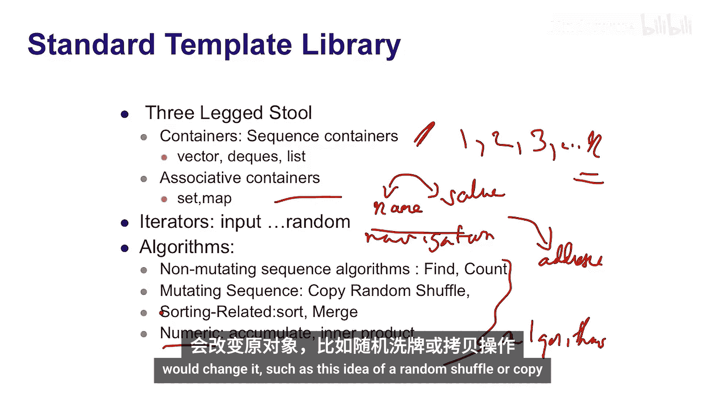
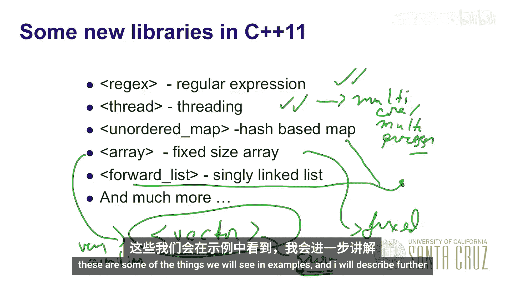
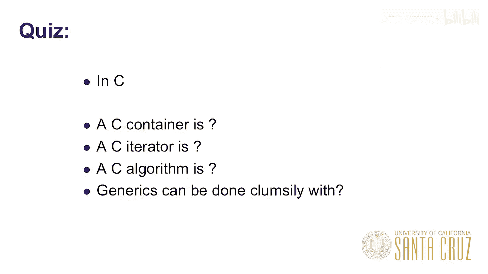
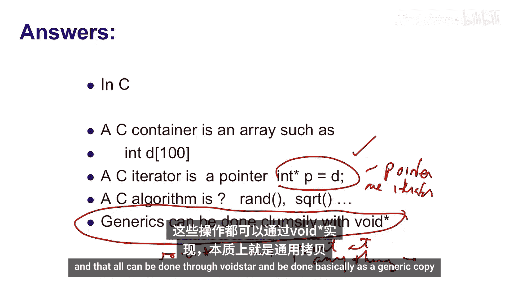

# 【加州大学】C++编程-｜-C-Plus-Plus-B-p04-P04_1-3-标准模板库_01_03_03--BV1KseJzqEbZ_p4-

Let's turn to the standard template library as a main topic of。Today's discussion。

The standard template library， the analogy I' like to use is。

Built like a three legged stool and got three legs to it。Those three legs are containers。

And the containers are of two kinds， ones that involve sequences。So you can say that there is。

An enment。The other kind which are associative。So you can't think of them as having an element。

 but you can think of them as having something a relation between what you use to look them up。

Like a name。And a value， you have some kind of relation， a built in relation。

Those are two major classes of containers。And then， we have。F kinds of iterators。

 These are pointers or cursors。Conceptually， they are these pointers or addresses。

They're a way of navigation， theyre our navigation tool。And then finally， what do we produce。

 how are these things to be used， and we have many， many useful。Algorithms。

And that's our three legs of the stool。And we can， because it's。Apartmentalized library。

 we tend to have things like numeric algorithms， sorting related algorithms such as sort and merge。

And we have things that don't mutate the sequences and things that mutate the sequences。

 non mutating means。The algorithm when applied to something， doesn't change that。

As opposed to a mutating algorithm which when applied to something like a vector would change it。

 such as this idea of a random shuffle or copy。

Okay。So。Here are some things that are new。I will talk about them over the next set of sessions。

Some are very complex， we won't be able to in this kind of basic course to fully explore much of this。

 but by giving you a roadmap。And if you have a need for it。

 libraries are way too big to go into in detail， and they have quite an extensive amount of documentation。

嗯。So it's really what you need。How to understand it and then how to look it up to make use of it。

So here are some of the things。That have been placed into the standard now based on existing practice。

Regular expressions。 Well， there have been regular expression packages in Uniunuchs and languages for quite a while。

 Pearl， for example， is a language that has a lot of regular expression built into its use。

And now through this standard library， RedX gets you to examine。

Typically strings and see if they conform form to a particular syntax。Threading。

So we're in the age of multi chos。And multiprocessors。

And we want to be able to parallelize our programming to be more effective and we now have a basic thread library now that's not the only library that gets involved in concurrency。

 the other libraries， but I won't be able to get into them in detail， for example。

 libraries that allow for atomic operations，Are available as well in the standard。

We have unordered maps and unordered sets added to SDL， so the ordinary map。

An STL was based on a red black tree， and a red black tree has basic operations that frequently require log N operations。

To work with。A very good hash lets you do very similar things。Assoocciiateative arrays maps。

But Jewsism and。Constant time。 order one time。So it can be far more efficient than people started using hash based。

Libraries quite a bit ago， but now they've been standardized。Recall that。The 90%。

Rule that I've talked about frequently。The one class you should really the one standard template。

Class that you should really get used to using as vector。It buys you all sorts of value。

But in some situations， that can be specialized to what is now called an array vector。Can be。

Can grow in size。This is fixed， though they share a there's a lot of commonality between array and vector。

Very similar。But array。Has as a part of its definition， a size。Again。The original list in。

STL was a doubly linked list so you could go previous or next。But that required some extra space。

And so what was added was a pure singly linked list， a forward list。

A ton more exist in STL that these are some of the things we will see in examples and I will describe further。

Okay， let's take another brief quiz。Think about your C experience。

 all of you are experienced C programmers， that's why you're in this course。

What would be a container and sea？What would be a iterator in C？What would be an algorithm。

 a standard algorithm at C？Can you name those？And here's a little more advanced question。

How can you do generic coding and C。Or can you。

Okay， everybody out there should have gotten。The fact that these are standard arrays and C。

And a raise and sea are really pointers and a way to manipulate or search through such things is to have pointer declarations。

So pointers are cursors。xii。And there are a host of standard C algorithms， we've already used them。

 we use them even the C++ community， so mathematically you can get the C library and find square root。

Or you can have a pseudo random number generator produce random number integers using calling RAN。

And then this is the more advanced question。There's the special pointer type for its star。

That allows you to point at anything。And if you're careful and really know how to do advanced C code。

 you can use that to produce things like a generic mem copy， so there is in the standard library。

 a mem copy where you copy one set of things from memory to another set and that all can be done through voice star and be done that basically as a generic copy。

