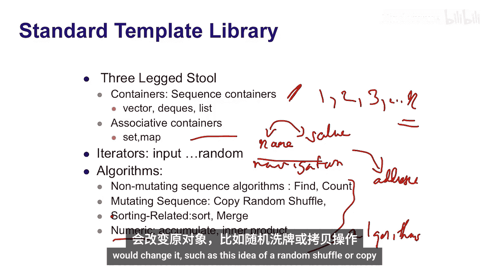
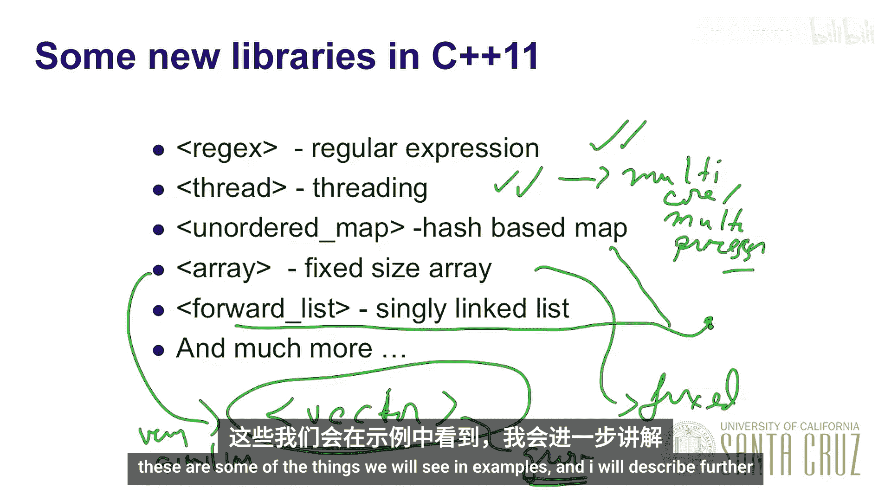
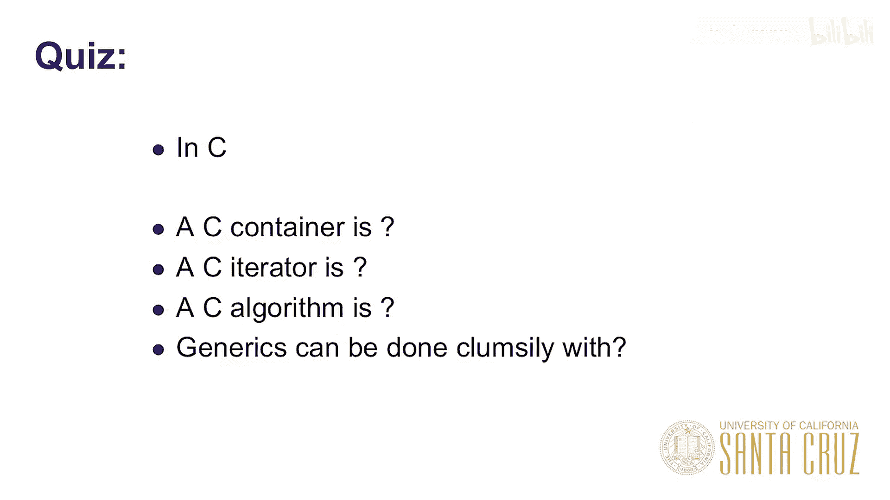
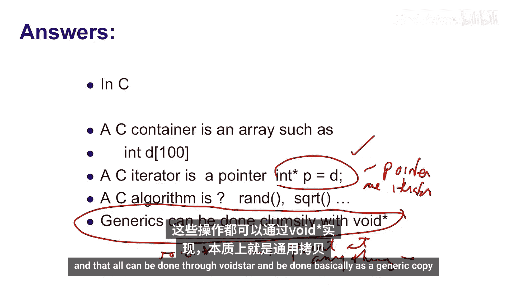

# C++编程：P04：标准模板库概述 🏛️

在本节课中，我们将要学习C++标准模板库（STL）的核心概念和基本结构。STL是C++标准库中一个功能强大且重要的组成部分，它提供了一系列可复用的通用组件，极大地简化了编程工作。

## 标准模板库的三条腿 🪑

标准模板库的结构可以类比为一个三条腿的凳子，它由三个核心部分组成。这三个部分是**容器**、**迭代器**和**算法**。它们相互独立又紧密协作，共同构成了STL的基石。

### 容器 📦

容器是用于存储和管理数据的对象。它们主要分为两大类。

以下是两种主要的容器类型：

*   **序列容器**：这类容器中的元素有明确的顺序。你可以说容器中“有一个元素”。例如 `vector` 和 `list`。
*   **关联容器**：这类容器不强调元素的顺序，而是建立了一种查找关系。你可以通过一个键（如名字）来查找对应的值。例如 `map` 和 `set`。

### 迭代器 👉

迭代器是STL中的导航工具。它们类似于指针或游标，为算法访问容器中的元素提供了统一的方法。

以下是迭代器的核心概念：

*   它们是指针或地址的概念性抽象。
*   它们是遍历容器元素的导航工具。

### 算法 ⚙️

算法是作用于容器上的一系列操作函数。STL提供了大量现成的、高效的通用算法。

由于STL是一个模块化的库，算法也进行了分类。以下是主要的算法类别：

*   **数值算法**：例如 `accumulate`（累加）。
*   **排序相关算法**：例如 `sort`（排序）和 `merge`（合并）。
*   **非修改性算法**：这类算法在应用于容器时，不会改变容器本身的内容，例如 `find`（查找）。
*   **修改性算法**：这类算法会改变容器的内容，例如 `random_shuffle`（随机打乱）或 `copy`（复制）。

---

上一节我们介绍了STL的三大核心组件，本节中我们来看看C++11/14标准为STL带来的一些重要新特性。

## STL的新增内容 🆕

接下来的课程中，我会讨论这些新内容。其中一些非常复杂，在这个基础课程中我们无法深入探讨所有细节，但通过提供一个路线图，当你需要时，可以知道如何去查找和使用。STL库非常庞大，有大量的文档，关键在于理解其基本概念，然后根据需求去查阅和使用。

以下是基于现有实践被纳入C++标准的一些新内容：

*   **正则表达式**：正则表达式在Unix和许多语言（如Perl）中已存在很久。现在通过标准库，`regex` 允许你检查字符串是否符合特定的语法模式。
*   **多线程**：我们处于多核和多处理器的时代。为了更高效地并行化程序，C++现在提供了一个基础的线程库。当然，这不是并发编程涉及的唯一库，例如还有支持原子操作的库，但本课程无法详细展开。
*   **无序容器**：`unordered_map` 和 `unordered_set` 被添加到STL中。普通的STL `map` 基于红黑树实现，其基本操作通常需要 **O(log N)** 的时间复杂度。而一个优秀的哈希表可以实现类似的关联数组（映射）功能，但能在 **O(1)** 的常数时间内完成，效率更高。虽然哈希库早已被广泛使用，但现在它们已被标准化。
*   **数组容器**：回想一下我经常提到的“90%规则”，即你最应该习惯使用的标准模板类是 `vector`。但在某些情况下，可以特化使用现在称为 `array` 的容器。`vector` 可以动态增长大小，而 `array` 的大小是固定的。不过，`array` 和 `vector` 之间有很多共同点，非常相似。但 `array` 的定义中包含了一个固定的大小。
*   **单向链表**：STL中原始的 `list` 是一个双向链表，可以向前或向后遍历，但这需要额外的存储空间。因此，新增了一个纯粹的单向链表 `forward_list`。

STL中还存在大量其他内容，我们将在示例中看到其中一些，并做进一步描述。

---

了解了STL的现代扩展后，让我们联系一下C语言的基础，看看其中的对应概念。

## 与C语言的对比 🤔

思考一下你的C语言经验。你们都是经验丰富的C程序员，这正是你们参加本课程的原因。

在C语言中，什么是容器？什么是迭代器？什么是标准算法？这里还有一个更高级的问题：在C语言中如何实现泛型编程？或者，可以实现吗？

以下是这些问题的答案：

*   **C语言中的容器**：是标准的数组。C语言中的数组本质上是指针。
*   **C语言中的迭代器**：是指针。操纵或遍历数组的方式就是使用指针声明，因此指针就是游标。
*   **C语言中的标准算法**：有一系列标准的C算法，我们甚至C++社区也一直在使用它们。例如，你可以使用C库中的 `sqrt` 函数求平方根，或者使用伪随机数生成器 `rand` 来产生随机整数。
*   **C语言中的泛型编程**：这属于更高级的问题。C语言中有特殊的指针类型 `void*`，它可以指向任何类型的数据。如果你足够小心并且真正懂得如何编写高级C代码，你可以用它来实现类似泛型 `memcpy` 的功能。标准库中确实有 `memcpy` 函数，它将内存中的一块数据复制到另一块，这都可以通过 `void*` 来完成，基本上实现了一种泛型的复制。

---

本节课中我们一起学习了C++标准模板库的核心架构，包括容器、迭代器和算法这“三条腿”。我们还简要了解了STL在现代C++标准中的一些重要扩展，如无序容器、多线程支持和正则表达式。最后，我们通过对比C语言中的类似概念，加深了对STL抽象和便利性的理解。掌握这些基本概念是有效使用STL强大功能的第一步。