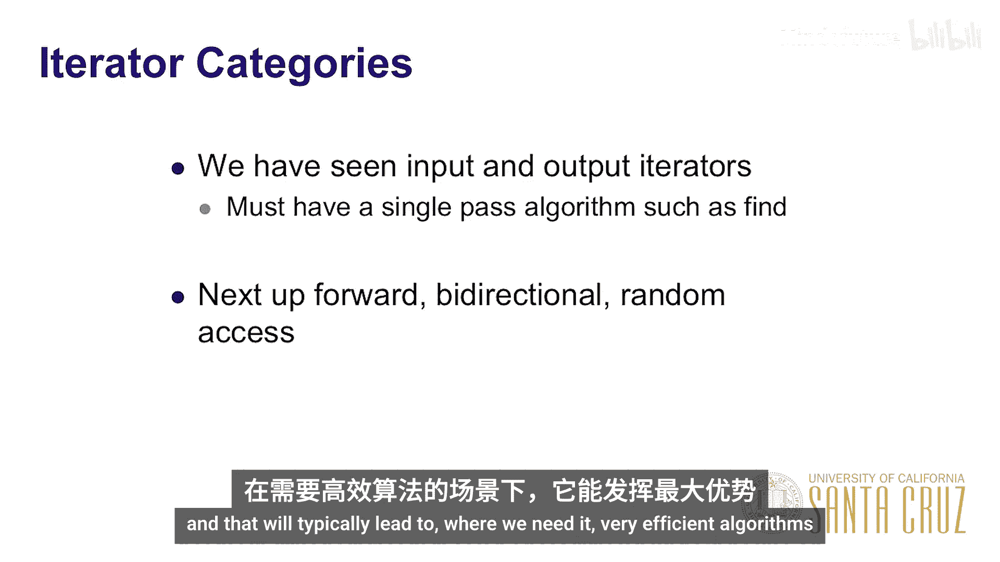
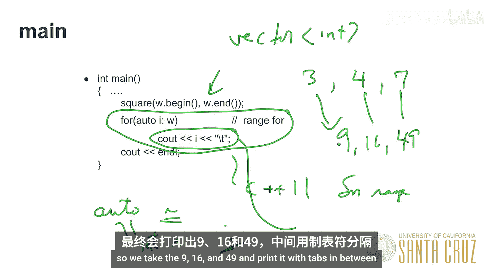

# 【加州大学】C++编程-｜-C-Plus-Plus-B-p05-P05_1-4-迭代器类别_01_04_01--BV1KseJzqEbZ_p5-

So iterators in C plus plus we've seen that already。 There are five categories。

 we've already seen examples with input and output iterators。

 the characteristic of the two weakest iterator categories are they're generally。Single path。

 they have to be single pass algorithm。 And such a single pass algorithm is， for example， a fine。

 So let's say I want to find a particular value。 Let's say I want to find a value 6。

 sitting in some vector。Well， I just go through it once and only once I start at the beginning and keep searching till the end。

 And if I find6， I can stop。 So that's a single pass algorithm。

But next up are going to be three more sophisticated categories， so they're stronger。

So weakest the strongest input to random access， and the stronger ones are going to be forward。

 and forward， we can go forward in the sequence or in the container。

But we can do multipas algorithms so we can go it over and over again。By directional。

 we can go both forward and backward。 And then finally， random access。

 We can go anywhere in the container。In constant time。That's our strongest。

 and that will typically lead to where we needed very efficient algorithms because clearly to be able to do random access。

Avos needing to search sequentially， which is for n elements on average， an order n computation。

So forward。And we don't mean a basketball forward， we mean an iterator forward。

And you can think of things that are iterators， I always love this Esher staircase。

 things that are just circling around， Of course this is an infinite staircase based on an optical illusion。

 Esher is just。Really， for self referentiality and interesting physical descriptions。

 hes just a marvelous painter。So let's see how we would use a forward iterator。

The kinds of operations we have a search forward， one by one。An operator that needs to be。

Deineed for it。Is。The plus plus operator。 So you can think of going forward， advancing the iterator。

 So typically you would see。B， plus plus。In some of the code， meaning get the next element。

We also need the dereencing in our operators。And such iterators can be。

Compared for equality or inequality。And operations can involve copy construction as well。

A canonical algorithm。Using this。Is the SL the standard template library。Replace the algorithm。

And here's what replay looks like。And what I want you to get out of this is。

Because we're not going to describe everything in this library。

 I mean that's really the point of a reference book you could get， for example， beyond Strstrs。

New edition edition4， which has。Vuluminous description。Of libraries。Of what's in the language。

 that book， I believe that's over 1300 pages long。And， you know。

 you're not going to remember everything。 You're just going to remember things that are extremely useful。

 but you need to know how to。Look stuff up and make sense out of it。So in this slide。

 we see that we have a form of the replace algorithm。Has four parameters， we have。

As is iconic in the standard template library， when we're processing sequential containers。

 we have a。First to last iterator so that we can march across。Our container in a forward direction。

 and then we have the parameters that we're going to use in the algorithm。

 which is that we're going to replace occurrences of x by occurrences of y。

 and you can see that the order of doing this algorithm is going to be。呃。

The time it takes to march across。The N elements。So it's going to be。Linear in this case。

In the size of the container。And we only need a forward iterator because we don't need any reason to。

Randomly。Look at elements or to go backwards。And this is quite a traditional algorithm。

Very efficient。呃。And， again。ATypical of a whole category of。Algorithms that you would find in STL？

What is the strength of iterator？That allows you to write this algorithm as efficiently as possible again。

Not only will you need that to understand SDL， but you'll need that to write code like SDL。

 So some of your professionals will also want to follow。Contemporary practice。

 which is very well understood among the professionals who use or implement STL。

And if they want to add stuff that isn't already in STL and as STL like。

 they have to follow the STL design notions。So you typically see an itererate range first and last。

 again in most instances。You would find these by using something like begin。And something like end。

To get those values。And in this case， there are two constant values。呃。

You're replacing called by reference， you're replacing x with a Y。And they're called by reference。

Because you want efficient， they want function call to be efficient。

So the algorithm is going to replace occurrences of x by y throughout whatever that specified range is。

 so that's also what you might call a mutating mutating sequence algorithm and this is canonical it's sort of the very typical one for forward iterator so you need to go forward and you need to be able to do this kind of replacement。

It's not merely a scanning algorithm。Here's an example using these ideas。Again， I have to。

I have to include all my libraries。I don't just throw everything in。 I would make the code too large。

 so I pick things that I'm going to use。 in this case， I want to use some streams。

 I need particular iterators and vectors。And here's an algorithm in which I have developed something that。

Is going to make use of forward iterators。I have a force statement。So。As long as。

First is not equal to last， I pass in first。I ought increment first。 Again， this is。Enioiomatic。

And here， I dereence the element first。Multiply it。 so I get it square。

And that gets returned to the element。 So each element in place is mutated to be a square。

So here we're using this four iterator algorithm square， as we say。

 what it did is it takes all the existing elements， so if there were elements like three，4 and 7。

They would end up getting to be 9。1649。And then here for those who haven't seen this before。

 this is the new C+ plus 11。For a range statement。And it uses the new form of auto， so it says。

Whatever W was。Provide an appropriate type for eye。So， if。W is storing that W is a vector event。

You assume it is。That I is。In this case， just。And I。And then Col says， that's going to。

Operate over the range of this container。 W。 So it's literally going to operate from W dot begin to end。

And in each case。In that iteration， it's going to do this operation。 So it's going to take。W。A begin。

Print out its value。And then， a tab。Then， pinned out。The next value in turn， so it would take the 9。

 16 and 49 and print it with tabs in between。

