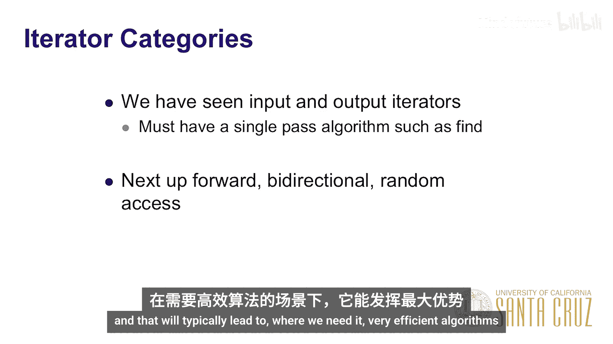
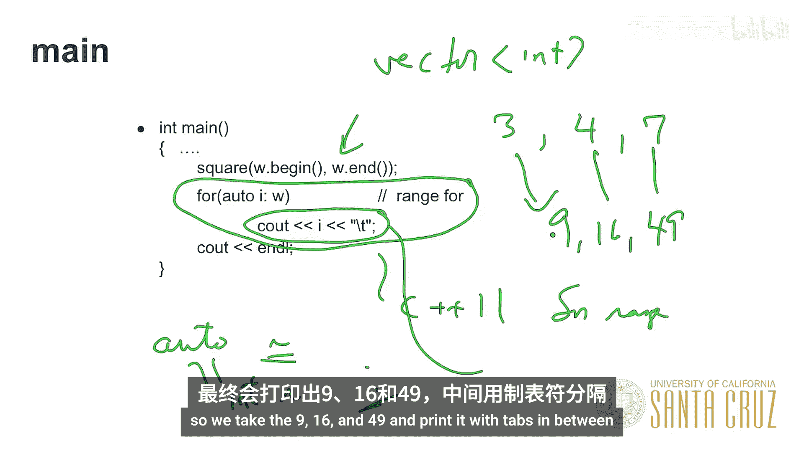

# C++编程：P05：迭代器类别

## 概述

在本节课中，我们将要学习C++中迭代器的不同类别。我们已经知道迭代器是访问容器元素的重要工具，但并非所有迭代器都拥有相同的能力。理解迭代器的类别对于高效地使用标准模板库（STL）算法和编写STL风格的代码至关重要。我们将从最基础的类别开始，逐步介绍更强大的迭代器类型，并了解它们各自适用的场景。

## 迭代器类别概览

C++中的迭代器分为五个主要类别。我们已经接触过输入和输出迭代器，它们是能力最弱的类别。

输入和输出迭代器的特点是它们通常只支持**单次遍历**算法。一个典型的单次遍历算法是`find`。例如，如果我想在一个`vector`中查找特定的值（比如6），我会从容器起始处开始，顺序搜索直到末尾，一旦找到6就可以停止。这个过程只遍历容器一次。



接下来，我们将介绍三种更强大、功能更丰富的迭代器类别。从最弱到最强，它们分别是：输入迭代器、输出迭代器、前向迭代器、双向迭代器和随机访问迭代器。更强的迭代器意味着能支持更复杂的操作。


## 前向迭代器

上一节我们介绍了最基础的迭代器类别，本节中我们来看看**前向迭代器**。

前向迭代器比输入/输出迭代器更强大，它支持**多次遍历**算法。这意味着我们可以反复遍历同一个容器。顾名思义，前向迭代器允许我们沿着序列或容器**向前**移动。

你可以把迭代器想象成在埃舍尔阶梯上行走。当然，埃舍尔阶梯是一个基于视觉错觉的无限循环阶梯。埃舍尔以其自指性和有趣的物理描绘而闻名，是一位杰出的画家。这形象地说明了迭代器在序列中移动的概念。

以下是前向迭代器支持的核心操作：

*   **递增操作符 (`++`)**: 用于将迭代器向前推进一个位置。在代码中通常表现为 `it++`，表示获取下一个元素。
*   **解引用操作符 (`*`)**: 用于访问迭代器当前指向的元素。
*   **相等/不等比较 (`==`, `!=`)**: 用于比较两个迭代器是否指向相同位置。
*   **拷贝构造**: 可以复制迭代器。

一个使用前向迭代器的经典算法是STL中的`replace`算法。理解这个算法很重要，因为我们不会详细描述STL库中的所有内容——那更像是参考书（如超过1300页的《C++ Primer》第4版）的任务。我们只需要记住最常用的部分，并学会查阅和理解文档。

在这个幻灯片中，我们看到`replace`算法的一种形式。它有四个参数，遵循STL处理顺序容器的典型模式：我们使用`first`和`last`迭代器来指定一个范围，以便向前遍历容器。然后，算法参数指定我们要将范围内所有等于`x`的值替换为`y`。

这个算法的时间复杂度是线性的，即与容器的大小`N`成正比。它只需要前向迭代器，因为我们不需要随机访问元素或向后移动。这是一个非常传统且高效的算法，也代表了STL中一整类算法的典型特征。

理解支持某个算法的最优迭代器类别强度至关重要。这不仅有助于你理解STL，也能指导你编写类似STL风格的代码。专业的C++开发者若想添加STL中尚未包含但风格一致的新功能，也必须遵循STL的设计理念。

通常，你会看到使用迭代器范围`[first, last)`，在大多数情况下，你可以使用`begin()`和`end()`来获取这些值。在这个例子中，有两个通过引用传递的常量值`x`和`y`。使用引用是为了保证函数调用的高效性。该算法将在指定范围内将所有出现的`x`替换为`y`，因此它也被称为**可变序列算法**。这是前向迭代器的一个典型用例：你需要向前遍历，并且能够进行这种替换操作，而不仅仅是扫描。

## 前向迭代器示例

以下是运用这些概念的一个代码示例。

首先，我需要包含必要的头文件。我不会一股脑地包含所有库，那样会使代码过于臃肿，我只选择将要使用的部分。在这个例子中，我需要使用一些流、特定的迭代器和向量。

```cpp
#include <iostream>
#include <vector>
#include <iterator>

// 一个使用前向迭代器的算法
template <typename ForwardIterator>
void square(ForwardIterator first, ForwardIterator last) {
    while (first != last) {
        *first = (*first) * (*first); // 解引用并计算平方
        ++first; // 递增迭代器
    }
}

int main() {
    std::vector<int> w = {3, 4, 7};

    // 使用我们的 square 算法
    square(w.begin(), w.end());

    // 使用 C++11 的范围 for 循环打印结果
    for (auto i : w) {
        std::cout << i << '\t';
    }
    std::cout << '\n';

    return 0;
}
```

我定义了一个使用前向迭代器的算法`square`。它有一个`while`循环：只要`first`不等于`last`，我就对`first`指向的元素进行操作，然后递增`first`。这是惯用的写法。

在循环体内，我解引用`first`指向的元素，计算其平方（`*first * *first`），然后将结果赋值回该元素。这样，容器中的每个元素都被原地修改为其平方值。

例如，如果原始元素是3、4和7，执行后它们将变为9、16和49。

接着，对于还没见过这种写法的读者，这里使用了C++11的**基于范围的for循环**。它使用了新的`auto`关键字，声明是：无论`w`是什么类型，都为`i`提供一个合适的类型。因此，如果`w`是一个`vector<int>`，那么`i`就是`int`。`:`表示这个循环将遍历容器`w`的范围。它本质上会从`w.begin()`迭代到`w.end()`。

在每次迭代中，它会执行循环体内的操作：打印出`i`的值和一个制表符。因此，它会依次打印出9、16和49，中间用制表符分隔。

## 更强的迭代器类别

我们刚刚详细探讨了前向迭代器。除了前向迭代器，还有更强大的类别：

*   **双向迭代器**: 在拥有前向迭代器所有能力的基础上，还支持**向后**移动（使用`--`操作符）。
*   **随机访问迭代器**: 这是功能最强大的迭代器。它支持在容器中**任意位置**进行**常数时间**的跳转。这通常能实现非常高效的算法，因为可以避免顺序搜索（对于N个元素，顺序搜索平均需要O(N)次计算）。随机访问允许我们像使用数组索引一样直接访问元素。

## 总结



本节课中，我们一起学习了C++迭代器的五大类别。我们从最基础的单次遍历的输入/输出迭代器开始，重点介绍了支持多次遍历的**前向迭代器**，了解了其核心操作（如`++`、`*`）和典型应用（如`replace`算法）。我们还通过一个具体的代码示例，展示了如何编写和使用基于前向迭代器的算法。最后，我们简要提及了更强大的**双向迭代器**和**随机访问迭代器**。理解这些迭代器类别的能力和适用场景，是有效使用STL和编写高效、现代C++代码的关键。