# 【加州大学】C++编程-｜-C-Plus-Plus-B-p06-P06_1-5-示例-扑克牌概率_01_04_02--BV1KseJzqEbZ_p6-

Let's take some of these ideas and use them to build a。Larger example。Remember。

 I'm going to be dealing a lot with game playing in this。Part of the course。It's motivating。

Programmers typically in their background love games is a similar psychology almost to playing games and playing with computers。

And here we're going to use a very traditional game， poker。

And we're going to try to figure out the probability in five cards stud of making a straight flush。

My guess is not too many of you out there know what that probability is。

 at least off the top of your head， or if you do know。

 it's probably an indication of a lot of ill spent time。We're going to create an abstract data type。

To have playing cards。And then we're going to use some stuff from STL。

 including vector and a shuffle routine to properly shuffle the cars。Again。

 five card stud is just a brutal old game where you know。

 people like Wyat Earth played this game and where the first card was down and then the next four cards were up and that was your entire hand and for those of you don't know much about poker poker is always denominated in five card hands。

 every hand from not having a pair up through a straight flush is whatever best however best interpretation you have for the five cards in front of you。

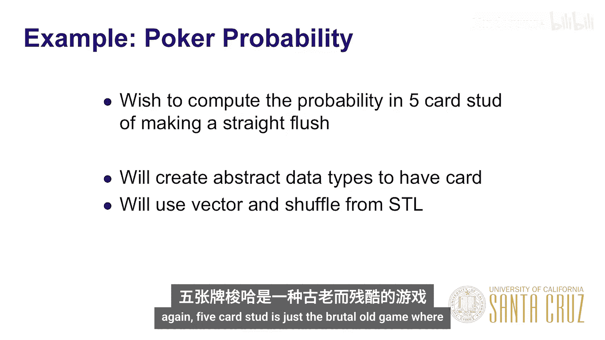

Here's a straight flush。If you play Sir poker and you were to play five cards stud。

You are not going to see that hand very often。And that's a middle level straight flush。

 The best possible straight flush is a royal straight flush where the top card is an ace。

 So it goes 10。

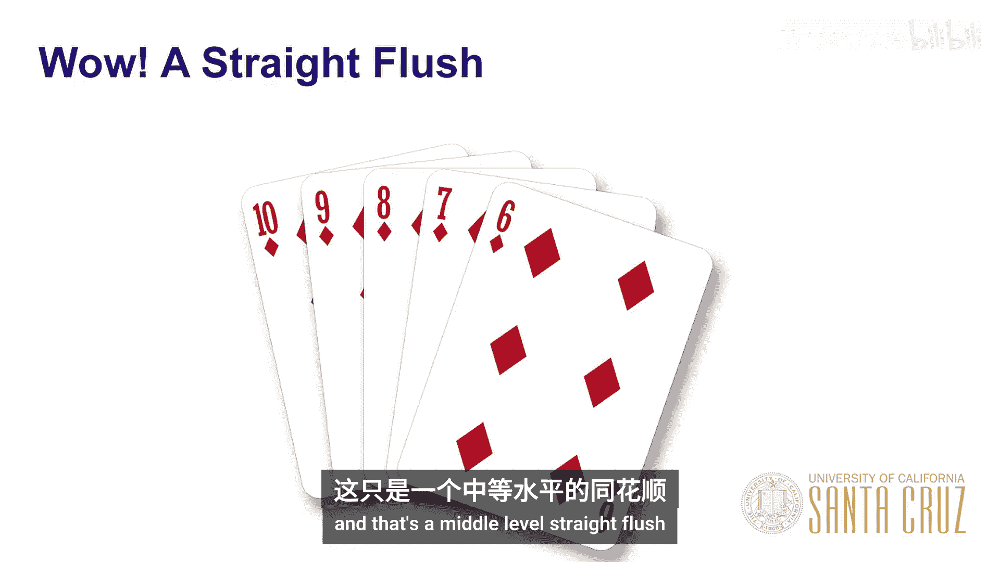

Jack Queen King Ace， that's called a royal flesh， that's an ordinary poker that's the best hand that's possible。

Well just to give you some to see what your knowledgeability is out there。

Do you have a sense of what the likelihood of having a flush is in a five guard stud game？

I'm giving you three choices， is it one in every 10 hands， one in every 500 hands， one in every 10。

000 hands？And how about a straight flush？Okay， so take some。Time to think about it。

 If you're really good at probability theory， you could actually sit down and。Quickly calculate this。

But for most of us， it would be easier to get the computer to do。Hmani Carlo calculation。Of this。

 and that's what I'm going to teach you。So the answers to this quiz are。

Fluushhees are approximately  one in 500 hands。And if you're in a friendly game。

And you're playing about 20 hands an hour in talking and drinking beer。

That's going to be quite a few hours before you're going to see a flush in a five card stud game。

But even more difficult to find。1 in 70000， approximately， is a straight flush。

So you may be playing all year long in your five guard stud game。

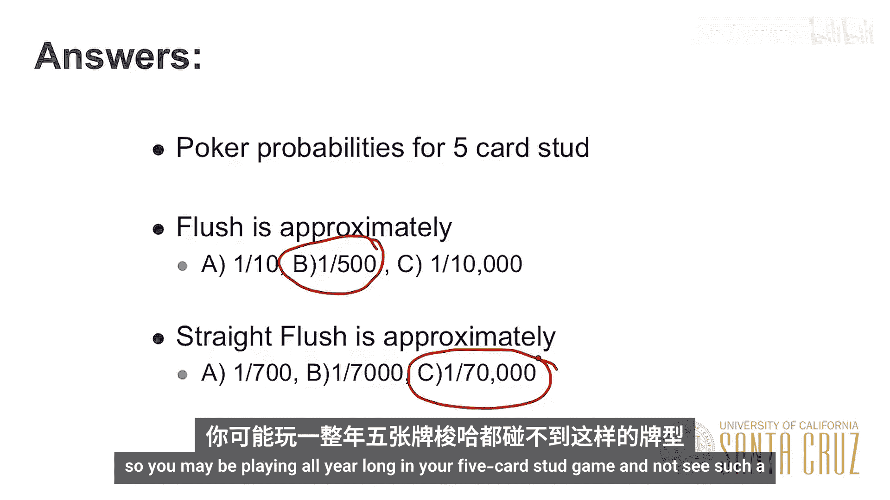

And not see such a hand。That's how rare it could be in five card stud。

So in order to do our poker calculations。We want to properly represent。Cards and a decker cards。

And a card is both a Ps number。Like a piPs number can be three or seven。And a suit。

In a suit traditionally are spades， hearts， diamonds and clubs。

And here we're using the C++ 11 style of a nom class。So the type is suit and notice。

That we have colon short。And what this allows us to do is specify an integerd type。4。

The underlying value of the enumerators， so spade is going to be zero。

 but it's being represented by a short。And that essentially。Could have been an int。Or long。

But by using short。We save memory。So， that's an extra。Little nuance。

That this new type of enumerator class lets us do。And here。

 the classes for Pps are that a king is going to be value 13。 A queen is going to be value 12。

 A Jack is going to be value 11， and then the ordinary Pps of the cards from a to 10 are going to have their values 1 to 10。

Now， here we're using our pips and suit types to create our card。 So imagine we want a card。Like。

Three of clubs， so。Whoop， I'm not very good at drawing this， but here are three clubs。

And that would be a three of clubs。And we want to be able to represent that。

 and our representation is going to involve both a suit and a Ps， and here are accessor functions。

The let us get。Get a suit or get a pipps。呃。Notice。That this can be improved a little bit。

if you want to be a better programmer， I should have included that and get Pps。

Since this member function。Is nonmating， we can use the keyword constant over here to indicate that the member function is not mutating the values of the class。

啊。And then we also。 So these are accessors。And we also have IO。And recall for IO。The type。Generally。

 when we build a new type， we also want to have the overloaded bit shift operator。

Work to give reasonable output for that type。In this case， it's a card and。Idiiomatically。

 we normally want that to be a constant。Empersand passed by reference。First off。

 we don't want to mutate it inside that function， and secondly。

 we want efficiently to pass its value， we don't want to create or recreate a local copy。

And it's a friend function。 And the reason it's a friend function， again， is。That。If it were。

 if you attempted to make it a member function， you would have。The o stream。Have to be。

A member in OSt is not a member， so it's forced， this is one of the instances in writing C++ code that it's completely appropriate to use friend functions。

Here's a code for doing a vector of cards。So a vector of cards is going to end up being our deck。And。

I'm getting piipps values。Okay。So。The ACce is going to be given the special value1 I don't know I may have misspoke earlier。

And then every ordinary car， two through 10。Has its normal value。A Jack is going to be 11。

A queen is going to be 12 and a king is going to be 13。So that's the range of values we have。

And notice how we build a card。 This is calling a constructor value。

And we're getting a single card and we' getting we're going across the values ace through King。

And creating。13 cards at a time for each suit， so this is creating the 13 cards in the spade suit。

 similar in the heart suit， similar in the diamond suit， similar in the club suit。By the way。

 this code could be simplified， you might think about it。I welcome a simplification of this code。

 I could merge these four statements into one four statement。

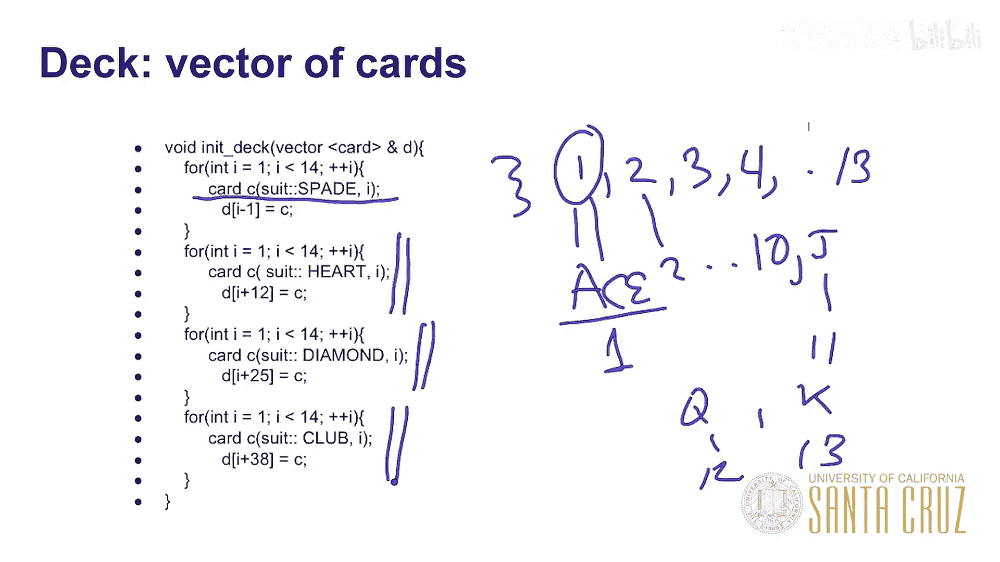

Let's use the C+ plus 11 auto feature。Here's a print of the car deck。Notice。That by using auto。

We get around。A complicated iterator declaration。Sort of vector of card。

So we don't have to remember the syntax and we don't have to make mistakes over it auto just deduces that it's an appropriate。

T。And then again， idiomaticically， we start at the beginning， we go to the end。

 we ought to increment the cursor。We de reference and print。

So this is going to print the card value like the three of arts。And here's our first。

Calculation this is a calculation for when is a hand of flesh。So think about a hand， that's a flush。

Let's do a little bit of a simulation。 What's a flush。 Let's look at a heart flush。

All poker hands are five cards。So we have five cards。Well。

 let's say the five cards are six and eight。A jack。A queen and an ace。

The only way those five cards can be a flush or heart flush is if they're all hearts。

So that's what we have to test for。If any of these cards is not a heart， any of the five。

We don't have a flush。So。We look at the card that's in a hand。 The hand is going to be。A little。

 a little vector， A vector of。I be。5 cards， Nahan。We're going to go use that accessor function get Sued。

 and we're going to see what's the first card suit？

So the first card can't invalidate getting a flush。

 it could be a hard to dine at the spade or a club doesn't matter。

And then we'll find out whether we have a flush if all the other for card suits match。

So we get that first suit。In this case， it would be a heart。That's。An an no class。Enumerator value。

And then we march along all the rest of the cards in the hand。

We get their suit and see if the suit is equal to the original suit。

Which in this case was a heart if it's ever。Among these other cards， if they're not hearts。

 we return false。Otherwise， it's true。 So we only return true if in marching through the five cards。

 they have the same suit as the first card。 That's going to be a flush。Again。

 you could code that differently。Could use logical operations， maybe avoid that。

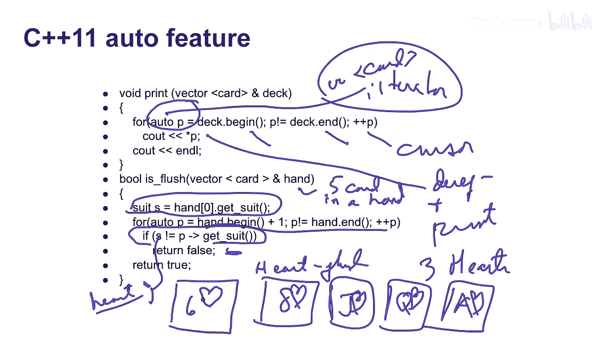

A。Brief quiz again I'm trying to migrate you to C+ plus 11。

How could you change print to use the more modern rangefor statement。Here's our answer。

Deec is 52 cards。Each card。Is stored in a vector。Order of card value gets us the right type。

So type will be cardd。And then that lets us print it all out。So we will see。

Before the deck is shuffled， we'll see ace of spades all the way till King of clubs in order if this print works properly。

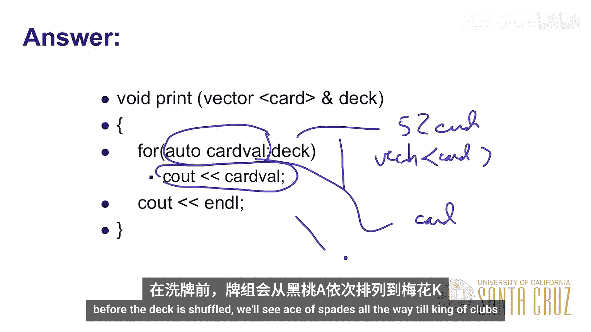

Straight a little more code， let's look at the straight code。Again。

Let's try and understand what a st is， some of you are not poker players。We have our five cards。

And a typical st is something like four。5。😔，6，7，8。So that we can line them up in order。

Now it's a little bit tricky because with a straight。We have two special kinds of straits where。

And they both involve ACEces。So in one kind of straight， ace is the lowest card。

Some of you who know a little bit more poker terminology know that。

The straight where ACce is the low card。This is called the wheel。Slois straight。Poker。

Straights go by the high card and you also have。A high card straight， which is 10。Jack。Quin。

King and their ace is a high card。So these have to be tested separately。

 and all the other straits can be tested。By making use of the fact that things are in sequence。

So the isstr is also going to look at five cards。And the Israel straight is only interested in PipPs value。

So we don't care what。Clubs， hearts were not interested in suit。In the flesh。

 we're only interested in suit and we're not interested in Ps value， in straightits。

 we're only interested in Ps value and not interested in suits。And here's the thing。

 You get dealt a hand and the hand isn't necessarily arranged in this order。

So in order to check one way to make sure。That we have as straight is we can sort by Pips value。

And then we can see， we can start。With the non special case， non aces。

And here's a big logical expression。Notice each PPPS value is one more than the previous PipPS value。

So after the sort， we just see if this is true。This says is4 greater than 5， greater than 6。

 greater than7， greater8， and they're only separated by one。 so we can't have。

Right if this was a four followed by a six， followed by a 9， followed by a 10， followed by a jack。

 not a straight， they have to be one apart。That's what this is testing。

It's just subtracting by one where the highest value is in v0。

 V0 is sorted to get the highest value and then。There's also a reason why we can't just check whether the highest value and the lowest value are separated by4。

 And that's because we could have。Let me write it here， we could have a four， a four， a six， a six。

And an eight。And four and eight are in the right relationship and six is in the right relationship。

 but this is really a hand that's too pair。So we have to test that everything and the sequence is one apart。

 that's what this is doing。And then we need a special logic。

 I won't go through it for where the ace is the lowest card versus where the ace is the highest card。

 Here's the ace is the highest card。 We're just checking to see that the five values。

Are where the ace is the highest card， and that's where the ACce is the lowest card。

 and those are the special cases， and that's what makes it a little longer and grungier code than was the case with the flush。

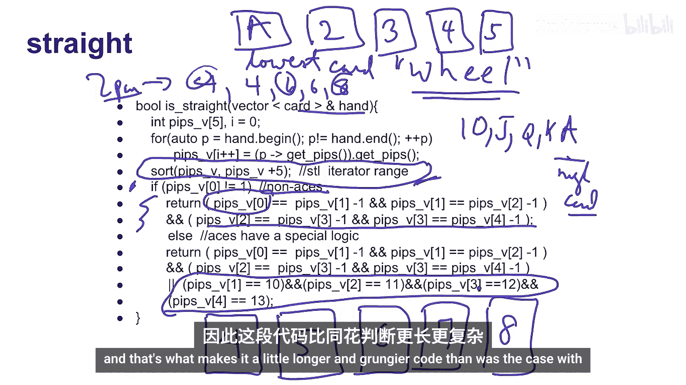

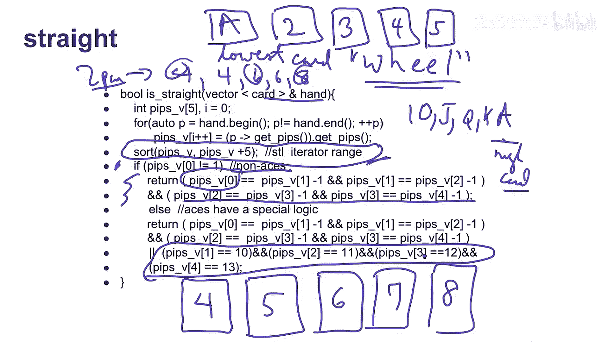

Straight flush is now easy。A hand that's a straight flush。

 a five card hand That is a straight flush has to be simultaneously。A straightit and a flush。

 So the logic behind the straight flush is。Both。A straight。And a flesh， at the same time。

Both properties have to be true， so we can check。Is flush ampersand Ampersand is the ant logical ant is straight。

Reusability， very nice， easy to do。 We didn't have to write a special routine。

Just sort of a factorization。

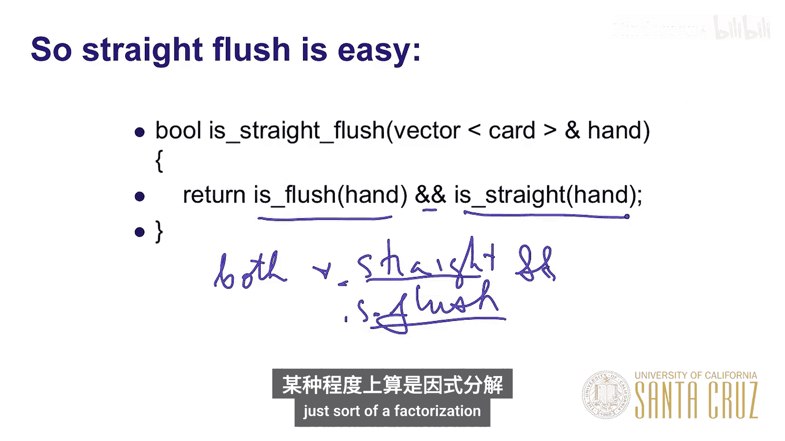

Now we're going to set up the Monte Carlo simulation。Here we get value out of STL as well。So。

We're using。What are we using for STL？What we're using from STL is a container， sequence container。

Stard library， we're doing some seating。Here's our routine for initializing the deck。

Where we initialized the spades， hearts， diamonds， and clubs。Here are some counts。

And here's some request。 How many shuffles。Do you want， in other words。

 in your Monte Carlo simulation， how many tests do you want？And of course。

 it would be too hard to do that at home if to， if you had to run a million。

To get some accurate simulations of probability of stits and flushes。

 you might have to run a million。Shuffles of your deck。

 that's going to take way too long for you in person。 not that you couldn't do it。

 but this is going to be a lot easier。 We're going to use the computer。

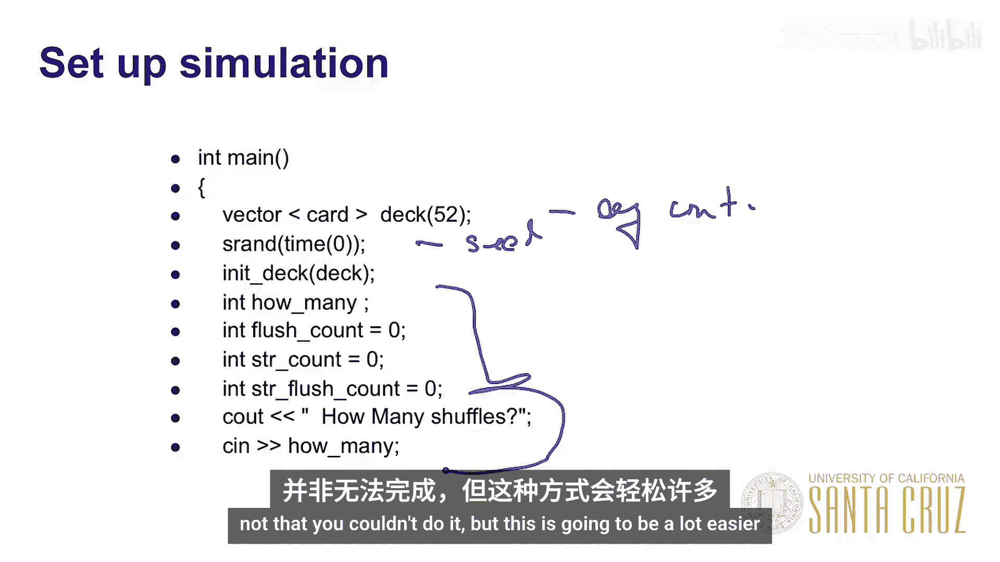

So once we get from the user， how many simulations？S Tel again。

 we have this very nice shuffle routine。And we've already initialized the random number generator。

 we've seatded it with the SRAand call。Now we use SL again to store our hand， our five cards。

And then， we test。What the deck looks like， what is the hand we get？

We need a five card hand out of the shuffle deck。And we can do a flush count。

 we can do a straight count， and we can do it separately。A straight flush count。

 And these get us our values。 and then。We see how many we have。Of those different hands appearing。

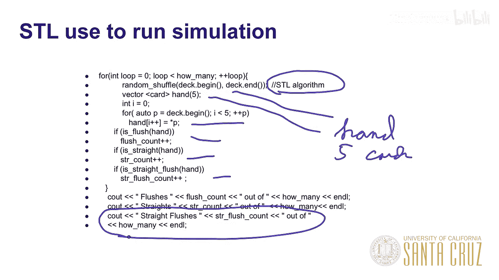

While I'm not going to do this for you， it should be relatively easy for you to do at home later。

To write some other routines， very simple routine could be another very。

 very good hand as for of a kind， so if you don't get a straight flush。

 four of a kind is the next highest category and so you might want to check if something is four aces or four kings。

And you might want to know what the probability of getting four of a kind is。

 How does that compare to the probability， which we said was around one in 70000。

For getting a straight flush。Now， another interesting thing that you can do。 again。

 it won't be very complicated is。A。I'm drawing here a seven cards studhand。

 The typical way that gets laid out is two cards down， then in succession。A first card up。

 a second card up， a third card up， a fourth card up， and then what's called the river。

Which is also down。So， of course， part of the game is bluffing。 We don't know what this person has。

 And so the question is， could we determine whether this person has a straight flush in a seven card game。

So in a seven card game。We have to take。A best hand。By choosing5。So， for example。

 it would be real easy if there were three other jacks underneath。

Our best hand would obviously before Jacks。And。Seeing a tour of hearts。A sixth of hearts。

A for of hearts。A jack of diamonds， let's say。And trying to estimate a best hand is part of the game of poker。

 There's bluffing and logic and probability。 And so you would want to know what the likelihood of getting a straight flushy or。

 if you saw a2，6 and four of hearts， you could imagine that two of the cars sitting there were a three and a five of hearts。

And that would lead to a straight flush。Now there can't be any other kind of straight flush because you could already deduce。

That no straight flush， except for hearts could exist。

 So this gives you a lot of information when you're playing the game。 But the question I'm asking is。

 could you rewrite my simulation， which was a simulation of a far5 card game to do a7 card game。

 And so now you couldn't， You would have to pick the best five cards out of the 7。

 And that would make this。A little more complicated homework。

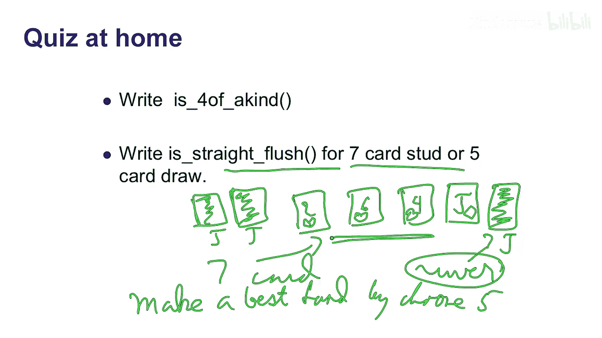