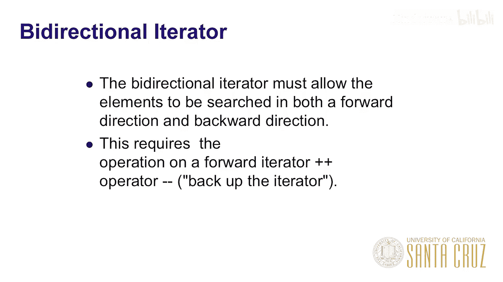
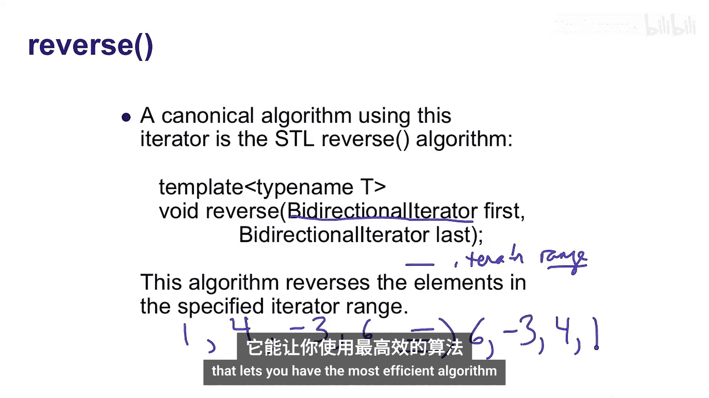
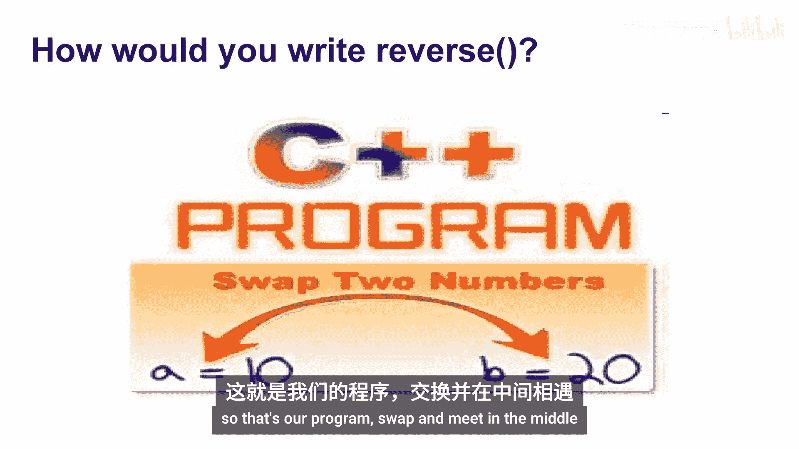
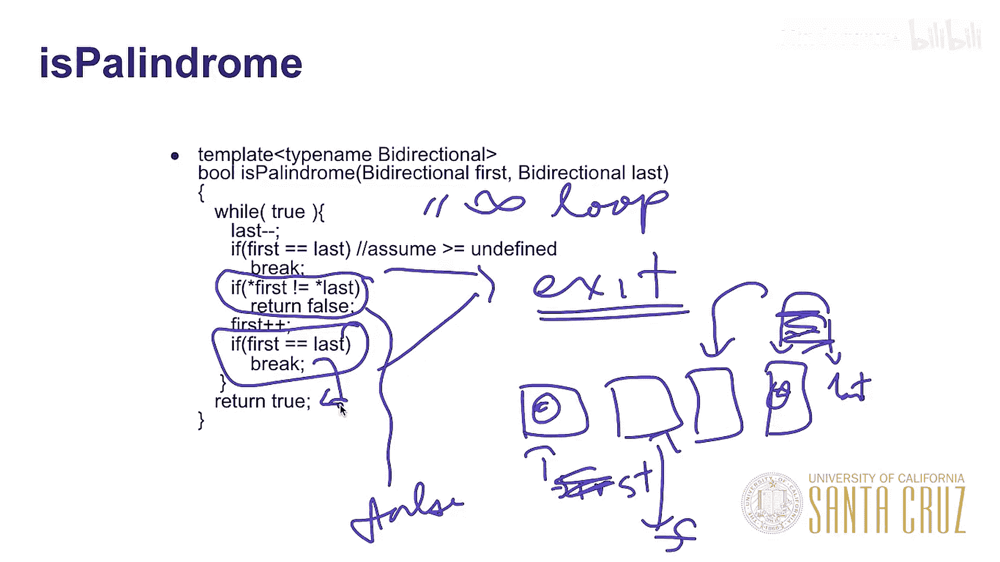
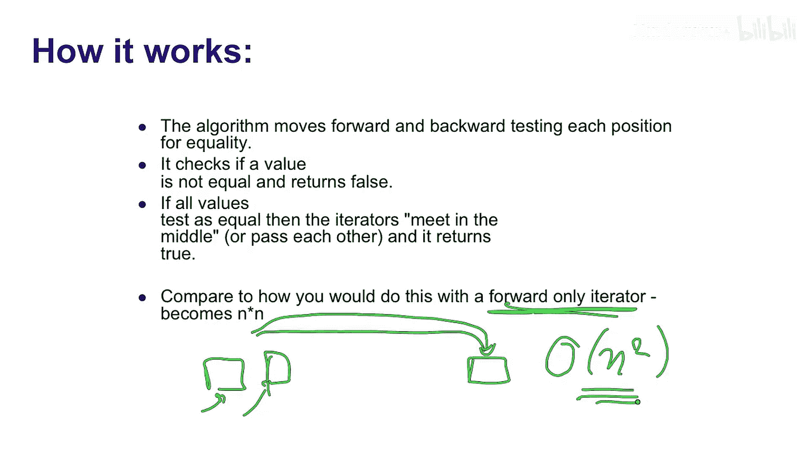

# 【加州大学】C++编程-｜-C-Plus-Plus-B-p07-P07_1-6-双向迭代器_01_04_03--BV1KseJzqEbZ_p7-

So let's go to the next more sophisticated stronger iterator type， that's the bidirectional type。

Bydirectional types must allow both the forward iterator operation plus plus。

 but also the backup iterator， back the iterator minus minus。

And again， let's study a canonical algorithm， a standard algorithm， and SDL that requires the use of。

The bidirectional iterator type。And again， the way you would read the library is you would see。

A name like bidirectional iterator indicating that that was indeed its type。

And then you would see something like first and last， which is the iterator range。Frequently。

 that's begin and end， but it can be some other subpart of that range。

And then what reverse does is to take it's a mutating algorithm。

 and it reverses the elements in the specified range。 So we would expect if we had。

A for minus3 and some。He throw in another one， six。At the end of this， you would have 6，-3，4，1。

 That's reverse。 That's what reverse is going to do。

And the logic in making STL algorithms efficient is pick the weakest iterator that lets you have the most efficient algorithm。

So efficiency is prized。And。We're going to do swapping because we're going to keep track of where we are。

 both forward and backward。And we can just do this in one pass if we have both forward and backward。

Iterator。And then we can just swap the reverse and meet in the middle， so that's our program。

 swap and meet in the middle。

We're going to move from both ends。So the notion again， is。We have these four elements。

 whatever they were。诶。I remember if they were， let's say three is here and six is there to begin with。

inus1 is here and two is there。And then we're going to start at the front with a front。Ksor。

Start at the back with the back cursor。Do a swap。So at the end of that first swap。

 you're going to see six。And three。us1。2。And then you're going to move the cursors。Oh。

 here's front and back again， F and B， I'll call them。And then the two and the。One ob swap。And then。

 we'll end up with。6，2。-1。thre。So that's the algorithm。

And that algorithm that I've just shown you will let us。Check for whether something is a palintro。

Simple palindrome is， for example， the name auto。Otherwise always。Autto forward or backward。

A more complicated palindrome is one you could see。Dalmatian na。It am lad。

So we could write Dalmatian either forward or backward。And here's how we would test for it。

 Here's an is palinrome algorithm using bi directionional， bidirectional。 And I love bidirectional。

 because I'm actually pretty well known in the AI community for something called bidirectional search。

 so。I have a warm spot for bidirectionalality。And here you can see that algorithm that I already described。

You keep going。So this is an infinite loop。Which means there's going to be an exit somewhere in here。

So。Here's an exit and there's an exit。 These are its exit points。

 Otherwise we'd have an infinite loop。We're testing to see when first and last get the meat。And。If。

As we move。Okay， so we're， let me just check what we're doing here。 We're saying， while， true。

 decrement the last。 Why do we decrement the last Because we're off by one。

That's going to be begin end。So last is going to start over here。First it's going to start over here。

We decrement it。 that's why it's bi directionional。 and now we're pointing at the last element。

And here's where we're testing。 And we return false。 So we check if this element。What's in here。

And what's in here are the same。If they're not the same， it's not a palindrome and we return false。

If there are the same。We have to move first over。We move first over。This is the new first。

We reenter the loop， so we move last back。We do our test to confirm whether。

They're different if they're different， we return false。And otherwise， we。

March 1 and last and if first。As long as first is not equal to last we return。

 but at first equals last。So if they meet in the middle， that means that we've hit a palinme。

 meat in the middle means we break and break gets us to true。

We've already said what's on the slide， algorithm moves forward and backward testing each position checks to see。

If two values that are symmetric are the same and if they're not。Internally， there's a false。

 if it keeps going and meets in the middle， it's true。

If you try to do this with only a forward iterator。You would have to think about it。

 You would have to start over here， and then you could use a forward itererate。

 It would be a multipass algorithm to move to the end。And then you could do the swap。

That would be okay。But then you'd have to move this iterator to the second position and then restart that iterator all over again。

And you would end up with an order。N squared computation。So we don't want forward iterator。

 even though it's possible to manufacture this algorithm with a forward iterator， that's a principle。

 a design principle for SDL。The strongest iterator necessary to make the algorithm efficient。

Notice we could also do this algorithm efficiently with a random access iterator。

But a random axis is too much power， we don't need it。

So we're always looking to optimize most efficient algorithm， weak as iterator。

