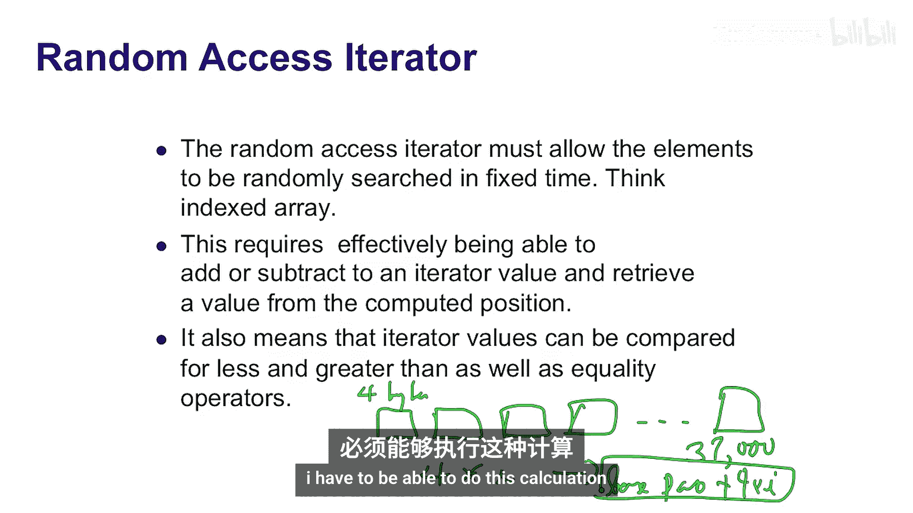
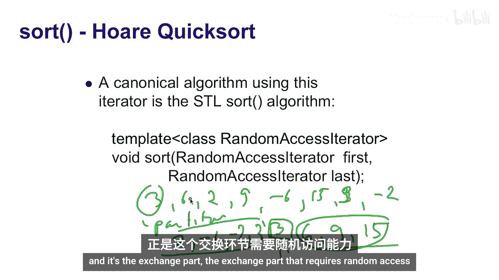
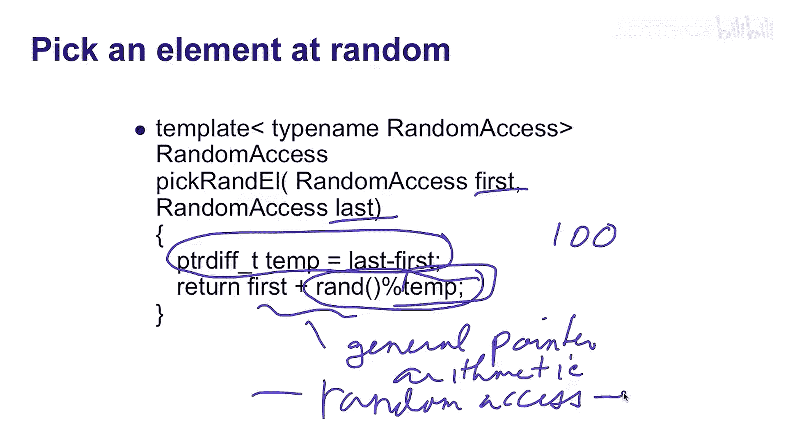
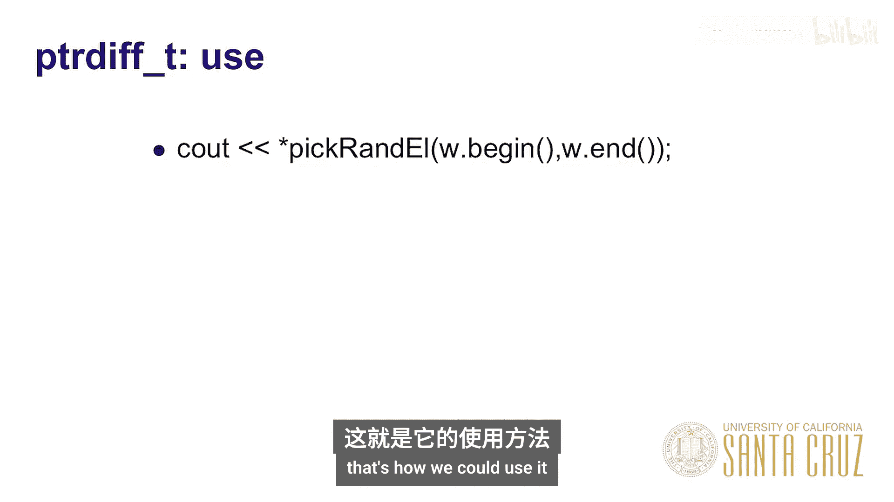

# 【加州大学】C++编程-｜-C-Plus-Plus-B-p08-P08_1-7-随机访问迭代器_01_04_04--BV1KseJzqEbZ_p8-

Finally， let's talk about the strongest of iterator classes。

And here you want to think of an indexed array。 That's where you typically are seeing something that's random access。

 Re call in an indexed array。 If I have an indexed array of elements。And so it had 37，000 elements。

At any time I can get to any of these elements through a simple address calculation。

How many ever bites is needed for store， typically that would be four bytes。Times the index， so4。

Times， whatever the index is。Gets me whatever the base pointer value is， base pointer。Plus。

Four times I， and that gives me invites where I am。And that's a simple calculation。

 that's a fixed time calculation but that。Means that I can do general address arithmetic。

So in order to be able to do things equivalent to the index array。

 which I can do for vector or the special class array or the special container class double ended Q。

I have to be able to do this calculation and that requires random access。

The canonical random access iterator， the one we have to have this behavior for is the sort algorithm。

 And again， we've used it already， the sort algorithm。

That's found in SDL as based on Horse Quick sort。 It's extremely fast。You should test it out。

You know， try it against。Your own hand coated version of Quicksort。 Remember。

 Quicksort is also called partition exchange sort。 So in quick sort。Just to recall what you're doing。

Here might be a bunch of values。Sitting in a container。Inju your values in this case。

Quick sort you would take one value，I'd say you take the three and you use it for your partition。

And after petitioning this set， you're going to end what's less than three and what's greater than equal to three。

 let's say。So here's that element three。And we might say two， minus6， minus2。Three is on one side。

 and then on the other side is six， nine and 15。So， we know that。This is in its right position。

 and these two are now unordered。And then we would。Recursively。Call and affect part。诶。

To partition these two sets recursively， so partition exchange means that like six got moved over there。

 that's the exchange part nine got moved over there。M-6 got moved over here。

And it's the exchange part， the exchange part that requires random access。

Here's a very simple random access element。This is selecting at random。From something in a range。

 So we have a normal range first and last。We compute a random number， which an integer。We。

Modullo by temp。And temp。Gives us last minus first。 it gives us the range of values。

 So if there's 100 values being stored there， temp's going to end up 100。

 Rand is going to give us a number between 0 and 99。

 and then we'll add that on to first and notice we need general point arithmetic。

And that's a hallmark of a random access iterator。So this is a scheme for picking an element at random。

Pointer di dot T is a type already defined type it's in the C standard depth library。

 it's basically an integer value， which is the result of an operation where you are given to。

Pointers， and you're allowing subtraction to get you an integer value for that pointer。 remember。

 pointers。Need to know the underlying size of。It's not merely an int， it's not like one。

 two or three if you have。Two long doubles， they might be eight bytes。

 so a pointer di between two long doubles might be intrinsically of a difference of eight。

So pointer di lets us factor in the size of the type。And here would be a simple way to print。啊。

A random element inside that range begin to end。 That's what。How we could use it。

Okay。So that's it for today， next time。I'm going to go further into STL， give you more SL。

 more insight into how it's designed to be efficient and orthogonal。

 And I'm also going to give you some newer parts of SL that are based on the C plus plus 11 standard。

 Okay see then。