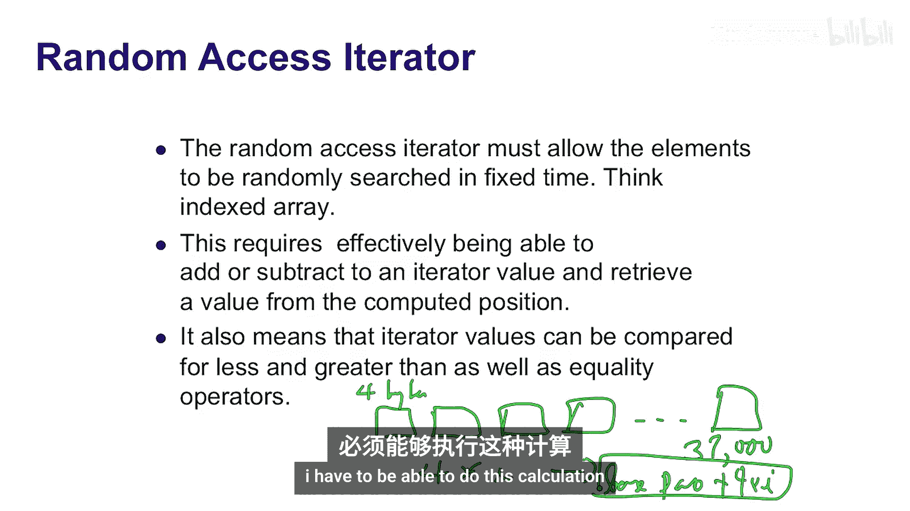
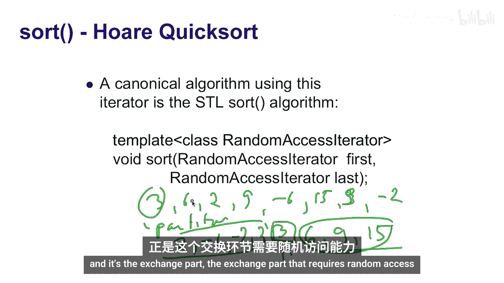
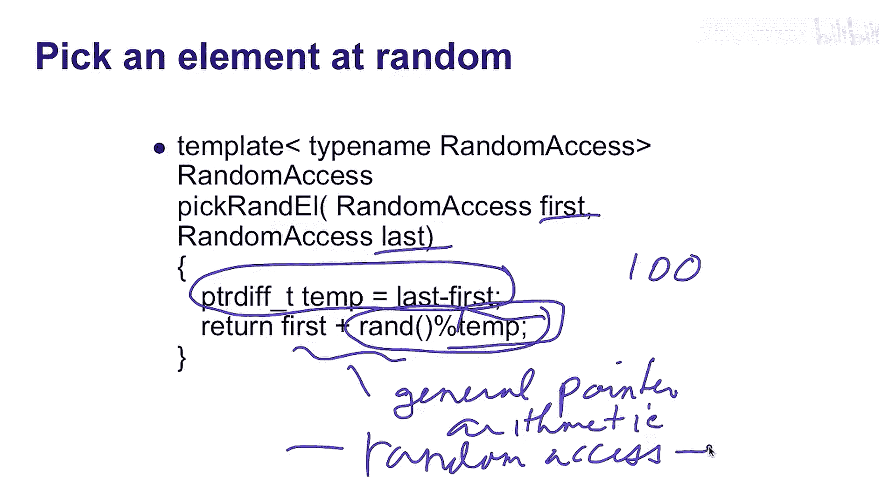
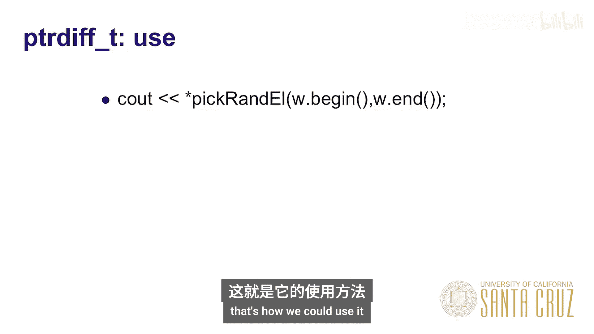

# C++编程：P08：随机访问迭代器 🎯

在本节课中，我们将要学习C++标准模板库（STL）中最强大的迭代器类别——随机访问迭代器。我们将了解它的核心概念、典型应用场景以及它与其他迭代器的区别。

## 随机访问迭代器的核心概念

上一节我们介绍了迭代器的不同类别，本节中我们来看看功能最强大的随机访问迭代器。

随机访问迭代器的设计灵感来源于索引数组。在索引数组中，我们可以通过简单的地址计算直接访问任何元素。例如，对于一个包含37,000个元素的数组，我们可以通过以下公式计算任意元素的地址：

**地址 = 基指针 + (元素大小 × 索引)**



假设每个元素占用4字节，那么访问第`i`个元素的地址计算公式为：

**基指针 + 4 × i**

这种计算是固定时间的，意味着我们可以进行通用的地址算术运算。为了在`vector`、`array`或`deque`等容器中实现类似索引数组的功能，迭代器必须支持随机访问。

## 排序算法与随机访问

随机访问迭代器的典型应用是排序算法，特别是STL中的`sort`算法。

`sort`算法基于快速排序实现，速度极快。你可以将其与自己手写的快速排序版本进行比较。快速排序也称为分区交换排序。其工作原理如下：

1.  从容器中选择一个基准值（例如3）
2.  将容器分为两部分：小于基准值的元素和大于等于基准值的元素
3.  基准值找到其正确位置
4.  递归地对两个子分区重复此过程

分区交换过程中，元素需要在容器中移动位置，这要求迭代器支持随机访问，以便高效地进行元素交换。

## 随机访问示例：随机选择元素



以下是使用随机访问迭代器从范围内随机选择一个元素的简单示例：

```cpp
// 假设first和last是随机访问迭代器
auto temp = last - first; // 计算范围大小
int random_index = rand() % temp; // 生成随机索引
auto random_element = *(first + random_index); // 访问随机元素
```

这段代码展示了随机访问迭代器的关键特性：支持迭代器的减法运算（计算范围）和加法运算（通过索引访问元素）。

## 指针差类型：`ptrdiff_t`



在C标准库中，`ptrdiff_t`是一个已定义的类型，它表示两个指针相减的结果。

需要注意的是，指针差不是简单的整数差。它考虑了底层类型的大小。例如，两个`long double`类型指针的差可能本质上是8字节的差异，而不仅仅是1、2或3。

`ptrdiff_t`让我们能够考虑类型的大小因素。以下是使用它打印范围内随机元素的示例：

```cpp
ptrdiff_t range = end - begin;
ptrdiff_t random_offset = rand() % range;
cout << *(begin + random_offset);
```

## 总结



本节课中我们一起学习了随机访问迭代器的核心概念和应用。我们了解到：

*   随机访问迭代器支持类似数组索引的直接元素访问
*   它通过地址算术实现高效的元素定位
*   `sort`等算法依赖随机访问迭代器实现高效操作
*   指针差类型`ptrdiff_t`用于正确计算迭代器之间的距离

随机访问迭代器是STL中功能最全面的迭代器类别，为`vector`、`array`和`deque`等容器提供了高效的随机访问能力。