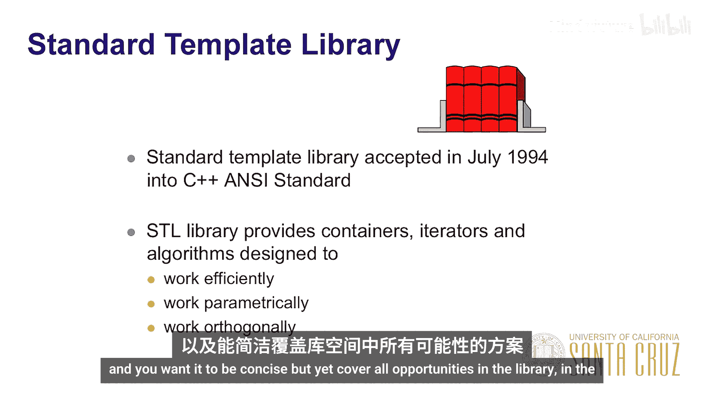
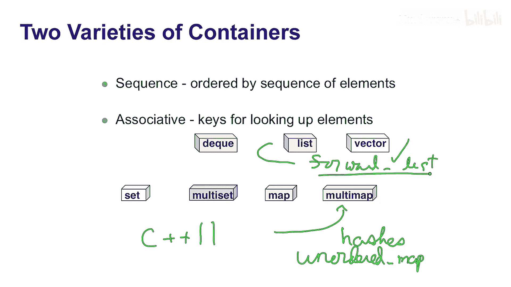
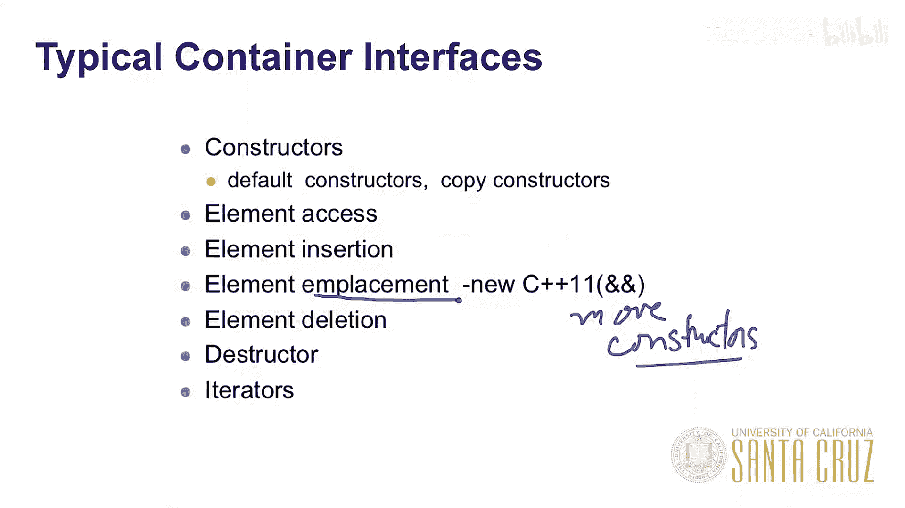
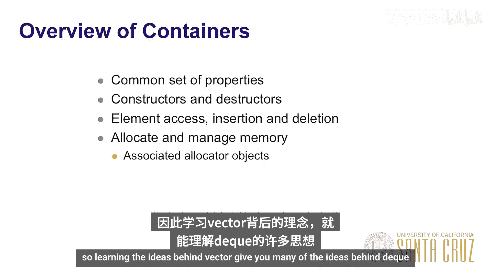

# 【加州大学】C++编程-｜-C-Plus-Plus-B-p09-P09_1-8-STL容器概述_01_05_01--BV1KseJzqEbZ_p9-

Okay， welcome， today's topic is a detailed look at the standard template library。

C plus plus has now been。Around professional aid since 1985。And there been。Several major innovations。

So initially C+ plus the initial innovation was turning C into an object oriented language by creating the concept class and data hiding within the C language。

That was originally called C with classes and then C++ in 1985。Then around 1989。A。

Beyondrn introduced templates。And templates are the basis of generic programming。So that was again。

 a huge change。That then allowed。A special library to be created。That utilized templates。

 and that's the standard template library， which got adopted as a standard in 1994。That again。

 increased the whole scope and the set of tools that you have professionally in the C++ community。

Once again in。2011。That library got expanded and C++ had major changes introduced into it。Now。

 some of these things have been created all along and these standards like the 2011 standard。

 the 1998 standard were times when the community。Codified these changes。

So today we're going to talk about。SDL。We're largely going to talk about practice。

 existing practice that's been around now for。Close to 20 years。

But we're also going to introduce some of the critical new features that。Expand。In a major way。

 the utility of the language and。The libraries themselves now recall S D L。

 as I described it the other day。Is。Based on。Its organized like a three legged stool。

 the three legs again are the iterator structure， the container structure。

 and then the algorithm structure， and you could think of the algorithm as ultimately the critical thing for the user。

And SDL has further principles that are quite important and we'll see how you could build your own form of SDL like algorithms。

If you follow these principles。So STL is designed to work efficiently。Not all libraries。

 especially generic libraries， could be made to work efficiently。

 some people just had these libraries， for example。

 in the early list community because they were universal。

 so the fact is that they weren't always efficient， but they were always applicable。

In the C community， which is a community of professional programmers that wants to squeeze the maximum efficiency。

Out of out of the hardware。So see itself。Its core reason for existence was to be near the metal。

Really allow you to have。Almost。Machine language abilities and utilizing whatever the architecture was working efficiently is critical。

In the C and C++ community。And the template architecture along within lining。

Allows things to be efficient。Work parametrically， by parametrically。

 it's just the notion of templates。A type is a parameter。

 so it has a great reach to the extent that a piece of code can be reused。The parametric。

Design just lets you use it all over the place。And then work orthogonally。

 what do I mean by orthogonally well you could think of your old high school notion of orthogonal。

 which was the X Y， Z axis and the X Y Z axis is a very easy and concise way。

 non repetitive way to note where something is， the location of something and three dimensionsional space。

So orthogonal is a way to be concise， but still general。 So what you have is。

You want high efficiency， you want the thing to work parametrically。

 and you want it to be concise but yet cover all opportunities in the library space。

So。A critical element in the SL design is standard containers。They give rise to a lot of。

The opportunities for using SDL code。By my 90% rule， what you really want to learn is vector。

 if you learn vector， you're going to get maximum benefit out of your containers because vector is the most used of the containers。

Nevertheless， there are two general categories of container， the sequence containers like vector。

 which allows you to efficiently access。Elements in an order and then associative containers。

 which allow you to look up elements by keys。 So they have two really different fo folkey and。

We'll also see。That this is expanded in C+ plus 11。And we're going to also see the equivalent here。

 for example， of hashes。They're going to be， for example。

 one of their ideas is something called the unordered map。And therere also going to be additional。

Standard sequence containers， such as a single list。A。

Container that only allows you to move in the forward direction。

 So a big expansion has occurred in C plus plus 11。

 where we've added to the standard library in important ways。

Now， when you have a container。You generally have。A whole bunch of elements in the standard container interface that makes the container useful。

What kinds of things make。Classes is useful。 constructors。 you want all sorts of constructors。

 There's going to be copy constructors， default constructors。

Constructors that allow you to specify the initial values in the container。

They're also going to be as part of new to C plus plus 11 things called move constructors we're not going to get to that today。

 it's an advanced concept。It's something for you to think about or start to look at。

Inside the container classes， we need to get access to the elements that's going to vary depending on the container map。

 an associative array type will have one kind of element access， vector， a random access。

ASential container will have another kind of access。

There's going to be things like element insertion， there's going to be an element insertion。

 something new called emplace。be element deletion deors and iterators。

 all of these things are the typical container interface now the library is huge， lots of stuff。

 so these are merely guidelines for you to be able to read the manuals when you have to in detail。

 learn how to use these containers。

The containers in general have common sets of properties。嗯。

Like the sequence containers all give you the ability to find the ice element。

The random access containers all give you the ability to do something like a random access sort。

They all have。Constructors and deors and allocators。

That's so you have the convenience of readily allocating， typically off the heat for these。

User determined size。Containers。Maybe it's even at runtime determined。

And then you get the ability to access in certain deletes so you have to learn and frequently the names remain the same。

 learn how to use each of these containers， but they have many， many common properties so learning。

The ideas behind vector give you many of the ideas behind De， learning the ideas behind set。

 give you many of the ideas for map。

