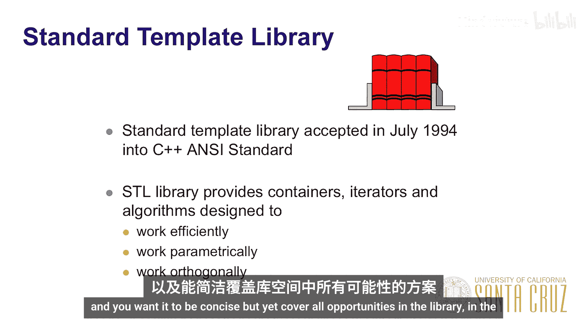
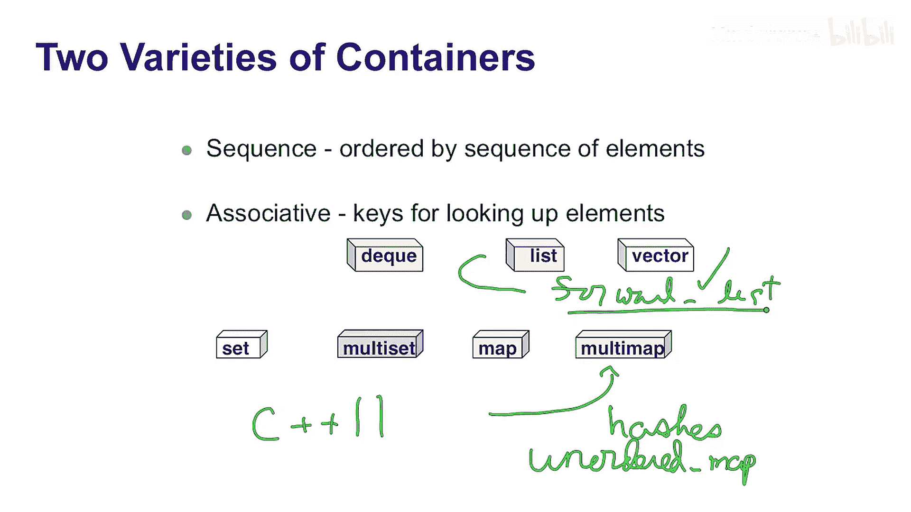
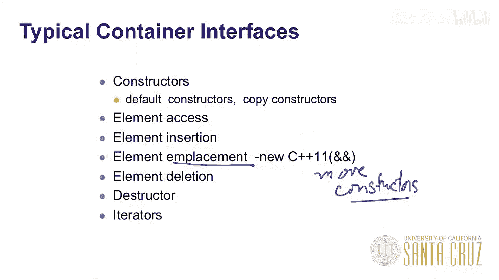
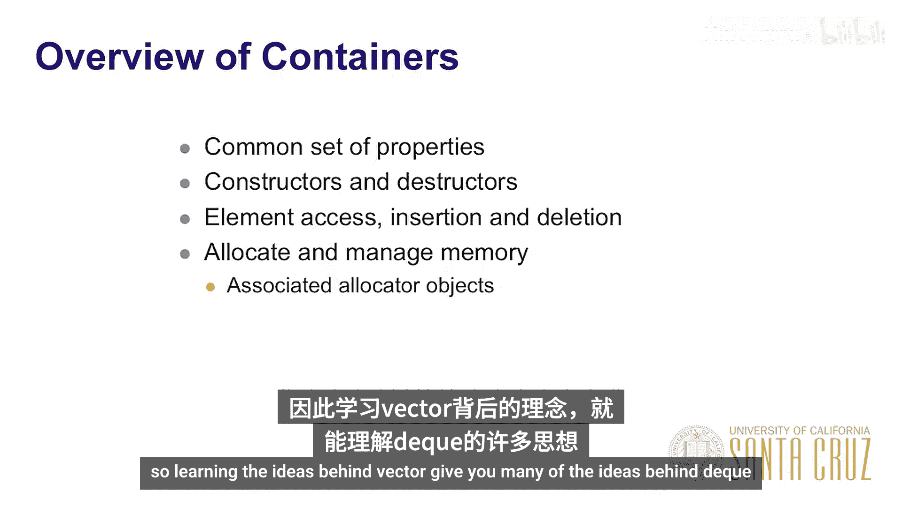

# C++编程：P09：STL容器概述 🗂️

在本节课中，我们将要学习C++标准模板库（STL）的核心组成部分之一：容器。我们将了解STL的设计哲学、容器的基本分类以及它们共有的接口特性。

## 概述

C++自1985年诞生以来，经历了数次重大革新。最初的创新是将C语言转变为面向对象语言，引入了“类”和“数据隐藏”的概念。大约在1989年，Bjarne Stroustrup引入了**模板**，这是泛型编程的基础。基于模板，标准模板库（STL）得以创建，并于1994年被采纳为标准。这极大地扩展了C++程序员可用的工具集。2011年，该库再次得到重大扩展，C++语言本身也引入了许多新特性。

STL的设计像一个三脚凳，其三个支柱分别是：
1.  **迭代器**
2.  **容器**
3.  **算法**

对于用户而言，算法是最终要使用的关键部分。STL遵循几个重要原则：高效性、参数化（通过模板实现）和正交性（设计简洁而全面，覆盖所有可能性）。

## 容器分类

STL的核心元素之一是标准容器。它们为使用STL代码提供了大量机会。根据“90%规则”，学习**vector**将带来最大收益，因为它是使用最广泛的容器。

容器主要分为两大类：

以下是序列容器的例子：
*   **vector**：动态数组，支持高效随机访问。
*   **deque**：双端队列，支持首尾高效插入/删除。
*   **list**：双向链表。
*   **forward_list** (C++11)：单向链表，只能向前遍历。

以下是关联容器的例子：
*   **set** / **multiset**：有序集合，基于键值存储，键即值。
*   **map** / **multimap**：有序映射，存储键值对。
*   **unordered_set** / **unordered_multiset** (C++11)：基于哈希表的无序集合。
*   **unordered_map** / **unordered_multimap** (C++11)：基于哈希表的无序映射。

C++11极大地扩展了标准库，新增了如单向链表（`forward_list`）和基于哈希的容器（如 `unordered_map`）。

## 容器通用接口

一个容器类要变得有用，需要提供一系列通用接口。了解这些接口有助于你查阅手册并学习如何使用各种容器。

以下是典型的容器接口成员：
*   **构造函数**：包括默认构造函数、拷贝构造函数以及指定初始值的构造函数。C++11还引入了移动构造函数。
*   **元素访问**：方式因容器而异。例如，映射（`map`）通过键访问，向量（`vector`）支持随机访问。
*   **元素插入**：如 `insert` 方法。C++11新增了 `emplace` 方法，用于原地构造元素。
*   **元素删除**：如 `erase` 方法。
*   **迭代器**：用于遍历容器中的元素。

## 容器的共同属性

尽管容器种类不同，但它们拥有许多共同的属性集，这使得学习曲线变得平缓。

以下是容器的一些常见属性：
*   **序列容器**通常提供访问第 `i` 个元素的能力。
*   **随机访问容器**支持像随机访问排序这样的操作。
*   所有容器都提供**构造函数**、**析构函数**和**分配器**，方便在堆上动态分配内存。
*   它们都提供了特定的访问和删除元素的方法。

学习 `vector` 背后的思想，能帮助你理解 `deque` 的许多特性；学习 `set` 的思想，也能帮助你掌握 `map` 的许多用法。

## 总结

本节课中，我们一起学习了C++标准模板库（STL）中容器的基本概念。我们了解了STL以高效、参数化、正交性为核心的设计哲学。我们探讨了容器的两大主要分类：序列容器（如 `vector`, `list`）和关联容器（如 `set`, `map`），并注意到C++11引入的新容器类型。最后，我们介绍了容器类共有的通用接口和属性，这些是有效使用任何STL容器的基础。掌握这些核心概念，将为后续深入学习迭代器和算法打下坚实的基础。