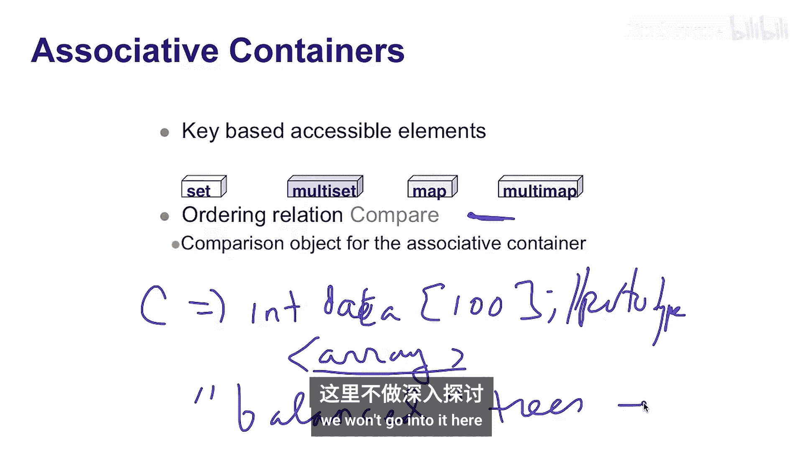
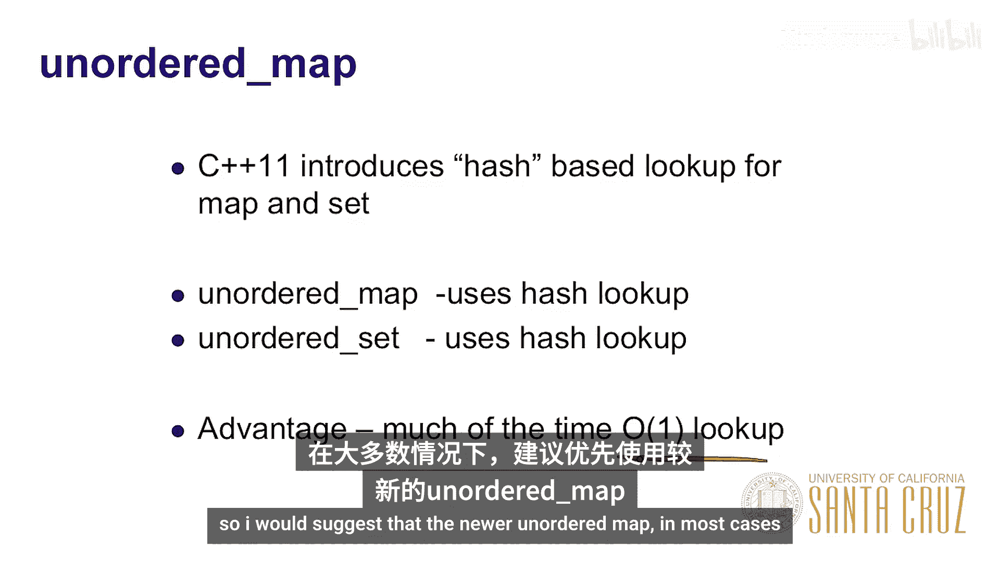
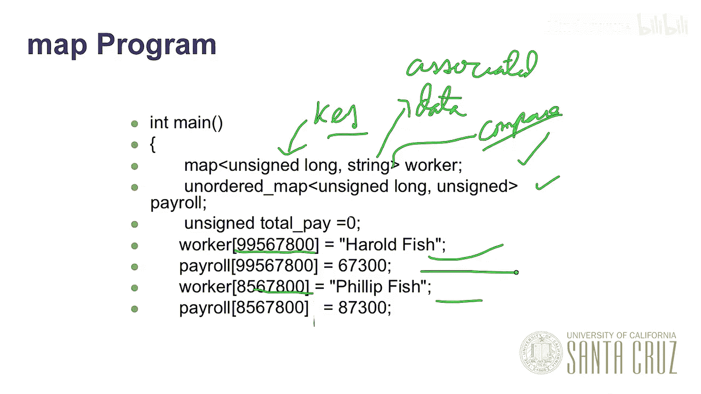
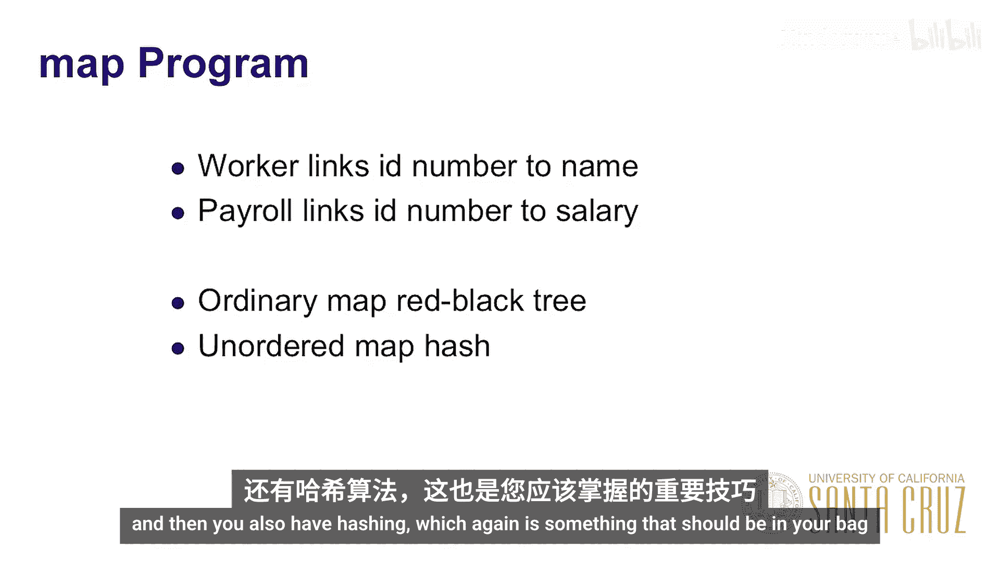
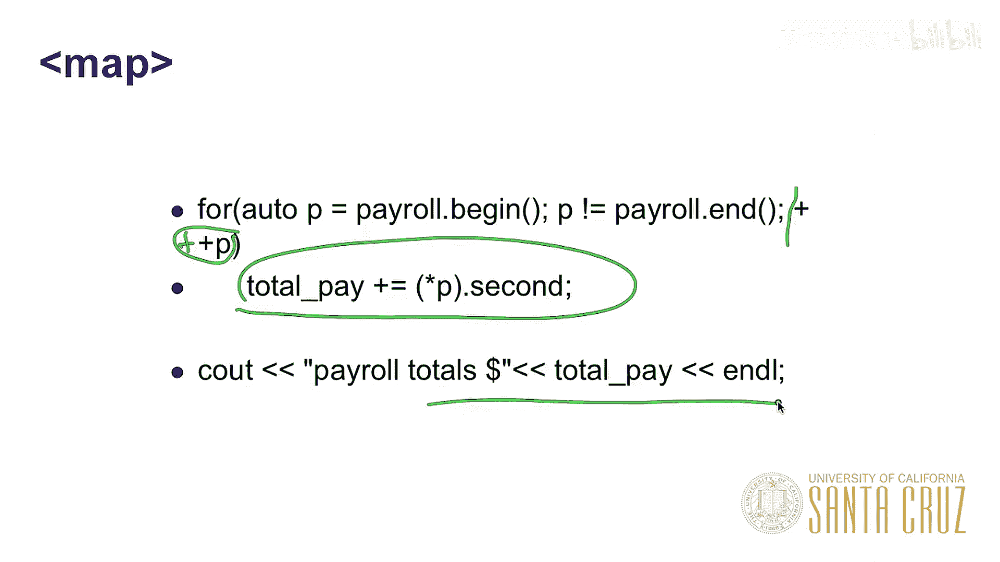

# 【加州大学】C++编程-｜-C-Plus-Plus-B-p10-P10_1-9-关联容器_01_05_02--BV1KseJzqEbZ_p10-

We've already dealt a fair amount with。The sequence containers。The sequence containers。

By the proto sequence container。Is what。It's just an array。So， in C。

This is what you might call the proto sequence container prototype。Very limited。Still in use。

It'll turn out that there are actually now a further STL。Container class that can actually。

Mimic the array even more more directly than vector does。 It's actually an array class。 so new to。

C plus plus 11 will be。An array class that allows you to specify specific sizes and attach that size of the array directly to that type。

You might think， oh， why is that if you think about vector， vector allows for expansion。

 but if you allow for expansion， you have some cost overhead。

An array which won't allow for that can be more finely tuned to the architecture and be quite efficient。

But let's get back to key base elementss， which we have not paid as much attention to yet。

 we haven't really dealt with yet。And in the key based access， there's an ordering relationship。

Since you're not ordering by insertion into some sequence。

 So you don't have the idea of the zeroth element， the first element， the second element。

 you instead are providing a relationship， for example， name to Social Security number。

Name to telephone number， those would be book to an Isbon number and they don't always have to be numbers。

It could be named to a household address。So it's a relationship in which you want to be able to look something up based on what's called the key。

Intrinsic to where that's placed in the data structure is some comparison operation we'll see with things like set and map。

The underlying data structure utilized to be efficient is what are called balance trees。

This is a very interesting topic。And。Computer science and data structures we won't go into it here to some extent you should have the background to understand this already and if you've studied it or used it some of the common types of balance trees or233 red black trees AVL trees and they have properties that allow the insertion and deletion operations to be order log n and the lookup operations as a consequence to be order log n so if you had ordinary trees that were unbalanced you could have。

Order。Much larger。Seeek times。Order and seek times。In worse case。

 but this forces all of the major operations on the data structure to be logarithmic。

 which is a great saving。Nowao。Added to this in the C11 is a hash based use of map and set。

And these are called unordered map and unordered set。And in many instances。

 these will dominate the preex ordinary map and ordinary set。

There'll still be places where you want to use the old map and set。But in most instances。

Is going to be this critical advantage。 So this is something to keep in mind。

 and that critical advantage is。Constantine lookup。Again， I'm not going to go into hashing。

 hashing is a idea that some of you should have learned as a precursor to taking this class。

But the basic idea and a hash is。You take the key， you turn it into a unique number。

 that unique number lets you use random access， that's constant time lookup。To find the element。

And if you have very reasonable hashing functions， that works。

Nearly perfectly sometimes you have some overflow heads and there are schemes for dealing with the overflow。

 but in general， for most application， you're going to find that you have this order one lookup if you use a hash function to build your associative。

Aray。Container。So I would suggest that the newer unordered map in most。

Cases will be more useful to you than than the older style。 This is a big。

Advantage in the newer C+ plus 11 community。Let's look at something that deals with。These associated。

Aase， we're going to have map， unordered map， both in this program will use both types of maps。Okay。

 here's the map declaration。 We'll have a worker。Here's the unordered map。

 and this is just by demonstration， I could have used map or unordered map for both。

 but I want to show you。How they look alike。And then you can play with them yourselves and in fact。

 if you play with them and try and do some timing data。

 you should be able to on your own system discover if you use it for large amounts of data。

 how unordered map。Will be more time efficient than。The balanced tree kind of map。So。

Map is a template as is unordered map。There's a。The item。That effect is the key。

And then what it's related to。Which is another type， which is the data to be stored or related to。

Associated data。Now， we could also further specify some comparison relationship like less that。

That's the typical one， which is less。 but it defaults。 So this could be longer。

 There are other parameters， but they are default parameters。

In the unored map we have the same two things， but of course we won't have a comparison relationship。

 why won't we have a comparison relationship because we're using hashing。

And if you recall in a balanced tree where you have this log and look up。

That is based on comparing different nodes in the tree。

 that's where the comparison operation shows up。So here you can think of this as the worker number。

 we're associating it with Harold Fish， and here's another worker number associated with Philip Fish。

 here's their worker number associated with their salary， Harold makes $67，300， Philip makes $87，300。

So both the map and under an unordered map link。ID number to name， ID number to salary。

In the ordinary map， you have a red black tree， again， I' not going to go into it。

 it's fascinating if you haven't had it， I suggest reading about it in the Wikipedia。啊。

And then you also have hashing， which again is something that should be in your bag of tricks。

And now let's see how we can use that。Recall again， our use of auto。That's a C plus plus 11。

Construct。Where it deduces type。Deduces type from context。

The context here is that this needs to be an iterator type。

And now we go from the beginning of the iterator range to the end。And。This plus。

 plus should have been all one term。I may draw it here。

So just recognize it as our normal idiom and this is saying。See out name P second ID number P1。

So we're looking at the worker。We're getting his name and we're getting his ID number notice we're using two members。

 one is called second。The other is called first。And these are actually the members inside a pair so that the。

Basic way that this associative array information is stored is as a pair。

And to find the name it's the second part of the pair and the ID number。

 which was what we were looking up was the first part of the pair， so we dereference the iterator。

 look at second， which gets us the worker name， look at first， and we get the ID number。

And here we're doing the total pay of the payroll。Again， this is all one operation。Doll plus， plus。

Same idiom。Memorize acididium。And。Here， we're just computing what our total payroll was。

And then printing it out。

