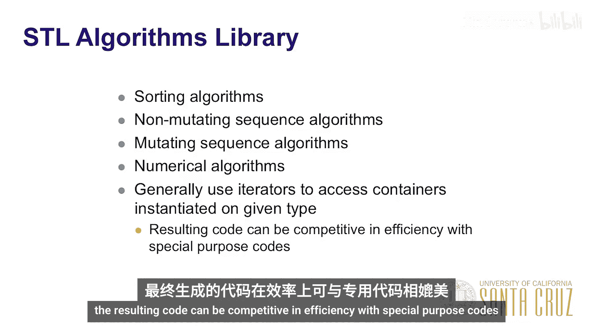
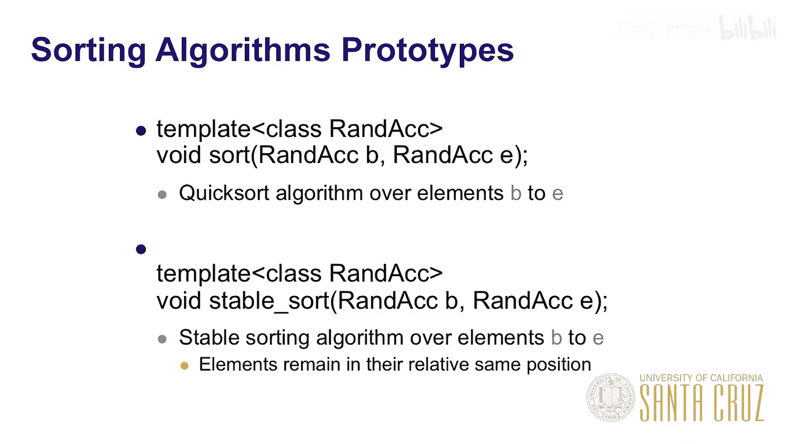

# 【加州大学】C++编程-｜-C-Plus-Plus-B-p11-P11_1-10-STL算法库_01_05_03--BV1KseJzqEbZ_p11-

All right， so we saw how to use an associative container in detail we saw。

One of the important new features of the new STL library is gives us more scope for， again。

 best practice， and we may well want to in place of associative。

The old associative containers map and set use the new ones， the unordered versions。

 because hashing tends to be way more efficient。Then logarithmic search and balance trees。

So what are we getting in the S L library， The S L library has its own organizing structure so that。

 again， common characteristics。A。Let us compartmentalize， give us a roadmap。To using。

The library because it's so big， you know， you're just not going to。Anytime you need details。

 you're going to have to look it up， hopefully you'll have online help。

Or you'll be sitting there with a big manual， or for whatever your current project is。

 you'll have one particular structure that you're making heavy use of so that you'll learn that structure。

But you have a whole bunch of categories。 and we're going to go through some of them so you can look at。

Archaetypal algorithms in those categories。 Again， think of SL 3 legged stool。

Containers and iterators lead you to algorithms。Princal。Design。

 a design principle is to be orthogonal and efficient。 General speaking。

 that means that you want to use。The library in the most possible instances。

 parametrically so that it can be used in all sorts of interesting ways without expanding the library and。

The efficiency comes from choosing the right iterator class。

 so we're going to concentrate on understanding which iterator class， remember the iterators are。5。

5 types， weakest to strongest， weakest being input iterator， strongest being random access iterate。

 And the design principle in SDL is use the。Weakest iterator that lets the algorithm be most efficient。

So what are our categories sorting algorithms？obvi， what they are。Nonmutating sequence algorithms。

 We'll see what those are。 Those are things where nonmating。

 meaning you can't change the values of the elements in the container。

 mutating sequence algorithms in which you may want to change the elements in the container。

 numerical algorithms。Where you want to compute something that's traditionally。

Part of your numerical repertoire。呃。And then in the SDL library， we're going to have heavy use。Of。

Iterators to access containers。And it'll turn out that the resulting code。

 that's what's really remarkable。 And you can test this out yourself。

 The resulting code can be competitive inefficiency with special purpose codes。

Okay， so one of the most famous algorithms in the history of computing is Quick sort。

 Quickss by Tony Hor， sometimes call partition exchange sort。

 everybody out there should know how to write their own Quick sort if they want。

And there is a template for it and notice that you need random access。

 and you can see that in the way we've declared the beginning end pointers。

 the beginning end iterators。So that's what you're going to see in the library prototype。

 you're going to typically see what the algorithm is， some description of it。

 and what the iterator range is to use it。And I challenge you to try your own version of Quickwordword up against the library version。

Even for something very simple， like integers， for some of you。

 this would be an interesting exercise。 Write a version of quick sort that you think is efficient。

 write it even in just primitive C terms。For integers。

 then use a random number generator to generate。10 million iterate，10 million。For example， keys。

And then run your quick sort versus the library Quick sort and see what a timing。Does。

Another important sorting algorithm is stable sort and the difference with stable sort and not a stable sort is that elements remain in their same relative position。

That isn't important if the elements are。Unique。Because they have to be sorted and if they're unique。

 there's only going to be one way you get one， two， three， four that's going to be the order。

 but what if you have one，1，2， two？So if you're going to sort。Let's say the configuration starts。To。

1，1，2。Stable sort would mean that that first two ends up in the third position。

 it can't end up in the fourth position。And that the second one ends up in the first position and the third one ends up in the second position。

So the relative positions for elements that have the same value in stable sort stay the same。

 and that can be important in certain kinds of database applications。

