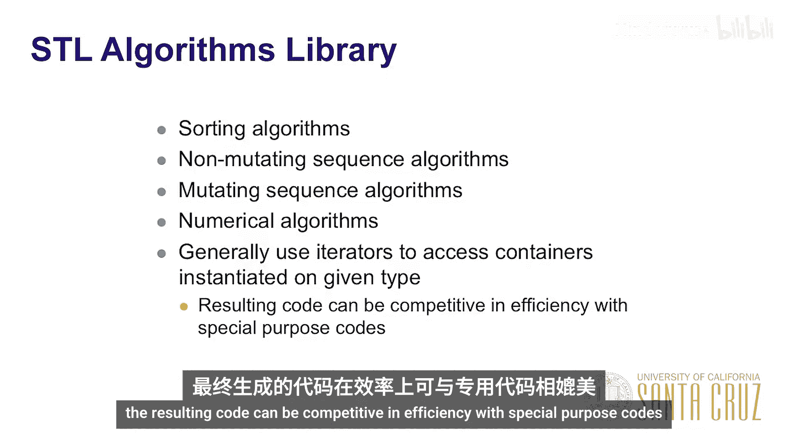
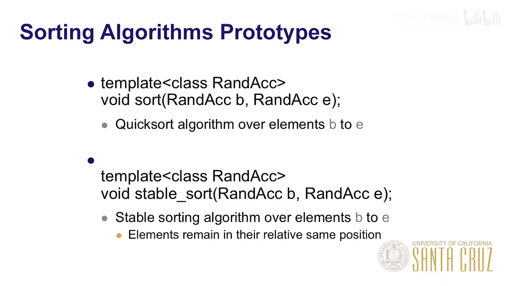

# C++编程：P11：STL算法库概述与排序算法

在本节课中，我们将要学习标准模板库（STL）中算法部分的核心概念与分类，并重点介绍排序算法。我们将了解STL的设计原则、迭代器的重要性，以及如何在实际编程中高效地使用这些算法。

上一节我们详细介绍了关联容器的使用。STL库的一个重要新特性是提供了更多遵循最佳实践的可能性。我们可能希望用新的无序版本（unordered_map和unordered_set）来替代旧的关联容器（map和set），因为哈希查找通常比对数搜索和平衡树更加高效。

## STL库的组织结构

STL库拥有自己的组织架构，将具有共同特性的算法进行分类。这种分类有助于我们理解和使用这个庞大的库。因为库非常庞大，我们不可能记住所有细节，通常需要在使用时查阅手册。对于当前项目，你可能会重点学习并使用某一种特定的数据结构。STL包含多个算法类别，我们将介绍其中一些，并查看各类别中的典型算法。

请记住STL的“三条腿凳子”原则：容器、迭代器和算法。它们共同构成了STL的核心。

## STL的设计原则

STL的一个核心设计原则是正交性和高效性。这意味着库被设计成可以在尽可能多的场景中以参数化的方式使用，而无需扩展库本身。高效性则来自于选择合适的迭代器类别。

迭代器共有5种类型，从最弱到最强依次是：输入迭代器、输出迭代器、前向迭代器、双向迭代器和随机访问迭代器。STL的设计原则是：**使用能让算法最高效运行的最弱迭代器类型**。

## 算法的主要类别

以下是STL算法库的几个主要类别：

*   **排序算法**：顾名思义，用于对序列进行排序。
*   **非变易序列算法**：这类算法不会改变容器中元素的值。
*   **变易序列算法**：这类算法可能会改变容器中的元素。
*   **数值算法**：用于执行传统的数值计算操作。

在STL库中，我们大量使用迭代器来访问容器。由此产生的代码效率非常出色，甚至可以与特殊用途的专用代码相媲美，这一点非常了不起，你可以自行测试验证。

## 排序算法详解



现在，让我们具体看看排序算法类别中的几个重要成员。

### 快速排序

计算历史上最著名的算法之一就是快速排序（Quicksort），由Tony Hoare发明，有时也称为分区交换排序。每个程序员都应该知道如何编写自己的快速排序。

STL中提供了快速排序的模板实现。需要注意的是，快速排序要求**随机访问迭代器**，这在其函数原型中声明起始和结束迭代器的方式上可以看出来。

**代码示例：快速排序原型**
```cpp
template <class RandomAccessIterator>
void sort(RandomAccessIterator first, RandomAccessIterator last);
```

我建议你尝试一个有趣的练习：编写一个你认为高效的快速排序版本（即使只是针对整数的简单C语言版本），然后使用随机数生成器生成大量数据（例如一千万个键值），最后对比你的快速排序和STL库中`std::sort`的性能。

### 稳定排序

另一个重要的排序算法是稳定排序（stable sort）。稳定排序与非稳定排序的区别在于：**在排序后，相等元素的相对位置保持不变**。

如果所有元素都是唯一的，那么这一点并不重要，因为排序结果只有一种。但是，如果存在重复元素，例如序列 `[1_a, 2, 1_b]`（这里用下标区分两个相同的“1”），稳定排序能保证第一个“1”（1_a）最终一定在第二个“1”（1_b）之前。这种特性在某些数据库应用中非常重要。

**公式：稳定排序性质**
对于输入序列中任意两个相等元素 `a_i` 和 `a_j`，若 `i < j`，则排序后 `a_i` 的新位置仍小于 `a_j` 的新位置。

---



本节课中我们一起学习了STL算法库的基本框架和设计哲学，重点探讨了排序算法，包括快速排序和稳定排序的原理与区别。理解迭代器的类别和选择原则，是高效运用STL算法的关键。在后续课程中，我们将继续探索其他类别的算法。