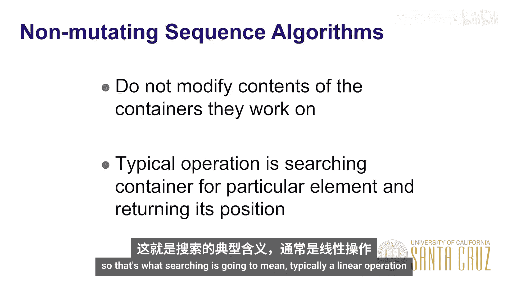
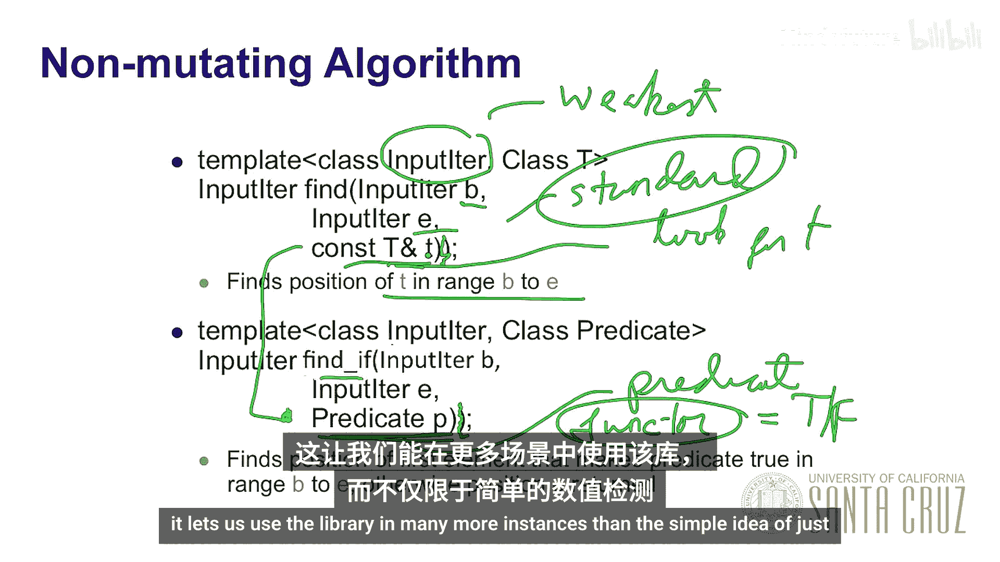
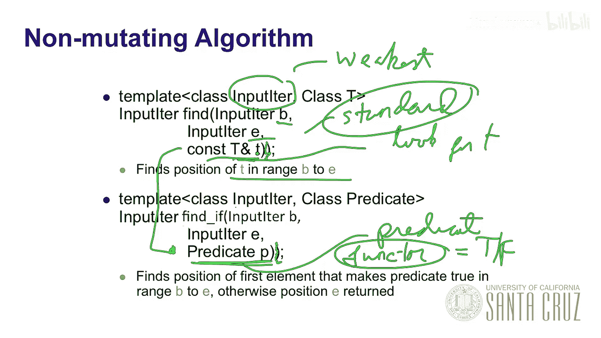
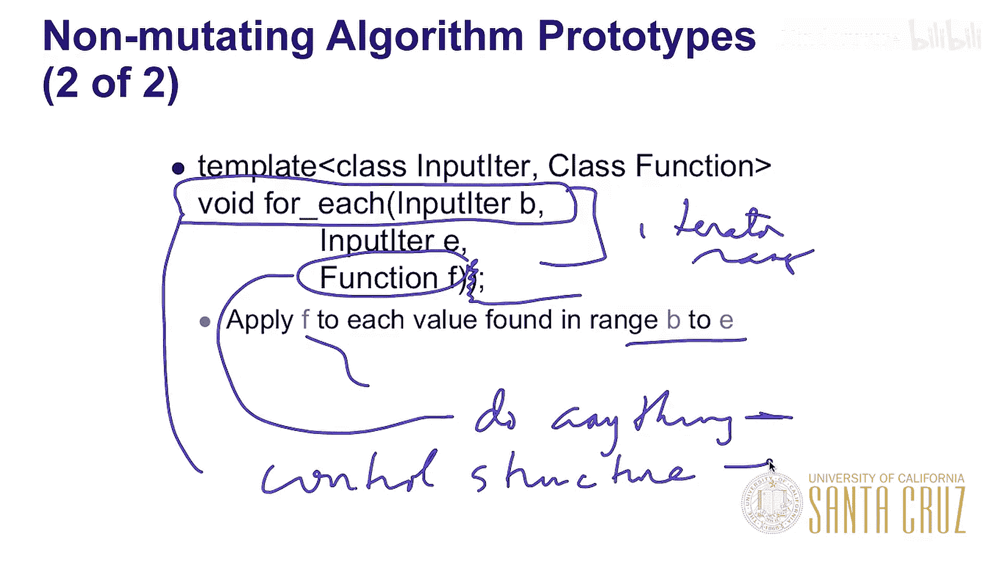
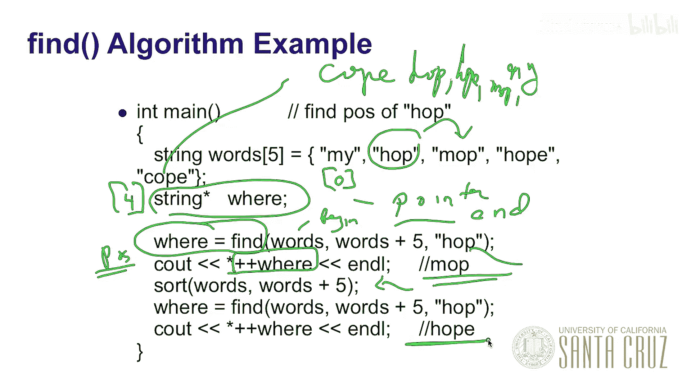

# 【加州大学】C++编程-｜-C-Plus-Plus-B-p12-P12_1-11-非变动算法_01_05_04--BV1KseJzqEbZ_p12-

Non mutating sequence algorithms。 They do not modify the container of the class they work on。

 Their typical operation is a searching operation for a particular element and returning its position。

 So you can imagine that you have a whole bunch of stuff on your desk。

 You could have a whole bunch of。Friends with their telephone numbers。

 and you want to search it to find a particular telephone number。

 So that's what searching is going going to mean， typicallyy a linear operation。

 And here are some of the nonmating algorithms。 you don't change any values。

 but you need to find something。 And again， if you look at the。

Prototype。Here's an iterator range that's a very frequent part of a signature。

This tells you that It it's。It requires a very weak。Iterator type weakest in this case。

And then this is the value being searched for。you're looking for a T in the range B to E。

That's going to be typically a linear time algorithm。

 typically only needs to be done in one direction， so it's a one pass algorithm。

 and that's why something like input iterator is sufficient。Here's a second signature for find。

 It's an overloaded version of find。 And notice in the overloaded version of find。啊嗯。Okay， there's。

For those of you who are wondering about syntax， there's an extra parenthesis here。

And the overloaded version of find。Instead of a value， we look for a predicate。

Recall what a predicate is predicate is。Something that leads to true or false。

So let's say in our pile of stuff。We want to find the first value。That's greater than 1 thousand。

That's a predicate。 We're not looking for a thousand。

 we're looking for the first value that is greater than 1 thousand。

So that means that somehow we can put in here something that a logician would call a funcor。

It's a func tour that yields true or false。And we're going to see how to do that as well。

 so that vastly increases the power。You could， actually。

But this is so common that you want to have that this could be arranged to be a predicate， right all。

 the predicate would be。A value matching T。So it's a subcase。Way more general。

 general and more powerful， but this is this this is。Standards。

 so you might as well have it specialized。We're going to see this kind of signature a lot in STL。

Where we're allowed to， instead of just a value， we're allowed to use a function。

The function will vastly increase。 Remember orthogonality in the design of the library。

 It lets us use the library in many more instances than the simple idea of just testing for a value。

Here's another nonmating algorithm。Again， it uses the idea of。A function。We're going to see this。

In use in an example shortly。Again， there's an iterator range。Again。

 for some reason I have an extra par。呃。And here's a function。

 And we want to apply the function to every element found in the range。

Let's say we want the function to do output。So every element in this range of a four each would be outputted。

And this function lets us sort of basically do anything。And for each， you can see is a very。

 very powerful。In effect， it's a control structure。

So here's our example。We have a string， we have words。We have。

An initialization of the words to my hop， mop hope and cope。 So words sub0 is my， right， This is the。

Sub0 one， and this is the sub4 one。Here we have the equivalent of an iterator， it's a pointer。

So this is what we get back from find， we get back the position， it finds a position。

And we're looking for this is your begin。And your end。We're looking for a position of hop。

So hop is sitting there。And then we're auto incrementing it。 We're moving one pass where we would be。

And that means we jump over here， and we get mop。Here's a sort。So now we're going to sort it。Again。

 this is Quick sort。We sort the whole range， we could sort a subrange as well。

 shows you how using iterator ranges is quite powerful。

 so we could have a whole big sequence and only sort a sub sequenceequence， but in this case。

 we're sorting from the beginning to the end of the array。And we're using legraph sort。

 so cope is going to end up first， right？Cope is going to end up first。呃。

If I'm getting my dictionary order right， I think my is going to end up last。

And then what's in the middle， we have Co。Hoop hope。Mop my， so hop a second。And then， hope is third。

And then。EM。And finally， my。So what comes after hop after sorting is hope。

