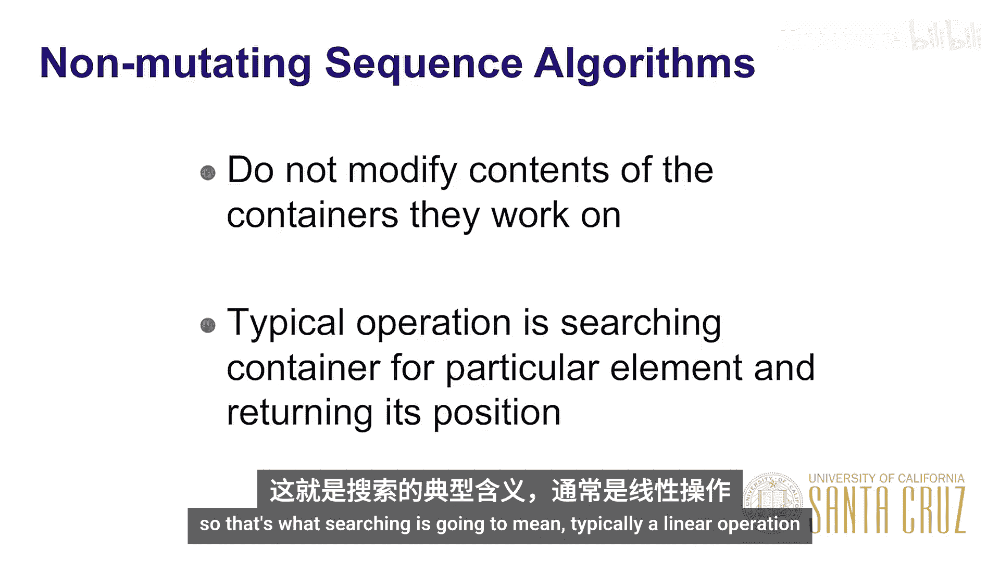
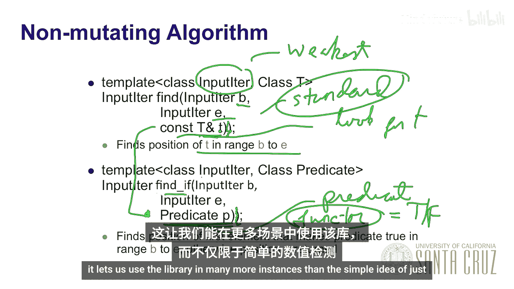
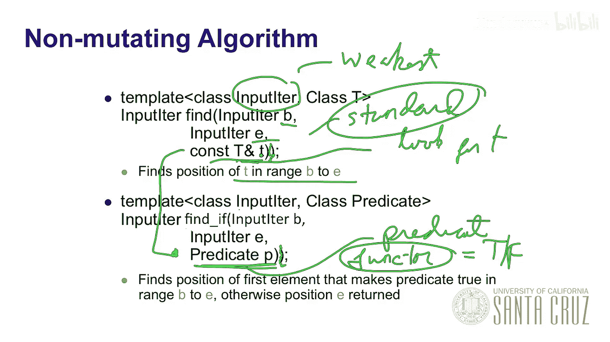
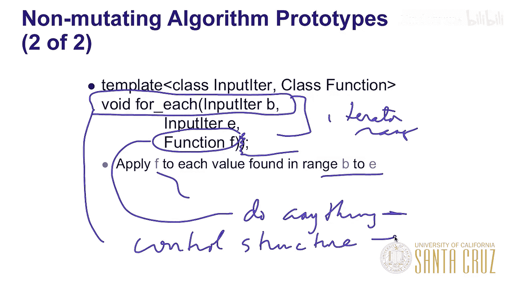
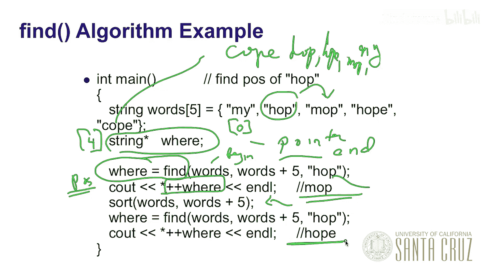

# C++编程：P12：非变动算法

在本节课中，我们将要学习C++标准模板库（STL）中的非变动算法。这些算法用于在容器中搜索或处理元素，但**不会修改容器本身的内容**。理解这些算法是掌握STL高效数据处理能力的基础。

## 非变动算法概述

非变动算法不修改它们所操作的容器或类。它们的典型操作是搜索特定元素并返回其位置。



想象一下，你的桌面上有一堆东西，比如一堆朋友及其电话号码的列表。你想在其中搜索一个特定的电话号码。这就是搜索操作的含义，它通常是一个线性操作。

以下是部分非变动算法。它们不改变任何值，但用于查找某些内容。同样，如果你查看函数原型，会发现一些常见的模式。

## `find` 算法：按值查找

`find` 算法的原型如下：

```cpp
template <class InputIterator, class T>
InputIterator find (InputIterator first, InputIterator last, const T& val);
```

这个签名包含一个迭代器范围 `[first, last)`，这是STL算法中非常常见的部分。它告诉你，该算法对迭代器类型的要求非常弱，在这里输入迭代器就足够了。参数 `val` 是要搜索的值。你将在范围 `[first, last)` 中寻找值 `T`。

这通常是一个线性时间算法，只需要单向遍历一次，因此输入迭代器就足以满足要求。

## `find` 算法：按谓词查找

`find` 算法还有一个重载版本，签名如下：

```cpp
template <class InputIterator, class UnaryPredicate>
InputIterator find_if (InputIterator first, InputIterator last, UnaryPredicate pred);
```

注意，在这个重载版本中，我们寻找的不是一个具体的值，而是一个**谓词**。

回忆一下，谓词是能得出 `true` 或 `false` 结果的函数对象。例如，在我们的一堆数据中，我们想找到第一个大于1000的值，这就是一个谓词。我们不是在寻找1000，而是在寻找第一个满足“大于1000”这个条件的值。

这意味着我们可以在这里传入一个函数对象（仿函数），它返回布尔值。这极大地增强了算法的能力。实际上，按值查找可以看作是谓词查找的一个特例（谓词为“值等于T”）。STL中经常出现这种签名，它允许我们使用函数而非简单值，这体现了库设计的正交性，让我们能在更多场景下使用库的功能。





## `for_each` 算法：对每个元素应用函数

另一个非变动算法是 `for_each`。它的原型如下：

```cpp
template <class InputIterator, class Function>
Function for_each (InputIterator first, InputIterator last, Function fn);
```

这个算法同样使用迭代器范围和一个函数。它会对范围 `[first, last)` 内的每一个元素应用函数 `fn`。



例如，我们可以让这个函数执行输出操作，那么 `for_each` 就会输出范围内的每一个元素。`for_each` 是一个非常强大的算法，本质上，它提供了一种控制结构。

## 代码示例分析

让我们通过一个例子来理解这些算法：

```cpp
#include <algorithm>
#include <iostream>
#include <string>

int main() {
    std::string words[5] = {"my", "hop", "mop", "hope", "cope"};

    // 使用 find 查找 “hop”
    std::string* where = std::find(words, words + 5, "hop");
    std::cout << *where << std::endl; // 输出: hop

    // 指针自增，移动到下一个元素
    ++where;
    std::cout << *where << std::endl; // 输出: mop

    // 使用 sort 对数组排序
    std::sort(words, words + 5);

    // 排序后，数组顺序变为: "cope", "hop", "hope", "mop", "my"
    // 因此，排序后 “hop” 的下一个元素是 “hope”
    where = std::find(words, words + 5, "hop");
    ++where;
    std::cout << *where << std::endl; // 输出: hope

    return 0;
}
```

在这个例子中：
1.  我们有一个字符串数组 `words`，初始化为 `"my"`, `"hop"`, `"mop"`, `"hope"`, `"cope"`。
2.  我们使用 `std::find` 在数组中找到 `"hop"` 的位置，并输出它。
3.  将找到的指针自增，移动到下一个元素（`"mop"`）并输出。
4.  使用 `std::sort` 对整个数组进行排序（内部使用快速排序）。排序后，数组按字典序变为：`"cope"`, `"hop"`, `"hope"`, `"mop"`, `"my"`。
5.  再次查找 `"hop"` 并移动指针，此时下一个元素变为 `"hope"`。

这个例子展示了迭代器范围的强大之处，我们可以对整个序列或子序列进行操作。

## 总结

本节课中我们一起学习了C++ STL中的非变动算法。我们重点介绍了：
*   **`find` 算法**：用于在序列中查找特定值或满足特定条件的元素。
*   **`for_each` 算法**：用于对序列中的每个元素应用一个函数。
*   这些算法的核心特点是**不修改容器内容**，主要用于搜索和处理数据。
*   我们理解了迭代器范围 `[first, last)` 的概念以及谓词函数如何增强算法的灵活性。
*   通过代码示例，我们看到了 `find` 和 `sort` 算法的实际应用。



掌握这些基础算法是有效使用STL进行数据操作的关键第一步。