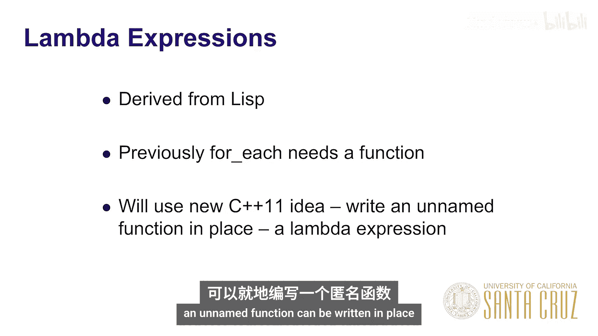
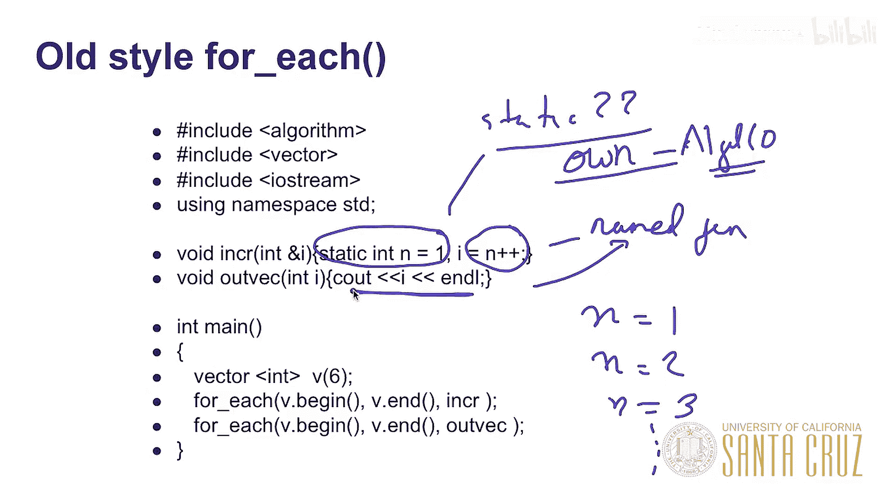
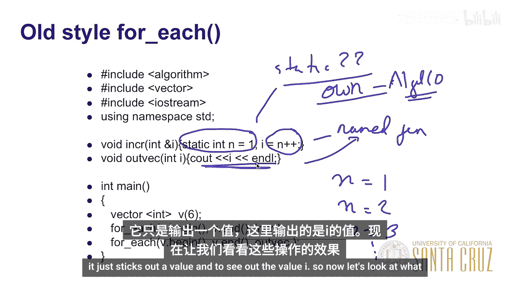
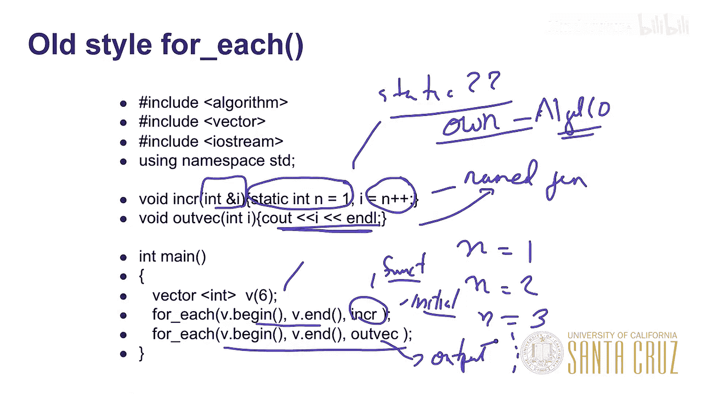
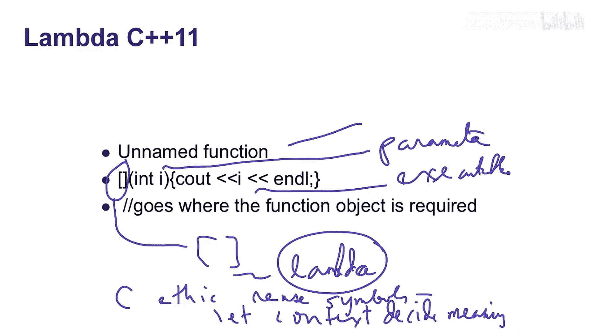
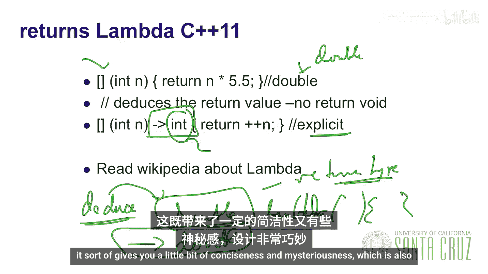
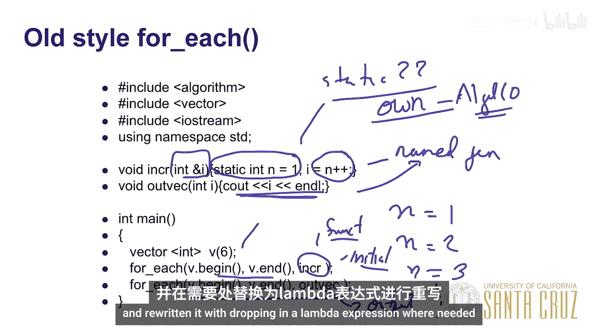
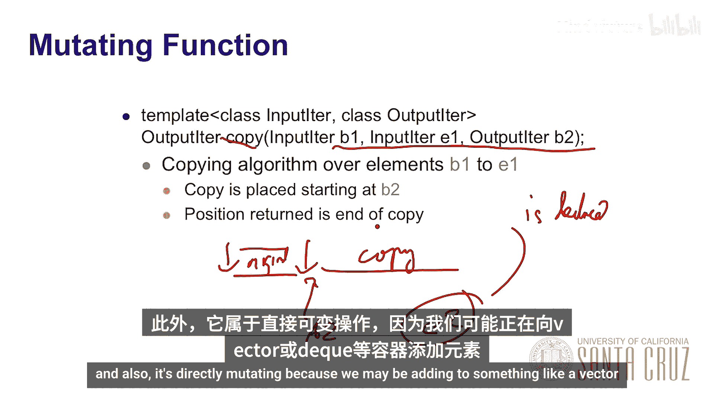
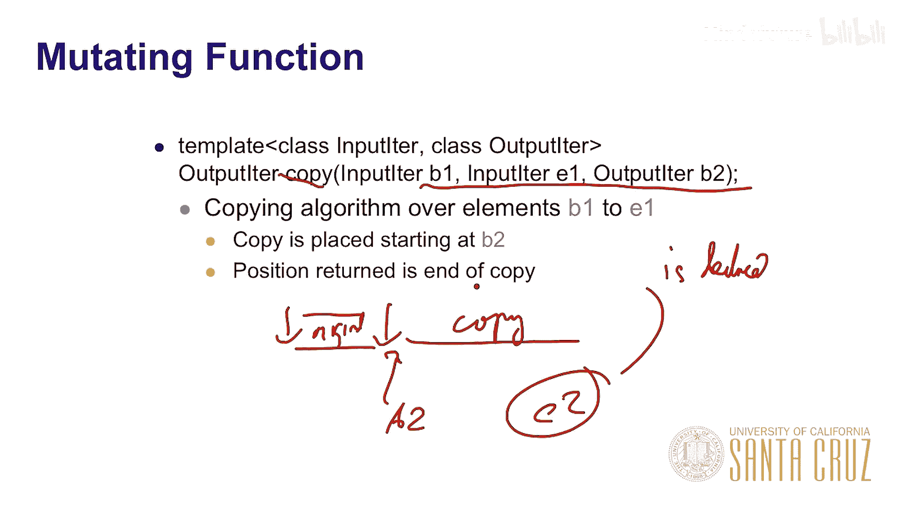

# 【加州大学】C++编程-｜-C-Plus-Plus-B-p13-P13_1-12-for_each函数的Lambda表达式_01_06_01--BV1KseJzqEbZ_p13-

So we've seen how to use nonmutating sequence algorithms。And we saw in some instances that we wanted。

As an argument。A predicate argument or a function argument。 And here comes a new。Very exciting。

 very interesting。To my great surprise feature that got included in the latest。Version of language。

Lambda expressions。So。Lambda expressions are an idea that come from Lisp。Lisp is the original。

Major AI language。Was based on。Churches land the calculus。

 so it was sort of a logician's idea of doing computing。Wasn't worried about efficiency。

 it was initially implemented with a compiler interpret not a compiler， but an interpreter。

So was typically very slow in order of magnitude slower than the hardware。 so in some sense。

 land expression came from a language computing milieu that was the opposite to the milieu。

 the system implementation language idea behind sea。So these two things are strikingly different。

 so to find that the， in effect， furthest away idea from what initially was C as a system emblementangle get added into the new version of the language。

 Lambis。Was just striking to me， but it makes perfect sense。

 I almost can fall in love with the feature， even if you don't have Lisp experience or in more modern terms。

 functional languages such as Haskell， which also make very strong use of it。

So if we go back to what we just saw， we're in for each， you need a function。

Lambda expressions give you a way to write a function in place。

 an unnamed function can be written in place。

So here's old style。Let's look at an old style for each。We have two named functions。

 this is a named or ordinary function。It's pretty easy to see what they do。Increment。Takes。

Call by reference， an integer。Has a local static variable， you have to remember。

What static means in this context。You recall？If you're all here in my classroom。

 I would I'd ask this as a question for whoever could get it first。 Sta means when the program。

 when the call to increment exits， the value is retained。 So we start with n equal 1。

 But notice n is going to change。 So on the next call， N is going to start at2 and each sub。In turn。

 is going to change by plus one。 So each call is going to have a different starting value event。

 That's what static means there。For those of you who are。Afficionados of programming languages。

 this concept was in Algal 60。First as what was called an own variable。

The second thing is the South effect， which is just putting out a value。

Right， it's non mutating。 It just sticks out of value into to see out the value I。

 So now let's look at what these do。 Here's an integer vector。 It's got six elements。

 Here's for each。 and the for each。

Over the vector range does an increment。So what is it going to do。

 it's going to shove into because it's called by reference。A sequence of values。

 and they're going to be the values I believe。Wn。Through six， so we're going to get those values。

Shuved into。Into this container， into the sequence of K。 And then this for each uses outvec。

 So here's the two functions。They're being applied to the sequence。

 one of the functions does the initialization。And the other function does the output。Old style。

So what got printed， that's for you to decide， think about that a second。

The answer is static keeps the value on exit， so the printouts are1 through six。Now。

 what if we substitute instead of the name functions， a lambda expression， first off。

 we have to know how to write a lambda expression or unnamed function。

I guess I'm not that happy about the syntax。But this bracketing syntax is like saying lambmbda。

So in that context。Again。Here's a place where I'm not completely sympathetic to。TheThe C ethic。

 but the C ethic。Reuse symbols。Let context decide their meaning。In some ways。

 that makes the language subject to。Readability constraints， because in many cases。

 the empty brackets are really intended to mean a declaration。If you find them contextually in。

A function call， they mean a pointer in old sea。 So the fact that they chose not to define something that would make it clear like Lambda。

 which would make it very clear， is just habitually something that the sea community does。嗯。

In a nice way， it makes us all feel cognizante that we are into all this esera。Okay。

 so it was taken from Lsp。 It's an noname function。 Here is， in effect， the parameter list。

For the unnamed function。And here is the executable。 So the executable and the parameter list。

Look pretty much the same so it's not like you're going to have to learn a lot。

 you just have to learn to use it and then contextually you drop it in where you need it。

that's frequently local functions。

Here are some lamb that's just very simple ones。The first one is something that does a calculation。

And you get the value of an integer value times a double value。

And that means that it's going to return double。And the compiler understands that。It's as if。

It would have double。Lambda。Argument list。Here， so you don't have to specify the return type。

The compiler makes sure you get it right。It's a deduction。That's nice， that's a convenience。

 and it's also a type safety issue。And here， again。呃。You're going to deduce that。

It's an integer value， but here we've also set it explicitly。

You might want to read more about lambmbdas， where do we sit explicitly？

We said it explicitly with this notation。So we can also have said。Arrow double。Showing arrow。Again。

Think about。Arrow， arrow occurs lots in old C。 it's the pointer operation in old C here contextually it's used to say the return value is double again。

It sort of gives you a little bit of conciseness and mysteriousness。Which is also very clever。

So we've seen templates and you should be able to with those templates and with things like those predicates。

 you should be able to turn them into lambmbda expressions so you could have rewritten。

The old style for each that I just showed you and rewritten it with dropping in a lambmbda expression where needed。

Mutating functions。 That's sort of the next mutating functions。A traditional prototype。

 archetypal mutating function。Is copy。and copy we have。3 iterator ranges。 we have。

So B2 is telling us take a copy。Take these elements and make a copy starting at wherever B2 is。

 This is the copy。This is the original。Why don't I specify an E2。Because E2 is deduced。Right。

If I'm going to copy these many elements。I know how many elements I'm copying without having to specify an E2。

And then we return a position at the end of the copy。 So we could copy over。

 And that's why it's mutating。 and also。

It's directly mutating because we may be adding to something like a vector or a deak。

