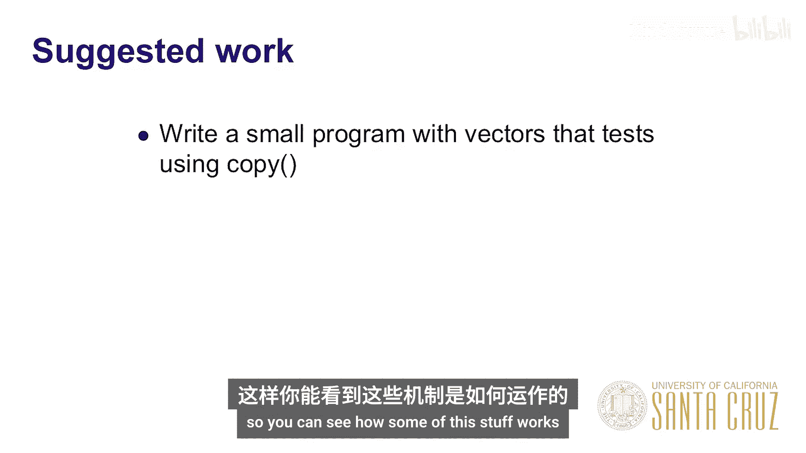
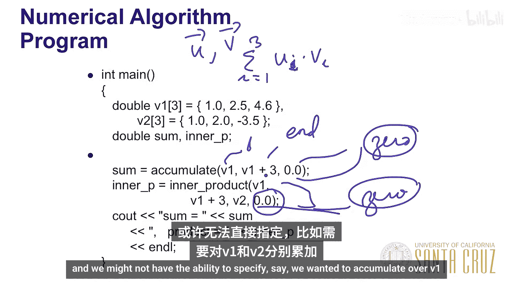
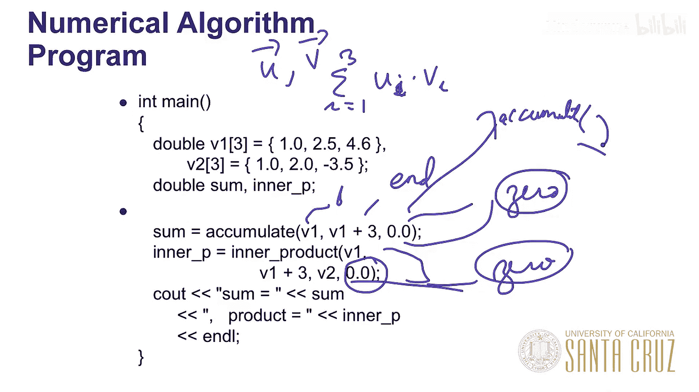
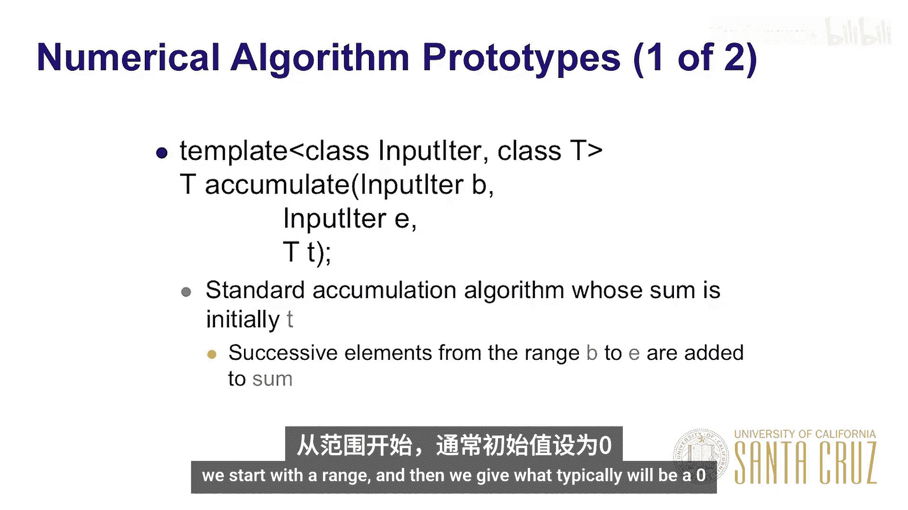
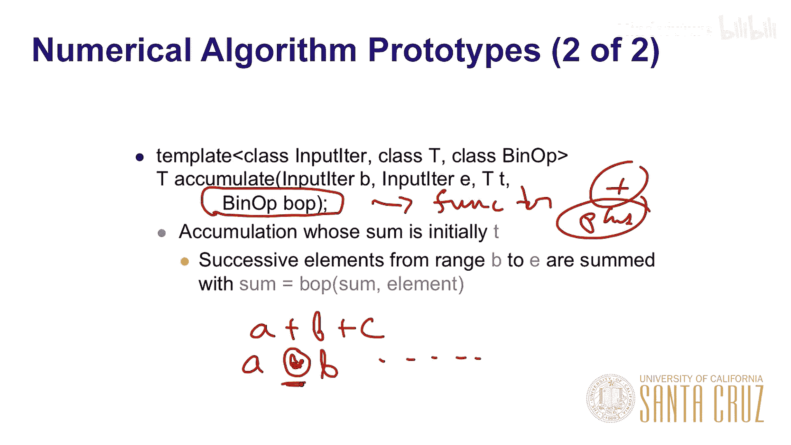

# 【加州大学】C++编程-｜-C-Plus-Plus-B-p14-P14_1-13-数值算法_01_06_02--BV1KseJzqEbZ_p14-

Final category of algorithm， numerical algorithms。These are things like sums， in products。

 adjacent sums。And generally speaking with the numerical algorithms like sums or accumulate。

They are going to be functions that can behave differently depending on what numerical operations are used with the functions such as plus in times。

And depending on whether the underlying types have appropriate definitions。

So it isn't absolutely the case that you have to use the numerical algorithms。On。Mathematical types。

 you have to use them on types that have the。They could be pseudo mathematical types as long as they have the appropriate operation。

 for example， in sums， you're going to need the operation。A plus defined。

 And if you have that some operation plus defined。Then it may make sense to use it on something that you wouldn't normally think of。

As a numerical。Entity to be some example， common example in programming is strings。

 When I take string one and add it to string  two， it's concatenation。 I have a longer string。

 so it is reasonable though it could be obscure and it could be dangerous to apply numerical algorithms to non-nu types。

 but the basis for doing numerical algorithms is really to produce numerical results that's the real use and you probably should avoid using them in these other clever ways。

Okay， I suggest that you also try to write a small program with vectors that test using copies so you can see how some of this stuff works。

Now heres an actual numerical algorithm。Very simple one。We have two primitive containers。

 It could also be done with vectors or the newer type array， so again。Depending on your energy level。

 you might try to redo this with some other container class。In one case。

 we're going to produce some sum in the other case。

 we're going to produce something that we call the inner product。And some we going to accumulate。

And we have three elements。 So here's the begin end range。

And here is what we start the accumulation with and the typical thing that we start with is a zero。

So we're going to add to 01 and 2。5 then 0。6。Here's an inner product。Again， we give it a range。

That's the。The inner product， if you remember， is。A。If I had two vectors， let's call them V and U。

The inner product is in mathematical terms， the sum。呃。Ui times the I。In this case。

 when I went from one to3。So it would just be multiplying one by one，2 by 2。5 minus3。5 by 4。46。

 and again， you have a starting value。A。Which is much traditionally a zero。And by the way。

 by starting traditionally at 0， we could have avoided using that。

 but by allowing an arbitrary value there， we again。Maximize the orthogonality of the algorithm。

 because we could want to accumulate over several ranges。

 and we might not have the ability to specify， say we wanted to accumulate over V1 and V2 separately。

 So we'd have to do this first。 We'd get an answer。 And then we could do the second one。

And we can actually shove。The V1， as an argument。Here， we could make that accumulate。

And then give it parameters。So you can see that that' sort of in effect。Creates。

Interesting opportunities that expand the utility of the STL library。

So here's a prototype for what we've just seen。We start with a range。

 and then we give what typically will be a zero。

And here's this further other interesting idea that lets us use something like a lambda or an equivalent。

 which is。A。An operator that's intended to be a binary operator is actually an， again， a funnctor。

 It's actually a definition。You can't。 You're not going to actually put plus there。

That you could put something like plus as a function that you define。

But you can put an arbitrary binary operator there。

 and then accumulation is going to work not by doing a plus B plus C， but instead will be A。

 the binary operator， whatever special thing that is。Plus， B， et cea。So now you again。

 through orthogonality and through possibly using something like a lambda that would operate as a binary operator。

A vast expansion of the effective use of the library。

