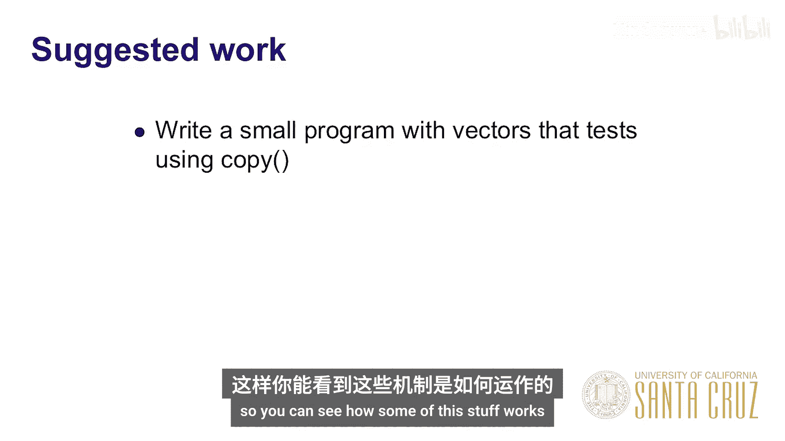
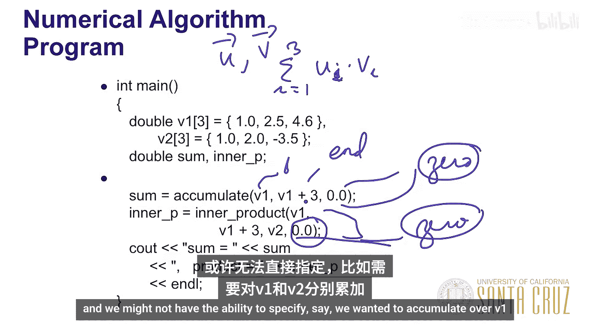
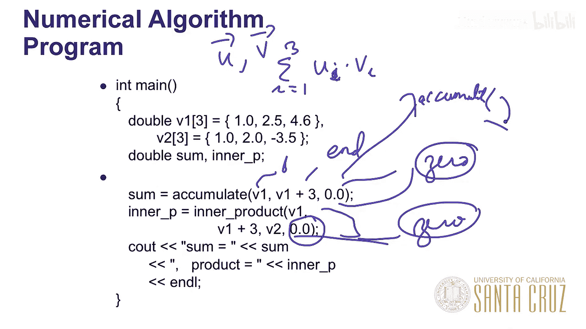
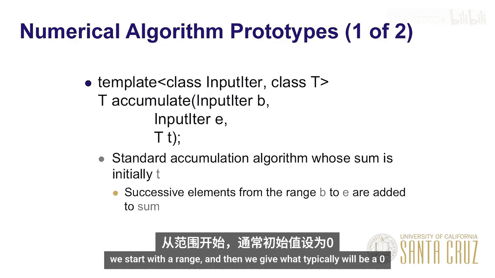
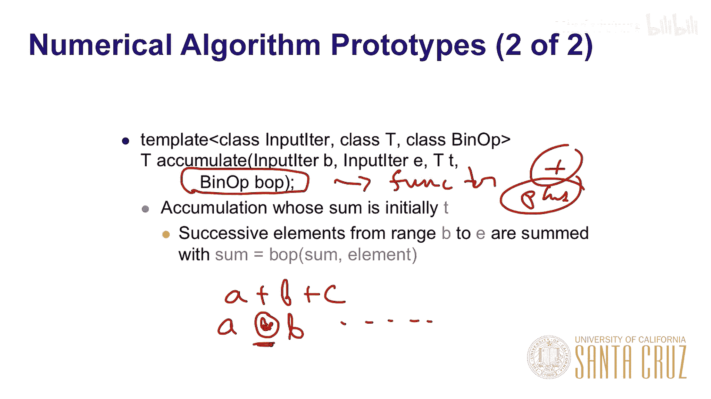

# C++编程：P14：数值算法

在本节课中，我们将要学习C++标准模板库（STL）中的最后一类算法——数值算法。这类算法主要用于执行数学运算，例如求和、求积和计算内积。我们将了解它们的基本用法、灵活性以及在实际编程中的应用。

## 数值算法概述

数值算法是STL中用于处理数学运算的函数。它们包括求和、求积以及相邻元素求和等操作。这些函数的行为可以根据所使用的数值运算（如加法或乘法）以及底层数据类型是否定义了相应的操作而有所不同。

数值算法并非只能用于严格的数学类型。只要数据类型定义了相应的操作（例如，对于求和运算，需要定义了 `+` 操作符），就可以使用这些算法。一个常见的例子是字符串：将两个字符串“相加”实际上是进行拼接。虽然可以将数值算法用于非数值类型，但这可能使代码难以理解且存在风险。数值算法的核心用途是产生数值结果，因此建议避免将其用于其他“巧妙”但非常规的用途。

上一节我们介绍了数值算法的基本概念，本节中我们来看看具体的函数示例。

## 求和与内积算法

以下是两个基本的数值算法示例：`accumulate`（求和）和 `inner_product`（内积）。它们通常作用于容器（如数组或向量）的元素上。



```cpp
// 示例：使用 accumulate 求和
#include <numeric>
#include <vector>
#include <iostream>

int main() {
    std::vector<double> vec = {1.0, 2.5, 0.6};
    double sum = std::accumulate(vec.begin(), vec.end(), 0.0);
    std::cout << "Sum: " << sum << std::endl; // 输出：Sum: 4.1
    return 0;
}
```

在上面的代码中，`std::accumulate` 函数接受一个范围（由迭代器 `begin` 和 `end` 指定）和一个初始值（这里是 `0.0`）。它会将范围内的所有元素依次加到初始值上，并返回最终结果。

```cpp
// 示例：使用 inner_product 计算内积
#include <numeric>
#include <vector>
#include <iostream>

int main() {
    std::vector<double> v = {1.0, 2.5, -3.5};
    std::vector<double> u = {1.0, 2.0, 4.46};
    double inner_prod = std::inner_product(v.begin(), v.end(), u.begin(), 0.0);
    std::cout << "Inner Product: " << inner_prod << std::endl; // 输出：Inner Product: -11.61
    return 0;
}
```

`std::inner_product` 函数计算两个序列的内积。在数学上，对于两个向量 **v** 和 **u**，其内积定义为 **Σ (v_i * u_i)**。该函数接受第一个序列的范围、第二个序列的起始迭代器以及一个初始值。

## 算法的灵活性与正交性

STL数值算法的一个强大特性是其灵活性和正交性。通过允许指定自定义的二元操作符，我们可以极大地扩展这些算法的用途。

以下是 `accumulate` 函数的原型，它展示了如何接受一个自定义的二元操作符：



```cpp
template <class InputIt, class T, class BinaryOperation>
T accumulate(InputIt first, InputIt last, T init, BinaryOperation op);
```

在这个原型中：
*   `first`, `last`：定义了输入序列的范围。
*   `init`：累积操作的初始值，通常为 `0`。
*   `op`：一个二元操作符（函数对象、函数指针或Lambda表达式），用于替代默认的加法操作。



通过提供一个自定义的 `op`，累积操作将不再执行 `A + B + C ...`，而是执行 `op(op(init, A), B)...`。这种设计使得算法不再局限于简单的加法，可以执行任何符合逻辑的二元累积操作，例如乘法、字符串连接或更复杂的自定义操作。



这种正交性设计极大地扩展了STL库的效用。例如，我们可以先对一个向量 `V1` 使用 `accumulate`，然后将结果作为初始值，再对另一个向量 `V2` 进行累积，从而实现跨多个范围的复杂计算。

## 核心概念总结

本节课中我们一起学习了C++ STL中的数值算法。我们了解到：

1.  **数值算法**主要用于执行如求和、求积等数学运算。
2.  它们不仅可用于内置数值类型，也可用于任何定义了相应操作符的类型（如字符串拼接），但应谨慎用于非数值目的。
3.  我们重点介绍了两个函数：
    *   **`std::accumulate`**：用于计算序列中所有元素的累积和（或使用自定义操作符的累积结果）。
    *   **`std::inner_product`**：用于计算两个序列的内积。
4.  这些算法的强大之处在于其**正交性**和**灵活性**。通过接受自定义的二元操作符（如Lambda表达式），它们的功能得到了极大扩展，可以适应各种复杂的计算场景。



建议你尝试编写小程序，使用向量测试这些算法，以加深对它们工作原理的理解。