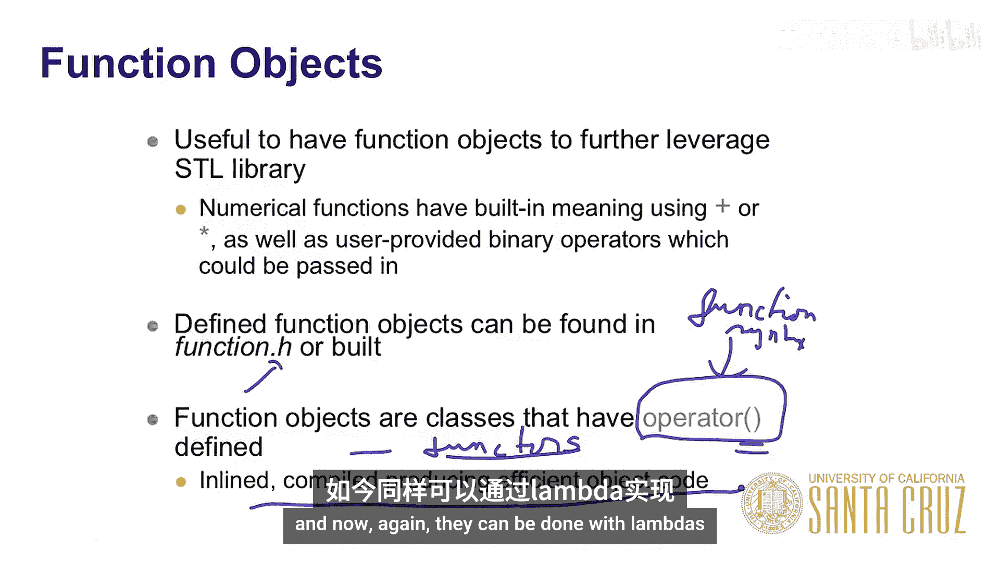
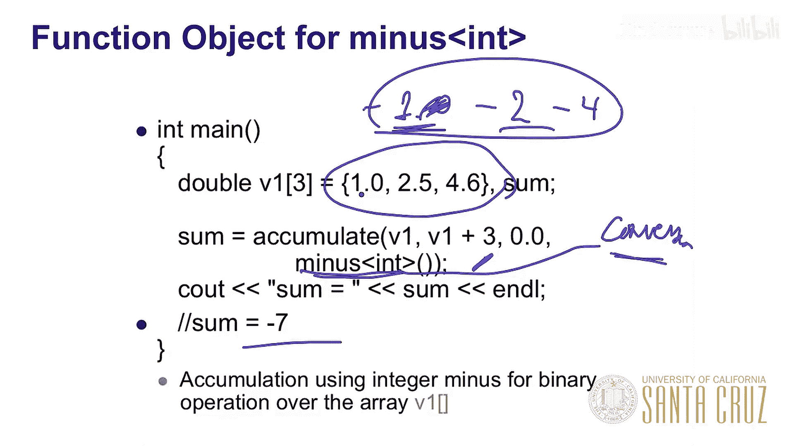
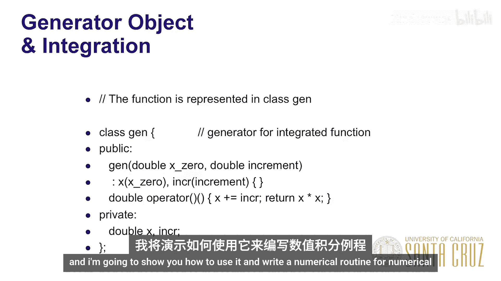
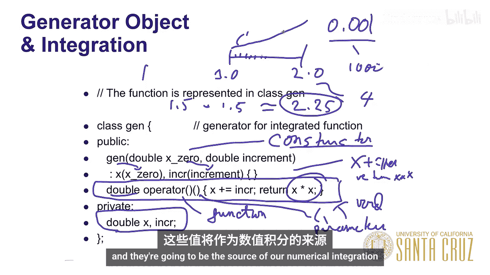
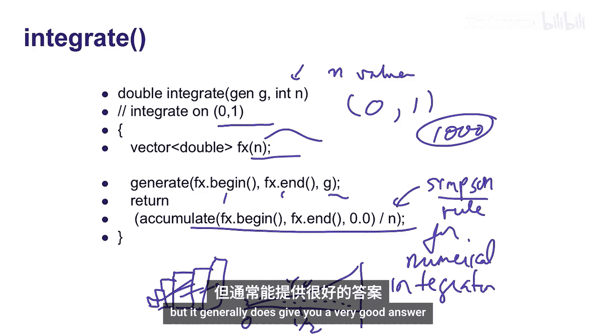
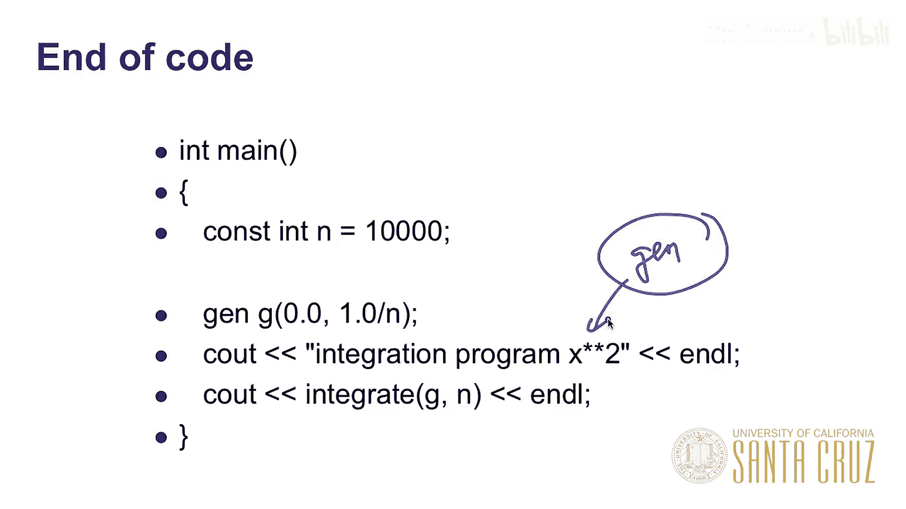

# 【加州大学】C++编程-｜-C-Plus-Plus-B-p15-P15_1-14-函数对象_01_06_03--BV1KseJzqEbZ_p15-

So STL， even traditional STL， had the ability to use function objects such as binary operator。

There were built in meetings。So you could say things like plus and minus and give them a type they were part of the templates in the built in function objects in SDL。

 some of them could be defined in a library called function or function。 H if you using old style C。

And these function objects were defined in classes。That had。Operator。

This is basically the way to overload function syntax。

So this gate rise to function objects are what I was calling functors。

And it was through a class mechanism， and there were predefined things in the templates that you could include。

A。And these were indeed in line and could provide very efficient code as function objects。 And now。

 again。They can be done with。

Lmbs。Here's an example。Here's your binary operator。We're calling minus， which is a function object。

 minus on integers， we're doing this accumulation。But now instead of it being the ordinary add function。

 we're going to be basically doing one zero。我。It's a little tricky because I I'm doing it as an integer operator。

 so I'm going to be doing integer division。So I'm going to do one。-2。-1， minus-2， minus-4。Excuse me。

These are going to be converted。Because of that， the tricky is a complicit conversion。

And we're going to end up with -7 from。These now being done in。And an integer。Sense。

Okay。There are other kinds of important function objects， again， they vastly expand。

The ability to use STL。One such。Funur function object is a generator object。

And I'm going to show you how to use it and write a numerical routine for numerical integration。

So for those of you who had a little trouble with calculus and you were never quite getting the right answers。

 you can replace it with your own program and let the program compute your answers for you。So。

 let's look at。This， specifically。So this is overloading function。

 it means we're overloading functions and text。We're overloading it with。Parameter list， that's void。

So in this case， it's void。And then we're giving it a meaning， which is x。Plus。

 equals some increment。Return x squared。So the return type is double。

And these variables are the private variables of the class。So X and increment。Are， in fact。

 available。And they're available through this。Constructor。A little bit unusual。

 So here's initialization x is。Initialized to whatever the zero value is。

 And then increment is initialized to whatever you want as an increment。 So think of this。

 as let's say， on the real line。Let's say I want to start at 1。0， an integrated object。2。0。

 And I want the increment to be 0 at 0，0，1。 I want to have little。Increments， that's going to be up。

In effect，1 thousand0 of them。So that's what's going to be done。

 and this is going to compute x squared。At each point。

So it's going to start off at one x squared at1 is1 by the time it gets to two it's going to be4。

 and then let's say when it's at 1。5， that's going to end up x squared is going to be2 and a quarter。

So this is going to go through and produce。A set of values。Something like this。

And they're going to be the source of our numerical integration。

So， into the integrate program。We pass in this generator。It's a class object。

But its real job is to produce a series of values。 It's really a generator in the sense that it generates a sequence。

It's going to generate a sequence of end values。That's going to generate n values。

We're going to allow it to integrate over the range 01。We're going to start with。

So if we think of thousand， n was passed in as a thousand。

 it's going to be a vector of size a thousand。And here's some。Fx begin Fx and。And a generator。

And this is now going to return。That series of values。In the F x。

And that's going to be these values x squared。 So what it's really doing is it's taking。Here's one。

 here's zero， let's look at a half。A half this value is going to be a quarter。

So it's going to produce all these values all along here， all these thousand values。

 and then we're going to return and accumulate them。And then we're going to average them。

And this is really what might be called。A simpson style。For numerical integration。We're basically。

Integrating numerically by adding all these little rectangles。And they're each。At。

1 over in intervals。And this is the numerical， if you remember your calculus doesn't matter。

 this is basically a numerical approximation to an integration。

The nice thing about it is it always works。 so it may not be super accurate。

 You'd have to know a fair amount of numerical analysis and make sure that the function was smooth。

 but it generally does give you a very good answer， and we can。

Actually， call this。And see how it works。 in this case， we're integrating over。Rang of 10，000 values。

And we're integrating x squared。For those of you who have calculus。

 try it and you can try it with other things as well。If you want to try it for other things。

 you have to change the generator package， right？Generator is what gave us x squared。

