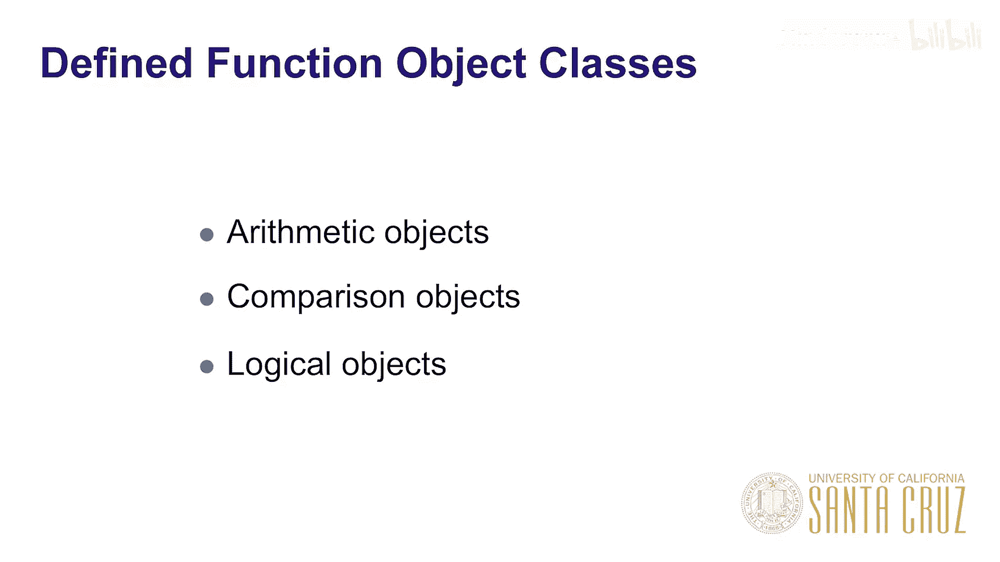
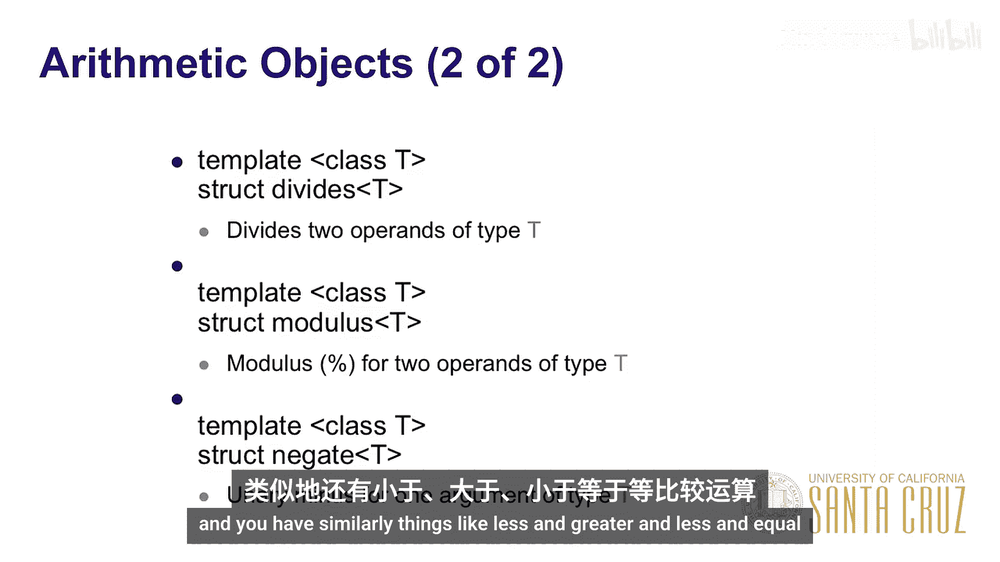
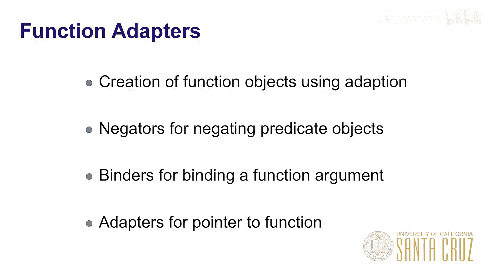
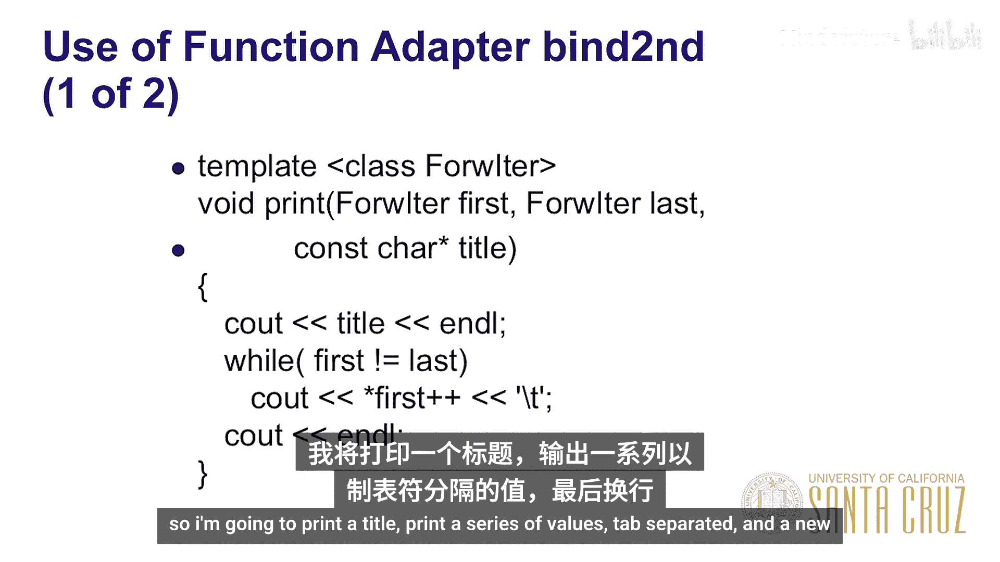
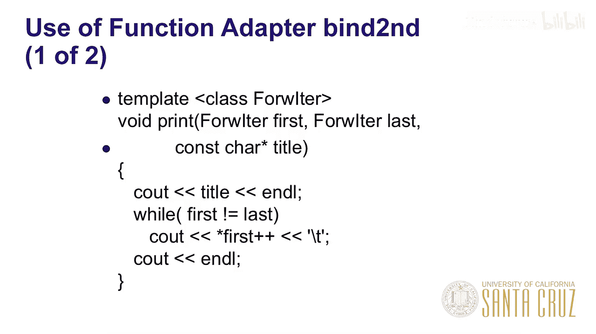
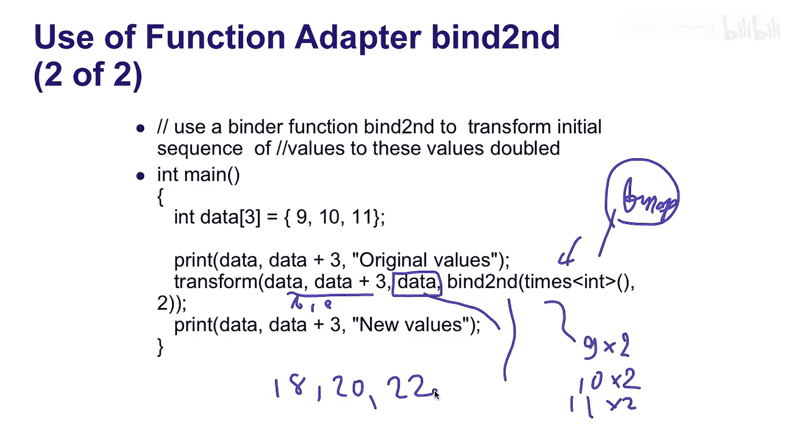
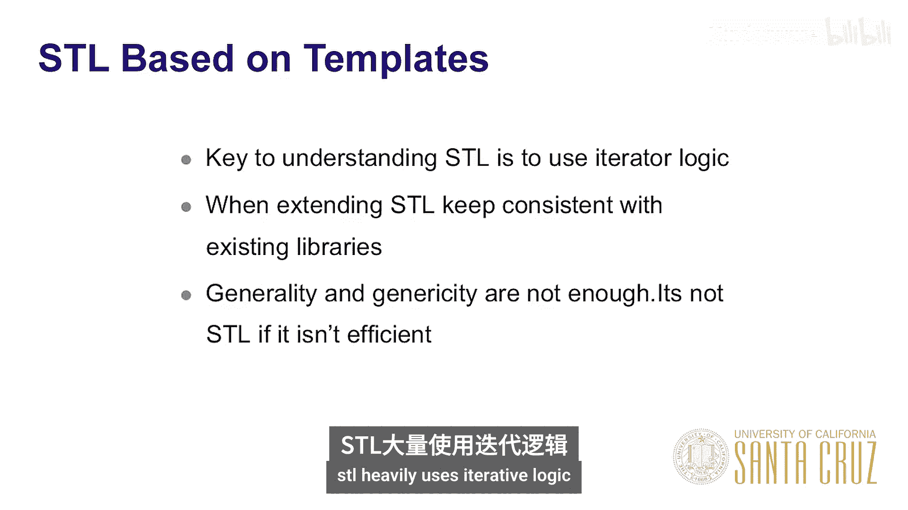
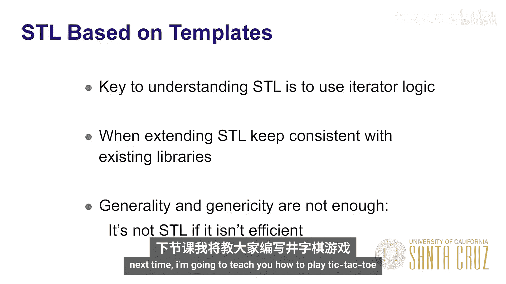
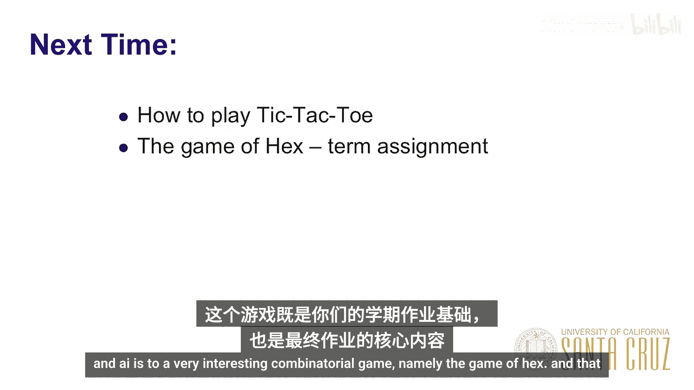

# 【加州大学】C++编程-｜-C-Plus-Plus-B-p16-P16_1-15-已定义函数对象类-函数适配器_01_06_04--BV1KseJzqEbZ_p16-

Now。Where we got a lot of power was we could have minus plus， we had arithmetic objects。

 binary objects， predicate objects， all of those exist in these function class objects。

And there are three big categories in arithmetic objects， comparison objects like less。

 less may be used in things like maps。诶。Logical objects， predicates， you can do ans and os this way。

Here's what some of the arithmetic objects look like plus minus times。

 they're all specified as templates， they have to be defined。

 you have to have these things defined in terms of their types。

 if they are defined if the plus operator defined over the type， that's the binary plus operator。

 that's what you're going to get， when you invoke this thing， for example。

 accumulate using one of these arithmetic funs。More ametic objects negate modulus divide。

And you have similarly things like less and greater and less than equal。

And then there are also some further kinds of special function adapters。

There are things like negators for negating predicate objects。

 there are things that allow the creation of function objects using certain kinds of adaptation。

One such adaptation is a binder for binding a function argument。

 So the typical thing in a in a binding thing is， let's say we have。Two arguments， A and B。

And we actually can't use a function that has two arguments。

 We need to use a function of one argument。So we've defined something which requires a function of one argument。

 but we're stuck with something that provides a function of two arguments。

The adapter that binds allows us to take the two argument function and turn it into a one argument function。

 a simple example might be make the second argument always one。

So that the adapter would say instead of a function of a plus B， B is always one。

 So now it's a plus1。And now。We only need the one argument A because B is always going to be the second argument。

 this constant。

And here we'll see a use of it in a simple case。 I have a print method that I've written。

It needs a forward iterator， I'm going to print out some title。

 and then I'm going to print out from first to last。What I think is the values。

Sitting in that sequence and then a new line and then tab characters。 So I'm going to print a title。

Prrint a series of values， separate tabs， separated and a new line。

And here's a binder function。 So here's the initial sequence of values，9，1011。

If I print the original values， of course， I'm going to get 9，10，11 printed out。

Now I'm going to transform those values through the binder function。

And how is the transformer function going to work。Guue。Here's my beginning range。

Here's what I want to operate on。So this is a mutating function。

And here's what I want to be the bomb thing。 I'm taking an argument， which is going to be an integer。

 I'm going to use a times operation， And I'm going to multiply the argument by2。 So basically。

 I'm going to have n times 2。10 times 2。11 times 2。

So this binding function takes what would otherwise be a binary up。Transforms it。

To a single value and applies it to the values in data and gets these new values。They're replaced。

It's， in effect， copy like。But it's transforming， so it's mutating。So we're going to end up with。18。

2022。

SDL is based on templates， key to understanding STL is iterative logic。

 SDL heavily uses iterator logic。

So you just， if you want to write STL functions， STL like functions。

 you want arguments to typically be iterator ranges。You want when you。Try to write like STL。

 you want to keep。Consistent with existing library practice。Geneality and generosity are not enough。

You have to make sure things are efficient， so youve got to use inlining。

Wherever in liing is appropriate。And youve got to leave things consistent in the sense of you might want to have a version of an algorithm that just goes over some iterators and has an implied operation。

 or you want to make the operation be a funtor。Allow a special function because that again。

 will increase。The reach of whatever you're doing。So by looking at the standard elements of STL。

 you should。Grass what the design features are， and hopefully the comments in the last set of talks have given you a very good sense of what that is。

Next time。

Next time I'm going to teach you how to play Ti Tto。

 probably many of you know how to do that already， but we have a purpose in mind。

Tickte toe is very simple， we all understand it。And we're going to generalize it in very important ways and the main assignment to see how to apply all the ideas we're teaching you in C++ and C+ plus 11。

And AI is to a very interesting combinatorial game， namely the game of Hex。

 and that game is the basis of your term assignment， of your final assignment as well。

 what you're going to be working on to capture all these ideas the C++ ideas and the algorithmic ideas in in this rather unique assignment Okay。

 we'll see you next time。

