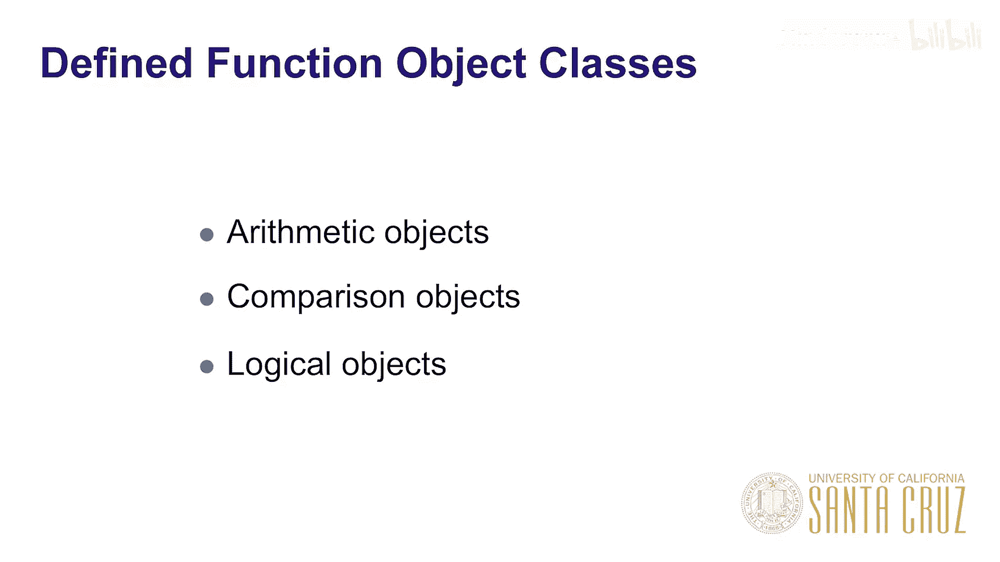
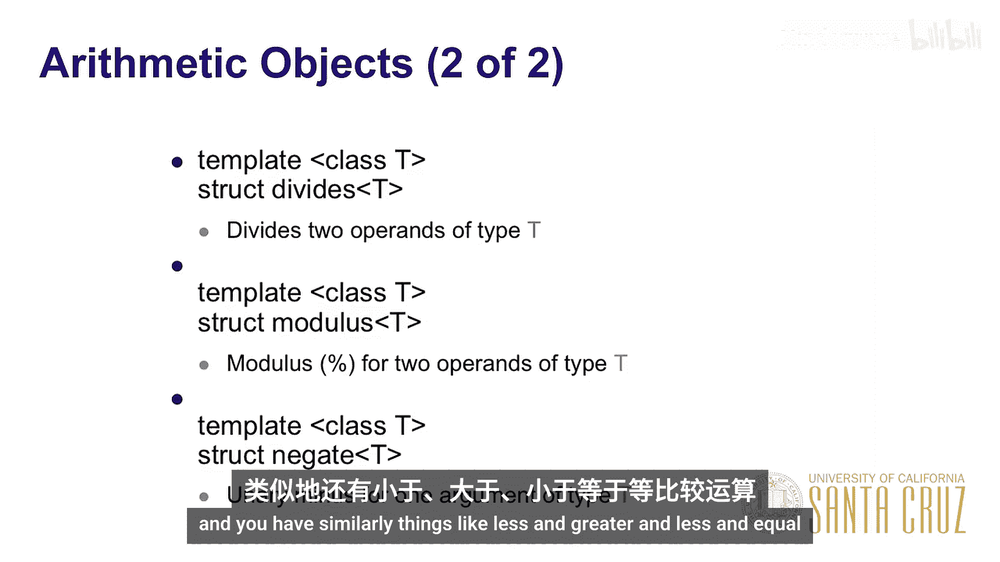
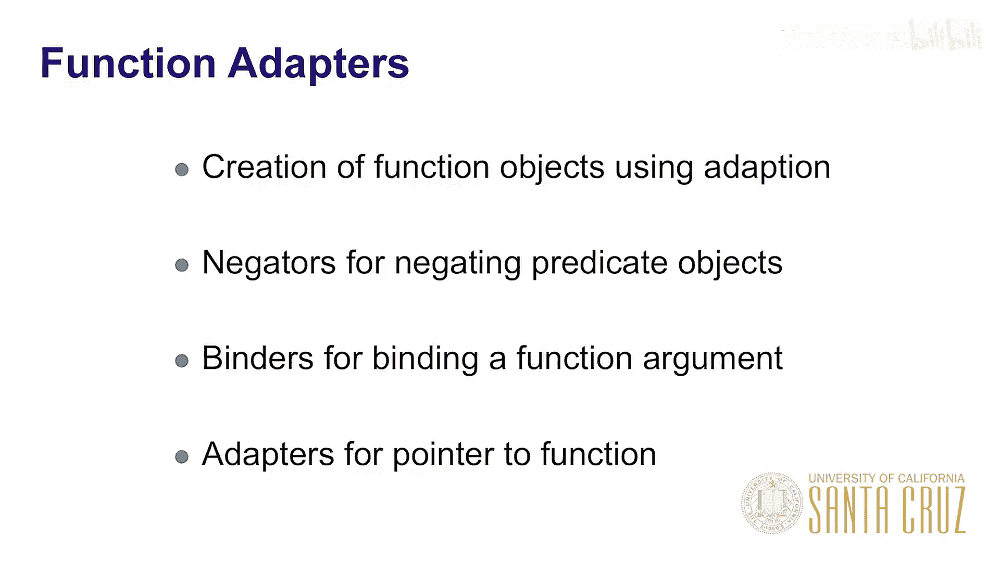
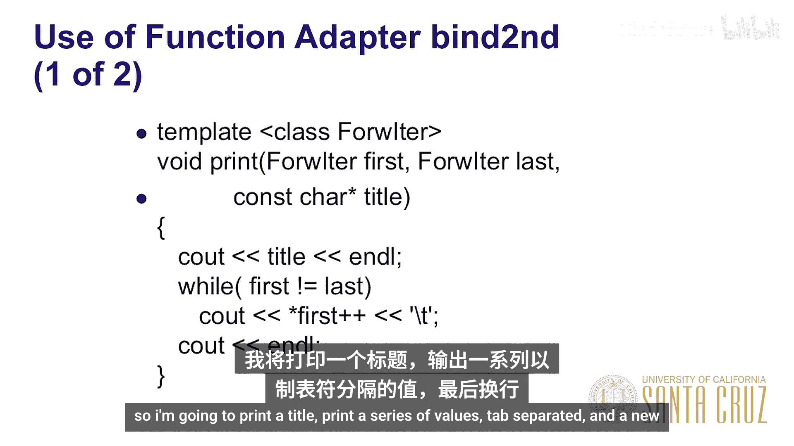
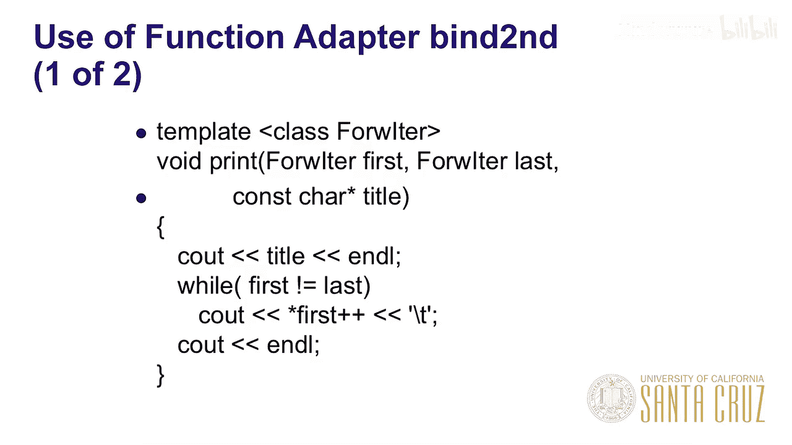
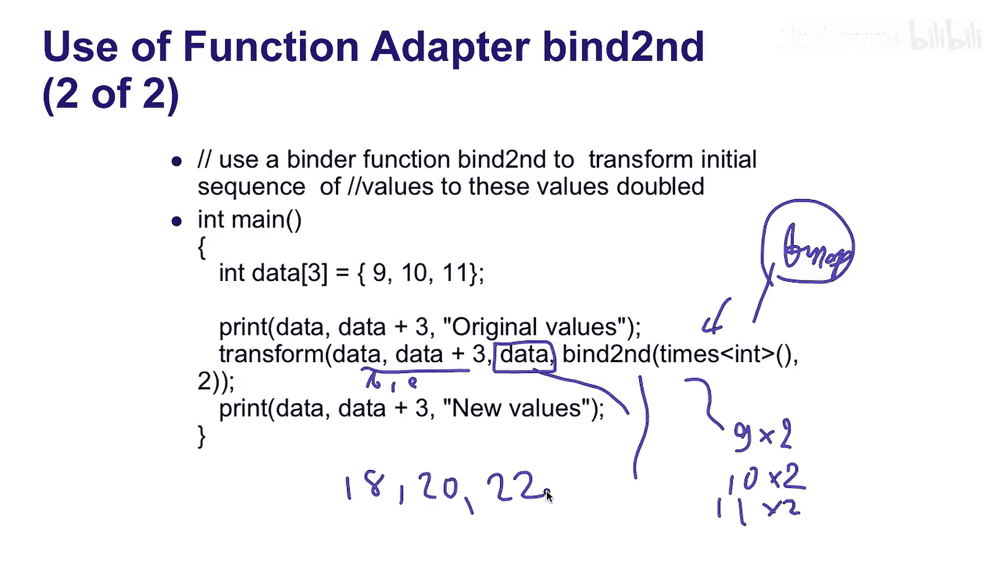
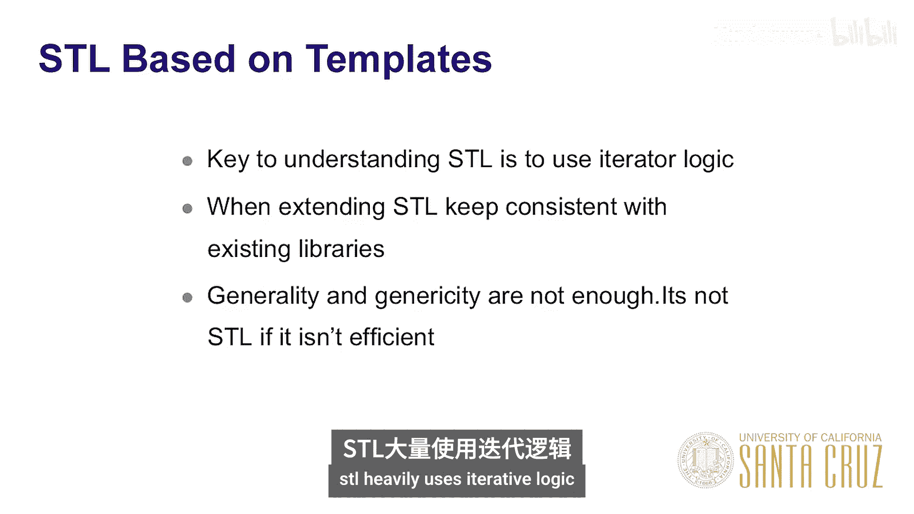
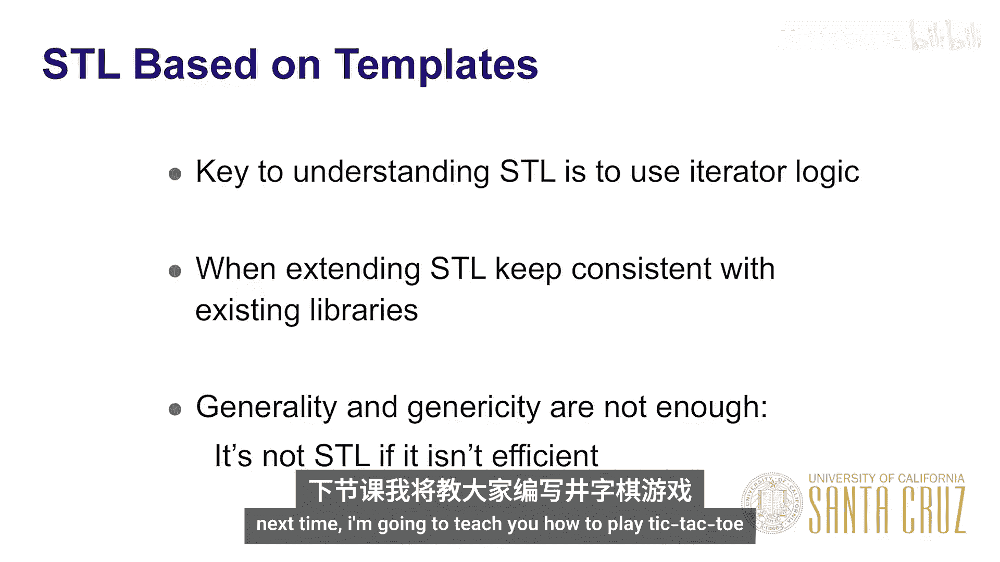
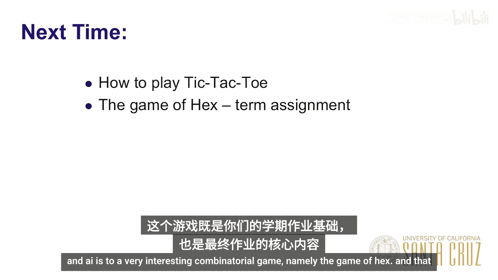

# C++编程：P16：已定义函数对象类与函数适配器 🧩

在本节课中，我们将学习C++标准库中预定义的函数对象类以及函数适配器的概念。这些工具极大地增强了算法的灵活性和表达能力，是理解STL设计哲学的关键。

## 函数对象类的强大功能 💪

上一节我们介绍了函数对象的基本概念。现在，我们来看看标准库提供的强大功能。我们可以使用 `plus`、`minus` 等算术对象，以及二元对象、谓词对象。所有这些都存在于预定义的函数类对象中。

这些函数对象主要分为三大类：
*   **算术对象**：如 `plus`, `minus`。
*   **比较对象**：如 `less`（常用于 `map` 等容器中）。
*   **逻辑对象（谓词）**：可以用于实现 `and`、`or` 等逻辑操作。

## 算术与比较对象示例 📊

以下是部分算术对象的样子：`plus`、`minus`、`multiplies`。它们都被指定为模板，必须根据其类型进行定义。如果某个类型定义了 `+` 运算符（即二元加号运算符），那么当你调用这个函数对象时，就会使用该运算符。例如，在使用这些算术函数对象进行 `accumulate` 操作时就是如此。

更多的算术对象包括 `negate`、`modulus`、`divides`。

类似地，还有 `less`、`greater`、`less_equal` 等比较对象。

## 函数适配器介绍 🔧

除了基本的函数对象，还有一些特殊类型的函数适配器。

以下是几种适配器：
*   **取反器**：用于对谓词对象的结果进行逻辑取反。
*   **绑定器**：用于绑定函数的某个参数。

绑定器的典型应用场景是：假设我们有一个接收两个参数 A 和 B 的函数，但我们实际需要一个单参数函数。我们定义了一个需要单参数函数的算法，但手头只有双参数函数。绑定适配器允许我们将双参数函数转换为单参数函数。

一个简单的例子是：让第二个参数恒为1。这样，适配器会将 `A + B` 这样的函数，在B恒为1的情况下，变成 `A + 1`。现在我们只需要参数A，因为第二个参数B被绑定为常量1。

## 绑定器使用示例 🧪

接下来，我们通过一个简单案例看看它的用法。我写了一个 `print` 方法。

它需要一个前向迭代器，我会先打印一个标题，然后打印从 `first` 到 `last` 迭代器范围内的值。我认为这些值存储在该序列中，然后换行并打印制表符。所以，我会打印一个标题，打印一系列用制表符分隔的值，最后换行。

这是一个使用绑定器的例子。初始值序列是：9, 10, 11。

如果我打印原始值，当然会输出 9, 10, 11。

现在，我将通过绑定函数来转换这些值。

转换函数将如何工作呢？给定一个起始范围，这就是我要操作的数据。这是一个会改变数据的函数。

这里是我要使用的“炸弹”（指函数对象）。我接收一个整数参数，使用乘法操作，将参数乘以2。基本上，就是 `n * 2`。所以，9乘以2，10乘以2，11乘以2。

这个绑定函数将一个原本是二元操作（需要两个参数）的函数，转换成一个单值函数，并将其应用到 `data` 中的值上，从而得到新值。这些新值会替换原值。这本质上是类似复制的操作，但带有转换，所以是改变性的。最终我们将得到：18, 20, 22。

## STL设计理念与最佳实践 🏗️

STL基于模板，理解STL的关键是迭代器逻辑。STL大量使用了迭代器逻辑。

因此，如果你想编写STL函数或类STL函数，你的参数通常应该是迭代器范围。当你尝试像STL一样编写代码时，你需要保持与现有库实践的一致性。

仅有通用性和广泛性是不够的。你必须确保效率，因此要在适当的地方使用内联。你还需要保持一致性，例如，你可能想要一个算法的版本，它只是遍历一些迭代器并执行一个隐含的操作；或者你可能想让该操作成为一个函数对象，以允许一个特殊的函数，因为这将再次增加你所做事情的适用范围。

通过研究STL的标准元素，你应该能把握其设计特点。希望上一系列讲座中的评论已经让你很好地理解了这一点。

## 下节课预告 🎮

下次课我将教你们如何玩井字棋（Tic Tac Toe），可能你们很多人已经会了，但我们有明确的目的。

井字棋非常简单，我们都理解它。我们将以非常重要的方式对其进行推广，主要的作业是看看如何将我们在C++和C++11中教授的所有思想，以及AI，应用到一个非常有趣的组合游戏上，即Hex游戏。这个游戏将是你们学期作业、最终作业的基础，你们将在这个相当独特的作业中运用所有这些C++思想和算法思想。

好的，我们下次课见。

## 总结 📝

本节课我们一起学习了C++标准库中预定义的函数对象类，包括算术、比较和逻辑对象。我们还深入探讨了函数适配器，特别是绑定器的原理与用法，它能够将多参数函数适配为算法所需的参数形式。理解这些工具对于高效、灵活地使用STL算法至关重要。最后，我们了解了STL的设计理念，并预告了下节课将结合游戏案例来综合应用这些C++概念。