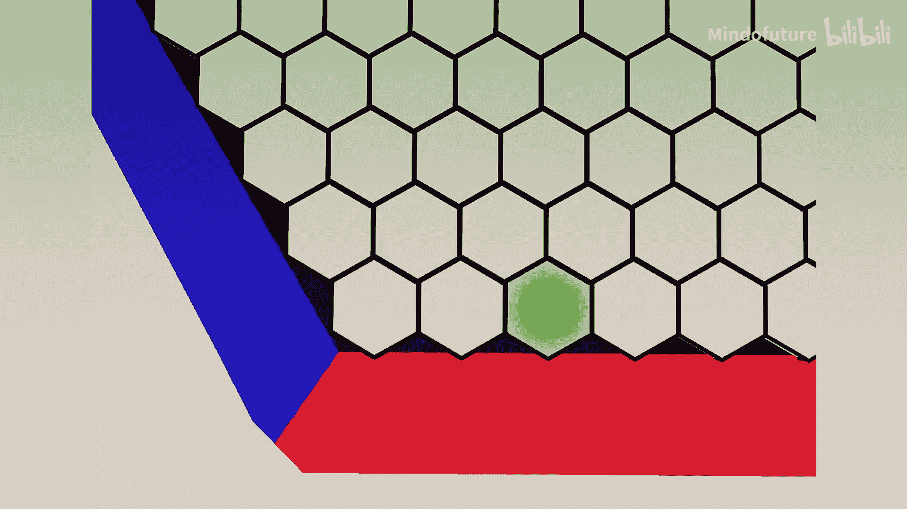

# 【加州大学】C++编程-｜-C-Plus-Plus-B-p17-P17_2-1-从井字游戏到六边形棋_02_02_01--BV1KseJzqEbZ_p17-

。

🎼嗯。🎼，🎼は。🎼あ。🎼Welcome back， today's lecture is going to be on our term project。How to implement。

The game of Hex。How to have a challenging machine program that utilizes。Artificial intelligence。

How to embed all this in a C+ plus program。And we're going to continue with the topic of inheritance in C++ inheritance is the hallmark idea behind object oriented programming。

And then we're going to also continue to emphasize some of the latest ideas in the new C++ 11 standard ideas。

 especially that relate to inheritance in this case。Okay， we all。

Learned as a child how to play T Tto。So here's a ttao position。It's x's move， x goes first。

Where should X move。And what's the result of the game going to be？Why don't you think about that。

 Where would you。Put X， if you were the X player， how would you decide it？

So I'd like you to answer what you thought x's best move in the last slide is。

If you know something about。Two person games， you have an idea of what should be filled in。

 Ti T toe is a game of some kind of information。And with best play is Titkto a win a draw or loss for X？

And if you were to start with the blank board in Tite toe， what do you think the first move。

For x should be， what would be a first best move。So think about that。

 you may not have played Titoe for a while， but。Of。Think about what you would answer。Okay。

Here's what I think。A first move in that initial position should be。If you put your ex there。

You guarantee two things， one that you block any possible wins for O because O can only win on the bottom line。

Secondly， you have the possibility of winning as X because there's one place where X can win。

 That's the top line。Tickt toe is a game of perfect information。In contrast。

 poker is not a game of perfect information。 in a game of perfect information。

 The opponents see everything that lets them make a decision is nothing hit。Poker， you have。

Each opponent or multi opponents， which have hidden information。

 namely the card deck and what the order of cards are and what's in a particular person's hand。

So in a game of perfect information， you should be able to decide what a best move is。Well。

 in Tite toe， if people play perfectly from the beginning， the game is always going to be a draw。

 That's easy enough to prove It's probably why most of you stopped playing when you were 5 or 6 because it just got too boring。

And if you were to decide on a best move when you were playing as a kid。

 you probably quickly learned that the best move for the first player。

 the X player was to put the X in the middle。 And why was that The X in the middle gave you the most possibilities。

 It gave you the most opportunities for win。And it gave the other player the most opportunities to lose。

The worst moves were the middle of the sideboards and the intermediate quality moves were the corners。

And each one gave you。More possibilities， the most being the。Move in the middle。

 the next most being corners and the least being the non corner moves on the side。Now， tick tick。

 though， isn't too interesting。 Why it's a very small game。 It's easy to exhaust。

 It's easy for a child， even to quickly figure out。What a best strategy is。

But people still play Tite toe like games。 Why you can make the board larger。

So a frequent style of tick T toe is playing on a very large board like a go board。

 A go board is a 19 by 19 board and trying to get 5 in a row rather than 3 in a row。

That starts making everything a lot larger。And it deemphasizes the importance of the middle square because there's in effect。

 lots of middle squares。Another thing you can do to maketict toe more interesting is have more dimensions obviouslytic taecte is played on a sheet of paper that's two dimensional but what if you play it three dimensionally so now you have board that's。

3 boards。 and they're like a ground story， a first story and a second story board。

 Each board now is3 by 3。 So there's basically 27 squares。

 And now you can win by having a rower column on any board。 but you can also have a rower column。

That goes on the third dimension as well。So it becomes more complex， there are more squares。

 there are more ways to win， there are more ways to lose， just gets more complex in general。

The final way that I'm going to talk about to make the game more interesting。Is to make the board。

More complex。If you look atticte toe， the simple ways to win are row。Columns and diagonals。

In the game， I'm about to describe Hex， the board is。Got hexagonal six sided squares。

 and the six sided squares have six squares adjacent to them。In the square board， you have。At most。

 four squares adjacent to you。 It's a square。 The square is a square。 in the hexagonal circumstance。

 There are six neighbors in the square circumstances， four neighbors。

 So when you have six connected neighbors， you essentially will have more places that you can extend your three in a row or your five in a row or your in in a row。

Here's the heckx board。Hex was a game invented by professional mathematicians。

It was invented separately。By Pete Ane， who was a Dutch mathematician who invented it first in 1942。

And then later， John Nash， who if you recall the Academy Award winning movie， a Beautiful mindd。

 he won a Nobel Prize， he invented it while he was a student at Princeton getting his PhD in 1947。

And here is a seven by seven board。And you can see the little hexagonals。

And you can see there are white squares， white pieces。Black pieces。And empty empty squares。

White and black get to take turns。And。White has its boundaries。Black has its boundaries to think of。

 here's north。Here's south。Blacks， black。Makes a path。From north to south。In this case。

 black has one。Because he has a connected path from north to south。White。

 who is trying to make a path from east to west。Has lost because it hasn't。

It's whoever gets the first path。To win。Game is actually fairly complex。 If you start to play it。

 it's not as simple as just a small version of Tte toe， but it hasticte toe like elements。So。

Let's be more specific。 Here are the rules。 Each player has an allocated color。

Red and blue or white and black is conventional。We just saw white and black。

Players take turns placing a stone of their color on a single cell。Within the overall playing board。

The goal is to form a connected path of their stones， linking opposite sides of the board。

 which is marked by their color。 So one player is the north south player。

 the other player is the East West player。The first player to get a connected path。

Between their two sides wins the game。Now， what's been found to be the case is the first player has a huge advantage。

 It's liketictetoe。 You get to go in the middle。 You have the most possibilities， and。Pretty much。

If you know what you're doing， it's guaranteed to be a win indeed。呃。Nash actually proves。That。

 on the general。Xport。The first player， if the first player plays perfectly， must win。 So this。

 again， a game of perfect information。 There's no bluffing。 There's nothing hidden。And winning。

Would occur if the first player placed their piece in the middle。

And the game continued with perfect play from there。

So it turns out that there's a way to avoid that big advantage。And that's what's called the pie rule。

And in the p rule。You decide that there's a first player， the first player makes a move。

And the second player， only on this move。Can make one of two decisions， they can say，Geep。

I liked your move。So I'm going to become the first player。

 and you are automatically now the second player。Or they can say。I didn't like your move。

So I'm going to stay the second player。And make。What I think is a better move。

Why is it called a pie raw？ Well， remember when you were a kid and your mother had a big had a pie or。

Ice cream and said here， I'm going to divide up the pie into two pieces。And I'm going to let。

Johnny picked the piece first， and Mabel will pick the piece second。

 but Mabel can pick Johnny's piece if they want。 And that's just a way to ensure fairness。 And name。

 well， it really works that the that one of them is supposed to cut the pie。

 So it's an incentive to cut the pie as fairly as possible because。

First player who actually cuts the pie， and if they don't make it as a good job。

 then the other player can take over their piece。So with that rule， actually the game is very fair。

 becomes the case that you want to make a move， that you want to make a move that's not quite bad enough so that you will end up losing。

But it's good enough that if you become the second player。

You have a chance to win the game in any case。Okay。Some facts about the game。

 Nash proves the first player wins without the pie rule。And the proof went something like this。C， if。

I make a move。How can I possibly be hurt？So if the second player， after I move。

 just pick some square， I made a move。The second player then plays perfectly， and wins。Well。

 why not have me play the first the second player's moves？

I will be able to play the second player's moves with this one extra piece on the board。

The one extra piece can't hurt me。So if the second player had a way to win。

The first player playing perfectly has to be able to use that same way of winning。

So what that tells you is the first player。Has to win。There is no way to have the game a draw。

Whoever gets a path， cut the other guys paths off， There's no way for a path。

To where there can be a deadlock where there's no way from one side to the other。

Without conceding some other path， so it can't be tied like the T ta toe game can be tied。

So the first player played perfectly wins。 But this gives no insight into what the first player's move should be。

 It's just a proof that the first player must win because going first is。An advantage。

And the game must be won。So。In smaller boards， boards like size seven by seven。

Computers and mathematicians have been able to examine the game exhaustively。And indeed。

 they have ways of knowing how to win。On the board sizes， I believe by now， up to 8 by 8。

 I'm not sure whether 9 by 9 is completely solved。 But when you have a tournament play。

Both human and computer tournament， they now start with 11 by 11 or greater， sometimes 13 by 13。

 sometimes 19 by 19。And best play is unknown on this much larger size games， indeed。The game itself。

In general， on an end by end board is considered to be NP space complete， which means。

That from a computational view， it's not expected to have a simple polynomial time solution of any kind。

Okay， so here's the board I'm going to feature for our homework。

 the homework I want you to do is be able to play on an arbitrary size board。

 but typically at least 11 by 11， but in your debugging stages you should use something a lot smaller。

And when you go and represent this， remember， we did a lot of work in our initial class。

With graph theory， so think of hex as a graph。If x is a graph。The individual squares are nodes。

So here's a note。So that's where I'm pointing as a node。And it's any or its edges are the。

Other squares next to it。 And in that case， there are six squares next to it。

 If you are a node that's sitting over there on the edge。

 you only have three squares adjacent to you。So there are in effect on this 11 by 11 board。

 121 nodes， and the corner squares can be either connectivity 2 or three。

 where the upper left and lower right of connectivity2 and the upper right and lower left have connectivity 3。

 though they relatively weak moves。And the center。Off the edges have the most moves。

 and then intermediate are the edges that are on the rim。Quz。

How many squares are connected if they're internal？Xes。M should really say the hexes。

What already told you this， though I hope you've been paying attention。

 what hex's position as the least connections？And if each node is a square。Or heckx。

With the degree being the number of edges。Then what are the ranges of the degree of the nodes？

Take a second to fill that out。Let me just answer that。On the heckx board。

A hex in the corner can either be connectivity2 or connectivity3。And therefore。

 the connectivity of the。Noes that make up the heckx board。Vary from the low of two to a high of six。

And if we go back and look at the square。Then a rimage like this has four。

