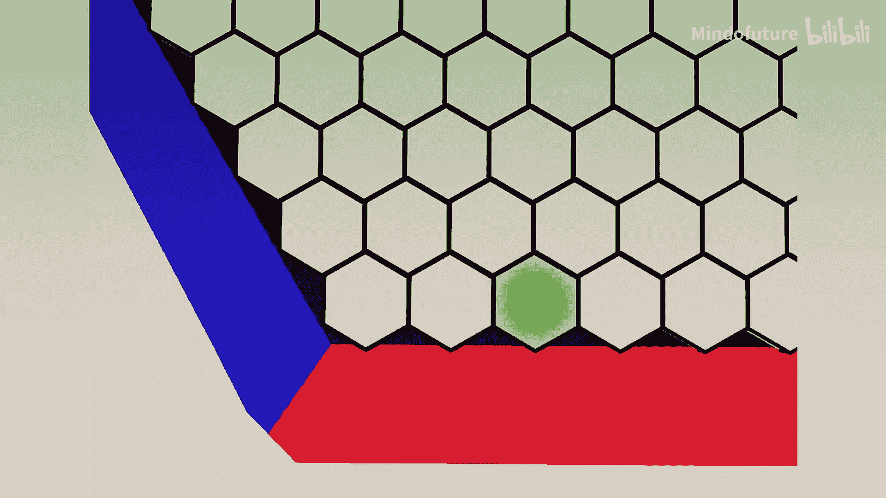

# 从井字游戏到六边形棋：P17：项目介绍与游戏规则

在本节课中，我们将学习如何实现一个名为“六边形棋”的游戏项目。我们将探讨如何创建一个具有挑战性的、运用人工智能的机器程序，并学习如何将其嵌入到C++程序中。课程将继续深入C++中的继承概念，这是面向对象编程的核心思想，并强调C++11新标准中与继承相关的一些特性。

## 从井字游戏谈起

我们小时候都学过如何玩井字棋。下图展示了一个井字棋的局面，轮到X方走棋（X方先手）。X方应该走在哪里？游戏的结果会是什么？请思考一下，如果你是X方玩家，你会如何决定？

井字棋是一种**完全信息**游戏。与之相对，扑克就不是完全信息游戏。在完全信息游戏中，对手能看到所有用于决策的信息。而在扑克中，每位对手都拥有隐藏信息，例如牌堆的顺序和每个人手中的牌。

在井字棋中，如果双方都完美地下棋，游戏总会以平局告终。这很容易证明，可能也是你们大多数人五六岁后就不再玩它的原因——它变得太无聊了。如果你小时候决定最佳着法，你很可能很快就知道，先手玩家（X方）的最佳着法是**将X放在棋盘中央**。这是因为中央位置能为你提供最多的获胜可能性，同时给对手最多的失败机会。最差的着法是放在边线的中点，而质量居中的着法是放在角落。

然而，井字棋并不太有趣。它是一个非常小的游戏，很容易穷举，即使是一个孩子也能很快找出最佳策略。但人们仍然在玩类似井字棋的游戏。你可以将棋盘变大，例如在19x19的围棋棋盘上尝试连成五子而非三子。这大大增加了复杂性，并削弱了中央方格的重要性，因为实际上有很多“中央”方格。

另一种让游戏更有趣的方法是增加维度。井字棋通常在二维的纸上进行，但如果在三维空间玩呢？现在你有一个由3个棋盘组成的立体棋盘，就像一层、二层和三层，每层是3x3，总共有27个方格。现在，你不仅可以在任何一层上通过一行或一列获胜，还可以在第三维度上连成一线。这增加了复杂性：更多方格、更多获胜方式、更多失败方式。

最后一种增加趣味性的方法是让棋盘结构更复杂。在井字棋中，简单的获胜方式是行、列和对角线。在接下来要介绍的“六边形棋”中，棋盘由六边形的格子组成，每个六边形格子有六个相邻的格子。而在方形棋盘上，一个格子最多只有四个邻居。当你有六个连接的邻居时，本质上你就有更多地方可以延伸你的“三连子”、“五连子”或“N连子”。

## 六边形棋介绍

六边形棋是由专业数学家发明的游戏。它由荷兰数学家皮特·海恩于1942年首次发明，后来由约翰·纳什（如果你记得奥斯卡获奖电影《美丽心灵》，他获得了诺贝尔奖）于1947年在普林斯顿大学攻读博士学位时独立发明。

下图展示了一个7x7的六边形棋盘。你可以看到白色的六边形、黑色的棋子和空的格子。白方和黑方轮流走棋。黑方的目标是**在南北方向之间形成一条由己方棋子组成的连通路径**。白方的目标是**在东西方向之间形成一条连通路径**。首先完成路径的一方获胜。

## 游戏规则详解

以下是六边形棋的具体规则：
*   每位玩家分配一种颜色（通常是红与蓝，或白与黑）。
*   玩家轮流在棋盘的一个空单元格中放置一颗己方颜色的棋子。
*   目标是形成一条由己方棋子组成的连通路径，连接棋盘上标记为己方颜色的两条对边（一方连接南北，另一方连接东西）。
*   首先完成连通路径的玩家获胜。

研究发现，先手玩家拥有巨大优势，类似于井字棋中先手占据中央的情况。实际上，纳什证明了在通用尺寸的棋盘上，如果先手玩家完美行棋，则**必须获胜**。这同样是一个完全信息游戏，没有虚张声势，没有隐藏信息。如果先手玩家将棋子放在中央，并且之后双方都完美行棋，先手将获胜。

有一种方法可以避免这种巨大的先手优势，即采用**“切饼规则”**。在这个规则下，先手玩家走第一步棋。然后，后手玩家**仅在此回合**可以做出两个决定之一：
1.  说：“我喜欢你这步棋。所以我将成为先手玩家，而你自动成为后手玩家。”
2.  说：“我不喜欢你这步棋。所以我将继续作为后手玩家，并走出我认为更好的着法。”

为什么叫“切饼规则”？想象一下，当你还是个孩子时，你的妈妈有一块馅饼或冰淇淋，她说：“我来把饼分成两块。我会让约翰尼先选一块，然后梅布尔选第二块，但梅布尔可以选择约翰尼的那块。” 这是一种确保公平的方式。实际上，负责切饼的人有动机尽可能公平地切分，因为如果他们切得不好，对方就可以拿走他们切的那块。有了这个规则，游戏变得非常公平。你会想走一步棋，它不至于坏到让你最终输掉，但又足够好，以至于如果你变成后手玩家，你仍然有机会获胜。

## 关于游戏的一些事实

纳什证明了在没有“切饼规则”的情况下，先手玩家必胜。证明思路大致如下：假设我先手走了一步棋。我怎么可能受到损害呢？如果后手玩家在我走棋后，通过某种完美行棋的方式获胜，那么为什么我不能扮演后手玩家的角色呢？我可以在棋盘上多出我这颗棋子的情况下，走出后手玩家那些获胜的着法。这颗额外的棋子不可能损害我。因此，如果后手玩家有办法获胜，那么完美行棋的先手玩家也一定能使用同样的方法获胜。这告诉我们先手玩家必须获胜。

游戏不可能出现平局。总有一方会形成一条路径，切断另一方的路径。不可能出现双方都无法从一边连接到另一边的僵局，这与井字棋可能平局不同。因此，完美行棋的先手玩家必胜。但这个证明并没有揭示先手玩家的具体着法应该是什么，它只是证明了先手必胜，因为先手是一种优势，并且游戏必须分出胜负。

在较小的棋盘上，例如7x7，计算机和数学家已经能够穷举分析游戏。事实上，他们已经知道如何获胜。据我所知，目前可能已经解决了最多8x8的棋盘，我不确定9x9是否已完全解决。在进行人类和计算机比赛时，他们通常从11x11或更大的棋盘（有时是13x13或19x19）开始。在这些更大的棋盘上，最佳着法仍然是未知的。事实上，从计算角度看，在N x N的棋盘上，六边形棋通常被认为是**NP空间完全**问题，这意味着预计不存在任何简单的多项式时间解决方案。

## 项目使用的棋盘

在我们的作业项目中，我将以11x11的棋盘为例。我希望你们能够在一个任意尺寸的棋盘上进行游戏，但调试阶段应该使用小得多的棋盘。当你们去表示这个棋盘时，请记住我们在课程初期做了很多图论相关的工作，所以**将六边形棋视为一个图**。

在六边形棋的图中：
*   每个单独的六边形格子是一个**节点**。
*   节点之间的**边**表示格子相邻。
*   一个内部的六边形格子有**六个**相邻的格子。
*   位于边缘的节点可能只有**两到三个**相邻的格子。

在这个11x11的棋盘上，有121个节点。角落的格子连接度可能是2或3（左上和右下为2，右上和左下为3，尽管这些都是相对较弱的着法）。棋盘中心的格子拥有最多的连接（6个），而边缘上的格子连接数居中。

**小测验**：一个内部的六边形格子连接多少个邻居？我们已经告诉过你了。那么，连接度最低的格子位置是哪里？如果每个节点是一个六边形格子，其“度”表示边的数量，那么节点度的范围是多少？

让我来回答一下。在六边形棋盘上，一个角落的格子连接度可以是2或3。因此，构成六边形棋盘的节点的连接度范围是**从最低的2到最高的6**。如果我们回头看方形棋盘，一个像这样的边缘格子连接度是4。

## 总结

本节课我们一起学习了从简单的井字游戏过渡到更复杂的六边形棋的过程。我们介绍了六边形棋的基本规则、先手优势以及用于平衡游戏的“切饼规则”。我们还了解了将棋盘抽象为图模型的方法，这是后续用C++实现游戏AI的重要基础。在接下来的课程中，我们将开始探讨如何利用继承等面向对象编程技术来构建这个游戏程序。