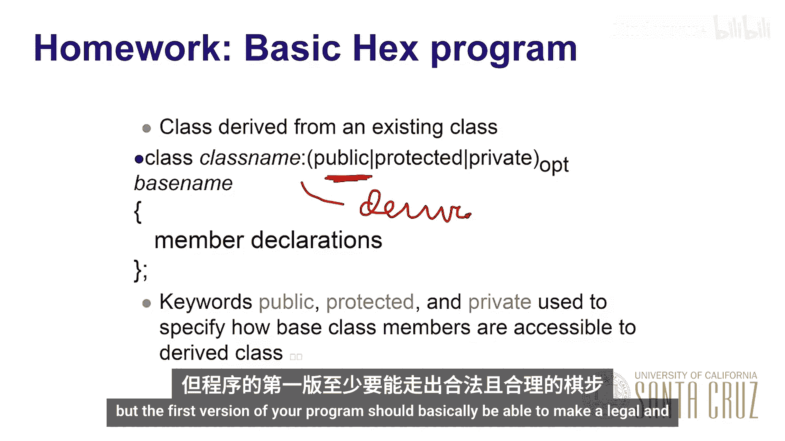
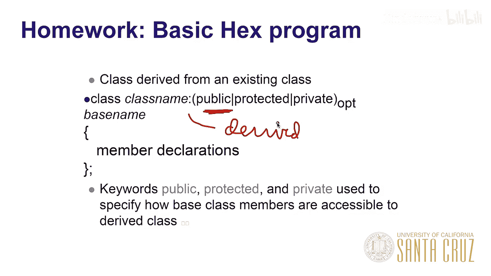
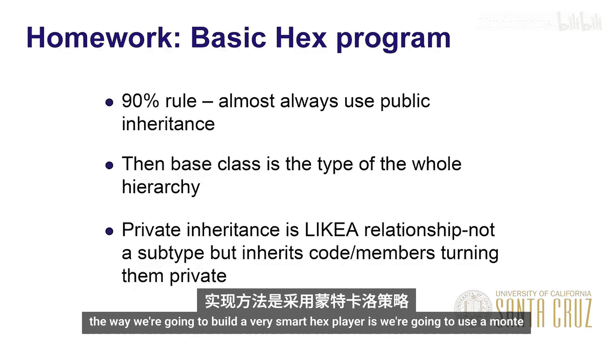
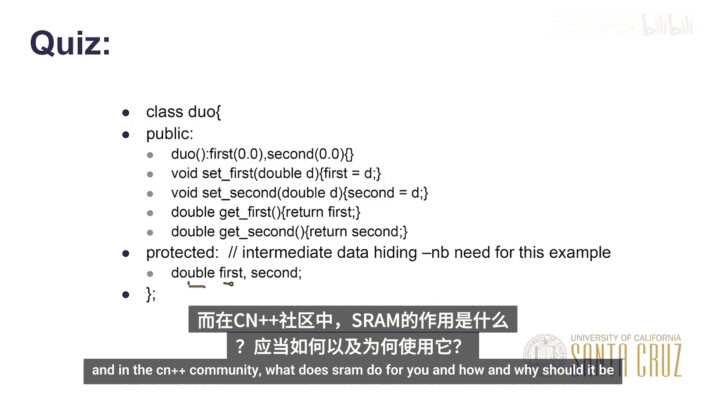
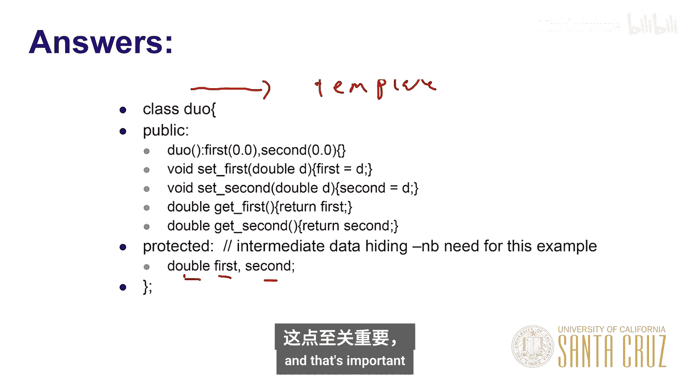
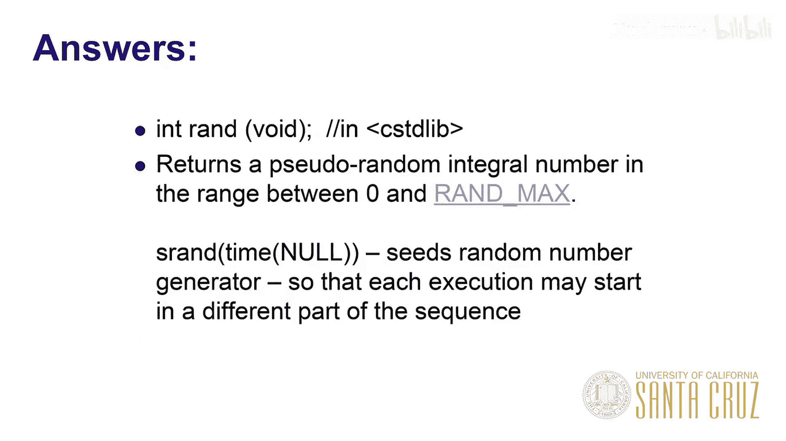

# 【加州大学】C++编程-｜-C-Plus-Plus-B-p18-P18_2-2-作业-基本六边形棋程序_02_02_02--BV1KseJzqEbZ_p18-

So again， what is going to be your major work in this class， It's going to build a hex program。

 The first version of your program is going to be a simple version。In that version。

 you're not going to do much in the way of what I'm calling AI artificial intelligence。

 there' going to be detailed explanation on the course site of the homework。

But the first version of your program should basically be able to make a legal and reasonable move。

By a legal and reasonable move， think about the moves you tried to do when you were playing Ti Tktoe what were reasonable moves in T Tk toe Ti T toe as a reasonable move is you tried to connect whatever your longest set of x's were to make them longer。

If you had。A single X， you tried to make another x near it so that you can ultimately add three in a row。

Or if you were in five in a row， if you had a three in a row。

 you wanted to try and make it at four in a row。So in Titk toe。

 what gave you a reasonable move was extend your longest path and block your opponent's longest path are sort of。

What any kid would sort of come up with after playing the game for a while or reading about the game。

That's what I want you to do， the analogous thing in Hex is try and create longer paths。

From your borders or block longer paths for your opponent borders。

Now later we're going to build a very smart hex player the way we're going to build a very smart hex player is we're going to use a Monte Carlo strategy。

 again Monte Carlo is the very famous gambling resort。

James Bond is always playing in the Monte Carlo Caino， of course， his game of choice is Baccara。

Our game of choice is going to be a dice game and we're going to take probabilities by using a pseudo random number generator and then in this way we're going to choose our moves at random and we're going to use randomness and simulation to try and build a smart player。

 sort of a contradiction we're going to use dice thrown at random。

 find moves at random and yet they're going to lead to us building a very smart player that by itself is a very interesting result in the artificial intelligence community。

So Monte Carlo programs are probabilistic simulations。And when you do them， here's a short quiz。

What is your standard pseudorandom number function in the CNC++ community？And in the C++ community。

 what does ZRAand do for you and how and why should it be used， take a second。

So the standard。Function， we should have used it already is Entran void。

 it's in the C standard Library。It returns a pseudoran number generator。

 a positive number between0 and a predefined constant RAm RAm is important because we can use it if we do double arithmetic to get us a probability if we divide the random number by RAm using double well get a probability between 0 and1。

S RA time null is a way to seed the random number generator so that each call to the random pseudo random number generator doesn't start at the same point in the list。

 and that's important we don't want to continually simulate the same set of events every time we restart program。

 we wanted to be using a different part of the sequence。

Okay。So that's going to be what we're doing with Hex。

 we're going to aim ultimately at a super good he program。

