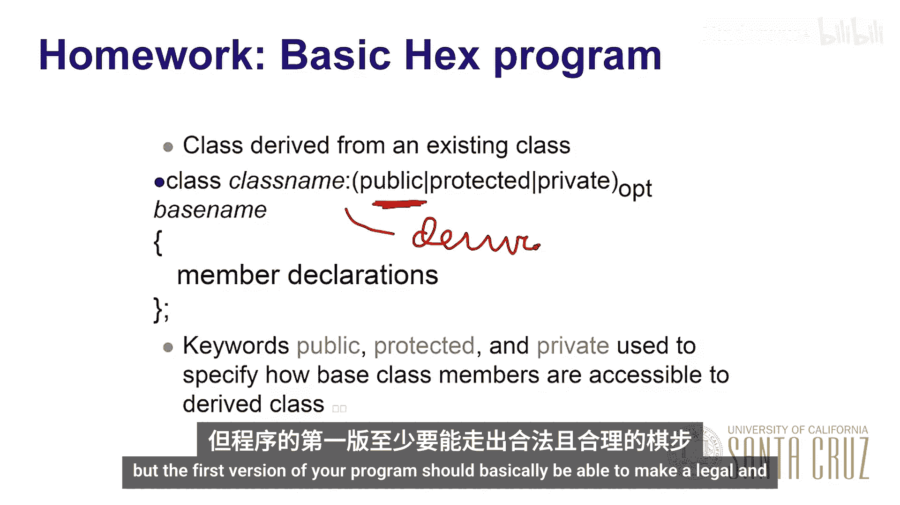
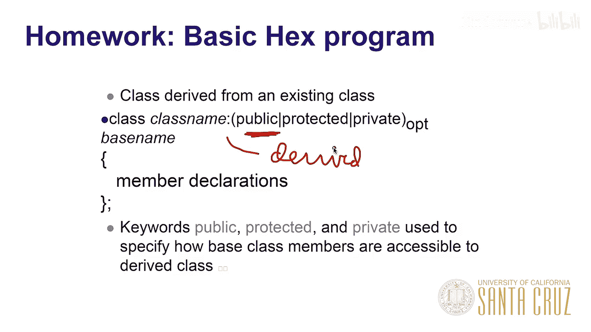
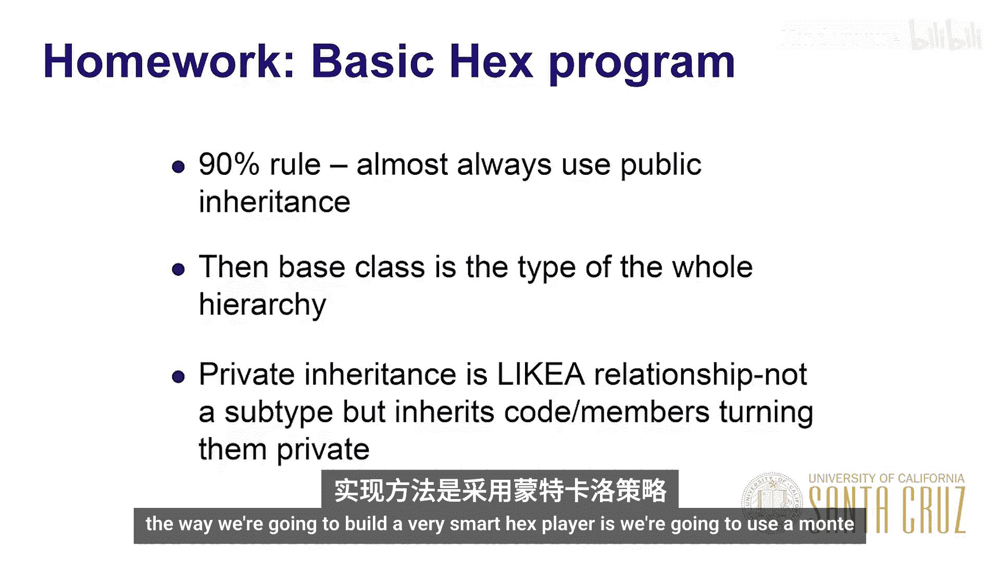
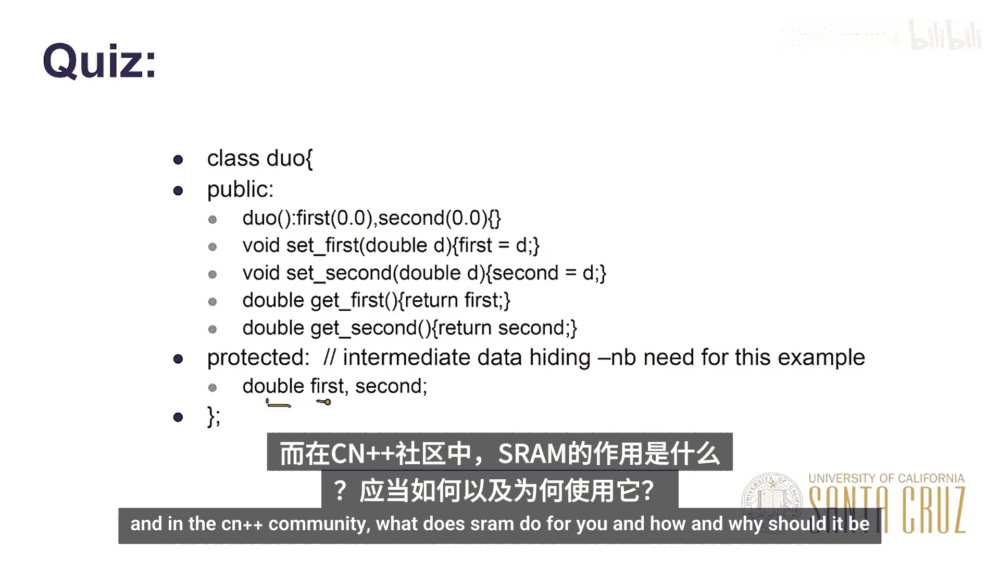
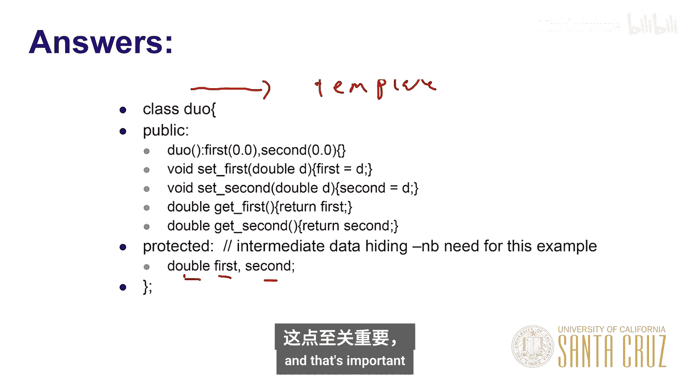
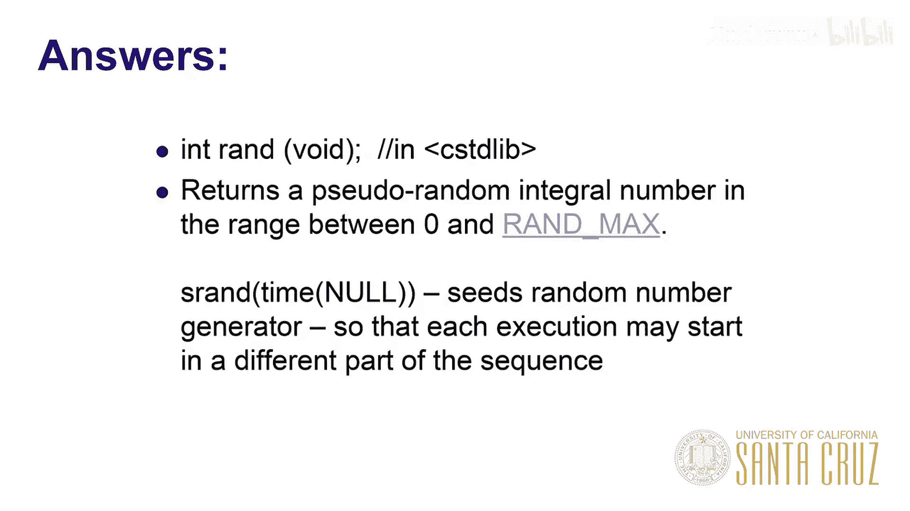

# C++编程：P18：作业 - 基本六边形棋程序

在本节课中，我们将要学习本课程的主要作业项目：构建一个六边形棋程序。我们将从构建一个简单的版本开始，并最终实现一个使用蒙特卡洛策略的智能玩家。

## 课程主要任务 🎯

本课程的主要任务是构建一个六边形棋程序。

你的程序的第一个版本将是一个简单的版本。在这个版本中，你不会做太多我称之为人工智能的工作。关于作业的详细说明会在课程网站上发布。

但你的程序的第一个版本应该基本上能够做出合法且合理的移动。

## 什么是合理移动？ 🤔

一个合法且合理的移动，可以回想一下你在玩井字棋时尝试的移动。在井字棋中，什么是合理的移动？一个合理的移动是，你试图连接你最长的X序列，使其变得更长。

如果你有一个单独的X，你会尝试在它附近再放一个X，以便最终能连成三个。或者，如果你在玩五子棋，如果你有三个连成一线，你会希望尝试将其变成四个。

因此，在井字棋中，合理的移动是：**延长你自己的最长路径**，以及**阻挡对手的最长路径**。这是任何孩子在玩了一段时间游戏或阅读了相关资料后都会想到的策略。

我希望你在六边形棋中做类似的事情：尝试创建从你的边界出发的更长的路径，或者阻挡对手从边界出发的更长路径。

## 迈向智能玩家：蒙特卡洛策略 🎲

接下来，我们将构建一个非常聪明的六边形棋玩家。我们将使用一种蒙特卡洛策略。蒙特卡洛是一个非常著名的赌场度假胜地，詹姆斯·邦德总是在蒙特卡洛赌场玩，当然，他选择的游戏是百家乐。

我们选择的游戏将是一个掷骰子游戏。我们将使用伪随机数生成器来获取概率，通过这种方式，我们将随机选择我们的移动。我们将利用随机性和模拟来尝试构建一个聪明的玩家。这听起来有些矛盾：我们使用随机掷骰子，随机寻找移动，但它们将引导我们构建一个非常聪明的玩家。这本身在人工智能领域就是一个非常有趣的结果。

所以，蒙特卡洛程序是概率模拟。当你进行模拟时，这里有一个小测验。

## C++中的随机数生成 📝

在C/C++社区中，标准的伪随机数函数是什么？在C++社区中，`srand`函数为你做什么，以及应该如何和为什么使用它？请花点时间思考一下。

标准的函数，我们应该已经使用过，是 `int rand(void)`，它在C标准库中。它返回一个伪随机数，一个介于0和预定义常量 `RAND_MAX` 之间的正数。`RAND_MAX` 很重要，因为如果我们进行浮点数运算，我们可以用它来获得一个概率：如果我们用 `rand()` 的返回值除以 `RAND_MAX`，使用 `double` 类型，我们将得到一个介于0和1之间的概率。

`srand(time(NULL))` 是一种为随机数生成器提供种子的方法，这样每次调用伪随机数生成器时，不会从列表中的同一点开始。这很重要：我们不希望每次重启程序时都持续模拟同一组事件，我们希望使用序列的不同部分。

## 总结 📚

本节课中我们一起学习了本课程的核心作业——构建六边形棋程序。我们从理解“合法且合理的移动”这一基本概念开始，将其类比为井字棋中的策略。接着，我们展望了未来将使用**蒙特卡洛策略**来构建一个智能玩家，并回顾了在C++中生成随机数的关键函数 `rand()`、`srand(time(NULL))` 以及常量 `RAND_MAX` 的用法。我们的最终目标是开发出一个优秀的六边形棋程序。