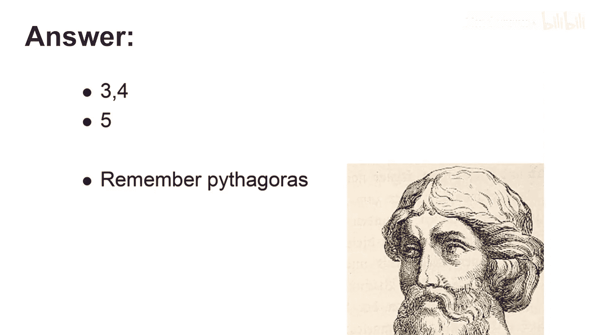

# 【加州大学】C++编程-｜-C-Plus-Plus-B-p19-P19_2-3-继承基础_02_04_01--BV1KseJzqEbZ_p19-

Now among the things that should be in our toolkit。For doing our programming is inheritance。

Inheritance。Is a reuse mechanism。Recall all along， I keep telling you， reuse is if you want。

 is the golden Bull。In software development， you don't want to write original code。

 you want to reuse existing code that's well tested。

An ariance in jargon terms uses what's called pure polymorphism， which I'll talk about later。呃。

Getting ahead of myself， that's going to use what's called the virtual function mechanism。

 and it's a different scheme than you would find in some other languages such as Java。

 where pure polymorphism is the default。And inheritance also is a way to build a typing structure。

 remember， C++ tries to emphasize strong typing， strong typing is very good because it allows the compiler to douce things and to enforce correctness。

And O， O， P is at the heart of。The heart of OOP programming。

 object oriented programming is inheritance。So the original languages like S 67。

And small talk were the first languages that really got going with things like inheritance and showed how can be used to create objects。

 build objects， build a type structure do reuse。And provide dynamic function calls that are at the heart of pure polymorphism。

 all mechanisms that are very， very useful if you are going to build large pieces of software。

When you have an OOP in object oriented programming design methodology。

 you have a design step and a design methodology， and you need to decide first on what are appropriate set of types。

You don't have a predefined set of types， you don't have to make everything be inter double or char as you wouldn't see。

You try to build types that are appropriate to your problem domain。 So in Hex。

 you have a problem domain that's analogous to a graph。

 So you might want to use a graph as a basic type。 You have a hex board。

So you might have a type such as a hex board or a hex game。

And part of its implementation may involve graphs。 So when you sit down to do a complex problem like the Hex programming assignment。

 part of your design methodology would be to decide on what will make it easy and convenient for you to implement this hex program。

Once you decide on a set of types， you can design in that relatedness are types related to each other Inheritance is a way to share code among classes and we'll see that in some of the coming examples。

Syntactically。Any class in C。Could be thought of as a base class that can be derived from。

And when you wanted to arrive。You have to derive from it。V。A accessibility mode。

And the typical one is going to be public。So most of your benefit。Is going to have。

The ability to have a class。That is derived， the colon means derived from。

And this is the base class name。So that's your syntax， and in effect。

 that means you can reuse all the code from the base class。And you can reuse it。Publicly。

 which means that the base class is a super。Type for the derived class。

Anything that is a derived class member element is of the type of the base class。

 that's important to the type structure。Okay。So again， we have a 90% rule here。You know it's。

Unimaginable as anybody would know everything in the C++ language at this point。

 it's just too large a thing。So I love things where what you know is going to be the essentials in most of your work。

So if you know nothing else in the inheritance stuff， you want to know about public inheritance。

 all the other stuff is。Po。It's relatively little used if it was abandoned， it would not be。

Important。So what you really want to know about inheritance is public inheritance。

 it matches the 90% rule， everything you learn about public inheritance will be applicable to what you do。

 private inheritance， which is the other main characteristic that gets used is used less than 10% of the time and in private inheritance you have what's called a like a relationship where there isn't subtyping。

 so public inheritance is a method of subtyping。 private inheritance is just pure code reuse。

And code reuse is not quite as important， I mean it's useful， they don't want to throw it away。

 but it's not dynamic， it's not object oriented in the way that public inheritance is。

So here's an example we're going to make heavy use of。

 you might want to write this into your own compiler and play around with it。

 I recommend it because it gives you。Easy enough， intuitive example。

And yet it's important enough that in the real world， it's actually part of the standard library。

 what I'm saying is class du here is actually typically called a peer。And in modern C+ plus 11。

Gets generalized to what's called a Tuple to U PLE。

 so you might want to keep that in mind and as you migrate to C++ 11。

 but we're going to have our own form of it， we're going to call it duo so it doesn't conflict with what's typically a pair in the C++ world。

And a pair is going to have a first and second element in this case。It's double。

If we were to generalize this。Everybody should be used to a generalization that would involve a template。

And then。This would be tea。These things would be teaed。So if I were to do this in the real world。

 I would undoubtedly be doing this as a template， just keep that in mind。

We see a constructor first and second， we see some accessor functions。

Where we can get first and get second， we see some mutator functions where we can set those。

And notice， what is new is we have， instead of calling this private。We've called this protected。

And protected gives access。For inheritance。So things that are protected are still in the family。

 So within the family， it's okay to work with them， but otherwise， they're seen as private。

So if somebody is not in the inheritance hierarchy。They don't see them any more than that's private。

 so you can think of it as private。 So when you start using a lot of inheritance。

 you probably are architecturally going to change how you write your code。

 You're going to probably turn what used to be private into protected。And now we're going to inherit。

So。A point is going to be a form of duo。A point is just a duo。

 But now we're thinking of not just as a random pair。Of。Doubles。

 but it's more like something on the Xy axis。So here's our duo now。

And since it's now representing a point in X Y， we can have a method such as length。

Square root of the first of the pair times the square of the second of the pair。

And 20 is a type of point。Oh， excusecuse me， said it wrong。 Gota be careful。Point。Is a duo。But。A duo。

Is。Not necessarily。A point。So there's this kind of typing relationship。

And then all of the members are inherited。Including the constructors。So here's a point， Q。

We've set at the be the 0。34。看。APoin is a duo， but not duoss are points。

I give it as quote Socrates quote because it's。Take off on。Plato was a man， all men are mortal。

 Plato is mortal。But an ape is not a man， maybe or maybe not an ape is mortal。U。

So here we have a calculation and we see that we can do this calculation of length。

Which we couldn't do on duo。There is no length for duo。So the fact is that that has to be a point。

 That's a point computation。 but everything else。The representation issues are all embedded in the code we've grabbed or inherited from Duo。

What。What did that program print this is a little quiz for you， so take a second。

We had Q dots set first at 3。0， Q dots at second at 4。0。We're going to print out， get first。

 get second， and then length， and what will they be？So if our set values were three and four。

The square root of 3 squared plus 4 squared ats 9 plus 16 to 25 square root of 25 is 5。

Just remember the Pythagoras and you'd get that right。

