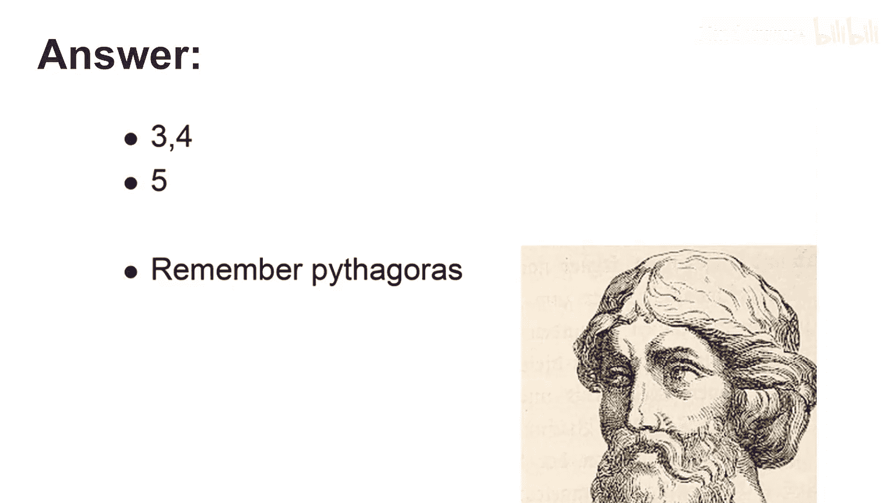

# C++编程：P19：继承基础


## 概述

在本节课中，我们将要学习C++中一个核心的面向对象编程概念——继承。继承是一种代码重用机制，也是构建类型体系结构的关键。我们将通过一个具体的例子来理解其语法、用途以及“公有继承”这一最常用的形式。

---

## 继承：一种重用机制

在软件开发中，重用是黄金法则。你不希望编写全新的代码，而是希望重用经过充分测试的现有代码。继承就是一种强大的代码重用机制。

从术语上讲，继承会用到所谓的“纯多态”，这依赖于虚函数机制。这与Java等语言不同，在Java中，纯多态是默认行为。此外，继承也是构建类型结构的一种方式。C++强调强类型，这有助于编译器检查和确保代码的正确性。

面向对象编程的核心就是继承。早期的语言如Simula 67和Smalltalk率先引入了继承，展示了如何用它来创建对象、构建类型结构、实现代码重用，并提供构成纯多态核心的动态函数调用机制。这些机制对于构建大型软件非常有用。

---

## 面向对象设计方法论

当你采用面向对象编程的设计方法时，会有一个设计步骤。你需要首先决定一套适合问题领域的类型。你不再局限于预定义的类型（如`int`、`double`、`char`），而是尝试构建与你的问题域相匹配的类型。

例如，在“六边形棋”游戏中，问题域类似于图论。因此，你可能希望将“图”作为一种基础类型。你有一个六边形棋盘，所以可能定义`HexBoard`或`HexGame`这样的类型，其部分实现可能涉及图结构。在设计像六边形棋编程作业这样的复杂问题时，设计方法论的一部分就是决定如何让实现变得简单便捷。

一旦确定了一组类型，你就可以设计它们之间的关系。继承是类之间共享代码的一种方式，我们将在接下来的例子中看到这一点。

---

## 继承的语法

在C++中，任何类都可以作为可以被派生的基类。

以下是派生类的语法：
```cpp
class DerivedClass : public BaseClass {
    // ... 成员定义 ...
};
```
`:` 表示“派生自”，`BaseClass`是基类名称，`public`是典型的可访问性模式。

这意味着你可以重用基类的所有代码。公有继承意味着基类是派生类的超类型。任何派生类的成员元素也属于基类类型，这对类型结构很重要。

这里有一个“90%规则”：在继承相关的知识中，你需要重点掌握公有继承。你所学的关于公有继承的一切都将适用于你的大部分工作。私有继承等其他特性的使用频率低于10%。在私有继承中，是一种“类似”的关系，不涉及子类型化；而公有继承是一种子类型化方法。私有继承只是纯粹的代码重用，它不像公有继承那样具有动态性和面向对象特性。

---

## 示例：从Duo到Point

我们将通过一个例子来深入理解。建议你将其写入编译器并尝试运行，这是一个直观且重要的例子。在现实世界中，它实际上是标准库的一部分（通常称为`pair`，在C++11中泛化为`tuple`）。我们这里称其为`Duo`，以避免与标准库名称冲突。

我们的`Duo`类将拥有`first`和`second`两个元素。为了通用化，本应使用模板，但为了示例清晰，我们暂时使用`double`类型。

以下是`Duo`类的定义：
```cpp
class Duo {
protected:
    double first;
    double second;
public:
    Duo(double f = 0.0, double s = 0.0) : first(f), second(s) {}
    double getFirst() const { return first; }
    double getSecond() const { return second; }
    void setFirst(double f) { first = f; }
    void setSecond(double s) { second = s; }
};
```
注意，这里使用了`protected`而非`private`。`protected`为继承提供了访问权限。受保护的成员仍然在“家族”内部可见，但对于继承层次结构之外的人来说，它们就像私有成员一样。当你开始大量使用继承时，你可能会在架构上改变编写代码的方式，将原本`private`的成员改为`protected`。

现在，我们通过继承来创建`Point`类。一个点可以看作是`Duo`的一种形式，但我们现在将其视为XY轴上的一个点，而不仅仅是随机的数值对。

以下是`Point`类的定义：
```cpp
class Point : public Duo {
public:
    Point(double x = 0.0, double y = 0.0) : Duo(x, y) {}
    double length() const {
        return sqrt(first * first + second * second);
    }
};
```
由于`Point`是`Duo`的公有派生类，它继承了`Duo`的所有成员，包括构造函数。现在，`Point`是一种`Duo`，但并非所有`Duo`都是`Point`。这体现了类型关系。此外，`Point`还添加了`length`方法，用于计算点到原点的距离，这是`Duo`类所没有的功能。

---

## 一个小测验

考虑以下代码：
```cpp
Point q(0.0, 0.0);
q.setFirst(3.0);
q.setSecond(4.0);
cout << q.getFirst() << ", " << q.getSecond() << ", " << q.length() << endl;
```
这段代码会输出什么？

我们先将`q`的`first`设为3.0，`second`设为4.0。`length`方法计算的是`sqrt(3^2 + 4^2)`，即`sqrt(9 + 16) = sqrt(25) = 5`。

因此，输出结果是：
```
3, 4, 5
```

---

## 总结



本节课我们一起学习了C++中继承的基础知识。我们了解到继承是一种强大的代码重用和类型构建机制。重点掌握了公有继承的语法（`class Derived : public Base`）及其意义——它建立了“是一个”的子类型关系。我们还通过`Duo`和`Point`的示例，看到了如何通过继承扩展现有类的功能，并理解了`protected`访问修饰符在继承中的作用。记住，在大多数情况下，你会使用公有继承，它遵循“90%规则”，是你面向对象编程工具箱中的核心工具。