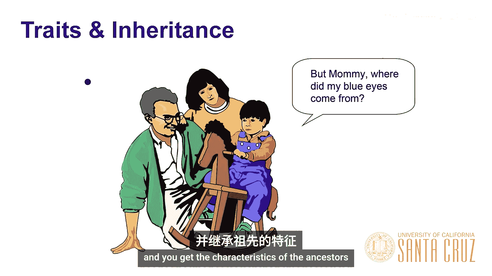
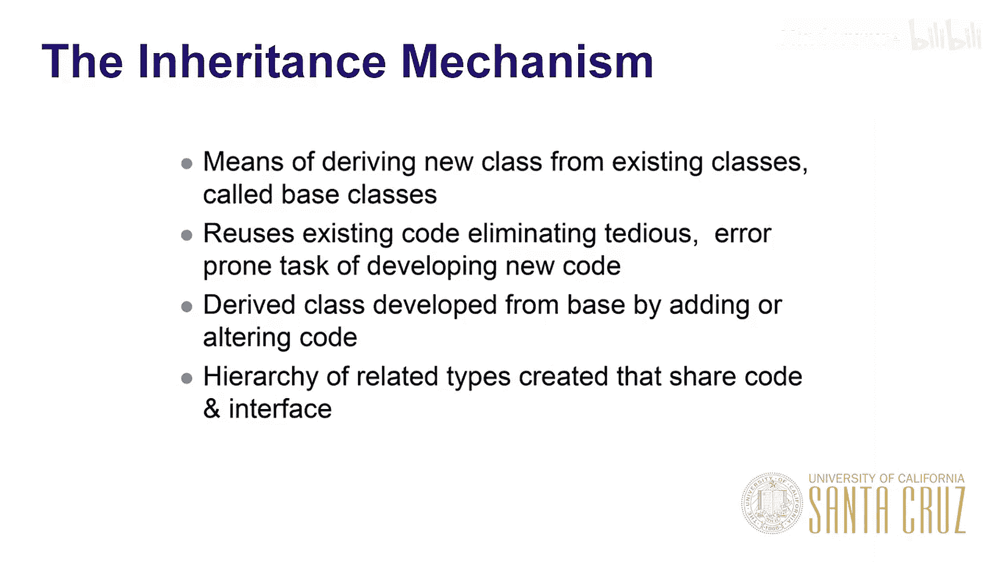
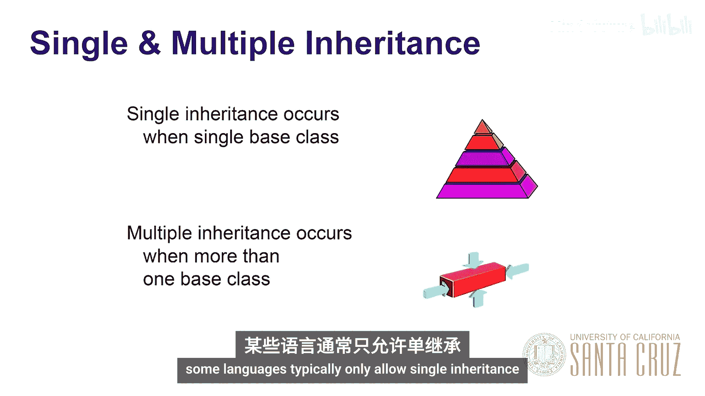
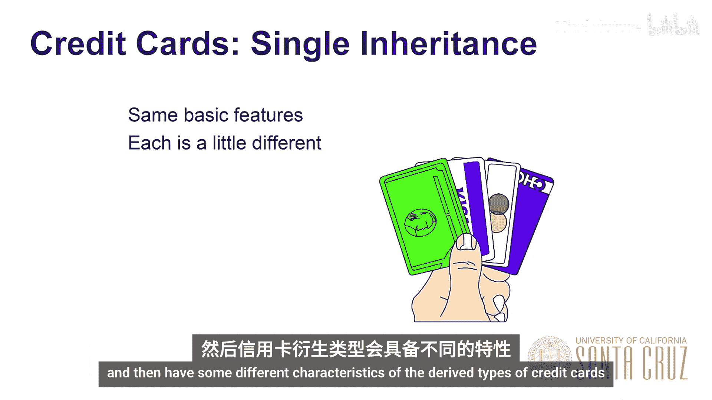
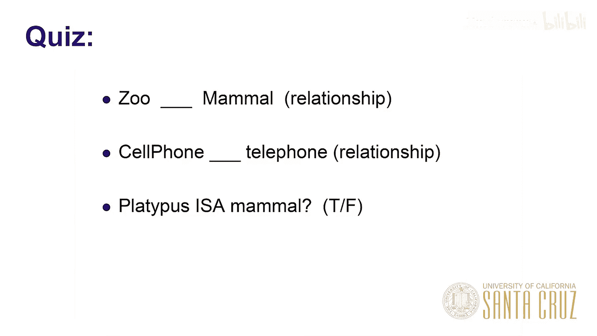
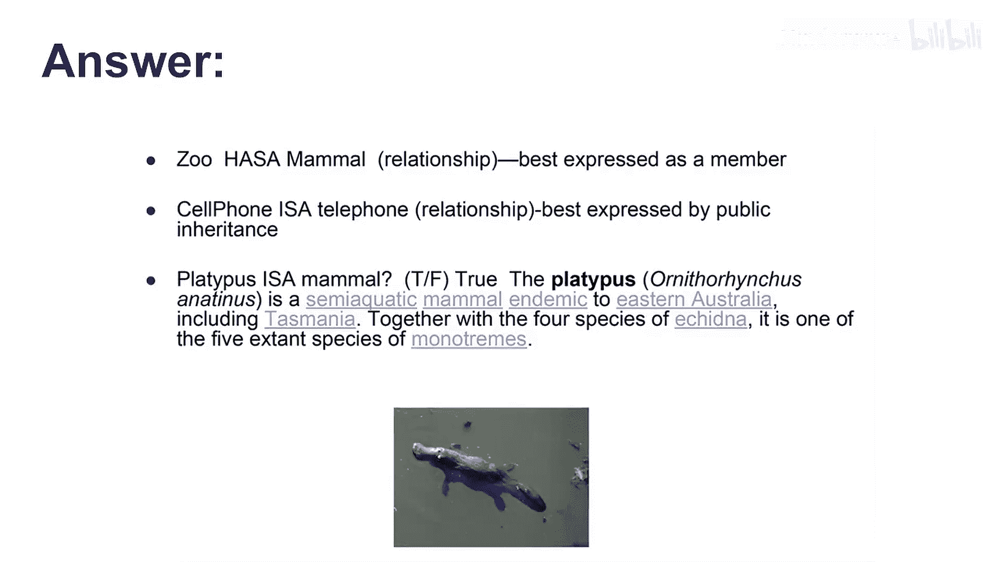

# 【加州大学】C++编程-｜-C-Plus-Plus-B-p20-P20_2-4-特质与继承_02_04_02--BV1KseJzqEbZ_p20-

So our main topic， which is inheritance。 and we know inheritance in in the real world。

 It's you have parents， you have， and you're a。Descendants， you have ancestors。

 and you get the characteristics of the ancestors。 you derive from the ancestors。

The inheritance mechanism is a means for deriving new classes from existing classes。

 The existing classes are called base classes。It reuses the existing code， which eliminates。

The need to test and develop new code， that's one of the reasons that it's important。Typically。

 the derived class adds more information。It modifies behavior， for example。

 so that by deriving point from duo， we added a length calculation。

And then the hierarchy of related types created can share code and interface so you can develop larger and larger systems and keep the code fairly tight。

We're allowed in C++ to do both single inheritance and multiple inheritance。

Some languages typically only allow single inheritance， but in C++。

A derived class can derive from multiple chaos。Here's single inheritance。

 let's say we have the notion of a credit card， but there are different kinds of credit cards and each might have some different features。

 so we might decide to derive from some prototype credit card and then have some different characteristics of the derived types of credit cards where they each have a different scheme。

In multiple inheritance， we might have two separate kinds of issues like a male where we have characteristics of mail。

 and we also have phones， which have characteristics of phones。

 and then the new thing might be phone mail， so we get a derived class that has as parenthood。

 the features of mail， features of phone。So it combines both things both things become available。

All of this comes under the heading of taxonomic classification。

 one of the great breakthroughs in science。Was the understanding that things could be lumped into big categories。

Where do you see that， you see that， for example， in the periodic table。

Until you had the periodic table， chemistry was a pseudoscience。Once you started having a taxonomy。

 you could start seeing things like， oh， here are the inert gases， here are the basic metals。

 and that taxonomy。Allowed chemistry to become a science。

 same thing with biology once you started to have。A categorization like the idea of vertebrate invertebrate。

 The idea of mammal versus reptile。 you started to see where there were characteristics that were shared and that there were rude concepts and that you could。

Get a scientific understanding。Of very large groups rather than everything being idiosyncratic information。

So we have， for example， a concept like mammal， warm blooded， higher vertebrate。

 nourishing you're young with memory class， and then we see that within mammal。

 something like a rodent and an elephant share a lot of characteristics they both are。

 even on the surface。An elephant looks no different than a toad。Yet an elephant is ineffectively。

 is a very close relative to a mouse。And not such a close relative to a toad。

And you can even see that in modern terms with the DNA spec。So that even would emphasize it more。

 more modern biology。Mouse is a mammal， E is a mammal， it's a way to get a characterization。

 a characterization allows sharing。Remember， software reuse， sharing， same thing with a taxonomy。

 So that's what we're doing when we build in an object oriented fashion。

 When we build type hierarchies， we're building something that lets us share。

 And when we want to build something in a big system that sharing gets to be very。

 a very powerful asset。In C++ terms， classes such as elephant and mouse derive from a base class mammal。

There is terminology for this。 An elephant is a mammal。 It describes a relationship。

 It describes a typing relationship。On the other hand， the circus might have elephants。

The object circus might have members that are tight elephant。But a circus is not a kind of elephant。

 and elephant is not a kind of circus。So that's a very different relationship。In the class circus。

There has a relationship。It's a subpart relationship。

So here's a quiz to see if you get this little terminology， again。

 it's worth reading up on the basics of object orientation。

 that was an expectation coming into the class。And the question is， zoo。

Has what relationship to mammal？Cell phone has what relationship to telephone。Platyus。Is a mammal。

 is that true or false？

Zoo has a mammal， much like circus might have an elephant。It's best expressed as a member。

A cell phone is a telephone。There's a relationship that's best expressed by public ands。 By the way。

 you might， if you wanted to go and build a cell phone。You might say most modern cell phones。E。

Cameras。So all of a sudden， you could build the modern cell phone if you wanted to build it in software with multiple inheritance。

Cell phone is also a personal digital assistant， PDA keeps your calendar。

So it's also in many instances， today， a fairly general computer。

So cell phone could give rise to if you want in reuse terms to effectively using multiple inherance。

Though we're going to stay away from alls， a lot of trickiness and multiple inheritance。

Platypus is a mammal that is true， platypus is a semi aquatic mammal。There's a platypus。

Gave me an excuse to get that picture off of the Wikipedia。

