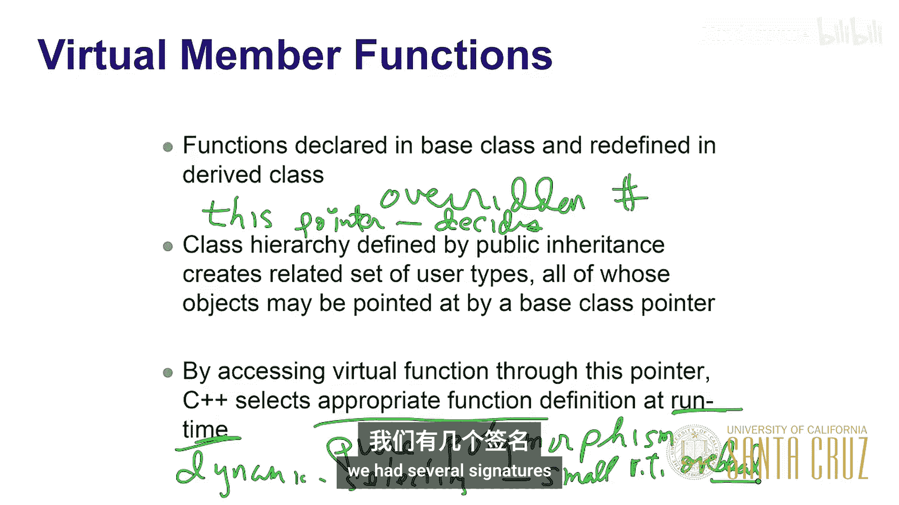
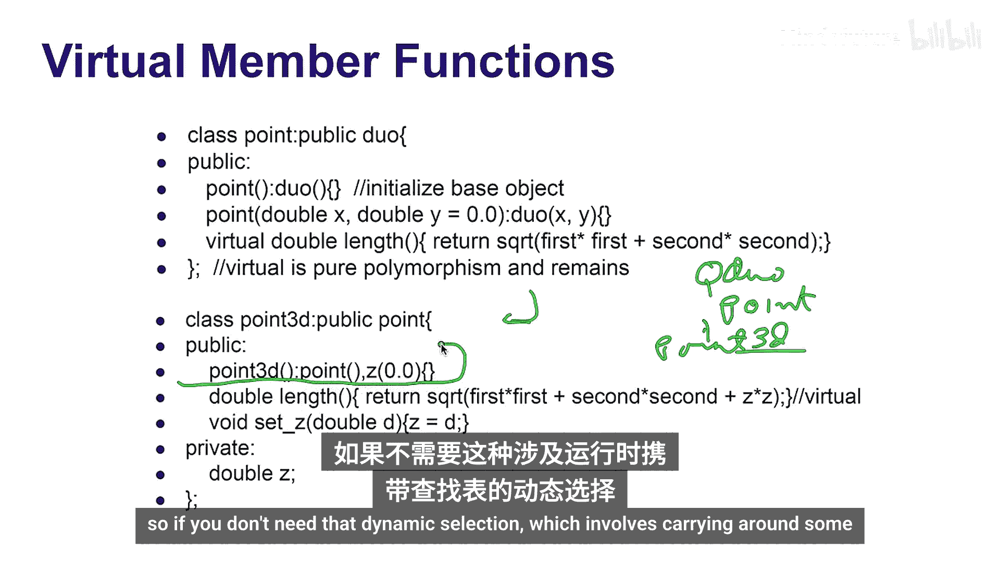
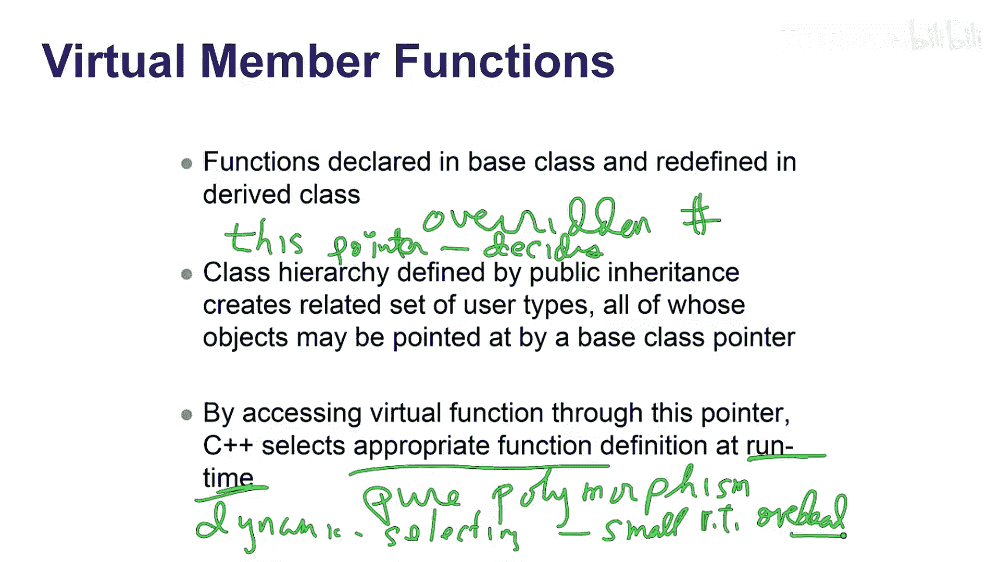
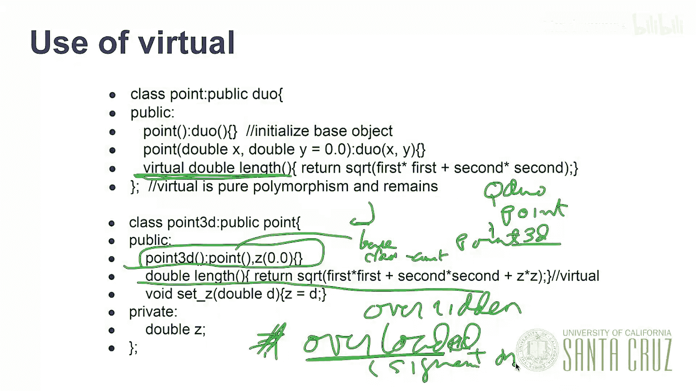
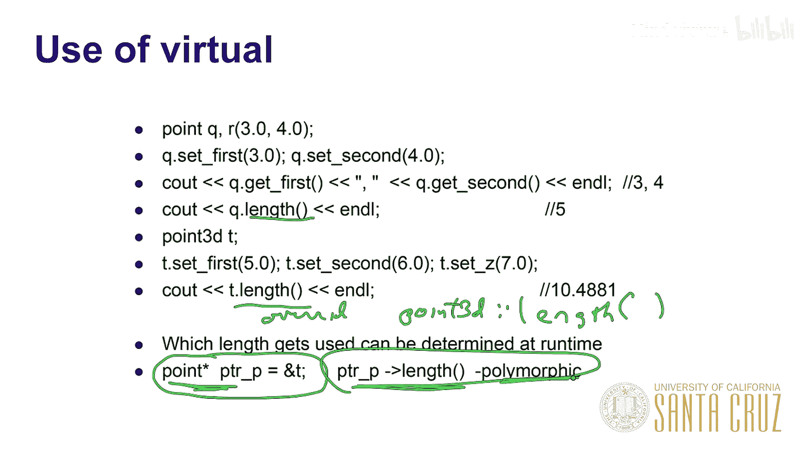
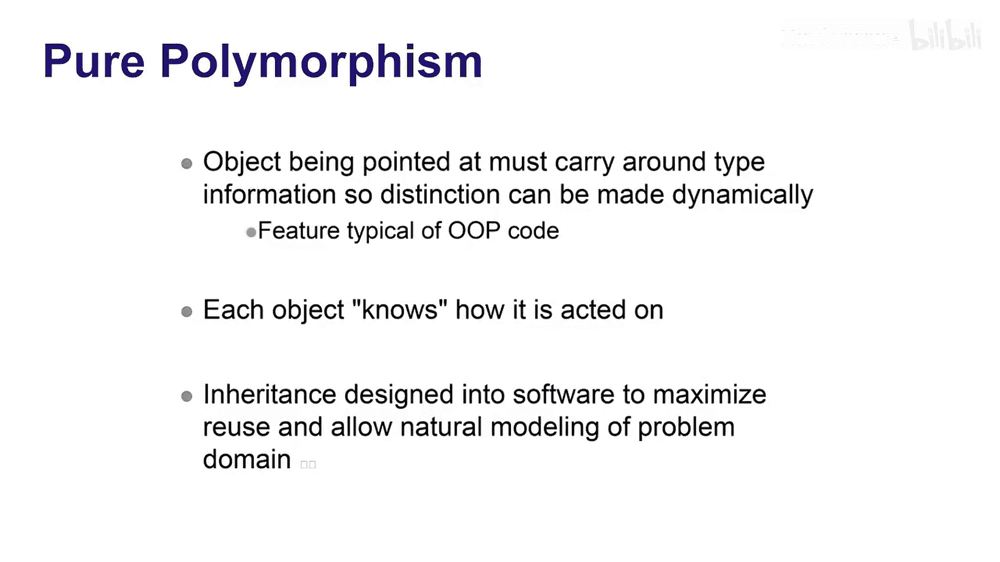

# 【加州大学】C++编程-｜-C-Plus-Plus-B-p21-P21_2-5-虚成员函数_02_04_03--BV1KseJzqEbZ_p21-

Now， in order to build inheritance in a way that supports。Pure polymorphism。

This a term I was using earlier。We need a concept called a virtual function。

A virtual function is going to be a function that's declared in a base class。And redefined。

In the derived class。The right term for that redefinite mission is going to be called over。Rin。

And overridden。Is not the same。As。A redefinition that we were used to。When we add several signatures。

For the same function like sort or print。So overridden， we keep the signature。

We changed the definition， but what triggers the use of the new definition is where you are in the type hierarchy。

Where you are supposed to the signature， it's basically the this pointer。

So that this pointer lets you to decide on selection， and that has to be at runtime。

The class hierarchy defined by public inheritance， creates related types。

 all of whose objects can be pointed at by a class， a base class pointer。

So there's going to be a very simple idiom to decide。

How to run a program in which all the objects are coming from a single type hierarchy and have virtual overridden methods。

 And that's going to be through at this， through a pointer to the base class。

 And then depending on what that pointer sees， what kind of sub。Type there is dynamically at runtime。

 it'll select the appropriate function。And this is this mechanism。It's called pure polymorphism。

Runtime， dynamic。It's a dynamic selection。By the way， since it's dynamic。

It involves a small overhead， small runtime overhead。R T for runtime overhead。

And that's a reason why not everything in the C++ community is virtual if you look at something like Java。

Basically， Java is all virtual functions。And that's the common case。However。

 C++ still tries to maintain super efficiency， so if you don't need that dynamic selection。

 which involves carrying around some tables at runtime， referencing the runtime tables。

And you can avoid that， then you can avoid it through non virtual member functions so that they're not overridden in the success of inherited classes。

It makes the language more complicated， but it also gives you more tools in your tool bag to have things efficient。

So let's go back to our point， to our example。And let's go and see what we could do with further inheritance。

In this example。We're starting with a point which was a two dimensional point。

Which inherited from duo。And then。We're going further in the hierarchy。

So the hierarchy looks like this， dual up here。A point is a duo。And then a 0。3D。

Is a 2D kind of point with another dimension。You can see it here in this。Constructor。

 you look at this constructor。It uses the base class。Constructor。

So it's a default base class constructor on point and then it adds a e value in this case the value0。

 so basically the initialization is going to end up being typically zero0 zero a standard initialized three dimensional point unless we have two dimensional values to it and this is just you should be able to if you want extend this by writing other constructors。

 so again， it's very worth your。Effort。To do duo point， 3D point and play with all this to see how。

Inheritance works。 And here we've had a virtual function。What used to be。Non virtual。

 we've turned into a virtual function so that it could be overridden。I didn't on the last。Slide。

Remember， what we're used to with signatures is overload。And that's where we get signature matching。

But in overridden， we're using this pointer。And notice what we've done， we have。

The square root now of all three。The first， the second， and then the z value。

And we've added this further private part。Now in the main part of code。

 we would see what would happen with virtual three and four is going to give rise to five。

But if we had a 3D point。And we set the 3D point values to five， six， and seven。

And we asked what the length of the 3D point was。We would be invoking。The virtual mechanism。

And this length is not that length， these are different， this is overwrittenden。So it's really。Using。

Scope resolution， we're really invoking。The overridden。Lth method。

And if we squared that and squared that and squared that。

 we'd end up with and take their square root， we'd end up with 10。

488 as' a three dimensional length in three space。All of this could be done via a pointer logic。

So if there was。Point。Both 3D and 2D point are forms of points and then。

This kind of pointer selection would be what's called pure polymorphic。 It would pick the right one。

The right length， either is a two dimensional calculation。

 if was a2D point or three dimensional calculation would be done so we could have them all mixed up and run some piece of code and allow。

Dynaically， the right thing to get done。

Pure polymorphism。The object being pointed at must carry around type information。

So that the distinction can be made dynamically。 This is your typical OOP code， whether you're in。

Java。Or modern day Python or any other of the sea Sha， other major。Object oriented languages。

Each object knows how it's to be acted on， so that's a compartmentalization。In a way。

I know what the action means。Then I can get it right。 I can have it tested。

 It's actually the basis of something called unit testing。 that you keep everything。closeose to。

The individual element that you're developing。 And it just makes extending big pieces of software。

It compartmentalizes it， it allows the software to maximize reuse， it also allows a natural modeling。

A taxonomic modeling of。The problem domain。

