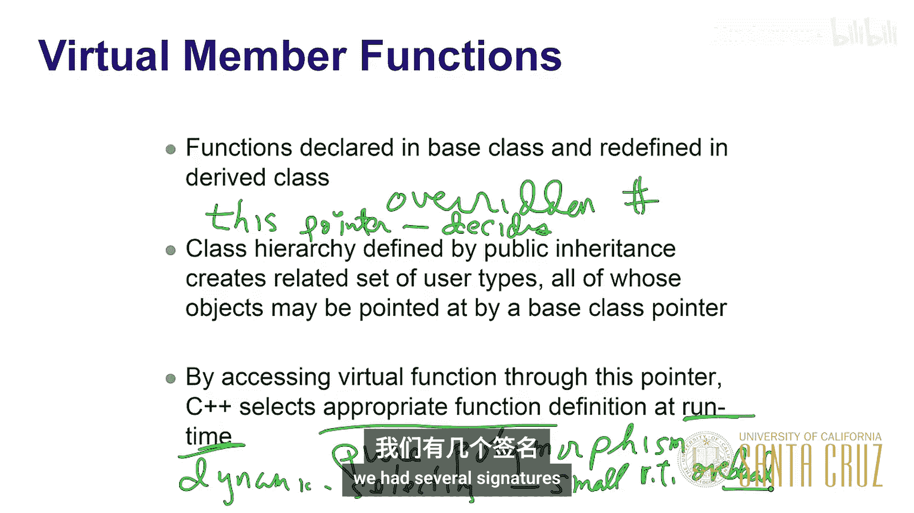
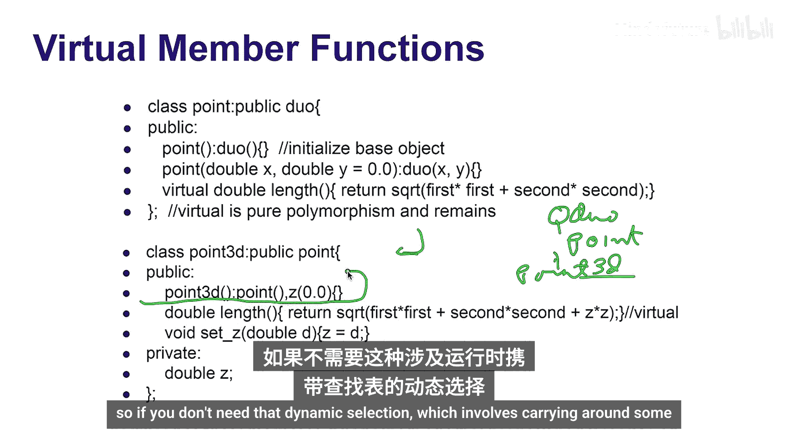
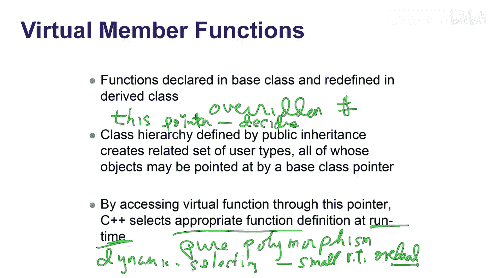
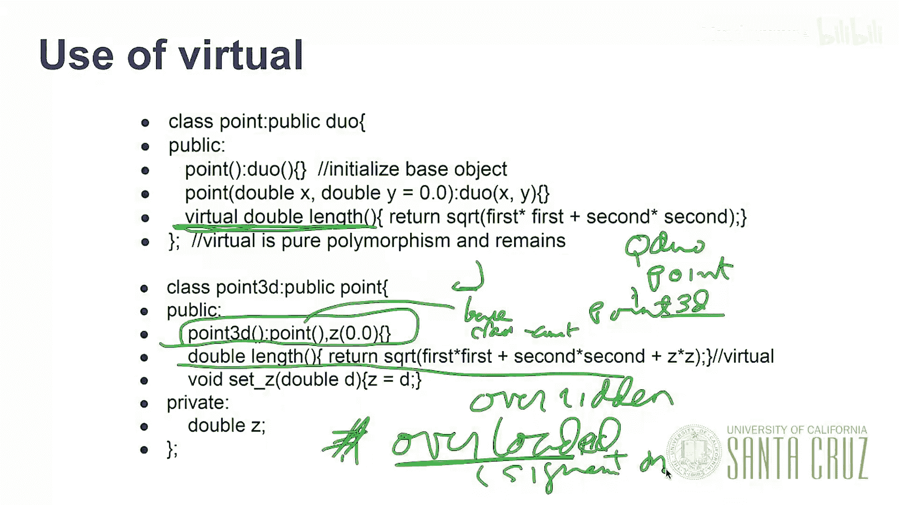
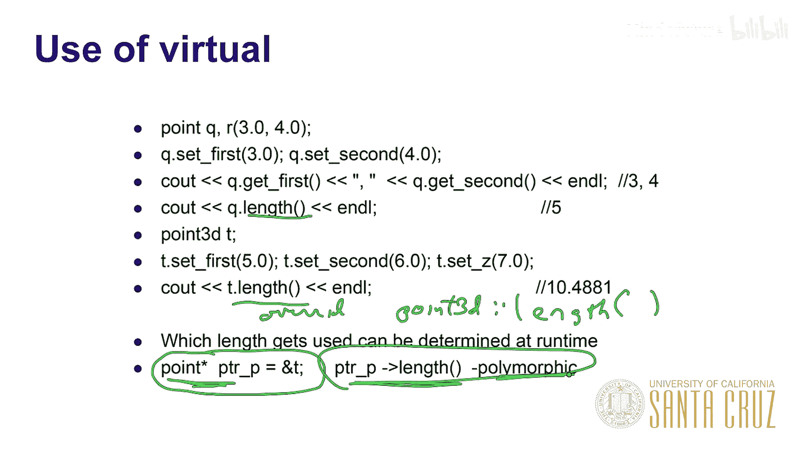
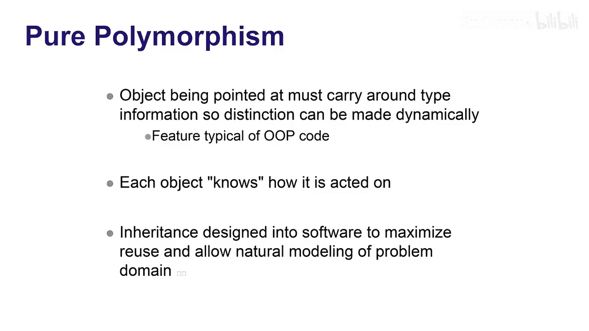

# C++编程：P21：虚成员函数与纯多态 🧬

在本节课中，我们将学习C++中实现**纯多态**的核心机制——**虚函数**。我们将探讨虚函数的声明、重写，以及如何通过基类指针实现运行时的动态方法选择。



---

## 概述

为了构建支持**纯多态**的继承体系，我们需要引入**虚函数**的概念。虚函数是在基类中声明，并在派生类中**重写**的成员函数。这种机制允许程序在运行时根据对象的实际类型来调用相应的方法，从而实现多态行为。

---

## 虚函数与重写

上一节我们介绍了继承的基本概念，本节中我们来看看实现多态的关键——虚函数。

一个虚函数在基类中声明，并在派生类中**重写**。这里的“重写”与我们之前熟悉的、通过不同函数签名实现的“重载”不同。

*   **重写**：保持函数签名完全相同，但改变函数的具体实现。触发使用新实现的关键因素在于对象在类型层次结构中的位置，这通常由 `this` 指针在运行时决定。
*   **重载**：为同一个函数名提供多个具有不同参数的版本，编译器在编译时根据调用时提供的参数来决定使用哪个版本。



通过公有继承定义的类层次结构创建了相关的类型，所有这些类型的对象都可以用一个**基类指针**来指向。这就形成了一个简单的模式来决定如何运行程序：程序中的所有对象都来自同一个类型层次结构，并且拥有被重写的虚方法。运行时，通过指向基类的指针，根据该指针在运行时动态感知到的具体子类型，来选择调用恰当的函数。这个机制就是**纯多态**，也称为**运行时多态**或**动态绑定**。



由于是动态的，这个机制会带来少量的运行时开销。这也是为什么在C++中，并非所有成员函数都是虚函数。相比之下，像Java这样的语言，其方法默认就是虚函数。C++为了保持极高的运行效率，允许开发者在不需动态选择的情况下，使用非虚成员函数，从而避免这部分开销。这使得语言更复杂，但也为追求效率提供了更多工具。

---

## 代码示例：从2D点到3D点

让我们回到具体的例子，看看进一步的继承能做什么。

在这个例子中，我们从表示二维点的 `Point` 类开始，它继承自 `Duo` 类。然后，我们在这个层次结构中继续扩展。

类层次结构如下：顶层的 `Duo`，`Point` 是一种 `Duo`，而 `Point3D` 则是一种增加了另一个维度的 `Point`。

以下是 `Point3D` 构造函数的一个示例：
```cpp
Point3D::Point3D(double x, double y, double z) : Point(x, y), z(z) {}
```
观察这个构造函数，它使用了基类 `Point` 的构造函数来初始化 `x` 和 `y`，然后额外初始化了 `z` 值。除非我们提供特定的二维坐标值，否则初始化结果通常是一个标准初始化的三维点 `(0, 0, 0)`。强烈建议你动手实践，编写 `Duo`、`Point` 和 `Point3D` 类，并尝试各种操作来深入理解继承的工作方式。

现在，我们将之前非虚的成员函数 `length` 改为了**虚函数**，以便它能够被重写。

请注意我们所做的：在 `Point3D` 的 `length` 方法中，我们计算了所有三个坐标值（`x`, `y`, `z`）平方和的平方根，并添加了相应的私有成员 `z`。

在代码的主体部分，如果我们有一个 `Point3D` 对象，将其坐标设置为 `(5, 6, 7)`，然后询问这个 `Point3D` 对象的长度，我们将会调用**虚函数机制**。此时调用的 `length` 方法不是基类中的那个，而是被重写后的版本。通过作用域解析，我们实际上调用了被重写的 `length` 方法。计算其平方和 `(5² + 6² + 7²)` 再开方，最终会得到结果 `√110 ≈ 10.488`，即三维空间中的长度。

所有这些都可以通过指针逻辑来完成。因为 `Point3D` 和 `Point` 都是 `Point` 类型（通过继承），所以这种指针选择就是所谓的**纯多态**。它会根据指针实际指向的对象是 `Point` 还是 `Point3D`，自动选择正确的 `length` 计算方法（二维或三维）。这样，我们就可以将不同类型的对象混合在一起，运行同一段代码，并允许在运行时动态地执行正确的操作。

---

## 纯多态的意义与特点

被指向的对象必须携带类型信息，以便能够在运行时做出区分。这是典型的面向对象编程代码，无论是在Java、现代Python还是其他主流的面向对象语言中都是如此。





每个对象都知道应该如何被操作，这在某种程度上是一种**封装**。对象“知道”某个操作对其自身的具体含义，从而能够正确执行。这也便于进行测试，实际上是**单元测试**的基础——将测试紧密关联到正在开发的单个元素上。

这种机制通过**分而治之**，使得扩展大型软件成为可能。它**最大化**了代码的**可重用性**，同时也允许对问题域进行自然的、分类学式的建模。

---

## 总结



本节课中我们一起学习了C++中实现**纯多态**的核心机制。我们了解了**虚函数**的声明与**重写**，及其与**重载**的区别。通过基类指针指向派生类对象，可以在运行时动态选择调用正确的函数版本，这是实现多态行为的关键。虽然这会引入少量运行时开销，但C++通过允许使用非虚函数，为开发者提供了在灵活性与效率之间进行权衡的工具。最后，我们通过一个从2D点到3D点的继承示例，具体演示了虚函数和纯多态的应用及其在软件设计中的重要意义。