# 【加州大学】C++编程-｜-C-Plus-Plus-B-p22-P22_2-6-C++特性-final_02_04_04--BV1KseJzqEbZ_p22-

Now let me just conclude with a nice new feature in C+ plus 11。

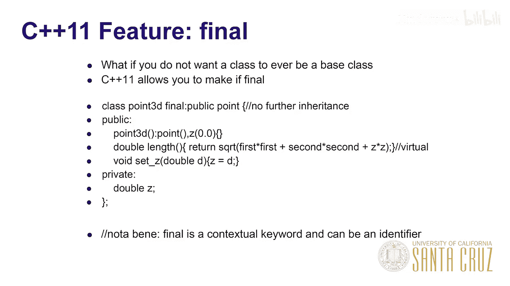

And that's the introduction of the term final contextually to indicate that you don't want any further inheritance again。

 it's a way of announcing objectives， it's a way of maintaining control of your software。

 you can always。

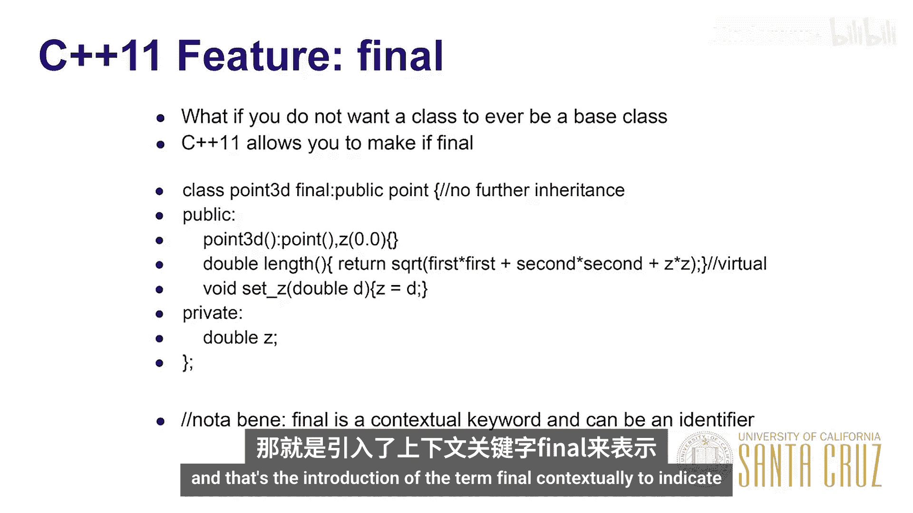

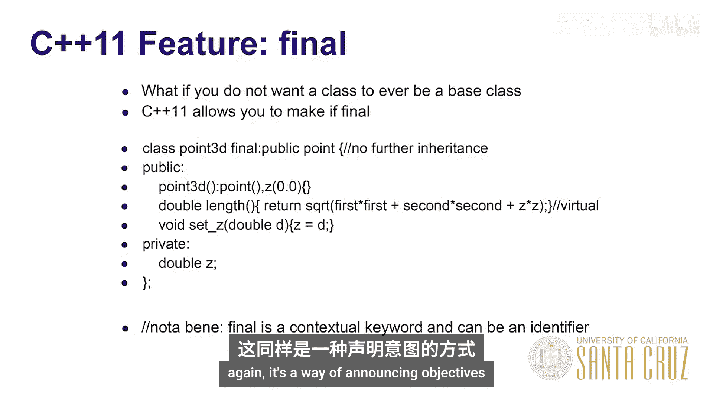

Retract that。But you don't necessarily， you may want to design something。

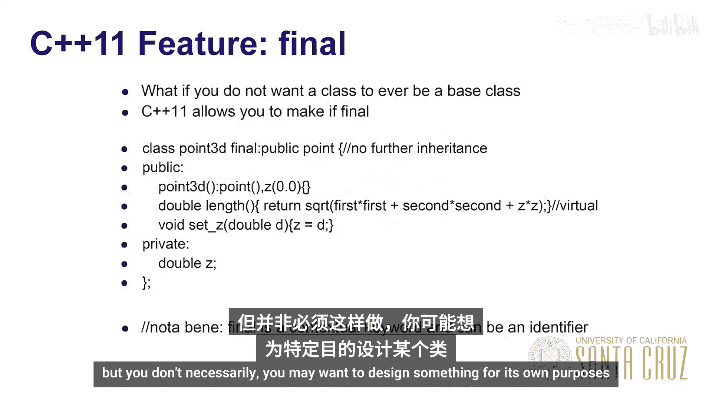

For its own purposes and not have anything that。Needs further development and it can actually involve some。

 it can allow the compiler to be in some ways more efficient if you know that a class doesn't have any ability to be inherited from。

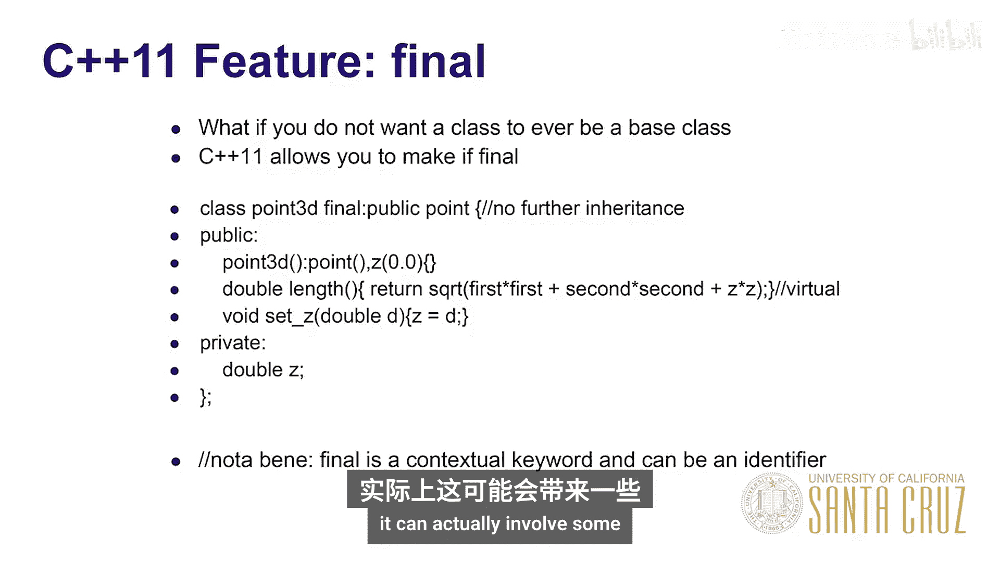

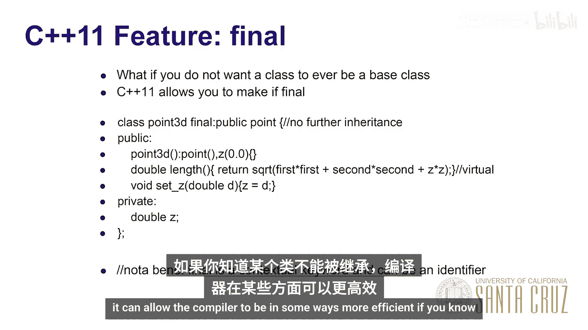

So here is that feature。And here's where it shows up。Syntically。

This says the 3D point is going to be by itself a final。 Nothing is going to derive at 3D point。

 That's a unique thing。

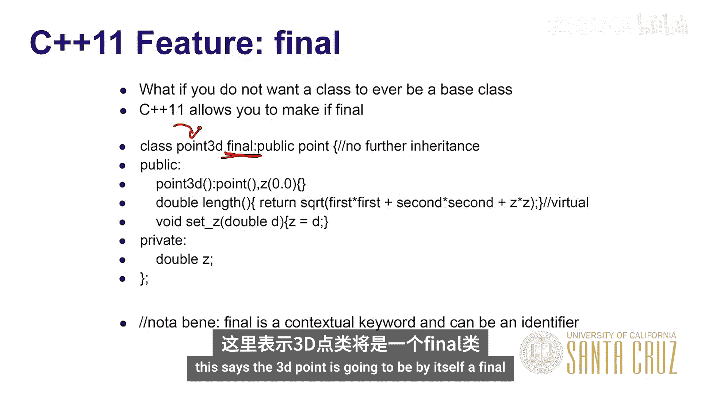

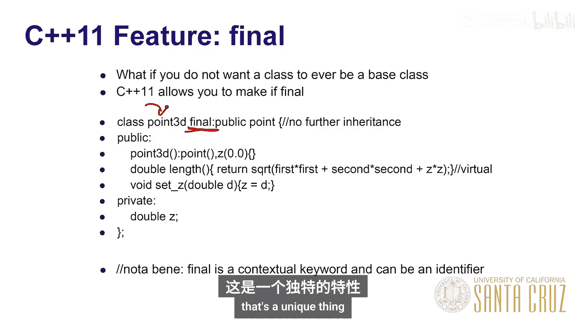

You might say in the taxonomy， something like a platypus would be an endpoint and they not going to be subcategories。

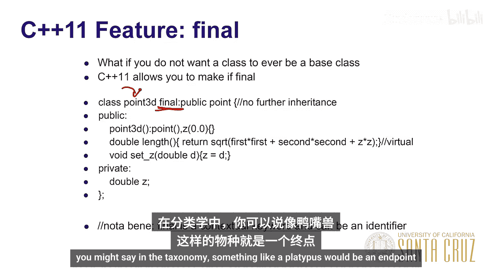

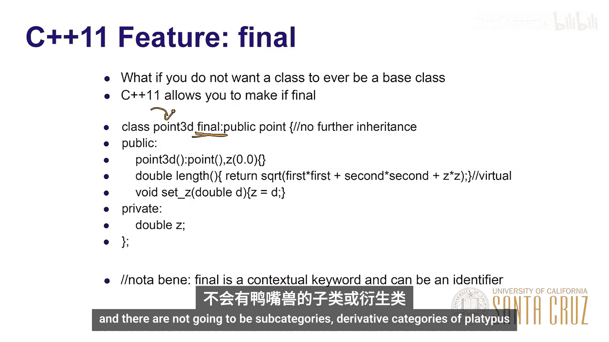

Derivative categories of platypus。Again， it's contextual keyword。

 it's sort of a little tricky if you want， though it's probably not any good practice。

 final can be used as an ordinary identifier elsewhere in your programming， I wouldn't recommend it。

 I would stay away from anything that has special meaning。

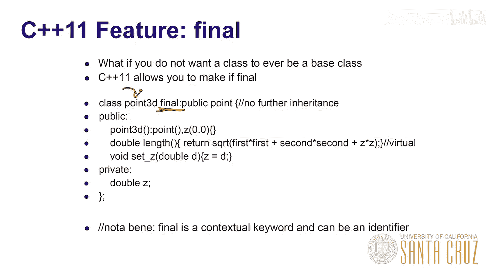

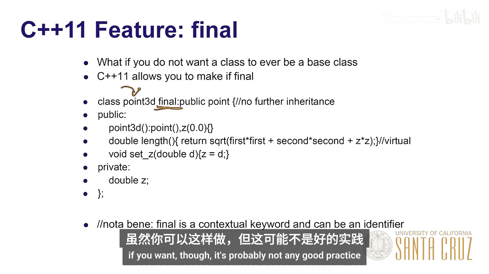

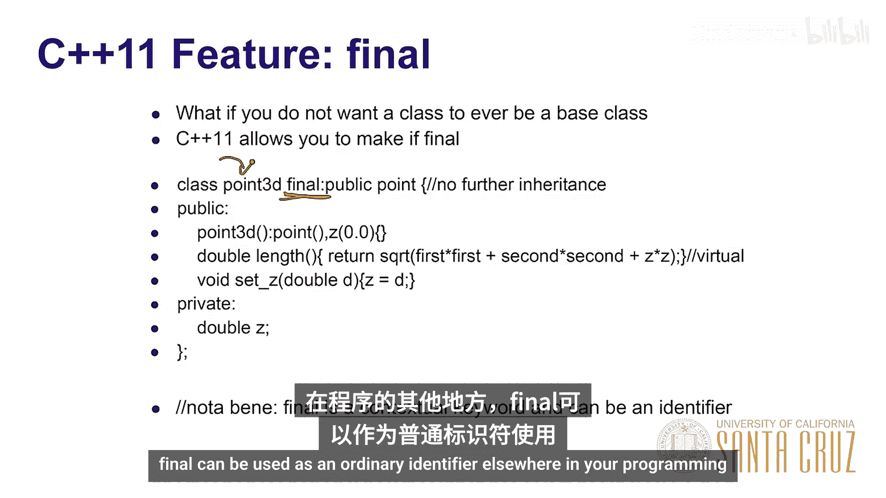

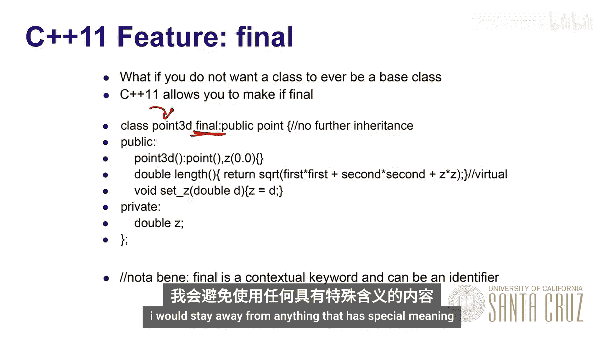

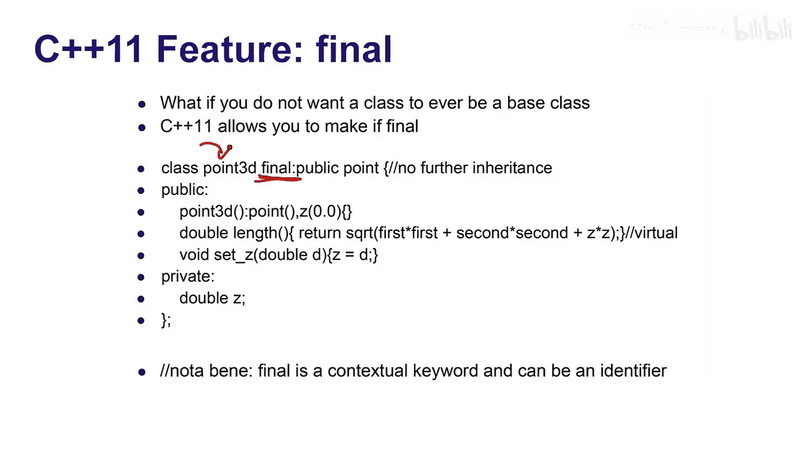