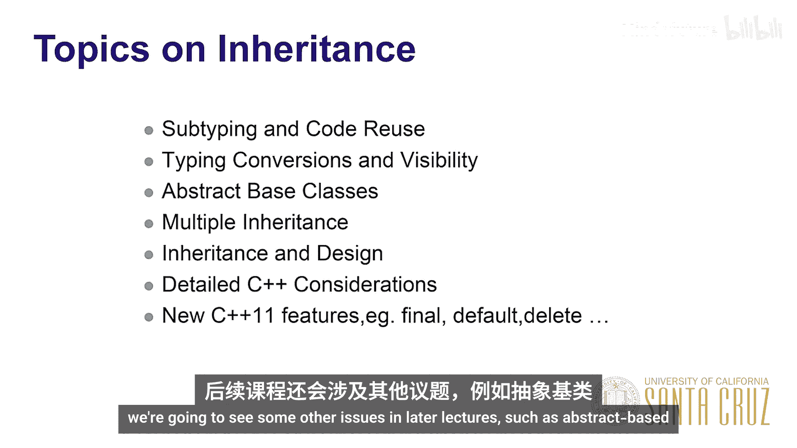
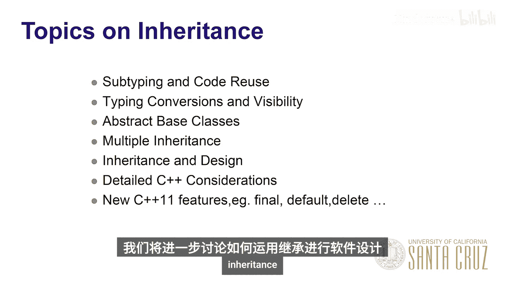
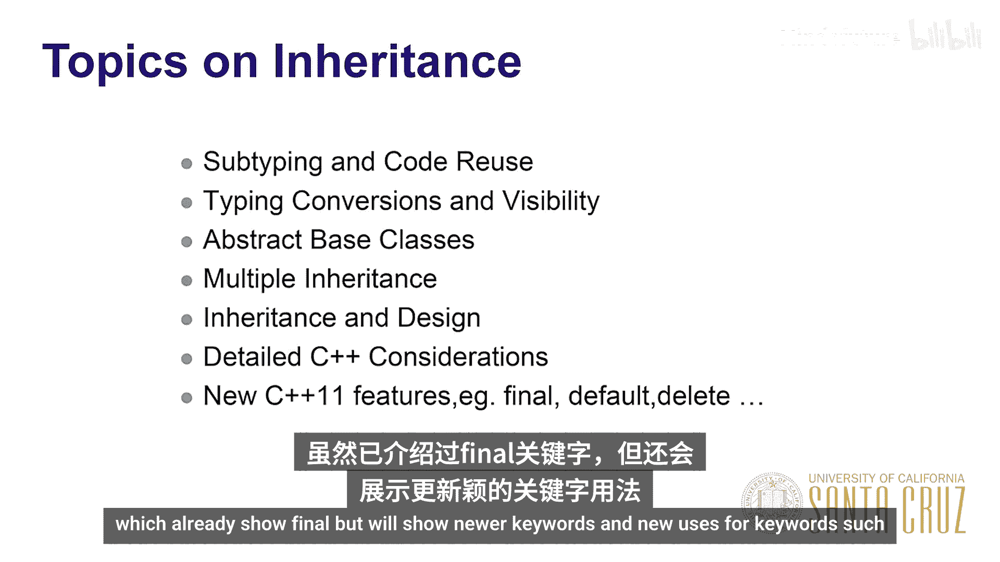
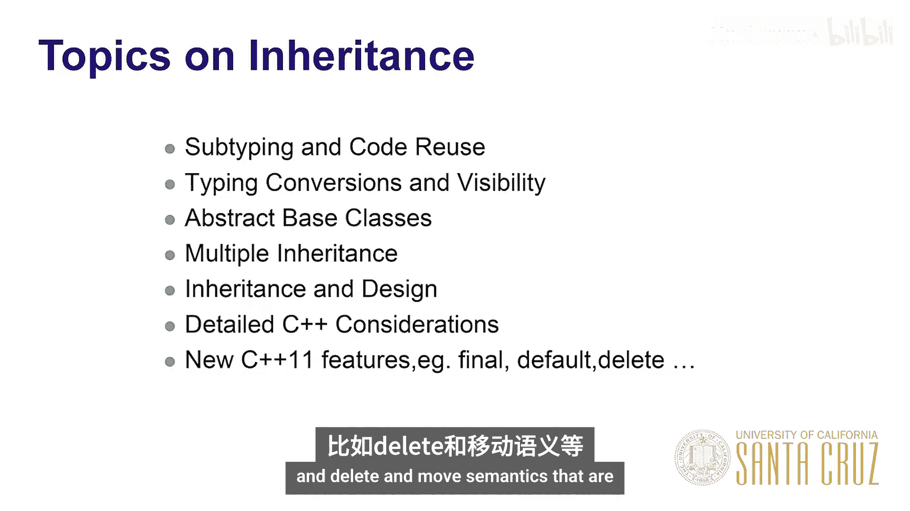
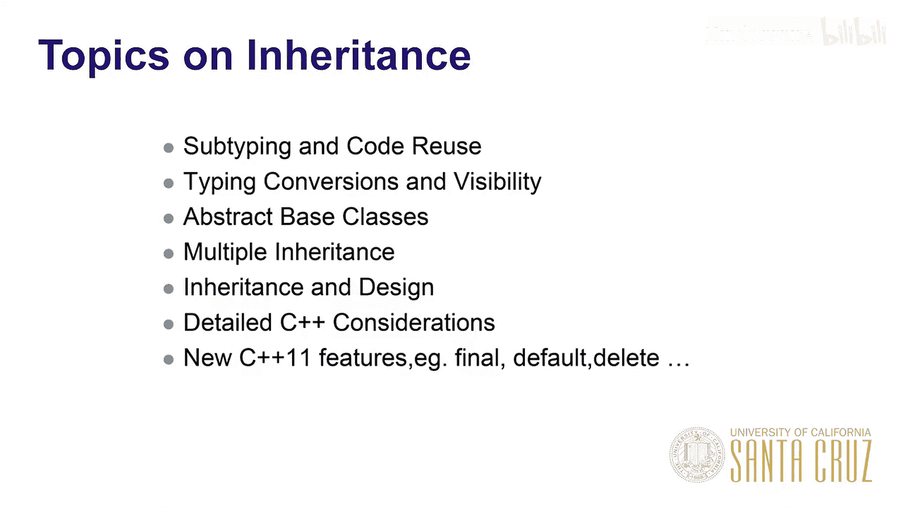

# 【加州大学】C++编程-｜-C-Plus-Plus-B-p23-P23_2-7-继承专题_02_04_05--BV1KseJzqEbZ_p23-

So we've had。Subtyping and code reuse。We've had typing conversions。Some degrees of visibility。

 like inheriting publicly versus inheriting privately。

We're going to see some other issues in later lectures such as abstract based classes。

 some specific use， or at least。

What makes multiple inheritance tricky？We're going to talk a little bit more about how to design your software using inheritance。

 and we're going to see some more detailed C++ considerations。

 especially some new C++ features which already show final but will show newer keywords and new uses for keywords such as default and delete and move semantics that。

Art。Very interesting new practice。

